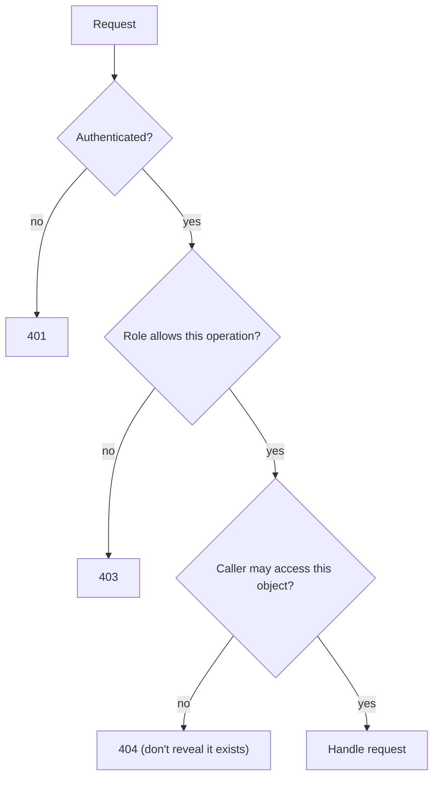

APIs are now the main attack surface of most products. A web page hides some of the system behind
buttons and forms; an API exposes every object and operation directly, documented in a convenient
OpenAPI file. OWASP keeps a separate list for this, the
[OWASP API Security Top 10](https://owasp.org/API-Security/), because API risks are different
enough from classic web pages. The top of that list is dominated by one theme: **authorisation**.
This session covers it, plus resource limits and input handling, and ends with a review of your own
FastAPI project.

## Object-level and function-level authorisation

Two questions must be answered on **every** request, separately:

1. **Function level**: may this caller use this _operation_ at all? (Can a learner call
   `DELETE /users/{id}`? Only admins should.)
2. **Object level**: may this caller act on this _particular object_? (Can learner 7 read
   `GET /progress/123`, which belongs to learner 9?)

The API Security Top 10 calls failures of the second kind **BOLA (Broken Object Level
Authorization)** and of the first **BFLA (Broken Function Level Authorization)**. Analogy: in a
gym, function level is "members may use the lockers, only staff may open the office"; object level
is "you may open _your_ locker, not every locker".



Why it goes wrong so often: IDs are right there in the URL, they are frequently sequential, and the
happy-path test always uses the owner's account. The bug is invisible until someone tries another
ID.

How to do it well in FastAPI:

```python
async def require_admin(user: User = Depends(current_user)) -> User:
    if user.role != "admin":
        raise HTTPException(status.HTTP_403_FORBIDDEN)
    return user

@router.delete("/users/{user_id}", dependencies=[Depends(require_admin)])  # function level
async def delete_user(user_id: int, db: AsyncSession = Depends(get_db)): ...

@router.get("/notes/{note_id}")
async def read_note(note_id: int, user: User = Depends(current_user), db=Depends(get_db)):
    note = await db.scalar(
        select(Note).where(Note.id == note_id, Note.owner_id == user.id)  # object level
    )
    if note is None:
        raise HTTPException(status.HTTP_404_NOT_FOUND)
    return note
```

> [!TIP]
> Random, non-sequential IDs (UUIDs) make guessing harder, but they are **not** an authorisation
> control. IDs leak through URLs, logs and shared links. Always check ownership.

> [!WARNING]
> Don't decide authorisation from data the client sends, such as a `user_id` in the body or an
> `is_admin` flag in a header. Derive the caller's identity from the verified session or token,
> and look up their permissions on the server.

## Rate limiting and resource exhaustion

Every request costs CPU, memory, database time, bandwidth or money. An API with no limits lets one
client consume all of it, by accident (a buggy retry loop) or on purpose. The API Top 10 calls this
**unrestricted resource consumption**. For AI features it is especially sharp: each tutor call
might cost real money on a paid LLM API.

Controls to combine:

- **Rate limits** per user, per API key and per IP: for example 60 requests per minute, with
  `429 Too Many Requests` and a `Retry-After` header when exceeded.
- **Stricter limits on expensive or sensitive endpoints**: login, password reset, LLM calls,
  exports.
- **Size limits**: maximum request body, maximum string length, maximum array length, maximum file
  upload size.
- **Pagination with a cap**: `limit` defaults to 20 and can never exceed 100.
- **Timeouts** on outbound calls and database queries, so slow dependencies don't pile up workers.
- **Spending limits and quotas** on third-party services, set in the provider's dashboard too.

```python
from pydantic import BaseModel, Field

class TutorQuestion(BaseModel):
    question: str = Field(min_length=1, max_length=2000)  # caps prompt size and cost

@router.get("/articles")
async def list_articles(limit: int = Query(20, ge=1, le=100), offset: int = Query(0, ge=0)): ...
```

> [!NOTE]
> Rate limiting is usually best done at the edge (reverse proxy, API gateway) for coarse limits,
> and in the application for limits that need to know the user or the cost of the operation.
> Both together is defence in depth.

## Mass assignment and input validation

**Mass assignment** happens when the API copies every field from the request body straight onto a
database object. If the model has a field the client should never set, such as `role`,
`is_verified` or `owner_id`, a caller can simply include it.

```python
# Vulnerable: every key in the body becomes a column update
@router.patch("/me")
async def update_me(body: dict, user=Depends(current_user), db=Depends(get_db)):
    for key, value in body.items():
        setattr(user, key, value)  # {"role": "admin"} works too
    await db.commit()
```

The fix is an **explicit input schema** that lists only the fields this operation may change:

```python
class ProfileUpdate(BaseModel):
    model_config = ConfigDict(extra="forbid")  # unknown fields are a 422, not silently ignored
    display_name: str | None = Field(default=None, max_length=50)
    timezone: str | None = None

@router.patch("/me", response_model=UserOut)
async def update_me(body: ProfileUpdate, user=Depends(current_user), db=Depends(get_db)):
    for key, value in body.model_dump(exclude_unset=True).items():
        setattr(user, key, value)
    await db.commit()
    return user
```

The mirror problem is **excessive data exposure**: returning whole database objects and trusting
the front end to hide fields like `password_hash` or `email`. Always use a response schema
(`response_model` in FastAPI) that lists exactly what leaves the server.

Good input validation, following the
[OWASP REST Security Cheat Sheet](https://cheatsheetseries.owasp.org/cheatsheets/REST_Security_Cheat_Sheet.html):

- Validate type, length, range and format at the boundary; reject rather than "fix" bad input.
- Prefer allow-lists (`Literal["asc", "desc"]`, enums) over deny-lists.
- Check `Content-Type` and reject what you don't expect.
- Return generic error messages to clients; keep details in server logs.

> [!EXAMPLE]
> FastAPI and Pydantic give you most of this for free: typed parameters, `Field` constraints,
> `Literal` types, `extra="forbid"` and `response_model`. The security work is mostly using them
> consistently on every endpoint, and not reaching for `dict` or `Any` for convenience.

## Practice: security review of your FastAPI project

Review your to-do API (or YouCanDoIt's `apps/api`) as if you were an outside reviewer. Allow about
90 minutes and produce a short report in your notes with findings and fixes.

### Step 1: List every endpoint

```sh
curl -s http://localhost:8000/openapi.json \
  | python -c "import json,sys; d=json.load(sys.stdin); [print(m.upper(), p) for p,v in d['paths'].items() for m in v]"
```

Put them in a table with columns: method, path, who should be allowed, what objects it touches,
cost (cheap, DB-heavy, LLM call).

### Step 2: Check authorisation on each

For every row, read the handler and answer: is there a function-level check? Is there an
object-level check? For YouCanDoIt, the honest answer today is "no authentication at all", which is
acceptable for a single-user local app. Write down what would need to change before it is exposed
to the internet, and which endpoints must be admin-only (for example `POST /articles/refresh`).

### Step 3: Check input and output schemas

```sh
grep -rnE "body: dict|: Any|Request\)" app/routes/   # handlers bypassing Pydantic
grep -rn "response_model" app/routes/ | wc -l          # compare with the number of endpoints
```

For each request model, check that strings have `max_length`, numbers have bounds, and enums are
`Literal` or `Enum`. For each response, check no internal fields leak.

### Step 4: Check resource limits

- Do list endpoints paginate with a capped `limit`?
- Do the AI endpoints cap question length? What happens with a 100 KB question?
- Do outbound HTTP calls (feeds, source pages, LLM) have timeouts?
- Is there any rate limiting, in the app or in front of it?

### Step 5: Check errors and logs

Trigger a validation error and a server error on purpose. Do responses expose stack traces or SQL?
Are failed authorisation attempts logged?

### Step 6: Fix the top three

Pick the three most important findings, fix them in small commits, and add a test for each. A
good first test is "calling another user's object returns 404":

```python
async def test_cannot_read_other_users_note(client, alice_token, bobs_note_id):
    r = await client.get(f"/notes/{bobs_note_id}", headers={"Authorization": f"Bearer {alice_token}"})
    assert r.status_code == 404
```

> [!TIP]
> Make "test as the wrong user" a standard part of every new endpoint's tests. It catches the most
> common API vulnerability for the price of one extra test.
