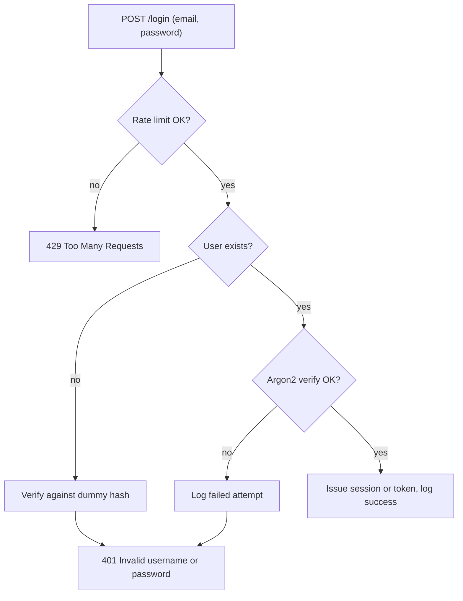
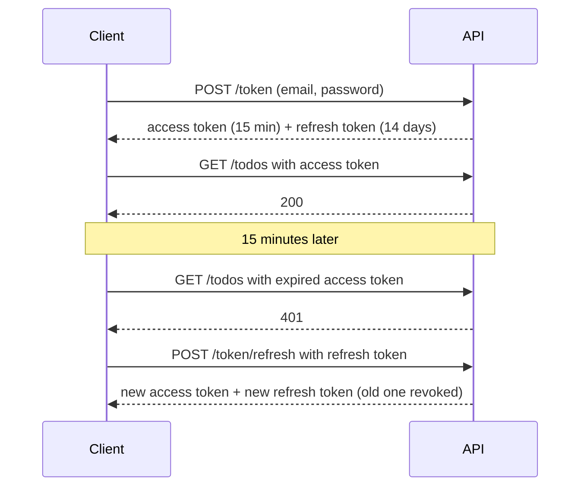

Authentication answers one question: **who is making this request?** Every other security
decision (what they may see, what they may change) depends on getting that answer right. This
session covers the classic username-and-password login done properly, the two main ways of
remembering a logged-in user (server sessions and JWTs), how long credentials should live, and then
you add login to your to-do API with FastAPI.

## Password-based login done right

Passwords are weak by nature: people reuse them, pick guessable ones, and type them into phishing
pages. Your job is to make your system as robust as possible anyway. The
[OWASP Authentication Cheat Sheet](https://cheatsheetseries.owasp.org/cheatsheets/Authentication_Cheat_Sheet.html)
is the reference; the essentials:

**Storing.** Hash with Argon2id (or bcrypt), never encrypt and never use a fast hash. You did this in
session 6.1.2.

**Password rules.** Length matters more than complexity rules. Allow long passwords and passphrases
(at least 64 characters), require a sensible minimum (8 with MFA, longer without), don't force
"one uppercase, one symbol" rules that produce `Password1!`, and check new passwords against lists
of known breached passwords.

**Login responses.** Return the same generic message, "Invalid username or password", whether the
user exists or not. Different messages ("no such user" vs "wrong password") let attackers discover
which accounts exist, called **user enumeration**. Response _time_ can leak too: if unknown users
return instantly but known users wait for an Argon2 check, timing reveals the difference. FastAPI's
tutorial handles this by verifying against a dummy hash when the user is unknown.

**Brute force and credential stuffing.** Attackers try leaked email/password pairs from other sites
at scale. Defences: rate limit login attempts per account and per IP, add increasing delays, alert
on spikes, and offer MFA (next session).

**Everything else that is a login.** Password reset, "remember me", email change and account
recovery are all authentication flows. Reset tokens must be random (`secrets`), single-use,
short-lived, and stored hashed. Changing the password or email should require the current
password, and should invalidate other sessions.



> [!WARNING]
> Always serve login over HTTPS, and never log the request body of an authentication endpoint.

## Sessions vs JWTs

After a successful login you need to remember the user on later requests. Two families:

**Server-side sessions.** The server creates a random session ID, stores "session abc123 belongs to
user 7, expires at ..." in a database or Redis, and sends the ID to the browser in a cookie. On every
request the server looks the ID up. Analogy: a cloakroom ticket. The ticket itself means nothing;
the cloakroom's records say what it's for.

**Self-contained tokens (JWTs).** A [JSON Web Token](https://jwt.io/introduction) is three
Base64URL-encoded parts, `header.payload.signature`. The payload holds **claims** such as `sub`
(subject, the user ID), `exp` (expiry) and `iat` (issued at). The server signs it with a secret
(HS256) or a private key (RS256/ES256). On each request the server verifies the signature and
expiry, without a database lookup. Analogy: a festival wristband. Staff check it's genuine and
unexpired; they don't phone the ticket office.

| | Server sessions | JWTs |
| --- | --- | --- |
| Where state lives | Server store | Inside the token |
| Revoke immediately | Easy: delete the session | Hard: valid until `exp`, unless you add a denylist |
| Scaling across servers | Needs a shared store | Any server with the key can verify |
| Payload visible to client | No | Yes (signed, not encrypted) |
| Typical fit | Classic web apps, first-party front end | APIs consumed by many services, mobile apps, SSO |

> [!NOTE]
> JWTs are not "more secure" or "more modern" than sessions; they make a different trade-off. For
> a single web app talking to its own API, a server session in an `HttpOnly` cookie is often the
> simpler and safer choice. JWTs shine when several independent services need to trust the same
> identity.

> [!WARNING]
> When verifying JWTs, always specify the accepted algorithms explicitly
> (`algorithms=["HS256"]`), never accept `alg: none`, and always check `exp`. Libraries like PyJWT
> do this when you pass the right arguments.

## Token storage and expiry, refresh tokens

**Where should the browser keep the credential?**

- **`HttpOnly`, `Secure`, `SameSite` cookie**: JavaScript cannot read it, so an XSS bug cannot
  simply steal it. You need CSRF protection for state-changing requests (SameSite plus a token or
  origin check; see 6.2.3).
- **`localStorage` / `sessionStorage`**: easy to use with an `Authorization: Bearer` header, and no
  CSRF, but any script on the page, including injected script, can read it.
- **In memory** (a JavaScript variable): lost on reload, usually paired with a refresh cookie.

For browser apps the usual recommendation is the cookie. For mobile apps and server-to-server
calls, use the platform's secure storage and the `Authorization` header.

**How long should it live?** Short-lived credentials limit the damage of theft. That conflicts with
users not wanting to log in every 15 minutes. **Refresh tokens** resolve this:

- An **access token** is short-lived (minutes) and sent with every API request.
- A **refresh token** is long-lived (days or weeks), stored more carefully, sent only to the token
  endpoint, and exchanged for a new access token.
- **Rotation**: every time a refresh token is used, issue a new one and invalidate the old. If an
  old one is ever presented again, someone copied it: revoke the whole chain.



Also set **absolute** limits (re-authenticate after 30 days regardless) and **idle** timeouts, and
give users a "log out everywhere" button that revokes all their sessions or refresh tokens.

> [!TIP]
> Store refresh tokens server-side as hashes, like passwords. Then a database leak doesn't hand out
> working long-lived credentials.

## Practice: add login to the to-do API

Following the [FastAPI Security tutorial](https://fastapi.tiangolo.com/tutorial/security/), you'll
add a `users` table, a token endpoint and protection on the to-do routes. Allow about 2 hours.

### Step 1: Install dependencies

```sh
pip install pyjwt "pwdlib[argon2]" python-multipart
```

`python-multipart` is needed because the OAuth2 password flow posts form data. Generate a secret and
put it in `.env`, not in code:

```sh
echo "JWT_SECRET=$(openssl rand -hex 32)" >> .env
```

### Step 2: Users and hashing

Add a `User` model (`id`, `email` unique, `password_hash`) with an Alembic migration, plus an
`owner_id` foreign key on `Todo`. Then the helpers:

```python
from pwdlib import PasswordHash

password_hash = PasswordHash.recommended()  # Argon2
DUMMY_HASH = password_hash.hash("dummy-password")

async def authenticate(db, email: str, password: str) -> User | None:
    user = await db.scalar(select(User).where(User.email == email))
    if user is None:
        password_hash.verify(password, DUMMY_HASH)  # equalise timing
        return None
    return user if password_hash.verify(password, user.password_hash) else None
```

### Step 3: Issue and verify tokens

```python
import jwt
from datetime import datetime, timedelta, timezone
from fastapi.security import OAuth2PasswordBearer, OAuth2PasswordRequestForm
from jwt.exceptions import InvalidTokenError

oauth2_scheme = OAuth2PasswordBearer(tokenUrl="token")

@router.post("/token")
async def login(form: Annotated[OAuth2PasswordRequestForm, Depends()], db=Depends(get_db)):
    user = await authenticate(db, form.username, form.password)
    if user is None:
        raise HTTPException(401, "Invalid username or password",
                            headers={"WWW-Authenticate": "Bearer"})
    exp = datetime.now(timezone.utc) + timedelta(minutes=15)
    token = jwt.encode({"sub": str(user.id), "exp": exp}, settings.jwt_secret, algorithm="HS256")
    return {"access_token": token, "token_type": "bearer"}

async def current_user(token: Annotated[str, Depends(oauth2_scheme)], db=Depends(get_db)) -> User:
    unauthorised = HTTPException(401, "Could not validate credentials",
                                 headers={"WWW-Authenticate": "Bearer"})
    try:
        payload = jwt.decode(token, settings.jwt_secret, algorithms=["HS256"])
    except InvalidTokenError:
        raise unauthorised
    user = await db.get(User, int(payload["sub"]))
    if user is None:
        raise unauthorised
    return user
```

### Step 4: Protect and scope the routes

Add `user: User = Depends(current_user)` to every to-do handler and filter every query by
`Todo.owner_id == user.id`. Creating a to-do sets `owner_id=user.id` on the server, never from the
request body.

### Step 5: Try it

Open `/docs`, click **Authorize**, register two users, and log in as each. Confirm that user A's
list doesn't contain user B's to-dos and that fetching B's to-do by ID as A returns 404.

### Step 6: Tests

Write tests for: wrong password returns 401 with the generic message; unknown user returns the same
401; expired token returns 401 (encode one with `exp` in the past); a valid token works; user A
can't read user B's to-do.

> [!TIP]
> Stretch goal: add a refresh token stored hashed in a `refresh_tokens` table, with rotation on
> every use, and a `POST /logout` that deletes it.
