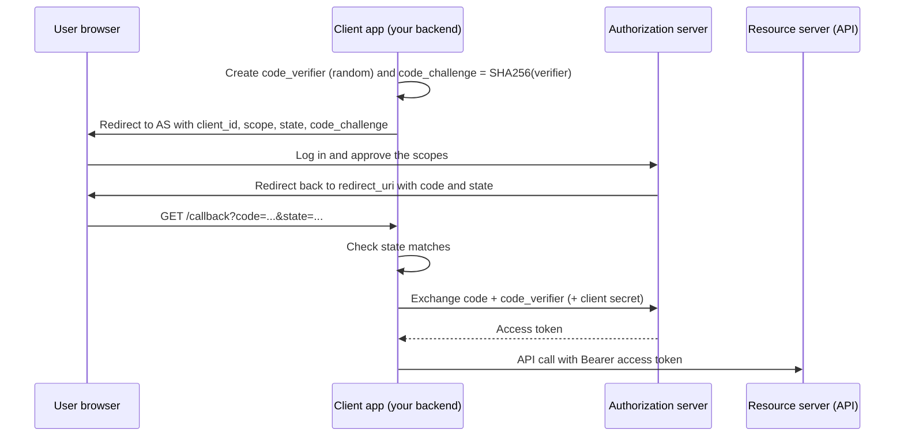
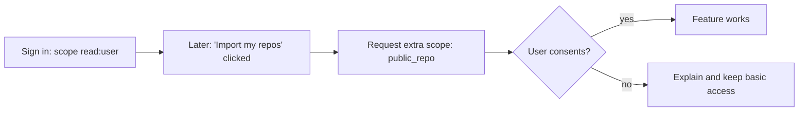

"Sign in with Google", "Connect your GitHub account", "Allow this app to read your calendar":
behind all of these are two standards, **OAuth 2.0** and **OpenID Connect (OIDC)**. They are often
mixed up, and that confusion causes real security bugs. This session separates them clearly: OAuth
is about _delegated access_ ("this app may do X on my behalf"), OIDC is about _identity_ ("this is
who the user is"). Then you'll build "Sign in with GitHub".

## OAuth roles and flows (authorization code + PKCE)

Before OAuth, if an app wanted your photos from another service, it asked for your password there.
That gave it full access, forever, and you couldn't revoke it without changing your password.
OAuth replaces that with **scoped, revocable tokens**.

Analogy: a hotel valet key. It starts the car and drives it to the car park, but it can't open the
boot or the glovebox. You give the valet a limited key, not your house keys.

[OAuth 2.0](https://oauth.net/2/) defines four roles:

| Role | Who it is | Example |
| --- | --- | --- |
| **Resource owner** | The user who owns the data | You |
| **Client** | The app that wants access | A to-do app wanting your GitHub profile |
| **Authorization server** | Issues tokens after the user consents | `github.com/login/oauth` |
| **Resource server** | The API holding the data | `api.github.com` |

OAuth has several **flows** (grant types). Today, for almost every case involving a user, the answer
is the **authorization code flow with PKCE**. The older **implicit** and **password** grants are
listed as legacy, and the in-progress **OAuth 2.1** consolidates these best practices by dropping
them.



Why each piece exists:

- **The code is not the token.** The browser only ever sees a short-lived, single-use code. The
  token exchange happens back-channel, server to server.
- **`state`**: a random value you generate and check on return. It ties the callback to the login
  _this_ browser started, preventing CSRF on the callback.
- **PKCE (Proof Key for Code Exchange)**: the client creates a secret `code_verifier` and sends only
  its hash (`code_challenge`) in the first redirect. To exchange the code it must present the
  original verifier. A stolen code is useless without it. Originally designed for mobile and
  single-page apps that can't keep a client secret, PKCE is now recommended for every client.
- **`redirect_uri`** must be registered exactly in advance; otherwise an attacker could have codes
  sent to their own site.

> [!WARNING]
> The **client secret** belongs only on a server. Never ship it in a mobile app or front-end bundle;
> anything in the browser is public. Public clients rely on PKCE instead.

## OpenID Connect and ID tokens

OAuth answers "may this app access this API?" It deliberately says nothing about _who_ the user is.
An access token is like a valet key: it opens the car, but it doesn't tell the car park who owns it.
Using "I received a valid access token" as proof of login is a known mistake: a token issued to a
different app could be replayed to yours.

[OpenID Connect](https://openid.net/developers/how-connect-works/) is a thin identity layer on top of
OAuth. You add the scope `openid` to the same authorization code flow, and the token response
includes an **ID token**: a signed JWT _about the user, addressed to your app_.

Key claims in an ID token:

| Claim | Meaning | You must check |
| --- | --- | --- |
| `iss` | Issuer (who signed it) | Equals the expected provider |
| `aud` | Audience (who it's for) | Equals **your** client ID |
| `sub` | Stable unique user ID at that issuer | Use `iss` + `sub` as the account key |
| `exp`, `iat` | Expiry and issue time | Not expired |
| `nonce` | Value you sent in the request | Matches, to prevent replay |
| `email`, `name` | Profile info (if scopes allow) | Don't use email as the unique key |

OIDC also standardises **discovery** (`/.well-known/openid-configuration` tells you every endpoint
and the signing keys' location) and a **UserInfo** endpoint.

> [!NOTE]
> Not every "Sign in with X" is OIDC. Google, Microsoft and Apple are OIDC providers. GitHub's user
> login is plain OAuth 2.0: you get an access token and call `GET https://api.github.com/user` to
> learn who the user is. That works because _your own backend_ receives the token directly from
> GitHub via the code exchange, so you know it was issued to your app.

> [!WARNING]
> Link accounts by `iss` + `sub` (or GitHub's numeric user `id`), not by email. Emails change, can
> be unverified at some providers, and can be reassigned, which can let one person take over
> another's account.

## Scopes and consent

**Scopes** are the permissions the client asks for: `read:user`, `repo`, `calendar.readonly`,
`openid email profile`. The authorization server shows them on a **consent screen**, and the access
token is limited to what the user approved.

Good practice:

- **Ask for the minimum.** A login button needs identity, not write access to all repositories.
  Users rightly abandon apps that ask for too much, and an over-scoped token is a bigger prize if
  your database leaks.
- **Ask incrementally.** Request extra scopes at the moment the user tries the feature that needs
  them ("Connect your calendar"), not at sign-up.
- **Check granted scopes.** Users can sometimes uncheck scopes. Read what was actually granted.
- **Treat tokens as secrets.** Encrypt stored access and refresh tokens; don't log them.
- **Support revocation.** Give users a "disconnect" button that revokes the token at the provider
  and deletes your copy.



## Practice: "Sign in with GitHub"

Add GitHub login to your to-do API, creating or finding a local user and then issuing your own
session or token, exactly as in 6.3.1. Allow about 2 hours.

### Step 1: Register an OAuth app

On GitHub, go to Settings, Developer settings, OAuth Apps, New OAuth App. Set the homepage to
`http://localhost:8000` and the callback URL to `http://localhost:8000/auth/github/callback`. Copy
the client ID and generate a client secret into `.env` as `GITHUB_CLIENT_ID` and
`GITHUB_CLIENT_SECRET`.

### Step 2: Start the flow

```python
import base64, hashlib, secrets
from urllib.parse import urlencode
from fastapi.responses import RedirectResponse

@router.get("/auth/github/login")
async def github_login():
    state = secrets.token_urlsafe(32)
    verifier = secrets.token_urlsafe(64)
    challenge = base64.urlsafe_b64encode(hashlib.sha256(verifier.encode()).digest()).rstrip(b"=").decode()
    params = {
        "client_id": settings.github_client_id,
        "redirect_uri": "http://localhost:8000/auth/github/callback",
        "scope": "read:user",
        "state": state,
        "code_challenge": challenge,
        "code_challenge_method": "S256",
    }
    resp = RedirectResponse("https://github.com/login/oauth/authorize?" + urlencode(params))
    cookie = dict(httponly=True, samesite="lax", max_age=600)  # add secure=True behind HTTPS
    resp.set_cookie("oauth_state", state, **cookie)
    resp.set_cookie("oauth_verifier", verifier, **cookie)
    return resp
```

### Step 3: Handle the callback

```python
import httpx

@router.get("/auth/github/callback")
async def github_callback(code: str, state: str, request: Request, db=Depends(get_db)):
    if not secrets.compare_digest(state, request.cookies.get("oauth_state", "")):
        raise HTTPException(400, "Invalid state")
    async with httpx.AsyncClient(timeout=10) as client:
        token = (await client.post(
            "https://github.com/login/oauth/access_token",
            headers={"Accept": "application/json"},
            data={
                "client_id": settings.github_client_id,
                "client_secret": settings.github_client_secret,
                "code": code,
                "code_verifier": request.cookies.get("oauth_verifier", ""),
                "redirect_uri": "http://localhost:8000/auth/github/callback",
            },
        )).json()
        if "access_token" not in token:
            raise HTTPException(400, "GitHub login failed")
        gh = (await client.get(
            "https://api.github.com/user",
            headers={"Authorization": f"Bearer {token['access_token']}"},
        )).json()
    user = await find_or_create_by_github_id(db, gh["id"], gh["login"])
    return issue_session(user)  # your 6.3.1 token or cookie
```

Add a nullable, unique `github_id` column to `users` for the account link.

### Step 4: Try it and break it

Log in through `/auth/github/login`. Then test the defences: edit the `state` in the callback URL
(expect 400); reuse an old callback URL (GitHub rejects the used code); clear the verifier cookie
before the callback (the exchange should fail).

### Step 5: Reflect

Write two sentences in your notes: why is this flow "OAuth" and not "OIDC", and what would change
if you added "Sign in with Google" (hint: ID token validation of `iss`, `aud`, `exp`, `nonce` with a
library such as Authlib).
