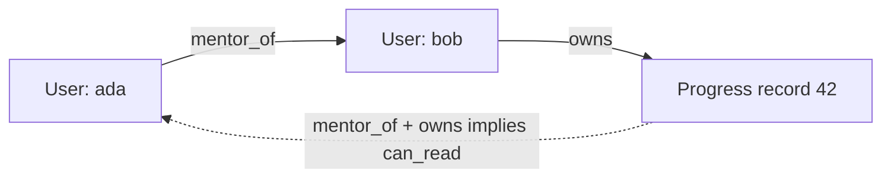
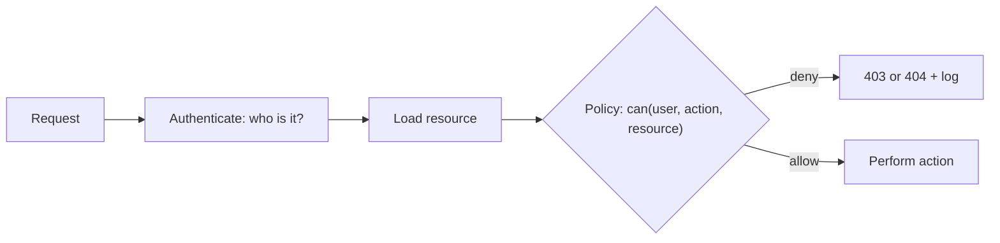

Authentication tells you _who_ is calling. **Authorisation** decides _what they may do_. It is
the number-one risk in both the OWASP Top 10 and the API Security Top 10 because it's easy to get
almost right: a check forgotten on one endpoint, a role that grew more powerful than intended, a
query that forgot the tenant filter. This session gives you vocabulary for the main models, a
pattern for enforcing them consistently in an API, and the special case of keeping customers'
data apart in a multi-tenant system.

## RBAC, ABAC and ReBAC

Three models, each answering "may subject S do action A on resource R?" with different
information.

**RBAC: Role-Based Access Control.** Permissions attach to **roles**, and users get roles. Analogy:
a hospital badge colour. Blue badges open the wards, red badges also open the pharmacy.

```text
admin   -> users:read, users:write, content:write, progress:read_all
mentor  -> progress:read_assigned, comments:write
learner -> progress:read_own, progress:write_own
```

Simple, easy to explain to auditors, and enough for many apps. Weak spots: it can't express
"_their own_" or "_their assigned learners_" by roles alone, and when every exception becomes a new
role you get **role explosion** (`mentor_eu_readonly_weekends`).

**ABAC: Attribute-Based Access Control.** Decisions combine **attributes** of the subject,
resource, action and environment in a policy. Analogy: a pharmacy rule, "a nurse may dispense
medicine _on their own ward, during their shift_".

```text
allow if user.role == "mentor"
     and resource.type == "progress"
     and resource.owner.mentor_id == user.id
     and action == "read"
```

Very expressive; the cost is that policies need careful design and testing.

**ReBAC: Relationship-Based Access Control.** Decisions follow **relationships** in a graph:
user is _member of_ team, team _owns_ folder, folder _contains_ document. Analogy: Google Drive
sharing, where access to a file follows from the folder it's in and who that folder is shared
with. Google's Zanzibar paper popularised it, and open-source systems such as OpenFGA and SpiceDB
implement it.



| Model | Decides using | Great for | Watch out for |
| --- | --- | --- | --- |
| RBAC | Roles | Coarse admin/staff/user splits | Role explosion; ownership needs extra checks |
| ABAC | Attributes and policies | Context rules: ownership, department, time | Policy complexity |
| ReBAC | Relationship graph | Sharing, teams, nested resources | Needs a graph store or service |

The [OWASP Authorization Cheat Sheet](https://cheatsheetseries.owasp.org/cheatsheets/Authorization_Cheat_Sheet.html)
recommends preferring ABAC or ReBAC for application development, because pure RBAC becomes brittle
as systems grow. In practice most apps use a **hybrid**: roles for coarse capabilities, plus
ownership and relationship checks for individual objects.

## Enforcing authorisation in APIs

Choosing a model is the easy part. Enforcing it _everywhere_ is the hard part. Principles from the
OWASP cheat sheet:

- **Deny by default.** If no rule explicitly allows it, the answer is no.
- **Check on every request, server-side.** Hiding a button is UX, not security.
- **Check the specific object**, not just the type ("may read _this_ progress record", not "may read
  progress records").
- **Centralise.** One policy module that every endpoint calls, rather than ad hoc `if` statements
  copied around. Then you can read, test and audit the rules in one place.
- **Fail safely.** An exception during the check means deny.
- **Log denials** and **test the rules**: unit tests for the policy, integration tests that call
  endpoints as the wrong user.

A clean pattern separates the **policy decision** (pure function: may S do A on R?) from the
**enforcement point** (the endpoint that asks and acts on the answer):



```python
# policy.py: one place, pure functions, easy to unit test
def can(user: User, action: str, resource) -> bool:
    if user.role == "admin":
        return True
    if isinstance(resource, Progress):
        if action == "read":
            return resource.user_id == user.id or resource.user.mentor_id == user.id
        if action == "write":
            return resource.user_id == user.id
    return False  # deny by default
```

> [!TIP]
> For **lists**, filter in the query rather than loading everything and checking each row. A
> learner's `GET /progress` should be `WHERE user_id = :me`; a mentor's should join on
> `mentor_id = :me`. Checking after loading leaks counts and wastes work.

> [!WARNING]
> Admin super-powers are convenient but dangerous. Consider whether admins really need to read
> learners' private data, or only manage accounts. Least privilege applies to admins too.

## Multi-tenancy isolation

A **multi-tenant** system serves many customers (tenants: companies, schools, teams) from the same
application and often the same database. The worst authorisation bug in such a system is one tenant
seeing another's data: it's a breach of every customer's trust at once.

Three isolation strategies, from strongest to most economical:

| Strategy | How | Isolation | Cost and complexity |
| --- | --- | --- | --- |
| Database per tenant | Separate DB per customer | Strongest | Highest ops cost; migrations x N |
| Schema per tenant | One DB, a schema per tenant | Strong | Moderate; many schemas to manage |
| Shared tables | `tenant_id` column on every row | Depends on discipline | Cheapest, most common |

With shared tables, a single missing `WHERE tenant_id = :t` leaks data. Defence in depth:

1. **Derive the tenant from the authenticated identity**, never from a request parameter the client
   can change.
2. **Enforce the filter centrally**: a repository layer or ORM hook that always adds the tenant
   condition, so individual queries can't forget it.
3. **Database-level backstop**: PostgreSQL **Row-Level Security (RLS)** lets the database itself
   refuse rows from other tenants.

```sql
ALTER TABLE todos ENABLE ROW LEVEL SECURITY;
CREATE POLICY tenant_isolation ON todos
  USING (tenant_id = current_setting('app.tenant_id')::int);
-- the app sets it per transaction: SET LOCAL app.tenant_id = '7';
```

4. **Test cross-tenant access** explicitly: create two tenants in fixtures and assert each can never
   see the other's data through any endpoint.

> [!NOTE]
> Row-level security policies don't apply to the table owner or superusers by default. Your
> application must connect as a separate, non-owner role for RLS to protect anything (see least
> privilege in Module 6.4).

## Practice: roles for admin, mentor and learner

Imagine YouCanDoIt becomes multi-user: learners track progress, mentors follow assigned learners,
and admins manage accounts and content. Implement it on your to-do API (rename to fit) or a small
copy of the progress API. Allow about 2 hours.

### Step 1: Write the permission matrix first

| Action | Learner | Mentor | Admin |
| --- | --- | --- | --- |
| Read own progress | yes | yes | yes |
| Write own progress | yes | yes | no (doesn't need it) |
| Read an assigned learner's progress | no | yes | yes |
| Comment on an assigned learner's session | no | yes | no |
| Assign mentors to learners | no | no | yes |
| Trigger `POST /articles/refresh` | no | no | yes |

Decide deliberately where admins should _not_ have access.

### Step 2: Model it

Add `role` (`Literal["learner", "mentor", "admin"]`) and nullable `mentor_id` to `users`, and a
`user_id` on progress records. Migration via Alembic.

### Step 3: Write the policy and its tests first

Create `policy.py` with `can(user, action, resource)` as above, covering every row of your matrix.
Write unit tests that loop over the matrix:

```python
MATRIX = [
    ("learner", "read", "own_progress", True),
    ("learner", "read", "other_progress", False),
    ("mentor", "read", "assigned_progress", True),
    ("mentor", "read", "unassigned_progress", False),
    ("admin", "write", "own_progress", False),
    # ...one line per cell
]

@pytest.mark.parametrize("role,action,target,expected", MATRIX)
def test_policy(role, action, target, expected, make_scenario):
    user, resource = make_scenario(role, target)
    assert can(user, action, resource) is expected
```

### Step 4: Enforce in endpoints

Add a FastAPI dependency for role-only checks (`require_role("admin")`) and call `can()` after
loading each object. Return 404 for objects the caller may not see, 403 when they can see but not
act. Filter list endpoints in SQL.

### Step 5: Integration tests

Seed one admin, two mentors and three learners. Assert through HTTP that a mentor can't read an
unassigned learner's progress, a learner can't call admin endpoints, and lists return only allowed
rows.

### Step 6 (stretch): Add a tenant

Add an `organisation_id` to users and progress, derive it from the logged-in user, and add a
cross-organisation test. Optionally enable RLS as a backstop.
