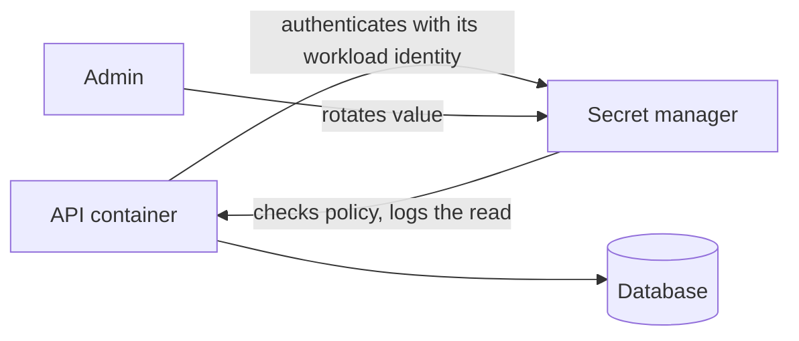
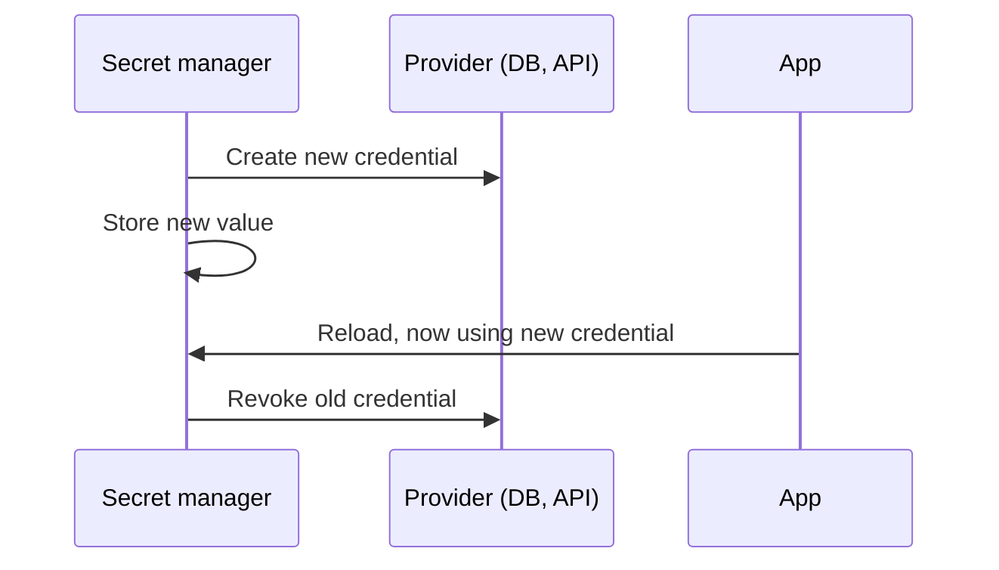

A **secret** is any value that grants access: database passwords, API keys, signing keys, OAuth
client secrets, cloud credentials, webhook secrets. Leaked secrets are one of the most common
causes of real breaches, and the leak is usually boring: a key committed to git, pasted in a chat,
printed in a log, or baked into a Docker image. This session covers where secrets should live,
the tools that manage them, how to catch leaks early, and what to do when one escapes anyway.

## Environment variables and their limits

The Twelve-Factor App advice "store config in the environment"
is a big step up from hard-coding. Your code reads `os.environ["DATABASE_URL"]`, and each
environment (laptop, CI, production) injects its own value. YouCanDoIt does this: `app/config.py`
uses pydantic-settings, and `docker-compose.yml` loads an optional, git-ignored `.env`.

```python
# Bad: the secret is in the code, the history, every clone and every fork
ANTHROPIC_API_KEY = "sk-ant-..."

# Better: the code only names the secret; the environment supplies it
class Settings(BaseSettings):
    anthropic_api_key: SecretStr | None = None  # SecretStr hides the value in repr/logs
```

But environment variables have real limits:

- **They leak easily.** Crash reporters, debug pages, `env` in a CI log, `docker inspect`, and
  `/proc/<pid>/environ` can all expose them. Child processes inherit them.
- **`.env` files are still plaintext files** on disks and laptops, and they get committed by
  accident.
- **No access control or audit.** Anyone who can read the environment reads every secret, and
  nobody knows who looked.
- **No rotation.** Changing a value means redeploying, so in practice nobody rotates.

> [!TIP]
> Commit a `.env.example` with names and dummy values, and keep `.env` in `.gitignore`. New
> developers know what to set, and the real file never enters git.

> [!WARNING]
> Never put secrets in a Dockerfile `ENV` or `ARG`, or `COPY` a `.env` into an image. Image layers
> are easy to inspect and images get pushed to registries. Inject secrets at runtime instead.

## Secret managers (Vault, cloud KMS)

A **secret manager** is a dedicated, access-controlled store for secrets. Analogy: instead of
keeping the office keys in everyone's desk drawer, you keep them in a key cabinet that logs who took
which key and when, and can change the locks on schedule.

What a secret manager gives you, per the
[OWASP Secrets Management Cheat Sheet](https://cheatsheetseries.owasp.org/cheatsheets/Secrets_Management_Cheat_Sheet.html):

- **Centralised storage**, encrypted at rest.
- **Fine-grained access control**: the API service may read `db/api-user`; the worker may not.
- **Audit logs** of every read.
- **Rotation**, sometimes automatic.
- **Dynamic secrets** (in tools like HashiCorp Vault): short-lived credentials generated on demand,
  for example a database user that exists for one hour.

Common options: **HashiCorp Vault / OpenBao** (self-hosted or managed), **AWS Secrets Manager**,
**Google Secret Manager**, **Azure Key Vault**, and the platform features of Kubernetes, GitHub
Actions and hosting providers.

A related service is the **KMS (Key Management Service)**: it holds _encryption keys_ that never
leave it. You send data (or a data key) to be encrypted or decrypted. This enables **envelope
encryption**: data is encrypted with a data key, and the data key is encrypted with a master key in
the KMS.



> [!NOTE]
> A secret manager creates a "secret zero" problem: how does the app authenticate to the manager?
> Good answers avoid another static secret: cloud workload identity (IAM roles for the VM or pod),
> Kubernetes service account tokens, or GitHub Actions OIDC federation to the cloud.

## Secret scanning and rotation

Assume someone will commit a secret one day, and catch it as early as possible:

| Where | Tool | What it does |
| --- | --- | --- |
| Developer laptop | Pre-commit hook with gitleaks or similar | Blocks the commit locally |
| Git host on push | [GitHub secret scanning](https://docs.github.com/en/code-security/secret-scanning) push protection | Blocks pushes containing recognised token formats |
| Repository | GitHub secret scanning alerts | Finds secrets already in the history; partners can be notified to revoke |
| CI | A scanner step | Fails the build on new findings |

Scanners match known formats (AWS keys, GitHub tokens, Stripe keys, private key headers) plus
high-entropy strings. They produce false positives; triage them rather than turning scanning off.

**Rotation** means replacing a secret with a new one and revoking the old. Do it:

- **Immediately** when a secret is or might be exposed.
- **When someone with access leaves.**
- **On a schedule**, ideally automated, so rotation is a routine operation, not a scary one.

Safe rotation usually needs a short overlap where both old and new are valid:



> [!TIP]
> Design apps to reload secrets without a code change: read them at start-up from the manager, and
> make restarts cheap. If rotating a key takes a release, you won't do it.

## Practice: remove a leaked secret from git history and rotate it

You'll simulate a leak in a throwaway repository, respond in the right order, and add guards so it
doesn't happen again. Allow about 60 minutes.

> [!WARNING]
> The order matters: **rotate first, clean up second.** Once a secret has been pushed, assume it is
> compromised. Rewriting history removes it from _future_ clones, but not from existing clones,
> forks, CI caches or anyone who already copied it.

### Step 1: Create the leak

```sh
mkdir leak-lab && cd leak-lab && git init
echo "print('hello')" > app.py
echo 'API_KEY="demo-not-real-1234567890abcdef"' > config.py
git add . && git commit -m "Initial commit"
echo "print('feature')" >> app.py && git add . && git commit -m "Add feature"
git log --oneline -p | grep API_KEY   # the secret is in history
```

Deleting `config.py` in a new commit doesn't help: the old commit still contains it.

### Step 2: Rotate (in a real incident)

For a real key: go to the provider, create a new key, update it in your secret manager or `.env`,
deploy, then **revoke the old key**. Check the provider's logs for use of the old key since the leak.
For this lab, write down the steps you would follow for one key you actually use (for example your
Anthropic key: console, create key, update `.env`, restart `api`, delete old key).

### Step 3: Rewrite history with git filter-repo

```sh
pip install git-filter-repo
# option A: remove the file from every commit
git filter-repo --invert-paths --path config.py --force
# option B (instead): keep the file but replace the value everywhere
echo 'demo-not-real-1234567890abcdef==>REMOVED' > ../replacements.txt
git filter-repo --replace-text ../replacements.txt --force
git log --all -p | grep -c demo-not-real   # expect 0
```

On a real shared repo you would then force-push every branch and tag, ask collaborators to
re-clone, and ask the host's support to purge cached views if needed. Coordinate before doing it.

### Step 4: Move the secret to the environment

```sh
cat > config.py <<'EOF'
import os
API_KEY = os.environ["API_KEY"]
EOF
printf 'API_KEY=\n' > .env.example
printf '.env\n' >> .gitignore
git add . && git commit -m "Read API key from environment"
```

### Step 5: Add a guard

Install a local scanner as a pre-commit hook (for example gitleaks via the `pre-commit`
framework), then try to commit a fake key in a new file and confirm the hook blocks it. On GitHub,
enable secret scanning and push protection in the repository's security settings.

### Step 6: Write a runbook

In your notes, write a five-line "leaked secret" runbook: who to tell, rotate, check logs for misuse,
clean history, add a guard. When it happens for real, you'll follow the list instead of panicking.
