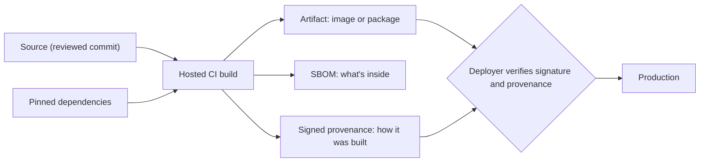

Your application is mostly code you didn't write. A small FastAPI service pulls in dozens of Python
packages; a Next.js app pulls in hundreds of npm packages; both run on a base image with its own
operating-system libraries; and CI runs third-party actions with access to your secrets. That chain
of everything that goes into your shipped software is the **software supply chain**, and attackers
have learned it's often easier to compromise a dependency than to attack you directly. OWASP Top 10
2025 now lists **Software Supply Chain Failures** as A03. This session covers the four practical
defences: know your vulnerabilities, pin what you use, document what you ship, and scan your images.

## Dependency vulnerabilities and Dependabot

Two different threats live in dependencies:

- **Known vulnerabilities**: an honest library has a bug, it gets a **CVE** identifier and a
  severity score (CVSS), and a fixed version is released. Your risk is running the old version.
- **Malicious packages**: a package is deliberately compromised (a hijacked maintainer account, a
  poisoned release, a typosquatted name like `reqeusts`). Your risk is installing it at all.

Analogy: a restaurant's suppliers. Sometimes a batch is recalled (CVE); occasionally someone tampers
with a delivery on purpose (malicious package). You need both the recall notices and checks on who
delivers.

**Software composition analysis (SCA)** tools compare your dependency list with vulnerability
databases (GitHub Advisory Database, OSV): `npm audit`, `pip-audit`, Trivy, and
[GitHub Dependabot](https://docs.github.com/en/code-security/dependabot). Dependabot has three
features:

| Feature | What it does |
| --- | --- |
| **Dependabot alerts** | Notifies you when a dependency in your manifests or lock files has a known vulnerability |
| **Security updates** | Opens a pull request bumping a vulnerable dependency to the fixed version |
| **Version updates** | Opens regular PRs to keep dependencies current, configured in `.github/dependabot.yml` |

```yaml
# .github/dependabot.yml
version: 2
updates:
  - package-ecosystem: "pip"
    directory: "/apps/api"
    schedule: { interval: "weekly" }
  - package-ecosystem: "npm"
    directory: "/apps/web"
    schedule: { interval: "weekly" }
    groups:
      minor-and-patch: { update-types: ["minor", "patch"] }
  - package-ecosystem: "docker"
    directory: "/apps/api"
    schedule: { interval: "weekly" }
  - package-ecosystem: "github-actions"
    directory: "/"
    schedule: { interval: "weekly" }
```

> [!TIP]
> Not every CVE is urgent. Ask: is the vulnerable function actually reachable from my code? Is it
> exposed to untrusted input? A critical CVE in a dev-only test tool matters less than a medium one
> in your HTTP parser. Triage, document the decision, and move on.

> [!WARNING]
> Automatic update PRs are only safe with good tests. Merging a green Dependabot PR is easy when CI
> exercises the app; merging blind is how a breaking or malicious update reaches production.

## Pinning, lock files and reproducible builds

If `requirements.txt` says `fastapi>=0.100`, two builds a week apart can install different code.
That's bad for debugging and bad for security: a compromised new release flows in automatically.

- **Lock files** record the exact resolved version of every direct and transitive dependency, often
  with a **hash** of each package: `package-lock.json`, `uv.lock`, `poetry.lock`, or
  `pip-compile --generate-hashes` output. Commit them.
- **Install from the lock file** in CI and Docker: `npm ci` (not `npm install`), `uv sync --frozen`,
  `pip install --require-hashes -r requirements.txt`. These fail instead of silently resolving
  something new.
- **Pin base images** by digest, not just tag: `python:3.12-slim@sha256:...`. Tags move; digests
  don't.
- **Pin GitHub Actions** by full commit SHA, not a movable tag like `@v4`. In March 2025 the
  popular `tj-actions/changed-files` action was compromised and its tags repointed to malicious
  code, which then ran in thousands of workflows that referenced it by tag.

```yaml
# movable: whoever controls the tag controls your CI
- uses: actions/checkout@v4
# pinned: a specific reviewed commit (Dependabot can still bump it)
- uses: actions/checkout@<full-40-char-commit-sha> # v4.x.y
```

A **reproducible build** produces bit-for-bit identical output from the same source, so anyone can
verify that a published artifact really came from that source. Pinning everything is the first
step towards it.

> [!NOTE]
> Look at YouCanDoIt: the web image uses `npm ci` with a committed lock file (good), and the
> Compose file pins image versions like `pgvector/pgvector:0.8.7-pg17` (good, though a tag rather
> than a digest). The API installs with `pip install -e ".[dev]"`, which resolves ranges at build
> time: a candidate for a lock file.

## SBOMs and SLSA provenance

An **SBOM (Software Bill of Materials)** is an ingredients list for your software: every component,
its version, supplier and licence, in a machine-readable format (**CycloneDX** or **SPDX**). When the
next big vulnerability lands (think Log4Shell in 2021), the question "are we affected, and where?"
becomes a search across SBOMs instead of a week of digging. Some customers and regulators now
require them; for example the EU Cyber Resilience Act expects manufacturers of products with digital
elements to document their components.

**Provenance** answers a different question: _how_ was this artifact built, from which source, by
which build system? [SLSA](https://slsa.dev/) (Supply-chain Levels for Software Artifacts,
pronounced "salsa") is a framework of increasing guarantees about that. Its **Build track** levels,
roughly:

| Level | Requirement | Protects against |
| --- | --- | --- |
| Build L0 | Nothing | – |
| Build L1 | Provenance exists, describing how the artifact was built | Mistakes, unknown builds |
| Build L2 | Built on a hosted build platform that signs the provenance | Tampering after the build |
| Build L3 | Hardened, isolated build platform; provenance can't be forged by the build itself | Tampering during the build |

Recent SLSA versions also add a **Source track** for how source revisions are produced and reviewed.



> [!NOTE]
> SBOM = _what_ is in it. Provenance = _how and where_ it was made. Signatures (for example with
> Sigstore's cosign) = proof that it hasn't changed since. You want all three.

## Image scanning (Trivy)

Container images bring a whole OS userland: `openssl`, `libc`, `zlib` and more, each with its own
CVEs. [Trivy](https://trivy.dev/docs/latest/) is a popular open-source scanner that checks images,
filesystems, repositories and Kubernetes clusters for known vulnerabilities, misconfigurations
(Dockerfile, Kubernetes manifests, Terraform), secrets and licences, and can generate SBOMs.

```sh
trivy image python:3.12-slim                                  # scan a base image
trivy image --severity HIGH,CRITICAL --ignore-unfixed ycdi-api # focus on fixable, serious issues
trivy fs --scanners vuln,secret,misconfig .                   # scan the repo: lock files, secrets, Dockerfiles
trivy image --format cyclonedx --output sbom.json ycdi-api     # generate an SBOM
```

Ways to cut image findings dramatically:

- **Smaller base images**: `-slim`, Alpine, or distroless images contain fewer packages, so fewer
  CVEs.
- **Multi-stage builds**: compilers and dev tools stay in the build stage; the runtime image gets
  only what runs. YouCanDoIt's web Dockerfile already does this.
- **Rebuild regularly** to pick up patched base layers, even when your code hasn't changed.

> [!TIP]
> `--ignore-unfixed` hides CVEs with no available fix. They are real, but you can't act on them by
> upgrading; track them separately rather than letting them drown the actionable ones.

## Practice: add dependency and image scanning to CI

Add three guards to YouCanDoIt's CI (or your own project): Dependabot, a dependency audit, and an
image scan that fails on fixable critical issues. Allow about 90 minutes.

### Step 1: Enable Dependabot

Create `.github/dependabot.yml` as in the first section, covering `pip` (`/apps/api`), `npm`
(`/apps/web`), `docker` and `github-actions`. In the repository settings, enable Dependabot alerts
and security updates.

### Step 2: Scan locally first

```sh
docker compose build api web
trivy image --severity HIGH,CRITICAL --ignore-unfixed youcandoit-api
trivy image --severity HIGH,CRITICAL --ignore-unfixed youcandoit-web
cd apps/web && npm audit --omit=dev
```

Record the counts. Try changing a base image (for example a newer patch tag) and compare.

### Step 3: Add a CI job

Add a job to `.github/workflows/ci.yml` that builds the images and scans them. Running Trivy from
its container image keeps the setup simple; pin the image to a specific version or digest (and
apply the same scrutiny to your security tools as to any other dependency).

```yaml
  scan:
    runs-on: ubuntu-latest
    steps:
      - uses: actions/checkout@v4   # pin to a SHA as discussed above
      - run: docker build -t ycdi-api ./apps/api
      - run: docker build -t ycdi-web ./apps/web
      - name: Scan images (fail on fixable HIGH/CRITICAL)
        run: |
          for img in ycdi-api ycdi-web; do
            docker save "$img" -o "$img.tar"   # scan a tarball instead of sharing the Docker socket
            docker run --rm -v "$PWD:/work" aquasec/trivy:<pinned-version> image \
              --input "/work/$img.tar" \
              --severity HIGH,CRITICAL --ignore-unfixed --exit-code 1
          done
      - name: Audit npm dependencies
        working-directory: apps/web
        run: npm ci && npm audit --omit=dev --audit-level=high
```

### Step 4: Handle the first failure

The first run will probably fail. For each finding: upgrade if a fix exists; if the package isn't
used at runtime, remove it or move it to dev dependencies; if you accept the risk, add it to a
`.trivyignore` file **with a comment and a review date**. Never just delete the scan step.

### Step 5: Generate an SBOM artifact

Add a step that runs Trivy with `--format cyclonedx --output sbom-api.json` and uploads it with
`actions/upload-artifact`. Open the JSON and find one transitive dependency you'd never heard of.
