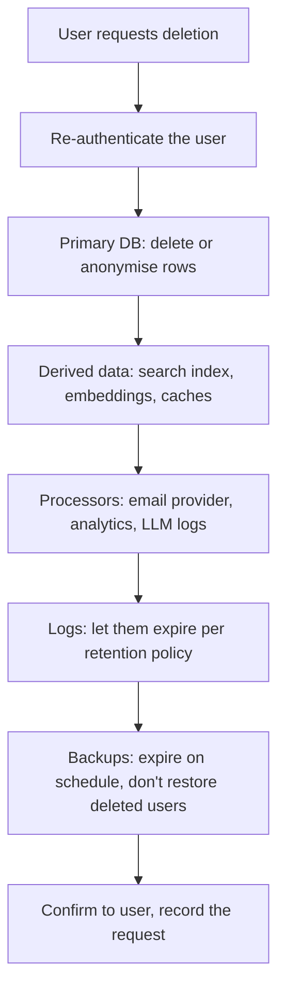

The **General Data Protection Regulation (GDPR)**,
[Regulation (EU) 2016/679](https://eur-lex.europa.eu/eli/reg/2016/679/oj), has applied since May
2018 to anyone processing personal data of people in the EU, wherever the company is based. Lawyers
and data protection officers interpret it, but **developers implement it**: the sign-up form, the
consent checkbox, the export button, the deletion job, the log retention setting. This session
translates the core articles into engineering decisions. It is not legal advice; for real products,
involve your company's privacy team.

> [!NOTE]
> Fines can reach EUR 20 million or 4% of worldwide annual turnover, whichever is higher (Article
> 83). But the everyday reason to care is trust: users increasingly choose products that respect
> their data, and enterprise customers won't sign without it.

## Personal data and lawful bases

**Personal data** (Article 4) is _any information relating to an identified or identifiable
person_. That is far broader than "name and email":

- Obvious: name, email, phone, address, photo.
- Less obvious: user IDs, IP addresses, device IDs, cookie identifiers, location, learning
  progress tied to an account, free-text messages to a chatbot.
- **Pseudonymised data** (a user ID instead of a name) is _still_ personal data if you, or someone,
  can link it back. Only truly **anonymous** data falls outside the GDPR, and true anonymisation is
  hard.

Some categories get extra protection (Article 9): health, ethnicity, religion, political opinions,
sexual orientation, biometric and genetic data. Avoid collecting them unless essential.

**Processing** means anything you do with the data: collecting, storing, reading, analysing,
sending, deleting. Every processing activity needs a **lawful basis** (Article 6). There are six:

| Basis | Meaning | Typical example |
| --- | --- | --- |
| **Consent** | The person freely agreed, for this specific purpose | Marketing newsletter, optional analytics |
| **Contract** | Necessary to deliver what they signed up for | Storing a learner's progress so the app works |
| **Legal obligation** | A law requires it | Keeping invoices for tax law |
| **Vital interests** | To protect someone's life | Emergency medical situations |
| **Public task** | Official functions of public bodies | A public school's records |
| **Legitimate interests** | Your genuine interest, balanced against their rights | Fraud prevention, basic security logs |

> [!WARNING]
> Consent is not the default answer. It must be freely given, specific, informed and unambiguous,
> as easy to withdraw as to give, and never a pre-ticked box. If the service can't work without the
> processing, consent is the wrong basis: use contract. If you rely on consent, record when and to
> what the user agreed.

## Privacy by design and data minimisation

Article 25 requires **data protection by design and by default**: privacy is built into the
architecture, and the default settings are the most protective ones. It's the privacy twin of
"security by design" from session 6.1.1.

The principles in Article 5 give you the checklist:

| Principle | Engineering translation |
| --- | --- |
| Lawfulness, fairness, transparency | Clear privacy notice; no hidden tracking |
| **Purpose limitation** | Data collected for login isn't reused for ad targeting without a new basis |
| **Data minimisation** | Collect only what the feature needs; drop optional fields |
| Accuracy | Let users correct their data |
| **Storage limitation** | Delete or anonymise when no longer needed (retention policies) |
| Integrity and confidentiality | Security: encryption, access control, logging |
| Accountability | Be able to show compliance: records, DPIAs, documented decisions |

Analogy: packing for a trip by asking "will I actually use this?" for each item. Every field you
don't collect is one you never have to secure, export, delete or explain.

> [!EXAMPLE]
> A learning app's sign-up asks for name, email, date of birth, phone and city. Which does it need?
> Email (login) and perhaps a display name. Date of birth only if you must verify age, and then an
> "I am over 16" confirmation may suffice. Phone and city: drop them. Analytics: aggregate counts, or
> pseudonymous events with short retention, rather than full user-level histories.

Practical patterns:

- **Separate identity from activity**: keep personal details in one table and activity keyed by an
  internal ID, so deletion and access control are easier.
- **Don't log personal data** you don't need; mask emails and IPs in logs.
- **Privacy-friendly defaults**: profiles private, optional tracking off until opted in.
- **Third parties**: every SDK and external API (analytics, LLM providers, error tracking) receives
  data. Know what you send. YouCanDoIt's tutor can send questions to Anthropic when configured:
  that's a data flow to document.

## Data subject rights: access, deletion, portability

The GDPR gives people rights over their data (Articles 15–22). As a developer, these become
features and back-office processes:

| Right | Article | What you build |
| --- | --- | --- |
| **Access** | 15 | A way to give a person a copy of their data and info on how it's used |
| Rectification | 16 | Edit profile; a process to correct other data |
| **Erasure** ("right to be forgotten") | 17 | Account deletion that really deletes, with documented exceptions |
| Restriction | 18 | A way to freeze processing while a dispute is resolved |
| **Portability** | 20 | Export in a structured, commonly used, machine-readable format (JSON, CSV) |
| Objection | 21 | Opt-out of processing based on legitimate interests, always for direct marketing |

You must respond **without undue delay and within one month** (Article 12), extendable in complex
cases. Self-service features make that trivial; manual processes across ten systems make it painful.

Erasure is the hardest to get right because data spreads:



> [!NOTE]
> Erasure has exceptions: data you're legally required to keep (invoices) or need for legal claims
> may be retained, restricted to that purpose. Document these exceptions rather than silently
> keeping everything.

> [!TIP]
> Build an internal "where does user data live?" map (Article 30's records of processing are a good
> format). Every new table, queue or third-party integration gets a line. Then export and deletion
> code knows where to look.

## Retention, DPAs and breach notification

**Retention.** Storage limitation means every kind of personal data needs a retention period and a
mechanism that enforces it. "Forever" is not a period. Examples: inactive accounts deleted after 24
months with an email warning first; application logs kept 30 days; security audit logs 1 year;
invoices as long as tax law requires. Enforce with scheduled jobs (YouCanDoIt already runs
APScheduler jobs; a retention job would sit naturally beside them) and with TTL settings in log
platforms.

**DPAs (Data Processing Agreements).** When a vendor processes personal data on your behalf (cloud
hosting, email delivery, an LLM API, error monitoring), they're a **processor** and you're the
**controller**. Article 28 requires a contract, the DPA, covering what they may do with the data,
security, sub-processors and deletion. Before adding a new SaaS or API that receives user data,
check that a DPA exists, where data is stored, and whether it's transferred outside the EU.

**Breach notification.** If personal data is leaked, lost or accessed without authorisation:

- Notify the **supervisory authority within 72 hours** of becoming aware, unless the breach is
  unlikely to result in a risk to people (Article 33).
- Inform the **affected people without undue delay** if the risk to them is high (Article 34).
- Document every breach, even ones you didn't need to report.

72 hours is short. It's only achievable if you can quickly answer: what data, whose, how many people,
since when? That depends on the logging, data maps and runbooks from earlier sessions.

> [!WARNING]
> A leaked database backup, an S3 bucket made public by mistake, or a laptop with an unencrypted
> export are all personal data breaches. Encryption at rest can mean the risk is low enough that
> individuals needn't be notified, which is another reason to use it.

## Practice: implement data export and account deletion

Add GDPR self-service to the to-do API with users and login from Module 6.3. Allow about 2 hours.

### Step 1: Map the data

List every place user data lives: `users`, `todos`, `refresh_tokens`, `recovery_codes`, any OAuth
links, logs, backups, third parties. Write it as a table in `docs/data-map.md` with the lawful basis
and retention period for each.

### Step 2: Export endpoint (access and portability)

```python
@router.get("/me/export")
async def export_my_data(user: User = Depends(current_user), db=Depends(get_db)):
    todos = (await db.scalars(select(Todo).where(Todo.owner_id == user.id))).all()
    data = {
        "exported_at": datetime.now(timezone.utc).isoformat(),
        "profile": {"id": user.id, "email": user.email, "created_at": user.created_at.isoformat(),
                    "two_factor_enabled": user.totp_enabled, "github_linked": user.github_id is not None},
        "todos": [TodoOut.model_validate(t).model_dump(mode="json") for t in todos],
    }
    headers = {"Content-Disposition": 'attachment; filename="my-data.json"'}
    return JSONResponse(data, headers=headers)
```

Include everything about the user, but **not** secrets such as the password hash or TOTP secret.
Rate-limit the endpoint and log that an export happened (without its content).

### Step 3: Deletion endpoint (erasure)

```python
class DeleteAccountIn(BaseModel):
    password: str

@router.delete("/me", status_code=204)
async def delete_my_account(body: DeleteAccountIn, user: User = Depends(current_user), db=Depends(get_db)):
    if not password_hash.verify(body.password, user.password_hash):
        raise HTTPException(403, "Password confirmation failed")
    user_id = user.id  # read before commit expires the object
    await db.execute(delete(Todo).where(Todo.owner_id == user_id))
    await db.execute(delete(RefreshToken).where(RefreshToken.user_id == user_id))
    await db.execute(delete(RecoveryCode).where(RecoveryCode.user_id == user_id))
    await db.delete(user)
    await db.commit()
    audit_log.info("account_deleted", extra={"user_id": user_id})  # ID only, no personal data
```

Alternatively, use `ON DELETE CASCADE` foreign keys and delete only the user, with a test proving
the cascade works.

### Step 4: Tests

Test that export contains the user's to-dos and none of another user's; that export never contains
`password_hash`; that deletion requires the password; that after deletion the user's rows are gone,
their tokens no longer work, and other users' data is untouched.

### Step 5: Retention job

Write a scheduled function that deletes refresh tokens older than their expiry and accounts inactive
for more than 24 months (log the count, not the emails). Document what happens to backups: how
long they're kept, and that a restore must re-apply deletions.
