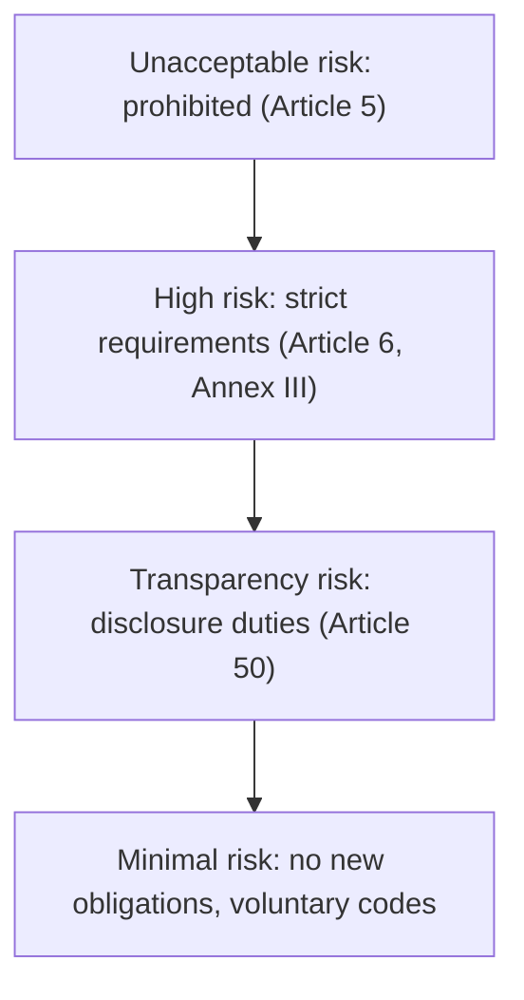
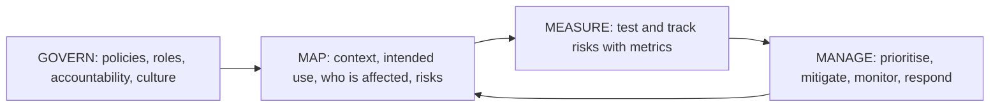

If you build features with LLMs, and in this roadmap you will, you now work under AI-specific
rules as well as the GDPR. The **EU AI Act**,
[Regulation (EU) 2024/1689](https://eur-lex.europa.eu/eli/reg/2024/1689/oj), is the first
comprehensive AI law, and like the GDPR it reaches anyone placing AI systems on the EU market. Its
core idea is simple: **the obligations depend on the risk of the use case**, not on the technology.
This session explains the risk tiers, the transparency duties that apply to almost every chatbot,
the technical side of fairness and explainability, and how risk management frameworks turn all of
this into a repeatable process. As with GDPR, this is an engineer's map, not legal advice.

> [!NOTE]
> Key dates: the Act entered into force on 1 August 2024. Prohibitions and AI-literacy duties apply
> from 2 February 2025, obligations for general-purpose AI models from 2 August 2025, and most other
> rules from 2 August 2026, with some high-risk product rules from August 2027. The EU has proposed
> adjustments to parts of this timeline, so check the current consolidated text before relying on a
> date.

## Risk categories under the AI Act

Think of it like food safety rules: a café selling coffee needs basic hygiene; a hospital kitchen
preparing meals for patients needs much stricter controls; some things simply can't be sold. The AI
Act sorts **uses** of AI into tiers:

**Unacceptable risk (prohibited).** Practices banned outright, including: manipulative or deceptive
techniques that cause significant harm; exploiting vulnerabilities due to age, disability or
social situation; social scoring; untargeted scraping of facial images to build recognition
databases; **emotion recognition in workplaces and educational institutions** (except for medical or
safety reasons); biometric categorisation to infer sensitive traits; and, with narrow exceptions,
real-time remote biometric identification in public spaces for law enforcement.

**High risk.** Two routes: AI that is a safety component of regulated products (medical devices,
machinery, toys), and use cases listed in **Annex III**, such as biometrics, critical
infrastructure, employment (CV screening, promotion decisions), access to essential services
(credit scoring), law enforcement, migration, justice, and **education**: AI used to decide
admission, to evaluate learning outcomes, to assess the level of education someone will access, or
to monitor students during tests. Providers of high-risk systems must implement a risk management
system, data governance, technical documentation, logging, human oversight, accuracy and robustness
measures, and a conformity assessment before market entry. Deployers have their own duties, such as
human oversight and monitoring.

**Transparency risk.** Systems that interact with people or generate content carry disclosure
duties (next section).

**Minimal risk.** Spam filters, recommendation of articles, code completion in your IDE: no new
obligations beyond existing law.

**General-purpose AI models** (the large models behind chatbots) have a separate regime for their
_providers_: technical documentation, copyright policy, a training-data summary, and extra duties for
models with systemic risk. If you call a model through an API, you're typically a downstream
provider or deployer of a _system_, not the model provider.

> [!WARNING]
> The same model can fall into different tiers depending on use. An LLM explaining recursion is
> minimal or transparency risk. The same LLM grading exams that decide course admission is high risk.
> Classify the **use case**, and reclassify when the feature changes.

## Transparency obligations for chatbots and generated content

Article 50 sets transparency duties that apply regardless of the high-risk classification:

| Situation | Obligation | Who |
| --- | --- | --- |
| An AI system interacts directly with people | Inform them they're interacting with AI, unless obvious from context | Provider |
| A system generates synthetic audio, image, video or text | Mark outputs in a machine-readable way so they're detectable as AI-generated | Provider |
| Deepfakes (realistic images, audio, video of real people, places or events) | Disclose that the content is artificially generated or manipulated | Deployer |
| AI-generated text published to inform the public on matters of public interest | Disclose, unless it underwent human review and someone holds editorial responsibility | Deployer |
| Emotion recognition or biometric categorisation (where permitted) | Inform the people exposed | Deployer |

For a developer, that translates into UI and pipeline features:

- A clear label on the chat window ("AI tutor: answers are generated by a language model and may be
  wrong").
- Labelling or metadata on generated images and media (watermarks, C2PA-style content credentials).
- An **AI literacy** duty too (Article 4): organisations must ensure staff who operate AI systems
  understand them sufficiently.

> [!TIP]
> Transparency is also good UX and good safety. Users who know an answer is generated are more likely
> to check it. Showing the **sources** behind a RAG answer, as YouCanDoIt's tutor does with a
> session's reading list, makes the answer verifiable.

## Bias, fairness and explainability

These words are often used loosely. Here's what they mean for an engineer.

**Bias** is a systematic error that disadvantages some group. It enters at several points:

- **Data**: training or retrieval data under-represents some groups or encodes past discrimination
  (historical hiring data that favoured one gender).
- **Labels and proxies**: using "past arrests" as a proxy for "crime" bakes in policing patterns;
  using postcode can proxy for ethnicity.
- **Model and prompt**: an LLM may produce worse explanations in some languages or stereotype in
  examples.
- **Deployment**: a system tested on one population and used on another.

**Fairness** is the goal of avoiding unjustified differences in outcomes or quality between groups.
There are several mathematical definitions (equal accuracy across groups, equal rates of positive
outcomes, equal error rates) and they can conflict, so you must choose deliberately for the use case
and write down why.

**Explainability** means being able to say _why_ a system produced an output, at a level the affected
person or the reviewer can use. For a credit decision, that might be the main factors; for a RAG
tutor, the retrieved passages it relied on.

Practical techniques:

- **Evaluate per group**: build test sets that cover the groups and languages your users span, and
  compare quality metrics across them rather than only the overall average.
- **Red-team prompts** for stereotypes and harmful content; keep them as regression tests.
- **Human oversight** for consequential decisions: the AI recommends, a person decides, and the
  interface makes it easy to disagree.
- **Log inputs, outputs and versions** (model, prompt, retrieved sources) so you can investigate
  complaints later, within your GDPR retention limits.
- **Ground outputs** in cited sources and show them.

> [!EXAMPLE]
> A tutor evaluated only on English questions scores 90% helpful. Split by language: English 92%,
> Italian 71%. The average hid a quality gap for Italian-speaking learners. The fix might be a
> different model, translated sources, or simply telling users the tutor works best in English.

## AI risk management frameworks

Rules say _what_ to achieve; frameworks give a process for _how_. The most widely used is the
[NIST AI Risk Management Framework](https://www.nist.gov/itl/ai-risk-management-framework)
(AI RMF 1.0, January 2023), voluntary and sector-agnostic, with a **Generative AI Profile**
(NIST-AI-600-1, July 2024) covering LLM-specific risks such as confabulation (hallucination), data
privacy and information integrity.

The AI RMF organises work into four functions:

- **Govern** is cross-cutting: who owns AI risk, which policies apply, how incidents are handled.
- **Map** establishes context: what is the system for, who uses it, who could be harmed, what could
  go wrong.
- **Measure** quantifies: evaluation sets, bias metrics, red-team results, monitoring.
- **Manage** acts: mitigations, go/no-go decisions, incident response, decommissioning.

It describes characteristics of **trustworthy AI**: valid and reliable; safe; secure and resilient;
accountable and transparent; explainable and interpretable; privacy-enhanced; and fair, with harmful
bias managed.

Other frameworks you'll meet: **ISO/IEC 42001** (an AI management system standard, certifiable like
ISO 27001) and the OWASP Top 10 for LLM Applications for security risks such as prompt injection.

> [!TIP]
> You don't need a compliance department to start. A one-page **AI impact assessment** per feature,
> revisited when the feature changes, covers Map and much of Measure. That's the practice task.

## Practice: write a short AI impact assessment for YouCanDoIt's tutor

Write a 1–2 page assessment in your notes for the tutor (`POST /ai/tutor`) and
"ask your reading list". Use `CLAUDE.md` and `apps/api/app/llm.py` and `rag.py` to understand how they
work. Allow about 90 minutes.

### Step 1: Describe the system

- **Purpose**: answer questions about a session, grounded in its sources.
- **Users**: who uses it today (you, single user) and who might tomorrow (other learners).
- **Components**: local Ollama model or Anthropic API, nomic embeddings, pgvector retrieval over
  fetched pages.
- **Data flows**: questions and retrieved text go to the LLM provider; nothing is sent to Anthropic
  unless configured.

### Step 2: Classify the risk

Answer, with a sentence of reasoning each:

1. Is any prohibited practice involved? (Check emotion recognition and manipulation.)
2. Is it high risk under Annex III point 3 (education)? Does the tutor decide admission, evaluate
   learning outcomes that steer someone's education in an institution, or monitor tests? Note the
   difference between a personal study tool and the same feature sold to a school that grades with it.
3. Which Article 50 transparency duties apply if it's offered to other people?

### Step 3: Map the risks

List at least six, for example: hallucinated or outdated answers; prompt injection from fetched
pages; lower quality in non-English questions; over-reliance (learners stop thinking for
themselves); personal data in questions sent to a third-party provider; cost or availability
exhaustion; generated answers that contradict the sources.

### Step 4: Measure

For each risk, define one way to measure it. Examples: a set of 30 questions with expected key points,
scored monthly; the same set translated into Italian; a few known prompt-injection test pages in a
test index; the percentage of tutor answers that a second model or a human flags as wrong.

### Step 5: Manage

For each risk, list the mitigation and the owner: "AI-generated" label and source citations in the
UI; treating retrieved text as data, never as instructions; input-length
caps and rate limits (session 6.2.4); a provider DPA and no personal data in prompts (session 6.5.1);
a feedback button to report bad answers.

### Step 6: Decide and schedule

End with a decision ("acceptable for personal use; before opening to other learners, add X, Y, Z")
and a review trigger ("revisit when the tutor's output affects progress, XP or certification").
