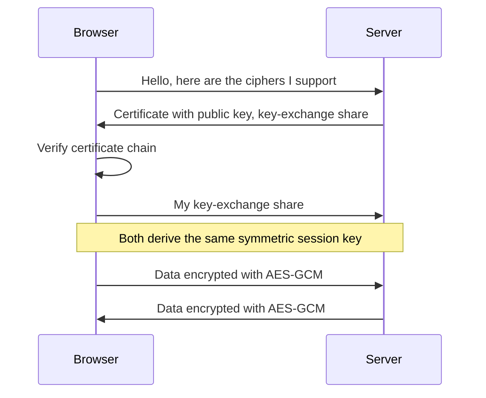
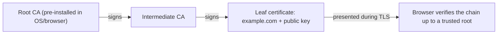

You will almost never implement a cipher, and you never should. But you will constantly _choose_
and _use_ cryptography: storing passwords, signing webhooks, verifying tokens, configuring TLS.
Using the wrong tool for the job (encoding instead of encrypting, a fast hash for passwords) is one
of the most common security bugs in real code. This session gives you a clear mental map of the
tools and when each one fits.

> [!WARNING]
> The golden rule: **don't roll your own crypto.** Not your own algorithm, and not your own
> clever combination of primitives either. Use a well-reviewed, high-level library (`cryptography`
> and `argon2-cffi` in Python, the Web Crypto API in the browser) with its defaults.

## Hashing vs encryption vs encoding

Three words that beginners mix up, with three very different jobs.

**Encoding** changes the _representation_ of data so it can travel safely through a system. There
is no secret: anyone can reverse it. Base64, URL encoding, UTF-8 and hex are encodings. Analogy:
translating a letter into Morse code. Anyone with a Morse chart can read it.

**Encryption** makes data unreadable to anyone without a _key_, and is reversible by those who have
it. Analogy: a letter in a locked box. Use it when you need the original back later (a stored API
token for a third-party service, a backup file).

**Hashing** turns any input into a fixed-size fingerprint, and is _one-way_: you cannot get the
input back. The same input always gives the same hash; a tiny change gives a completely different
one. Analogy: a fingerprint identifies a person but you cannot rebuild the person from it. Use it to
check integrity (did the file change?) or to compare without storing the original (passwords).

| | Reversible? | Needs a key? | Use it for |
| --- | --- | --- | --- |
| Encoding (Base64) | Yes, by anyone | No | Transport and formatting, **never** secrecy |
| Encryption (AES-GCM) | Yes, with the key | Yes | Confidentiality of data you need back |
| Hashing (SHA-256) | No | No | Integrity checks, fingerprints |
| Keyed hash (HMAC) | No | Yes | Proving a message came from someone holding the key |
| Password hash (Argon2id) | No | No (uses a salt) | Storing passwords |

```python
import base64, hashlib

base64.b64encode(b"secret")            # b'c2VjcmV0' -> anyone can decode this
hashlib.sha256(b"secret").hexdigest()  # '2bb80d53...' -> fixed size, one-way
```

> [!EXAMPLE]
> A JWT looks scrambled, but its header and payload are only Base64URL-encoded. Paste one into a
> decoder and you will read every claim. That's why you never put secrets in a JWT payload: it is
> signed, not encrypted.

## Symmetric and asymmetric encryption

**Symmetric encryption** uses the _same key_ to lock and unlock. It is fast and used for bulk data.
The modern default is **AES-GCM** (or ChaCha20-Poly1305), which is _authenticated_: it detects
tampering as well as hiding content. The hard part is not the maths, it is **key distribution**: how
do two parties share the key without someone intercepting it?

**Asymmetric (public-key) encryption** solves that with a key _pair_. The **public key** can be
shared with anyone; the **private key** never leaves its owner. What one key locks, only the other
can unlock. Analogy: a padlock you hand out freely (public key); anyone can snap it shut on a box,
but only you have the key that opens it (private key). Asymmetric operations are much slower, so
real systems use them to agree on a symmetric key and then switch to symmetric encryption. That
hybrid is exactly what **TLS** does every time you open an HTTPS page.



> [!NOTE]
> [Practical Cryptography for Developers](https://cryptobook.nakov.com/) has runnable examples for
> AES, ECC and key exchange. Read its chapters on symmetric and asymmetric ciphers if you want to
> see the building blocks in more detail.

> [!WARNING]
> With AES-GCM, never reuse a nonce with the same key. Reuse breaks both confidentiality and
> integrity. High-level APIs such as Fernet generate nonces for you, which is one reason to prefer
> them.

## Digital signatures and certificates

A **digital signature** is the reverse use of a key pair: you sign with your _private_ key, and
anyone verifies with your _public_ key. A valid signature proves two things: the message was not
altered (**integrity**) and it was produced by the holder of the private key (**authenticity**). It
does not hide the content.

Signing under the hood: hash the message, then apply the private key to the hash. Verifying: hash
the received message, then use the public key to check the signature matches that hash. Common
algorithms are **Ed25519** (modern, simple, fast), ECDSA and RSA-PSS.

A close cousin is the **HMAC**: a keyed hash using a _shared secret_. Webhooks (GitHub, Stripe) use
HMACs: they sign the body with a secret you both know, and you recompute and compare. Difference:
with HMAC, anyone who can verify can also forge, because both sides hold the same secret. With a
signature, verifiers only hold the public key.

But how do you know a public key really belongs to `github.com` and not to an attacker? A
**certificate** answers that. It is a document saying "this public key belongs to this domain",
signed by a **Certificate Authority (CA)**. That CA's certificate is in turn signed by a root CA
that your browser or OS already trusts. This chain is the **public key infrastructure (PKI)**.



> [!TIP]
> When comparing HMACs or tokens, use a constant-time comparison (`hmac.compare_digest` in
> Python). A normal `==` can return faster when the first bytes differ, which leaks information
> through timing.

## Password hashing (Argon2, bcrypt)

Passwords need special treatment. If your database leaks, attackers will try billions of guesses
per second against the hashes offline. A general-purpose hash like SHA-256 is designed to be
_fast_, which is exactly what the attacker wants. A **password hashing function** is designed to be
_deliberately slow and memory-hungry_, and adjustable as hardware improves.

Two other ingredients:

- **Salt**: a random value generated per password and stored next to the hash. It makes identical
  passwords hash differently and defeats precomputed "rainbow tables". Modern libraries generate
  and embed the salt for you.
- **Work factor**: the cost parameter. Tune it so a hash takes a noticeable fraction of a second on
  your server, and raise it over time.

The [OWASP Password Storage Cheat Sheet](https://cheatsheetseries.owasp.org/cheatsheets/Password_Storage_Cheat_Sheet.html)
recommends, in order of preference:

| Algorithm | OWASP minimum configuration | Notes |
| --- | --- | --- |
| **Argon2id** | 19 MiB memory, 2 iterations, parallelism 1 | First choice for new systems |
| **scrypt** | N=2^17 (128 MiB), r=8, p=1 | When Argon2id is unavailable |
| **bcrypt** | Work factor 10 or more | Legacy systems; max 72-byte input |
| **PBKDF2** | 600,000 iterations with HMAC-SHA256 | When FIPS compliance is required |

> [!WARNING]
> Never store passwords with MD5, SHA-1 or plain SHA-256, salted or not, and never encrypt them
> (encryption is reversible: whoever steals the key gets every password). bcrypt silently truncates
> input longer than 72 bytes, so enforce a maximum length if you use it.

## Practice: sign and verify a payload; hash passwords correctly

You will build a tiny script that signs a JSON payload, detects tampering, and stores passwords
safely. Allow about 45 minutes.

### Step 1: Set up

```sh
mkdir crypto-lab && cd crypto-lab
python -m venv .venv && source .venv/bin/activate
pip install cryptography argon2-cffi
```

### Step 2: Sign and verify with Ed25519

Create `sign.py`:

```python
import json
from cryptography.exceptions import InvalidSignature
from cryptography.hazmat.primitives.asymmetric.ed25519 import Ed25519PrivateKey

private_key = Ed25519PrivateKey.generate()
public_key = private_key.public_key()

payload = json.dumps({"user": "ada", "xp": 120}, sort_keys=True).encode()
signature = private_key.sign(payload)

public_key.verify(signature, payload)  # no exception = valid
print("original: valid")

tampered = payload.replace(b"120", b"9999")
try:
    public_key.verify(signature, tampered)
except InvalidSignature:
    print("tampered: rejected")
```

Run it. Note `sort_keys=True`: a signature covers exact bytes, so both sides must serialise the
same way. That's why formats like JWT sign the already-encoded string.

### Step 3: Compare with an HMAC

Add a webhook-style check using a shared secret:

```python
import hashlib, hmac, secrets

secret = secrets.token_bytes(32)
mac = hmac.new(secret, payload, hashlib.sha256).hexdigest()
received = mac  # imagine this arrived in an X-Signature header
print("hmac ok:", hmac.compare_digest(mac, received))
```

Write one sentence in a comment explaining when you would choose the HMAC and when the signature.

### Step 4: Hash passwords with Argon2id

Create `passwords.py`:

```python
from argon2 import PasswordHasher
from argon2.exceptions import VerifyMismatchError

ph = PasswordHasher()  # Argon2id; defaults exceed the OWASP minimum
stored = ph.hash("correct horse battery staple")
print(stored)  # $argon2id$v=19$m=...,t=...,p=...$<salt>$<hash>

for attempt in ["correct horse battery staple", "Tr0ub4dor&3"]:
    try:
        ph.verify(stored, attempt)
        print(attempt, "-> login ok")
        if ph.check_needs_rehash(stored):
            stored = ph.hash(attempt)  # upgrade parameters transparently
    except VerifyMismatchError:
        print(attempt, "-> wrong password")
```

Run it twice and compare the printed hashes: they differ because the salt is random. Notice the
parameters and salt are stored _inside_ the string, so you can raise the cost later and upgrade
hashes at the next successful login with `check_needs_rehash`.

### Step 5: Spot the mistakes

Explain in your notes what is wrong with each line:

```python
stored = base64.b64encode(password.encode())          # 1
stored = hashlib.sha256(password.encode()).hexdigest() # 2
stored = Fernet(key).encrypt(password.encode())        # 3
```

(1 is encoding, trivially reversible; 2 is a fast unsalted hash, cracked offline in seconds for
common passwords; 3 is reversible by anyone who obtains the key.)

```quiz
{"questions": [
  {"question": "A colleague stores API tokens Base64-encoded in the database 'so they're not in plain text'. What's the problem?", "options": ["Base64 is too slow", "Base64 is an encoding, so anyone can reverse it without a key", "Base64 output is too long for the column", "Nothing; Base64 is a form of encryption"], "answer": 1, "explanation": "Encoding only changes representation. If you need the token back and secret, encrypt it with a key kept outside the database."},
  {"question": "Why is SHA-256 a poor choice for storing passwords, even with a salt?", "options": ["It is reversible", "It produces collisions for every password", "It is designed to be fast, so attackers can test billions of guesses offline", "It cannot hash strings longer than 72 bytes"], "answer": 2, "explanation": "Password hashes must be deliberately slow and memory-hard (Argon2id, scrypt, bcrypt) so offline guessing becomes expensive."},
  {"question": "You publish a public key and sign release files with the matching private key. What does a valid signature prove to a downloader?", "options": ["The file was not modified and was signed by the private-key holder", "The file is encrypted and nobody else can read it", "The file contains no malware", "The downloader's connection is using TLS"], "answer": 0, "explanation": "Signatures give integrity and authenticity. They do not hide content and say nothing about whether the signer's code is safe."},
  {"question": "Why does TLS use asymmetric cryptography at the start and symmetric encryption afterwards?", "options": ["Symmetric encryption is less secure, so it's used only for unimportant data", "Asymmetric crypto solves key exchange; symmetric crypto is much faster for bulk data", "Browsers don't support asymmetric encryption for page content", "It's a historical accident with no technical reason"], "answer": 1, "explanation": "Public-key operations let two strangers agree on a shared key safely; then fast authenticated symmetric ciphers like AES-GCM protect the traffic."},
  {"question": "When verifying a GitHub webhook HMAC, why use hmac.compare_digest instead of ==?", "options": ["== doesn't work on strings", "compare_digest is constant-time, so it doesn't leak how many leading characters matched", "compare_digest also decrypts the payload", "== is slower"], "answer": 1, "explanation": "Early-exit comparisons leak timing information an attacker can use to guess a valid MAC byte by byte."}
]}
```
