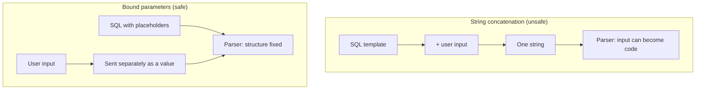
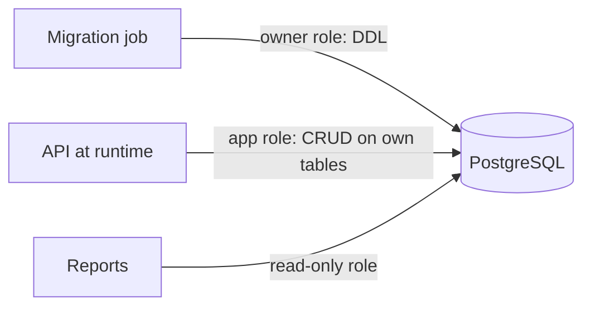

SQL injection is one of the oldest web vulnerabilities, and it still turns up in real code. It
falls under "Injection" in the OWASP Top 10 (session 6.2.1). The good news is that the fix is
well understood, cheap and nearly mechanical: **never build a query by gluing user input into SQL
text**. This lesson explains the problem once, at a high level, and then spends most of its time
on prevention: what to write, what to reject in code review, and how to prove it in a test.

## How SQL injection works

Analogy first. You hand a bank teller a pre-printed form: "Transfer ___ euros to account ___".
The teller follows the form and treats whatever you wrote in the blanks as values. Now imagine
the teller instead reads the whole sheet aloud as one instruction, including anything you wrote
in the margins. Someone could write "...and also empty the vault" in a blank, and the teller
would read it as part of the instruction.

That is SQL injection. When code builds a query by **string concatenation**, the database
receives one string and cannot tell which parts the developer wrote and which parts came from
the user. If the input contains SQL syntax (a quote, a keyword), it can **change the structure of
the query**, not just fill in a value.

> [!EXAMPLE]
> The classic textbook illustration. A login lookup built with an f-string:
>
> ```python
> # DO NOT SHIP: input is pasted into the SQL text
> sql = f"SELECT * FROM users WHERE name = '{name}'"
> ```
>
> With `name = "alice"` you get the query you meant. With `name = "x' OR '1'='1"` the string
> becomes `... WHERE name = 'x' OR '1'='1'`. The quote closed the value early, and the rest became
> a new condition that is always true, so the query returns every user.

That one example is all you need to understand the whole family. The key point: **the input
changed the query's structure**. Every defence below works by making that impossible, so the
input can only ever be a value.

The impact depends on what the database account may do: reading other users' data, changing or
deleting rows, and sometimes worse. The
[OWASP SQL Injection Prevention Cheat Sheet](https://cheatsheetseries.owasp.org/cheatsheets/SQL_Injection_Prevention_Cheat_Sheet.html)
is the reference to bookmark.



> [!WARNING]
> "I'll just escape the quotes" or "I'll strip semicolons" is not a fix. Blocklists miss cases
> (different quote characters, encodings, numeric contexts with no quotes at all). OWASP lists
> escaping as a last resort and strongly discourages it. Separate code from data instead.

## Parameterised queries and prepared statements

A **parameterised query** (also called a query with bound parameters) sends the SQL text with
placeholders, and sends the values **separately**. The database parses the structure first, then
plugs the values in as data. Whatever the value contains, quotes included, it is compared as a
plain string. It can never become a keyword. This is OWASP's first and main defence.

A **prepared statement** is the same idea taken one step further: the database parses and plans
the statement once, and you execute it many times with different values. Most drivers use one or
both behind the scenes. For safety, what matters is that the values travel separately.

Placeholder syntax varies by driver, but the shape is always the same:

```python
# asyncpg (raw driver): numbered placeholders
await conn.fetchrow("SELECT * FROM users WHERE name = $1", name)

# psycopg / sqlite3: %s or ? placeholders, values as a separate argument
cur.execute("SELECT * FROM users WHERE name = %s", (name,))

# SQLAlchemy text(): named placeholders + a params dict
await db.execute(text("SELECT * FROM users WHERE name = :name"), {"name": name})
```

Note the difference from the unsafe version: `name` is **never inside the string literal**. It is
a second argument. If you see a placeholder string built with `f"..."`, `%` or `+`, you are back
to concatenation.

### SQLAlchemy Core and ORM do this for you

This repo's API (`apps/api`) uses [SQLAlchemy 2.0](https://docs.sqlalchemy.org/en/20/) with
asyncpg. Its query builder turns Python expressions into SQL with bound parameters automatically.
For example, `apps/api/app/routes/progress.py`:

```python
@router.delete("/progress/{subchapter_id}", response_model=StatsOut)
async def uncomplete(subchapter_id: str, db: AsyncSession = Depends(get_db)) -> StatsOut:
    await db.execute(delete(Completion).where(Completion.subchapter_id == subchapter_id))
```

`subchapter_id` comes straight from the URL, which the user fully controls. But
`Completion.subchapter_id == subchapter_id` does not produce a string. It produces an expression
object. When it runs, SQLAlchemy sends something like `DELETE FROM completions WHERE
completions.subchapter_id = $1` with the value attached separately. The same holds for
`select(Document).where(Document.url == url)` in `rag.py`, for `db.get(Subchapter, id)`, and for
`insert(...).values(...)`.

> [!TIP]
> To see the real SQL and parameters, print a statement: `print(stmt)` shows placeholders. Or set
> `echo=True` on the engine in a dev shell, which logs every query with its parameters listed
> separately. Seeing `[parameters: ('...',)]` in the log tells you the value was bound.

FastAPI and Pydantic add a second, independent layer: `article_id: int` in `articles.py` rejects
anything that is not an integer before your code runs. Type validation is good defence in depth,
but it is **not** a replacement for parameters. A `str` field accepts any text.

## ORM pitfalls: raw SQL and string formatting

An ORM protects you only while you use its expression API. The trouble starts at the escape
hatches.

### `text()` with f-strings

`text()` runs SQL you write by hand. It is fine **with bound parameters** and dangerous without
them:

```python
# Unsafe: the f-string runs before SQLAlchemy ever sees the SQL
await db.execute(text(f"DELETE FROM completions WHERE subchapter_id = '{sid}'"))

# Safe: placeholder in the text, value passed separately
await db.execute(
    text("DELETE FROM completions WHERE subchapter_id = :sid"), {"sid": sid}
)
```

Both lines look like "SQLAlchemy". Only the second is protected. The ORM cannot recover the
boundary between code and data once Python has already merged them into one string. The same
applies to `.where(text(...))`, `.filter(text(...))`, `literal_column(f"...")`, and to calling
`conn.exec_driver_sql()` with formatted strings.

### Dynamic identifiers: allowlist them

Placeholders can only stand in for **values**. They cannot hold table names, column names, or
`ASC`/`DESC`. So a "sort by any column" feature tempts people into `f"ORDER BY {sort}"`. The fix
is an **allowlist**: map a small set of allowed user choices to code-defined columns, and reject
everything else.

```python
SORTS = {
    "newest": Article.published_at.desc().nulls_last(),
    "oldest": Article.published_at.asc(),
    "title": Article.title.asc(),
}

@router.get("/articles")
async def list_articles(sort: Literal["newest", "oldest", "title"] = "newest", ...):
    stmt = select(Article).order_by(SORTS[sort])
```

The user picks a key, never the SQL. `Literal[...]` makes FastAPI reject unknown values with a
422 before your handler runs. This repo's `list_articles` already follows the spirit of this: a
boolean `favorites` flag picks between two orderings written in code.

> [!NOTE]
> You will find one f-string in SQL in this repo: `tests/conftest.py` runs
> `f'CREATE DATABASE "{name}"'` because a database name is an identifier and cannot be a
> parameter. It is acceptable because `name` comes from the app's own settings, not a request.
> That is exactly the question to ask in review: **where does this value come from, and could a
> user ever control it?** If the answer might change later, use an allowlist or the driver's
> identifier quoting anyway.

### Other places to watch

- `LIKE` / `ilike` searches: bind the pattern (`Article.title.ilike(f"%{q}%")` is fine because
  the f-string builds a **value** that is then bound). If `%` and `_` in the input should be
  literal, escape them with the `escape=` argument; that is a correctness issue, not injection.
- Stored procedures are only safe if they do not build dynamic SQL inside.
- `LIMIT`/`OFFSET` from the query string: validate as `int` and cap them, as `list_articles` does
  with `min(limit, 200)`.

## Least-privilege database users

Parameterised queries stop injection. **Least privilege** limits the damage if something else goes
wrong: a missed `text()` call, a vulnerable dependency, a leaked password. OWASP lists it as an
additional defence.

Analogy: a shop assistant gets a key to the till, not to the safe and the manager's office.

In practice:

- **Separate roles.** The app's runtime role needs `SELECT`, `INSERT`, `UPDATE`, `DELETE` on its
  own tables. It does not need `CREATE`, `DROP`, `ALTER`, or superuser. Run migrations (Alembic
  here) with a different, more powerful role.
- **Never connect as superuser.** A superuser can read any database on the server and, in
  PostgreSQL, can even run programs on the host.
- **Read-only roles** for reporting or analytics endpoints.
- **One role per app** so a compromise of one service does not expose another's data.

```sql
-- Sketch for PostgreSQL: a runtime role that can use the data but not change the schema
CREATE ROLE ycdi_app LOGIN PASSWORD '...';
GRANT CONNECT ON DATABASE ycdi TO ycdi_app;
GRANT USAGE ON SCHEMA public TO ycdi_app;
GRANT SELECT, INSERT, UPDATE, DELETE ON ALL TABLES IN SCHEMA public TO ycdi_app;
GRANT USAGE ON ALL SEQUENCES IN SCHEMA public TO ycdi_app;
```

> [!WARNING]
> In this repo's `docker-compose.yml`, the API connects as `ycdi`, the role created by the
> Postgres image's `POSTGRES_USER`, which is a superuser. That is a reasonable shortcut for a
> local, single-user app, and the container runs `alembic upgrade head` itself, which needs DDL
> rights. In production you would split it: a migration job with the owner role, and the API with
> a restricted one like `ycdi_app`.



### Detection: linters and review

Make the unsafe pattern hard to merge:

- **Bandit** flags SQL built with string formatting (check B608, "possible SQL injection via
  string-based query construction"). Ruff ships the same rule as **S608** in its `flake8-bandit`
  set. This repo's ruff config selects `E, F, I, UP, B`; adding `"S608"` would catch new cases in
  CI.
- **Code review checklist:** any `text(`, `exec_driver_sql`, `literal_column` or raw cursor call?
  Is every value a bound parameter? Is every dynamic identifier from an allowlist?
- **Tests:** for each endpoint that takes text, at least one test sends input containing quotes
  and SQL keywords and asserts it is treated as data (no extra rows, no error 500). The practice
  below writes one.

Linters produce false positives and miss cases (for example SQL built across several functions),
so treat them as a net, not a guarantee.

## Practice: exploit and then fix a vulnerable endpoint locally

You will audit this repo's queries, see what the unsafe version of one endpoint would look like,
and write a test that proves the real endpoint treats a hostile-looking string as data. Everything
runs against the local `ycdi_test` database.

### 1. Audit the queries

From the repo root, list every place SQL could be written by hand:

```sh
grep -rnE "\btext\(|exec_driver_sql|literal_column|f[\"'](SELECT|INSERT|UPDATE|DELETE|CREATE)" apps/api
```

For each hit, answer the review questions: is every value bound? Could any identifier come from a
request? You should find `text("CREATE EXTENSION ...")` and the `CREATE DATABASE` f-string in
`tests/conftest.py`, both using fixed or config-only values, and nothing in `apps/api/app`. Then skim `routes/progress.py`, `routes/articles.py` and `rag.py`: every `where(...)`
compares a column to a Python value, so all values are bound.

### 2. Picture the unsafe version

Look at `uncomplete` in `routes/progress.py`. Imagine it had been written like this:

```python
# DO NOT SHIP: for discussion only
await db.execute(text(f"DELETE FROM completions WHERE subchapter_id = '{subchapter_id}'"))
```

Apply the classic example from the first section: a `subchapter_id` of `0.1.2.1' OR '1'='1`
turns the `WHERE` into a condition that is always true. The user would delete **every** completion
row, not just one. This is the "exploit" in its entirety. You do not need to run it to understand
it, and the test below is what matters.

### 3. Write the test

Create `apps/api/tests/test_sql_injection.py`:

```python
async def test_malicious_id_is_treated_as_data(client):
    xp = (await client.put("/progress/0.1.2.1")).json()["xp"]
    assert xp > 0

    hostile = "0.1.2.1' OR '1'='1"
    r = await client.delete(f"/progress/{hostile}")
    assert r.status_code == 200
    assert r.json()["xp"] == xp  # nothing was deleted: the whole string is one value

    assert (await client.put(f"/progress/{hostile}")).status_code == 404  # no such id

    await client.delete("/progress/0.1.2.1")  # leave the test DB clean
```

Run it:

```sh
docker compose run --rm -v "$PWD/apps/api:/app" api pytest -q tests/test_sql_injection.py
```

It passes because SQLAlchemy binds `subchapter_id` as a parameter. The database looks for a
subchapter whose id is literally `0.1.2.1' OR '1'='1`, finds none, and deletes nothing.

### 4. Prove the test has teeth

A test that cannot fail proves nothing. Temporarily replace the body of `uncomplete` with the
unsafe `text(f"...")` line from step 2 (import `text` from `sqlalchemy`), re-run the test, and
watch it fail: XP drops to 0 because every completion was deleted. Then **revert the change**
(`git checkout apps/api/app/routes/progress.py`) and confirm the test passes again. That
red-then-green cycle is the "fix" half of the exercise.

### 5. Harden the pipeline (optional)

- Add `"S608"` to `select` in `apps/api/pyproject.toml` and run
  `docker compose run --rm -v "$PWD/apps/api:/app" api ruff check .` to see whether it flags the
  test-only f-string in `conftest.py`. Decide whether to suppress it with a `# noqa: S608` and a
  one-line reason.
- Write down how you would split the `ycdi` role into an owner role and an app role.

> [!TIP]
> Keep the test. Regression tests like this are cheap, and they stop a future refactor that
> "optimises" a query into raw SQL from quietly reopening the hole.

```quiz
{"questions": [
  {"question": "What is the root cause of SQL injection?", "options": ["The database has a weak password", "User input is concatenated into the SQL text, so it can change the query's structure", "The query uses too many JOINs", "The app does not use HTTPS"], "answer": 1, "explanation": "When code and data are merged into one string, the parser cannot tell them apart. Input that contains SQL syntax becomes part of the query."},
  {"question": "Which of these SQLAlchemy calls is unsafe if `sid` comes from a request?", "options": ["delete(Completion).where(Completion.subchapter_id == sid)", "db.execute(text(\"DELETE FROM completions WHERE subchapter_id = :sid\"), {\"sid\": sid})", "db.execute(text(f\"DELETE FROM completions WHERE subchapter_id = '{sid}'\"))", "db.get(Subchapter, sid)"], "answer": 2, "explanation": "The f-string merges the value into the SQL before SQLAlchemy sees it, so there is nothing left to bind. The other three send sid as a bound parameter."},
  {"question": "A user can choose the sort column for a list endpoint. What is the safe way to implement it?", "options": ["Bind the column name as a parameter", "Escape quotes in the column name", "Map a small set of allowed choices to columns defined in code and reject anything else", "Wrap the column name in double quotes inside an f-string"], "answer": 2, "explanation": "Placeholders only work for values, not identifiers. An allowlist means the user picks a key and the SQL comes entirely from your code."},
  {"question": "All queries use bound parameters. Why still run the API with a least-privilege database role?", "options": ["It makes queries faster", "It limits the damage if another flaw or a leaked credential is ever exploited", "Parameterised queries only work with restricted roles", "PostgreSQL requires it"], "answer": 1, "explanation": "Least privilege is defence in depth: the app role cannot drop tables or read other databases even if something else goes wrong."},
  {"question": "Your injection test passes. How do you know it actually tests anything?", "options": ["Run it twice", "Temporarily introduce the unsafe query and check that the test fails, then revert", "Check code coverage is 100%", "Add more assertions"], "answer": 1, "explanation": "A test that cannot fail proves nothing. Seeing it go red against the vulnerable version and green against the fix shows it detects the bug."}
]}
```
