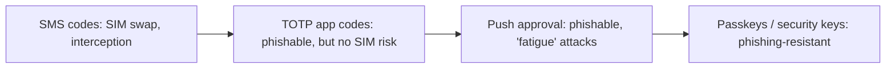
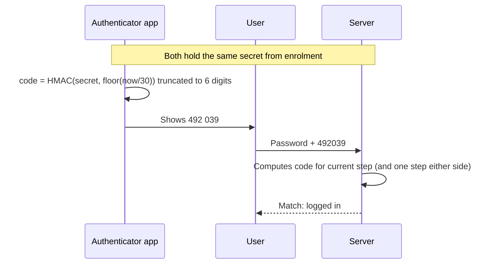
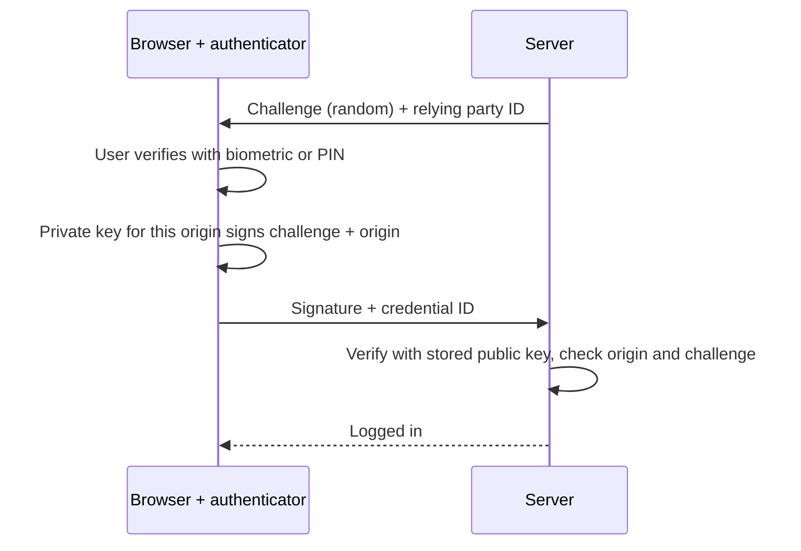

In the previous session you built a solid password login. But a password is still one secret,
and secrets leak: phishing, reuse across sites, malware, a breach somewhere else. This session adds
a second, independent proof of identity. You'll see why that matters, how the six-digit codes in
authenticator apps actually work (TOTP), how passkeys remove the password altogether, and then you
add TOTP to your own login.

## Why MFA

**Multi-factor authentication (MFA)** means proving identity with factors from at least two
_different_ categories:

| Factor | Meaning | Examples |
| --- | --- | --- |
| Something you **know** | A secret in your head | Password, PIN |
| Something you **have** | A physical object | Phone with an authenticator app, security key |
| Something you **are** | A biometric | Fingerprint, face |

Analogy: a bank vault needs both the combination _and_ the physical key. Stealing one isn't enough.
Two passwords are not two factors: they're the same category and fail the same way.

Why bother? The vast majority of account takeovers use stolen or guessed passwords: credential
stuffing with lists from other breaches, phishing, password spraying. A second factor stops most of
those cold, because the attacker has the password but not the phone or key. The
[OWASP Multifactor Authentication Cheat Sheet](https://cheatsheetseries.owasp.org/cheatsheets/Multifactor_Authentication_Cheat_Sheet.html)
calls MFA the single best defence against password-related attacks.

Not all second factors are equal:



> [!NOTE]
> SMS is better than nothing but weak: SIM-swap attacks move your number to the attacker's SIM. Use
> it only as a fallback. TOTP and passkeys are the developer-friendly options you'll build here.

> [!WARNING]
> MFA must also protect the _other_ ways in: password reset, email change, adding or removing an MFA
> method, and API tokens. A strong login with a reset flow that skips MFA is a side door.

## TOTP (RFC 6238) and recovery codes

**TOTP (Time-based One-Time Password)**, specified in [RFC 6238](https://www.rfc-editor.org/rfc/rfc6238),
is what Google Authenticator, 1Password, Aegis and similar apps implement. The idea is beautifully
simple:

1. At enrolment, the server generates a random **shared secret** and shows it to the user, usually
   as a QR code. The app stores it. From now on, both sides know the secret.
2. Both sides compute the current **time step**: `T = floor(unix_time / 30)`. Every 30 seconds T
   increases by one.
3. Both compute `HMAC-SHA1(secret, T)` and truncate it to a 6-digit number (the truncation comes from
   HOTP, RFC 4226).
4. The user types the app's number; the server computes its own and compares.

Because both sides derive the code from the same secret and the same clock, no network connection is
needed. Analogy: two people with identical synchronised code books, turning to the page for "now".



Implementation details that matter:

- **Clock drift**: accept the current step and at most one step on either side (RFC 6238 suggests
  allowing a small window for network delay).
- **Replay**: a code is valid for ~30–90 seconds. Remember the last step used per user and reject
  the same code twice.
- **Brute force**: there are only a million 6-digit codes. Rate limit and lock after a few wrong
  attempts.
- **Secret storage**: the TOTP secret must be recoverable (you need it to compute codes), so you
  can't hash it. Encrypt it at rest with a key kept outside the database.
- **Confirm enrolment**: only enable 2FA after the user enters a valid code, proving the app has
  the secret.

**Recovery codes** handle the lost-phone problem. At enrolment, generate around ten random
single-use codes, show them once, and store only their **hashes**. Each one can replace a TOTP code
exactly once.

> [!TIP]
> Treat a successful recovery-code login as a security event: email the user and prompt them to
> re-enrol 2FA.

## Passkeys and WebAuthn

TOTP codes can still be phished: a fake login page asks for the password and the code, and relays
both to the real site within 30 seconds. **Passkeys** fix this. They are built on **WebAuthn**, a W3C
standard supported by all major browsers, explained well by the [WebAuthn Guide](https://webauthn.guide/).

How it works, in short:

- **Registration**: the browser asks an **authenticator** (the phone's secure chip, a laptop's
  TPM, a YubiKey) to create a new **key pair** for _this website's origin_. The private key never
  leaves the authenticator. The server stores only the public key and a credential ID.
- **Authentication**: the server sends a random **challenge**. The authenticator, after the user
  unlocks it with a fingerprint, face or PIN, signs the challenge with the private key. The server
  verifies the signature with the stored public key.



Why it's so strong:

- **Phishing-resistant**: the browser binds the credential to the real origin. A look-alike
  domain gets nothing usable.
- **Nothing reusable to steal from the server**: the database holds public keys only.
- **Multi-factor in one gesture**: possession of the device plus the biometric or PIN that unlocks
  it.

A **passkey** is a WebAuthn credential designed to replace the password. Passkeys can be synced
across a user's devices by their platform (Apple, Google, password managers), which solves the
"lost device" problem that hardware keys have.

> [!NOTE]
> Don't implement WebAuthn's verification yourself; the CBOR and attestation details are subtle.
> Use a maintained library on both sides (for example SimpleWebAuthn in JavaScript or py_webauthn in
> Python).

## Practice: add TOTP 2FA to your login

Extend the to-do API from session 6.3.1. Allow about 2 hours.

### Step 1: Dependencies and schema

```sh
pip install pyotp "qrcode[pil]"
```

Add to `users`: `totp_secret_encrypted` (nullable), `totp_enabled` (bool, default false),
`totp_last_step` (int, nullable). Add a `recovery_codes` table: `id`, `user_id`, `code_hash`,
`used_at`. Write the Alembic migration.

### Step 2: Start enrolment

```python
import pyotp

@router.post("/2fa/setup")
async def setup_2fa(user: User = Depends(current_user), db=Depends(get_db)):
    secret = pyotp.random_base32()
    user.totp_secret_encrypted = fernet.encrypt(secret.encode())
    user.totp_enabled = False
    await db.commit()
    uri = pyotp.TOTP(secret).provisioning_uri(name=user.email, issuer_name="ToDo API")
    return {"otpauth_uri": uri}  # the client renders this as a QR code
```

Generate a QR code locally to test: `python -c "import qrcode; qrcode.make('<uri>').save('qr.png')"`
and scan it with an authenticator app.

### Step 3: Confirm enrolment and issue recovery codes

```python
@router.post("/2fa/confirm")
async def confirm_2fa(body: CodeIn, user: User = Depends(current_user), db=Depends(get_db)):
    if not verify_totp(user, body.code):
        raise HTTPException(400, "Invalid code")
    user.totp_enabled = True
    codes = [secrets.token_hex(5) for _ in range(10)]
    db.add_all(RecoveryCode(user_id=user.id, code_hash=password_hash.hash(c)) for c in codes)
    await db.commit()
    return {"recovery_codes": codes}  # shown once, never again
```

### Step 4: Verify with replay protection

```python
def verify_totp(user: User, code: str) -> bool:
    totp = pyotp.TOTP(fernet.decrypt(user.totp_secret_encrypted).decode())
    now = int(time.time())
    for offset in (-1, 0, 1):  # one step of clock drift either side
        step = now // 30 + offset
        if hmac.compare_digest(totp.at(step * 30), code) and step != user.totp_last_step:
            user.totp_last_step = step
            return True
    return False
```

### Step 5: Two-step login

Change `/token`: if the password is correct and `totp_enabled` is true, don't issue an access token.
Return a short-lived (5 minute) **pending** token with a claim like `"stage": "2fa"`. Add
`POST /token/2fa` that accepts the pending token plus a TOTP code or a recovery code, and only then
issues the real access token. Make `current_user` reject pending tokens.

### Step 6: Test the edges

Write tests for: correct code works; the same code twice fails; a wrong code fails and is rate
limited; a recovery code works once and then fails; a pending token can't call `/todos`. Use
`freezegun` or pass an explicit timestamp to control time in tests.

```quiz
{"questions": [
  {"question": "Why is 'password + security question' not multi-factor authentication?", "options": ["Security questions are too short", "Both are 'something you know', so they fail the same way", "Security questions are stored in plain text", "MFA requires biometrics"], "answer": 1, "explanation": "MFA needs factors from different categories. Both secrets can be phished or researched by the same attacker."},
  {"question": "How can the authenticator app produce the same code as the server without any network connection?", "options": ["The app downloads codes in advance", "Both compute an HMAC of a shared secret and the current 30-second time step", "The code is the user's password hashed", "The server pushes codes via SMS"], "answer": 1, "explanation": "TOTP derives the code from the secret shared at enrolment and the clock, so both sides compute it independently."},
  {"question": "Why must the server remember the last TOTP time step a user logged in with?", "options": ["To calculate the next code", "To prevent the same code being replayed within its validity window", "Because RFC 6238 requires a database", "To detect clock drift on the server"], "answer": 1, "explanation": "A code stays valid for 30–90 seconds. Rejecting reuse stops an attacker who observed it from logging in again."},
  {"question": "A user enters their password and TOTP code on a convincing fake site, which relays both to the real site. Which method would have prevented this?", "options": ["A longer TOTP code", "SMS codes", "A passkey (WebAuthn), because the credential is bound to the real origin", "Recovery codes"], "answer": 2, "explanation": "WebAuthn signs the challenge together with the origin, and the browser won't use the credential on a look-alike domain, so phishing relays fail."},
  {"question": "Why are recovery codes stored hashed but the TOTP secret stored encrypted?", "options": ["No reason; both could be hashed", "Recovery codes only need to be compared; the TOTP secret must be read back to compute codes", "Hashing is only allowed for short strings", "Encryption is faster than hashing"], "answer": 1, "explanation": "If you only need to check a value, hash it. If you need the original to compute something, encrypt it with a key kept outside the database."}
]}
```
