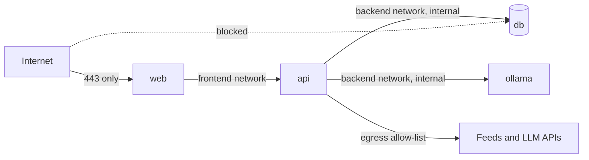

Secure code can still be deployed insecurely. A container running as root with a writable
filesystem, a database port open to the world, a cloud user with `AdministratorAccess` whose key
sits in a CI variable: each turns a small bug into a full compromise. **Hardening** means removing
everything an attacker could use after getting a foothold. The guiding idea is one you've met all
through this track: **least privilege**, applied to identities, processes and networks. This
session applies it to cloud accounts, containers and Kubernetes, adds the logging you need to notice
when something goes wrong, and finishes by hardening YouCanDoIt's own Compose file.

## Least-privilege IAM

**IAM (Identity and Access Management)** controls who and what can do which actions on which cloud
resources. In AWS, GCP and Azure every API call (start a VM, read a bucket, decrypt with a key) is
checked against IAM policies.

Analogy: a building with keycards. The cleaner's card opens every office floor at night but not the
server room; the auditor's card opens the archive, read-only, for one month. Nobody gets the
master key "to save time".

Principles:

- **Humans use SSO and short-lived sessions**, with MFA, not long-lived access keys.
- **Workloads use roles, not keys.** A VM, container or CI job assumes a role and gets temporary
  credentials (workload identity, GitHub Actions OIDC federation). No static key to leak.
- **Scope narrowly**: specific actions on specific resources, not `*` on `*`.
- **Separate environments** into separate accounts or projects, so a dev mistake can't touch
  production.
- **Review and prune**: cloud providers show unused permissions; remove them.
- **Protect the root/owner account**: MFA, no access keys, used only for break-glass tasks.

```json
{
  "Effect": "Allow",
  "Action": ["s3:GetObject", "s3:PutObject"],
  "Resource": "arn:aws:s3:::ycdi-exports/*"
}
```

Compare that with `"Action": "s3:*", "Resource": "*"`: the first lets the export job do its one
job; the second lets a compromised export job read and delete every bucket in the account.

> [!WARNING]
> "Temporarily" granting admin to make something work is how most over-privileged roles are born.
> If you broaden a permission to debug, write the follow-up task to narrow it before you merge.

## Container hardening: non-root, read-only filesystems

A container is a process with some isolation, sharing the host's kernel. If an attacker gets code
execution inside it (a deserialisation bug, a vulnerable dependency), hardening decides how much
further they can go. The
[OWASP Docker Security Cheat Sheet](https://cheatsheetseries.owasp.org/cheatsheets/Docker_Security_Cheat_Sheet.html)
lists the key rules; the ones you'll apply most:

| Control | Why | How (Docker/Compose) |
| --- | --- | --- |
| Run as a non-root user | Root in the container is much closer to root on the host | `USER app` in the Dockerfile, or `user:` in Compose |
| Read-only root filesystem | Attackers can't drop tools or modify code | `read_only: true` plus `tmpfs` for scratch dirs |
| Drop Linux capabilities | Root's powers are split into capabilities; most apps need none | `cap_drop: [ALL]` |
| No privilege escalation | Blocks setuid binaries from gaining privileges | `security_opt: [no-new-privileges:true]` |
| Limit resources | A runaway or attacked container can't starve the host | memory, CPU and `pids_limit` |
| Never mount the Docker socket | It's equivalent to root on the host | Don't mount `/var/run/docker.sock` |
| Minimal images | Fewer packages, fewer tools for attackers, fewer CVEs | slim/distroless, multi-stage |

```dockerfile
FROM python:3.12-slim
WORKDIR /app
COPY . .
RUN pip install --no-cache-dir . \
 && useradd --system --uid 10001 app
USER app
```

> [!NOTE]
> YouCanDoIt's web Dockerfile already creates an `app` user and switches to it. The API Dockerfile
> doesn't set `USER`, so it runs as root: a good first fix in the practice section.

> [!TIP]
> Turning on `read_only` will surface every place the app writes to disk. Each one becomes either a
> `tmpfs` mount (temporary files) or a named volume (data that must persist). That inventory is
> useful knowledge in itself.

## Network policies and segmentation

**Segmentation** means dividing the network so each component can only reach what it needs.
Analogy: a ship with watertight compartments. A leak in one doesn't sink the whole vessel.

In a typical web app:

- The **browser** reaches only the web front end (or a load balancer) on 443.
- The **web** reaches the API.
- The **API** reaches the database and the specific external services it needs.
- The **database** accepts connections only from the API, and is never published to the internet.



In Docker Compose, put services on separate user-defined networks and mark the backend network
`internal: true`. Only publish ports you actually need from the host, and bind them to
`127.0.0.1` on a developer machine so they aren't reachable from the local network.

In Kubernetes, all pods can talk to all pods by default. A **NetworkPolicy** restricts that, and the
[Kubernetes security docs](https://kubernetes.io/docs/concepts/security/) recommend starting from
**default deny** and allowing specific flows. Note that NetworkPolicies are only enforced if the
cluster's network plugin supports them.

```yaml
apiVersion: networking.k8s.io/v1
kind: NetworkPolicy
metadata: { name: db-allow-api-only, namespace: ycdi }
spec:
  podSelector: { matchLabels: { app: db } }
  policyTypes: [Ingress]
  ingress:
    - from: [{ podSelector: { matchLabels: { app: api } } }]
      ports: [{ port: 5432 }]
```

> [!WARNING]
> Publishing a container port with Docker can bypass host firewalls such as UFW, because Docker
> writes its own iptables rules. The OWASP cheat sheet calls this out explicitly. Don't rely on the
> host firewall; don't publish what you don't need.

## Security logging and monitoring

Hardening reduces what an attacker can do; logging and monitoring tell you that they're trying.
You need logs from several layers:

| Layer | Examples |
| --- | --- |
| Cloud control plane | AWS CloudTrail, GCP Cloud Audit Logs: who changed IAM, opened a port, read a secret |
| Kubernetes | API server audit logs: who exec'd into a pod, created a privileged pod |
| Containers and hosts | Runtime events: unexpected processes, writes, outbound connections (tools like Falco) |
| Application | Logins, failed logins, permission denials, admin actions, validation failures |

Principles:

- **Centralise** logs off the machine they describe, so an attacker can't quietly delete them.
- **Structure** them (JSON with timestamp, actor, action, target, outcome, request ID).
- **Alert on signals, not volume**: a burst of 403s from one user, a login from a new country
  followed by a password change, a new IAM admin, a container spawning a shell.
- **Keep secrets and personal data out**, and set retention deliberately (it's also a GDPR topic).
- **Synchronise clocks** so events from different systems line up.

> [!EXAMPLE]
> A useful first alert for almost any app: "more than 20 authorisation failures from the same
> account or IP in 5 minutes". It catches ID-enumeration attempts against your API and costs one
> query on your log platform.

## Practice: harden your Compose and Kubernetes manifests

Harden YouCanDoIt's `docker-compose.yml` step by step, verifying the app still works after each
change. Allow about 90 minutes. Work on a branch.

### Step 1: Baseline

```sh
docker compose up -d --build
docker compose exec api id            # which user?
docker compose exec web id
docker compose ps --format "table {{.Name}}\t{{.Ports}}"
trivy config docker-compose.yml        # optional: misconfiguration scan
```

Note which services run as root and which ports are published on `0.0.0.0`.

### Step 2: Run the API as non-root

Add a system user and `USER` to `apps/api/Dockerfile` as shown above. Rebuild, and check that
`alembic upgrade head` and the API still start.

### Step 3: Lock down services

Add these to `api` and `web` in `docker-compose.yml`:

```yaml
    read_only: true
    tmpfs: [/tmp]
    cap_drop: [ALL]
    security_opt: ["no-new-privileges:true"]
    pids_limit: 200
    deploy:
      resources:
        limits: { memory: 1g }
```

Start the stack and watch logs for permission errors. Fix each by adding a `tmpfs` or volume for the
exact directory that needs writing, not by removing `read_only`.

### Step 4: Close ports and segment

- Remove `ports` from `db` (the API reaches it over the Compose network), or bind it to
  `127.0.0.1:5432:5432` if you need local access with a GUI client.
- Bind `api` and `web` to `127.0.0.1` for local use.
- Define `frontend` and `backend` networks; put `db` and `ollama` on `backend` only. Note that the
  API needs internet access for feeds and source pages, so it should also join a network that isn't
  `internal`.

### Step 5: Kubernetes equivalents

If you deployed to Kubernetes in Track 4, add to each container:

```yaml
securityContext:
  runAsNonRoot: true
  allowPrivilegeEscalation: false
  readOnlyRootFilesystem: true
  capabilities: { drop: ["ALL"] }
  seccompProfile: { type: RuntimeDefault }
```

Set `automountServiceAccountToken: false` on pods that don't call the Kubernetes API, label the
namespace with `pod-security.kubernetes.io/enforce: restricted` to apply the Pod Security Standards,
and add a default-deny NetworkPolicy plus explicit allows like the one above.

### Step 6: Verify and record

Re-run the baseline commands and write a before/after table in your notes. Update the threat model
from session 6.1.1: which rows are now mitigated?

```quiz
{"questions": [
  {"question": "Your CI job only needs to upload files to one bucket. Which IAM setup follows least privilege?", "options": ["An admin access key stored as a CI secret", "A role assumed via OIDC with PutObject on that bucket's path only", "A shared team user with full S3 access", "The root account's key, rotated monthly"], "answer": 1, "explanation": "Short-lived credentials from a role, scoped to the exact action and resource, limit what a compromised job can do and leave no static key to leak."},
  {"question": "What does read_only: true on a container mainly protect against?", "options": ["SQL injection", "An attacker writing tools or modifying code inside the container after gaining execution", "Slow disk performance", "Expired TLS certificates"], "answer": 1, "explanation": "A read-only root filesystem makes post-exploitation much harder. Legitimate writes go to explicit tmpfs or volumes."},
  {"question": "Why is mounting /var/run/docker.sock into an application container dangerous?", "options": ["It slows Docker down", "Access to the Docker socket is effectively root access to the host", "It exposes the container's logs", "It disables networking"], "answer": 1, "explanation": "Whoever can talk to the daemon can start privileged containers that mount the host filesystem."},
  {"question": "In a fresh Kubernetes cluster without NetworkPolicies, which pods can reach the database pod?", "options": ["Only pods in the same deployment", "None, by default", "All pods in the cluster", "Only pods with the label app=api"], "answer": 2, "explanation": "Pod networking is open by default. Default-deny policies plus explicit allows are needed for segmentation, and the network plugin must enforce them."},
  {"question": "Which log event is most valuable to alert on for an API?", "options": ["Every successful GET request", "A burst of authorisation failures from one account or IP", "Container start-up messages", "Static file downloads"], "answer": 1, "explanation": "Repeated denials signal probing or ID enumeration. Alerts should target meaningful signals, not raw volume."}
]}
```
