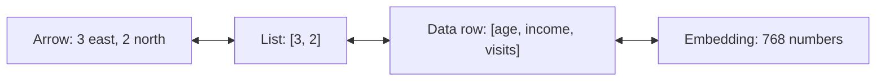
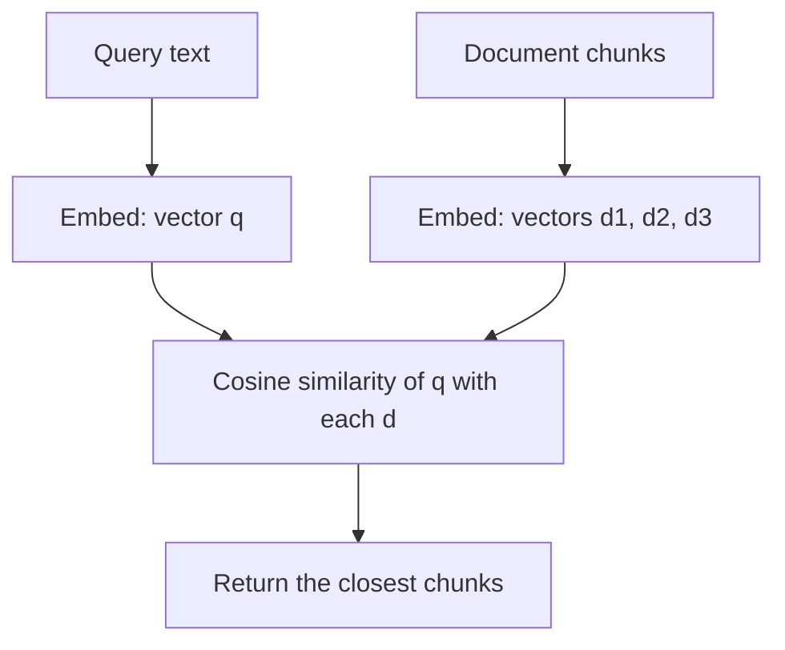

Almost everything in modern AI is stored as a **vector**: a word, a sentence, an image, a user's
taste in films, the chunk of a web page that YouCanDoIt's tutor retrieves from pgvector. If you
understand what a vector is, how to combine vectors and how to measure whether two of them "point
the same way", you understand the core of embeddings, semantic search and RAG. This session builds
that intuition the way [3Blue1Brown's Essence of Linear
Algebra](https://www.3blue1brown.com/topics/linear-algebra) does: pictures first, numbers second.
[Khan Academy's Linear Algebra course](https://www.khanacademy.org/math/linear-algebra) is the place
to drill the arithmetic if you want more exercises.

> [!NOTE]
> No maths degree needed. You need addition, multiplication and square roots. Everything else is
> a new name for something you can draw.

## Vectors as arrows and as lists of numbers

There are two ways to look at a vector, and fluency means switching between them freely.

**The arrow view (geometry).** A vector is an arrow from the origin: it has a **direction** and a
**length**. "Walk 3 steps east and 2 steps north" is a vector. Where you start doesn't matter, only
the displacement.

**The list view (data).** A vector is an ordered list of numbers, its **components**:
`v = [3, 2]`. The first number is how far along the x-axis, the second how far along the y-axis.
Order matters: `[3, 2]` and `[2, 3]` are different arrows.

The two views are the same object. The list is the arrow's "address" in a coordinate system.



The list view is what lets vectors escape two dimensions. A customer could be
`[34, 52000, 12]` (age, income, visits per month): a point in 3D space. An embedding from
`nomic-embed-text`, which YouCanDoIt uses, is a list of **768** numbers: an arrow in 768-dimensional
space. You can't picture 768 dimensions, and nobody can, but every rule you learn in 2D (adding,
scaling, measuring angles) works identically. That is the trick of linear algebra: **draw it in 2D,
compute it in any dimension**.

> [!TIP]
> The number of components is the vector's **dimension**. In NumPy that's `v.shape`, e.g. `(768,)`.
> A shape mismatch error is almost always "you tried to combine vectors of different dimensions".

A **vector space** is, informally, the "world" vectors live in: a set where you can add any two
vectors and scale any vector by a number and still stay inside the set. All lists of 2 real numbers
form the space ℝ² (the flat plane); all lists of 768 real numbers form ℝ⁷⁶⁸.

## Addition, scaling and linear combinations

**Addition: tip to tail.** To add `v = [3, 2]` and `w = [1, -1]`, put the tail of `w` on the tip of
`v` and see where you land. In numbers, add component by component:

```text
v + w = [3 + 1, 2 + (-1)] = [4, 1]
```

Analogy: two legs of a journey. The sum is the shortcut from start to finish.

**Scaling: stretch or flip.** Multiplying a vector by a single number (a **scalar**) stretches,
shrinks or reverses it:

```text
2 · [3, 2]    = [6, 4]      twice as long, same direction
0.5 · [3, 2]  = [1.5, 1]    half as long
-1 · [3, 2]   = [-3, -2]    same length, opposite direction
```

**Linear combinations.** Combine both operations and you get the most important idea in the
subject: a **linear combination** of vectors `v` and `w` is `a·v + b·w` for some scalars `a` and `b`.

> [!EXAMPLE]
> A smoothie recipe. Let `banana = [1, 0.1, 0]` and `spinach = [0.2, 0.3, 1]` be (sugar, protein,
> greenness) per portion. A smoothie of 2 bananas and 1 spinach is the linear combination
> `2·banana + 1·spinach = [2.2, 0.5, 1]`. Every possible smoothie made from those two ingredients is
> some linear combination of them.

The set of all vectors you can reach with linear combinations of some vectors is their **span**.
Two arrows pointing in different directions in 2D span the whole plane: any point can be reached.
Two arrows pointing along the same line only span that line; one of them is redundant, and we say
they are **linearly dependent**. The minimal set of vectors that spans a space is a **basis**, and
the standard basis of ℝ² is `i = [1, 0]` and `j = [0, 1]`. That's why `[3, 2]` really means
`3·i + 2·j`.

Why ML cares: a neural network layer computes weighted sums of its inputs, which are linear
combinations. The famous embedding trick `king - man + woman ≈ queen` is vector addition and
scaling on word vectors.

## Dot product, norms and cosine similarity

Now the tools for measuring.

**Norm (length).** The length of `v = [3, 4]` is Pythagoras: `‖v‖ = √(3² + 4²) = √25 = 5`. In
any dimension, square each component, add them, take the square root. This is the **L2 norm** or
Euclidean norm. A vector of length 1 is a **unit vector**; dividing a vector by its norm
**normalises** it, keeping the direction and discarding the length.

**Dot product.** For two vectors of the same dimension, multiply matching components and add:

```text
v = [3, 4], w = [4, 3]
v · w = 3·4 + 4·3 = 24
```

That's the algebra. The geometry is what makes it useful:

```text
v · w = ‖v‖ · ‖w‖ · cos(θ)
```

where θ is the angle between the arrows. So the dot product measures **how much two vectors point
the same way**, weighted by their lengths:

| Angle | cos θ | Dot product | Meaning |
| --- | --- | --- | --- |
| 0° | 1 | large positive | same direction |
| 90° | 0 | zero | **orthogonal**: unrelated |
| 180° | -1 | large negative | opposite directions |

Analogy: you push a box at an angle; the dot product is how much of your push actually goes in
the box's direction of travel.

**Cosine similarity.** Often you care about direction only, not length. A long document and a
short one on the same topic should count as similar. So divide the length out:

```text
cos_sim(v, w) = (v · w) / (‖v‖ · ‖w‖)
```

It ranges from -1 to 1. For `v = [3, 4]` and `w = [4, 3]`: `24 / (5 · 5) = 0.96`, very similar.



That diagram is semantic search, and it's what YouCanDoIt's RAG layer does with pgvector.

> [!TIP]
> If all vectors are normalised to length 1 first, cosine similarity **is** the dot product. Vector
> databases exploit this: normalise once at insert time, then use the cheaper dot product at query
> time.

> [!WARNING]
> Cosine similarity of 0.8 doesn't mean "80% similar" in any human sense. Scores depend on the
> embedding model; one model's "close" might be 0.85, another's 0.5. Compare scores only within one
> model, and rank rather than threshold when you can.

## Practice: compute cosine similarity between word vectors with NumPy

You'll implement the formulas by hand, check them against NumPy, and then try them on tiny made-up
"word vectors". Allow about 45 minutes.

### Step 1: Setup

```sh
python -m venv .venv && source .venv/bin/activate
pip install numpy
```

### Step 2: Implement from scratch

```python
import math

def dot(v, w):
    assert len(v) == len(w), "vectors must have the same dimension"
    return sum(a * b for a, b in zip(v, w))

def norm(v):
    return math.sqrt(dot(v, v))

def cosine(v, w):
    return dot(v, w) / (norm(v) * norm(w))

print(dot([3, 4], [4, 3]))     # 24
print(norm([3, 4]))            # 5.0
print(cosine([3, 4], [4, 3]))  # 0.96
```

Notice `norm(v)` is just `√(v · v)`: the length is the dot product of a vector with itself.

### Step 3: The NumPy version

```python
import numpy as np

def np_cosine(v, w):
    v, w = np.asarray(v, float), np.asarray(w, float)
    return v @ w / (np.linalg.norm(v) * np.linalg.norm(w))

assert abs(np_cosine([3, 4], [4, 3]) - cosine([3, 4], [4, 3])) < 1e-12
```

`@` is the dot product operator for 1D arrays.

### Step 4: Toy word vectors

Hand-make 4-dimensional vectors where the dimensions mean (royalty, masculinity, femininity,
food):

```python
words = {
    "king":  np.array([0.9, 0.8, 0.1, 0.0]),
    "queen": np.array([0.9, 0.1, 0.8, 0.0]),
    "man":   np.array([0.1, 0.9, 0.1, 0.0]),
    "woman": np.array([0.1, 0.1, 0.9, 0.0]),
    "pizza": np.array([0.0, 0.1, 0.1, 0.9]),
}

for a in words:
    print(a, {b: round(np_cosine(words[a], words[b]), 2) for b in words})

target = words["king"] - words["man"] + words["woman"]
print(max(words, key=lambda w: np_cosine(target, words[w])))   # queen
```

Check that `king` and `queen` score higher with each other than with `pizza`, and that the analogy
lands on `queen`.

### Step 5: Real embeddings (optional)

If you have Ollama reachable on `localhost:11434` (a local install, or YouCanDoIt's `ollama`
service with its commented-out `ports` line enabled in `docker-compose.yml`) and
`nomic-embed-text` pulled, embed real sentences and compare:

```python
import requests

def embed(text):
    r = requests.post("http://localhost:11434/api/embeddings",
                      json={"model": "nomic-embed-text", "prompt": text})
    return np.array(r.json()["embedding"])

a, b, c = embed("How do I reset my password?"), embed("I forgot my login"), embed("Best pasta recipe")
print(a.shape, np_cosine(a, b), np_cosine(a, c))
```

You should see shape `(768,)` and a clearly higher score for the password pair. Write down one
sentence explaining why cosine, not raw dot product, is the right choice here.
