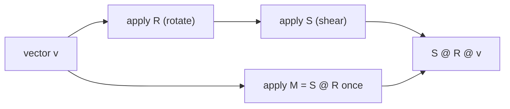
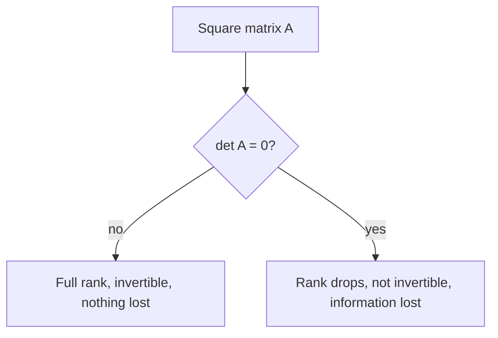

In session 7.1.1 vectors were arrows and lists. A **matrix** is the next step up: a grid of
numbers that, viewed the right way, is a machine that **moves every arrow in space at once**. A
neural network layer is exactly such a machine (plus a bias and a non-linearity), so "a model with
7 billion parameters" mostly means "a lot of numbers arranged in matrices". This session follows
the geometric approach of [3Blue1Brown's Essence of Linear
Algebra](https://www.3blue1brown.com/topics/linear-algebra), chapters 3 to 7, and uses [Khan
Academy's Linear Algebra course](https://www.khanacademy.org/math/linear-algebra) for practice
exercises.

> [!NOTE]
> Notation used below: a matrix is written as rows in square brackets, `[[a, b], [c, d]]`, the
> same way NumPy prints it. `A @ v` means "apply matrix A to vector v", as in Python.

## Matrices as transformations

Imagine the plane covered in a square grid of graph paper. A **linear transformation** moves every
point of the plane, with two rules:

1. Grid lines stay **straight and parallel** (and evenly spaced).
2. The **origin stays put**.

Rotations, stretches, reflections and shears all qualify. Bending or shifting does not.

Here's the key insight: because of those rules, you only need to know where the two basis
vectors `i = [1, 0]` and `j = [0, 1]` land. Every other vector `[x, y]` is `x·i + y·j`, a linear
combination, and it lands at `x·(new i) + y·(new j)`. So write the landing spots of `i` and `j` as
the **columns** of a grid, and that grid is the matrix:

```text
A = [[a, b],      column 1 = where i lands = [a, c]
     [c, d]]      column 2 = where j lands = [b, d]

A @ [x, y] = x·[a, c] + y·[b, d] = [a·x + b·y, c·x + d·y]
```

> [!EXAMPLE]
> Rotate 90° anticlockwise. `i = [1, 0]` lands at `[0, 1]`; `j = [0, 1]` lands at `[-1, 0]`. So
> the matrix is `[[0, -1], [1, 0]]`. Apply it to `[3, 2]`: `3·[0, 1] + 2·[-1, 0] = [-2, 3]`. Draw it:
> the arrow has turned a quarter turn left.

A small catalogue to build intuition:

| Matrix | Effect |
| --- | --- |
| `[[1, 0], [0, 1]]` | identity: nothing moves |
| `[[2, 0], [0, 2]]` | scale everything by 2 |
| `[[2, 0], [0, 1]]` | stretch horizontally only |
| `[[1, 1], [0, 1]]` | shear: slide the top sideways |
| `[[-1, 0], [0, 1]]` | mirror across the y-axis |
| `[[0, -1], [1, 0]]` | rotate 90° |

Matrices don't have to be square. A 3×2 matrix (3 rows, 2 columns) takes 2D vectors to 3D; a
2×768 matrix squashes a 768-dimensional embedding down to 2D. A dense neural network layer with 768
inputs and 256 outputs holds a 256×768 weight matrix.

## Matrix multiplication and composition

What if you rotate and then shear? Applying one transformation after another is **composition**,
and the matrix for the combined move is the **product** of the two matrices.



Note the order: `S @ R` means "**first R, then S**", read right to left, like function composition
`f(g(x))`.

**How to compute it.** Each column of the product is the first matrix applied to the matching
column of the second. Equivalently, the entry in row `i`, column `j` of `A @ B` is the dot product
of row `i` of `A` with column `j` of `B`:

```text
A = [[1, 2],    B = [[5, 6],
     [3, 4]]         [7, 8]]

A @ B = [[1·5 + 2·7, 1·6 + 2·8],    = [[19, 22],
         [3·5 + 4·7, 3·6 + 4·8]]       [43, 50]]
```

**Shape rule.** `(m × n) @ (n × p)` gives `(m × p)`. The inner numbers must match: the "output size"
of the first transformation applied must be the "input size" of the second.

> [!WARNING]
> Matrix multiplication is **not commutative**: in general `A @ B ≠ B @ A`. Rotating then shearing
> lands somewhere different from shearing then rotating. Try it with a book on your desk. It is,
> however, associative: `(A @ B) @ C = A @ (B @ C)`.

> [!TIP]
> In NumPy, `A * B` is element-by-element multiplication, **not** the matrix product. Use `A @ B`
> (or `np.matmul`). Mixing these up is the most common linear algebra bug in Python.

Why ML cares: a forward pass through a network is a chain of matrix products (with non-linear
functions in between). GPUs are, at heart, machines for doing enormous matrix multiplications fast.

## Determinant, inverse and rank

Three numbers-and-properties that tell you what a transformation does to space.

**Determinant: how areas scale.** Take the unit square formed by `i` and `j` (area 1). After the
transformation, it becomes a parallelogram. The **determinant** is that parallelogram's area,
signed:

```text
det([[a, b], [c, d]]) = a·d - b·c
```

| det | Meaning |
| --- | --- |
| 3 | areas get 3 times bigger |
| 0.5 | areas halve |
| negative | space is flipped (like a mirror) |
| **0** | space is squashed onto a line or a point |

Example: `det([[2, 0], [0, 2]]) = 4`: scaling by 2 in both directions quadruples area. A rotation
has determinant 1: areas don't change.

**Inverse: the undo button.** The **inverse** `A⁻¹` is the transformation that puts everything
back: `A⁻¹ @ A = I` (the identity). For a 90° rotation, the inverse is a 90° rotation the other
way. Inverses are how you solve systems of linear equations: if `A @ x = b`, then `x = A⁻¹ @ b`.

But you can only undo a move that didn't destroy information. If the determinant is 0, the plane
was flattened onto a line; many different points landed on the same spot, so there is no way to
know where each came from. **A matrix is invertible exactly when its determinant is non-zero.**

**Rank: how many dimensions survive.** The **rank** is the number of dimensions in the output. A
2×2 matrix that keeps the plane a plane has rank 2 (**full rank**); one that squashes it to a line
has rank 1. Equivalently, rank is the number of linearly independent columns.



> [!NOTE]
> Rank shows up in modern ML. **LoRA**, a popular way to fine-tune large language models, learns a
> weight update as the product of two thin matrices, which forces that update to have low rank and
> so needs far fewer trainable numbers. Session 7.1.3's SVD is the tool that finds low-rank
> approximations.

> [!WARNING]
> In real code, avoid computing `np.linalg.inv(A) @ b` to solve equations. `np.linalg.solve(A, b)`
> is faster and numerically more stable. Near-zero determinants mean the answer is very sensitive
> to rounding errors.

## Practice: implement matrix multiplication and compare with NumPy

You'll write matrix multiplication by hand, test it, time it against NumPy, and verify the
geometric claims above. Allow about 1 hour.

### Step 1: The naive version

```python
def matmul(A, B):
    n, m, p = len(A), len(B), len(B[0])
    assert all(len(row) == m for row in A), "inner dimensions must match"
    C = [[0.0] * p for _ in range(n)]
    for i in range(n):
        for j in range(p):
            C[i][j] = sum(A[i][k] * B[k][j] for k in range(m))
    return C

print(matmul([[1, 2], [3, 4]], [[5, 6], [7, 8]]))   # [[19, 22], [43, 50]]
```

Three nested loops: for an n×n matrix that's about n³ multiplications.

### Step 2: Check against NumPy

```python
import numpy as np

rng = np.random.default_rng(0)
for shape in [(2, 3, 4), (5, 5, 5), (1, 7, 1)]:
    n, m, p = shape
    A, B = rng.normal(size=(n, m)), rng.normal(size=(m, p))
    assert np.allclose(matmul(A.tolist(), B.tolist()), A @ B), shape
print("all good")
```

Use `np.allclose`, not `==`: floating-point sums in a different order differ in the last digits.

### Step 3: Time it

```python
import time

A, B = rng.normal(size=(200, 200)), rng.normal(size=(200, 200))
t = time.perf_counter(); matmul(A.tolist(), B.tolist()); slow = time.perf_counter() - t
t = time.perf_counter(); A @ B; fast = time.perf_counter() - t
print(f"python {slow:.3f}s  numpy {fast:.5f}s  speed-up x{slow / fast:.0f}")
```

Expect NumPy to win by a factor in the hundreds or more: it calls optimised BLAS libraries written
in C/Fortran that use CPU vector instructions and multiple cores.

### Step 4: Verify the geometry

```python
R = np.array([[0, -1], [1, 0]])      # rotate 90°
S = np.array([[1, 1], [0, 1]])       # shear
print(S @ R, R @ S)                  # different: order matters
print(np.linalg.det(R), np.linalg.det(np.array([[2, 0], [0, 2]])))   # 1.0, 4.0
flat = np.array([[1, 2], [2, 4]])    # second column = 2 × first
print(np.linalg.det(flat), np.linalg.matrix_rank(flat))              # ~0, 1
print(np.linalg.inv(R) @ R)          # identity
```

Then try `np.linalg.inv(flat)` and read the error.

### Step 5: Explain

In a few sentences in a notes file: why does `(2×3) @ (3×4)` work but `(2×3) @ (2×3)` fail, in
terms of transformations? Why does a zero determinant mean no inverse?
