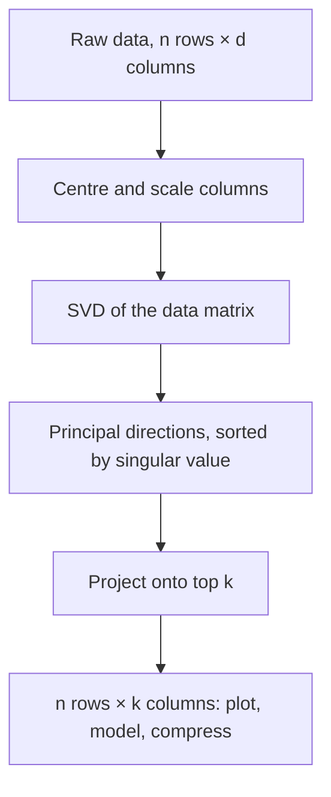

Most transformations knock vectors off their original direction. But almost every matrix has a few
special directions where vectors only get **stretched or shrunk**, never turned. Those directions,
**eigenvectors**, reveal what a matrix "really does". Generalise the idea and you get the **singular
value decomposition (SVD)**, which splits any matrix into simple pieces, and **principal component
analysis (PCA)**, which uses it to compress data with many columns into a few that keep most of the
information. The visual intuition comes from [3Blue1Brown's Essence of Linear
Algebra](https://www.3blue1brown.com/topics/linear-algebra) (the eigenvectors chapter); the ML
context from the [Google ML Crash Course](https://developers.google.com/machine-learning/crash-course).

> [!NOTE]
> This session builds on 7.1.2: a matrix is a transformation, `A @ v` applies it, and the
> determinant measures how areas scale.

## Eigenvalues and eigenvectors

Picture a shear transformation on a sheet of rubber with arrows drawn on it. Most arrows tilt to a
new direction. But arrows lying along the bottom edge just slide along their own line. They stay on
their own **span**. Those are eigenvectors.

Formally, a non-zero vector `v` is an **eigenvector** of a square matrix `A` if

```text
A @ v = λ · v
```

for some number `λ` (lambda), the **eigenvalue**. Applying the matrix does the same as multiplying
by a plain number: the vector keeps its line and gets scaled by `λ`.

| Eigenvalue λ | What happens along that direction |
| --- | --- |
| λ > 1 | stretched |
| 0 < λ < 1 | shrunk |
| λ < 0 | flipped and scaled |
| λ = 0 | squashed to zero (so det A = 0) |

> [!EXAMPLE]
> `A = [[3, 0], [0, 2]]` stretches x by 3 and y by 2. `[1, 0]` is an eigenvector with λ = 3,
> `[0, 1]` one with λ = 2. Any other vector, say `[1, 1]`, becomes `[3, 2]` and changes direction.
> A trickier one: `A = [[2, 1], [1, 2]]`. Try `v = [1, 1]`: `A @ v = [3, 3] = 3·v`, so λ = 3. Try
> `v = [1, -1]`: `A @ v = [1, -1]`, so λ = 1.

**Why care?** Eigenvectors give a matrix its natural coordinate system. Describe vectors in the
eigenvector basis and the transformation becomes pure stretching along each axis, which is easy to
reason about and fast to apply repeatedly: applying `A` a hundred times multiplies each eigen-direction
by `λ¹⁰⁰`. Directions with |λ| > 1 explode; those with |λ| < 1 fade. That's the intuition behind
exploding and vanishing gradients in deep networks, and behind Google's original PageRank, which
ranks pages by the leading eigenvector of a link matrix.

> [!WARNING]
> Not every matrix has real eigenvectors. A 90° rotation turns *every* vector, so in the real plane
> it has none (its eigenvalues are complex numbers). Symmetric matrices, which include covariance
> matrices used in PCA, always have real eigenvalues and perpendicular eigenvectors.

## Singular value decomposition

Eigen-decomposition only works for some square matrices. Data matrices are rarely square: 10,000
rows of customers by 20 columns of features. The **SVD** works for **any** matrix:

```text
A = U @ Σ @ Vᵀ
```

Geometrically, every linear transformation, however messy, is three simple moves in sequence
(read right to left):


- `Vᵀ` and `U` are rotations (possibly with a reflection). Their columns are orthonormal: unit
  length and mutually perpendicular.
- `Σ` (sigma) is diagonal; its entries `σ₁ ≥ σ₂ ≥ … ≥ 0` are the **singular values**, sorted from
  largest to smallest. They say how much stretch happens along each direction.

The killer feature: **the singular values rank directions by importance**. Keep only the top `k`
singular values (and the matching columns of `U` and `V`), throw the rest away, and you get the
**best possible rank-k approximation** of `A` (the Eckart–Young theorem).

> [!EXAMPLE]
> A greyscale image is a matrix of pixel brightnesses, say 1000×1000. Its SVD might show the first
> 50 singular values are large and the remaining 950 are tiny. Keep 50: you store
> `1000·50 + 50 + 50·1000 ≈ 100,050` numbers instead of 1,000,000, and the picture looks almost the
> same. That's compression by dropping unimportant directions.

Where SVD shows up in practice: recommendation systems (factorising a users × items ratings matrix
into "taste" factors), latent semantic analysis of text, the low-rank fine-tuning idea behind LoRA,
solving least-squares problems robustly, and, next, PCA.

> [!TIP]
> In NumPy: `U, S, Vt = np.linalg.svd(A, full_matrices=False)`. `S` comes back as a 1D array of
> singular values, already sorted, not as a diagonal matrix. Rebuild with `U @ np.diag(S) @ Vt`.

## Principal component analysis

You have a dataset with many columns: the 4 flower measurements of the Iris dataset, or 768
embedding dimensions. You want to plot it, speed up a model, or remove noise. **PCA** finds new axes,
the **principal components**, ordered so the first captures the most variation in the data, the
second the most of what remains (perpendicular to the first), and so on. Keep the first two and you
have a 2D view that preserves as much spread as any 2D linear projection can.

Analogy: photographing a 3D object. Some camera angles show its shape clearly; looking at a
pencil end-on shows just a dot. PCA picks the angle that shows the most spread.

The recipe:

1. **Centre** the data: subtract each column's mean, so the cloud sits around the origin.
2. (Usually) **scale** each column to unit variance, so a column in grams doesn't dominate one in
   kilograms purely because its numbers are bigger.
3. Compute the SVD of the centred data matrix `X = U Σ Vᵀ`. The rows of `Vᵀ` are the principal
   directions. (Equivalently: the eigenvectors of the covariance matrix `XᵀX / (n-1)`.)
4. **Project**: `X @ Vᵀ[:k].T` gives each row's coordinates on the top `k` components.
5. Check **explained variance**: `σᵢ² / Σσ²` is the fraction of total variance each component
   keeps.



> [!WARNING]
> PCA is **linear** and **unsupervised**. It finds directions of large variance, which isn't
> always the direction that separates your classes. And principal components are mixes of all
> original columns, so "component 1" rarely has a clean human meaning. For visualising complex
> structure (like embedding clusters), non-linear methods such as t-SNE or UMAP often look better;
> PCA is still the fast, deterministic first step.

The [Google ML Crash Course](https://developers.google.com/machine-learning/crash-course) treats
feature engineering and embeddings as central skills; PCA is the classic tool when you have too many
correlated features.

## Practice: reduce a dataset to 2D with PCA and plot it

You'll implement PCA with NumPy's SVD on the Iris dataset (150 flowers, 4 measurements, 3 species),
check it against scikit-learn, and plot it. Allow about 1 hour.

### Step 1: Setup

```sh
pip install numpy scikit-learn matplotlib
```

### Step 2: Load and centre

```python
import numpy as np
from sklearn.datasets import load_iris

iris = load_iris()
X, y = iris.data, iris.target          # X.shape == (150, 4)
Xc = (X - X.mean(axis=0)) / X.std(axis=0)
```

### Step 3: PCA by hand

```python
U, S, Vt = np.linalg.svd(Xc, full_matrices=False)
explained = S**2 / np.sum(S**2)
print("explained variance ratio:", explained.round(3))
Z = Xc @ Vt[:2].T                      # (150, 2)
```

Expect the first two components to keep well over 90% of the variance between them. Print `Vt[0]`:
which original measurements weigh most on component 1?

### Step 4: Compare with scikit-learn

```python
from sklearn.decomposition import PCA

Z_sk = PCA(n_components=2).fit_transform(Xc)
for i in range(2):                     # components are defined up to sign
    assert np.allclose(np.abs(Z[:, i]), np.abs(Z_sk[:, i]))
print("matches sklearn")
```

### Step 5: Plot

```python
import matplotlib.pyplot as plt

for label, name in enumerate(iris.target_names):
    pts = Z[y == label]
    plt.scatter(pts[:, 0], pts[:, 1], label=name, alpha=0.7)
plt.xlabel(f"PC1 ({explained[0]:.0%})"); plt.ylabel(f"PC2 ({explained[1]:.0%})")
plt.legend(); plt.title("Iris projected onto 2 principal components")
plt.savefig("iris_pca.png", dpi=150)
```

One species should separate cleanly; the other two overlap a bit. PCA never saw the labels: the
structure is in the measurements themselves.

### Step 6: Stretch goal

Verify the eigen connection: compute `np.linalg.eigh(np.cov(Xc, rowvar=False))` and check that its
eigenvalues equal `S**2 / (len(Xc) - 1)` (sorted) and its eigenvectors match the rows of `Vt` up
to sign.
