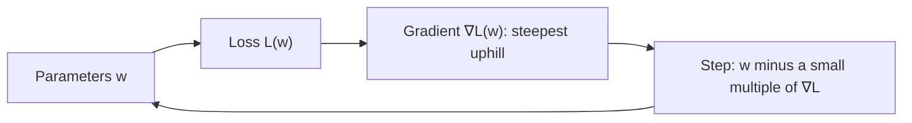

Training a model means repeatedly asking one question: **if I nudge this parameter a little, does
the error go up or down, and by how much?** The derivative answers that question for one parameter;
the **gradient** answers it for millions at once. This session builds the idea from scratch:
what "rate of change" really means, the handful of rules that let you compute derivatives quickly,
and how partial derivatives assemble into a gradient. The intuitions follow [3Blue1Brown's Essence
of Calculus](https://www.3blue1brown.com/topics/calculus); for drill exercises use [Khan Academy's
Calculus 1](https://www.khanacademy.org/math/calculus-1).

> [!NOTE]
> You won't need to differentiate by hand at work: PyTorch and JAX do it automatically. You need
> to know **what** a gradient is so you can read loss curves, debug training and understand why
> learning rates matter.

## Limits and the derivative as rate of change

Think of a car's speedometer. Your average speed over a trip is distance divided by time. But the
speedometer shows speed **right now**, at a single instant. How can you divide by a time interval of
zero?

You don't. You take shorter and shorter intervals and see what the average speed **approaches**.
That "approaches" is a **limit**.

For a function `f(x)`, the average rate of change between `x` and `x + h` is the slope of the line
through those two points:

```text
(f(x + h) - f(x)) / h
```

The **derivative** `f'(x)` is what that ratio approaches as `h` shrinks towards 0:

```text
f'(x) = lim (h → 0) of (f(x + h) - f(x)) / h
```

Geometrically: zoom in on a smooth curve far enough and it looks like a straight line. The
derivative is the **slope of that line**, the tangent.

> [!EXAMPLE]
> `f(x) = x²` at `x = 3`. Try shrinking `h`:
>
> | h | (f(3+h) - f(3)) / h |
> | --- | --- |
> | 1 | (16 - 9) / 1 = 7 |
> | 0.1 | (9.61 - 9) / 0.1 = 6.1 |
> | 0.01 | 6.01 |
> | 0.001 | 6.001 |
>
> The ratio approaches **6**. Algebraically `((3+h)² - 9) / h = 6 + h`, which goes to 6. So
> `f'(3) = 6`: near x = 3, the output grows about 6 times as fast as the input.

How to read a derivative:

| f'(x) | Meaning |
| --- | --- |
| positive | f is going up as x increases |
| negative | f is going down |
| zero | flat: possibly a minimum, maximum or plateau |
| large magnitude | steep: small change in x, big change in f |

That "zero means flat, possibly a minimum" row is the whole reason ML cares: training searches for
the minimum of a loss function.

## Rules of differentiation

Computing limits every time would be painful. A few rules cover almost everything:

| Rule | Function | Derivative |
| --- | --- | --- |
| Constant | `c` | `0` |
| Power | `xⁿ` | `n·xⁿ⁻¹` |
| Constant multiple | `c·f(x)` | `c·f'(x)` |
| Sum | `f(x) + g(x)` | `f'(x) + g'(x)` |
| Product | `f(x)·g(x)` | `f'(x)·g(x) + f(x)·g'(x)` |
| Exponential | `eˣ` | `eˣ` |
| Logarithm | `ln(x)` | `1/x` |
| Chain (preview) | `f(g(x))` | `f'(g(x))·g'(x)` |

> [!EXAMPLE]
> `f(x) = 3x² + 5x - 7`. Power rule on each term, sum rule to combine:
> `f'(x) = 6x + 5`. At `x = 2`, the slope is 17.

Why these rules make sense, intuitively (3Blue1Brown shows them as growing areas): for `x²`, picture
a square of side `x`. Grow the side by a sliver `dx` and the area gains two thin strips of size
`x·dx` each (plus a negligible corner), so the area grows at `2x`. That's the power rule for `n = 2`.

Two functions you'll meet constantly in ML:

- **Sigmoid** `σ(x) = 1 / (1 + e⁻ˣ)` squashes any number into (0, 1). Its derivative has a neat
  form: `σ'(x) = σ(x)·(1 - σ(x))`. It is at most 0.25, which is one reason deep stacks of sigmoids
  learn slowly (vanishing gradients).
- **ReLU** `max(0, x)` has derivative 0 for negative x and 1 for positive x. Simple and fast; it's
  the default activation in many networks.

> [!TIP]
> You'll use the chain rule more than any other, because neural networks are functions nested
> inside functions. Session 7.2.2 gives it a full treatment.

## Partial derivatives and the gradient

Real models have many inputs. A house price model `price(size, rooms)` depends on two variables; a
language model's loss depends on billions of weights.

A **partial derivative** asks: how does the output change if I nudge **one** input and freeze all
the others? It is written `∂f/∂x` (the curly ∂ signals "partial"). You compute it by treating the
other variables as constants.

> [!EXAMPLE]
> `f(x, y) = x² + 3xy + y²`.
> - `∂f/∂x`: treat y as a constant. `2x + 3y`.
> - `∂f/∂y`: treat x as a constant. `3x + 2y`.
>
> At the point (1, 2): `∂f/∂x = 8`, `∂f/∂y = 7`.

Stack all the partial derivatives into a vector and you get the **gradient**, written `∇f`
("nabla f"):

```text
∇f(x, y) = [∂f/∂x, ∂f/∂y]     at (1, 2): [8, 7]
```

Analogy: you're standing on a hillside in fog. The gradient is an arrow on the ground that points
**uphill in the steepest direction**, and its length says how steep that is. Walk the opposite way,
`-∇f`, and you go downhill fastest. That's gradient descent, the topic of 7.2.2.



Key facts about the gradient:

- It lives in **input space**: one component per parameter. A model with 10 million weights has a
  10-million-component gradient.
- At a minimum (or maximum, or saddle point) it is the **zero vector**: the ground is flat in every
  direction.
- It's a vector from session 7.1.1, so everything about dot products applies: the rate of change in
  any direction `u` (a unit vector) is `∇f · u`.

> [!WARNING]
> A zero gradient doesn't guarantee a minimum. In high dimensions, **saddle points** (uphill in
> some directions, downhill in others, like a horse saddle) are common. Training methods with a bit
> of noise, like the stochastic gradient descent in 7.2.2, tend to escape them.

## Practice: numerically approximate gradients in Python

You'll approximate derivatives with the limit definition, compare against the exact rules, and
build a reusable numerical gradient function, the same "gradient check" ML engineers use to test
backpropagation code. Allow about 45 minutes.

### Step 1: One variable

```python
def numerical_derivative(f, x, h=1e-5):
    return (f(x + h) - f(x - h)) / (2 * h)   # central difference: more accurate than one-sided

f = lambda x: 3 * x**2 + 5 * x - 7
print(numerical_derivative(f, 2.0))           # ≈ 17.0, exact f'(2) = 6·2 + 5 = 17
```

The central difference `(f(x+h) - f(x-h)) / 2h` has error proportional to `h²` instead of `h`.

### Step 2: Watch the limit and its limits

```python
for h in [1, 1e-1, 1e-3, 1e-5, 1e-8, 1e-12]:
    approx = (f(2 + h) - f(2)) / h
    print(f"h={h:<8g} approx={approx:.10f} error={abs(approx - 17):.2e}")
```

The error shrinks as `h` shrinks, until around `1e-8` where it gets *worse*. Floating-point numbers
have about 16 significant digits; subtracting two nearly equal numbers loses them. Math says "h to
zero"; computers say "not too small".

### Step 3: The gradient of a multi-variable function

```python
import numpy as np

def numerical_gradient(f, x, h=1e-5):
    x = np.asarray(x, dtype=float)
    grad = np.zeros_like(x)
    for i in range(x.size):
        step = np.zeros_like(x); step[i] = h
        grad[i] = (f(x + step) - f(x - step)) / (2 * h)
    return grad

f2 = lambda p: p[0]**2 + 3 * p[0] * p[1] + p[1]**2
exact = lambda p: np.array([2 * p[0] + 3 * p[1], 3 * p[0] + 2 * p[1]])
p = np.array([1.0, 2.0])
print(numerical_gradient(f2, p), exact(p))   # both ≈ [8, 7]
assert np.allclose(numerical_gradient(f2, p), exact(p), atol=1e-6)
```

### Step 4: A gradient check for sigmoid

```python
sigmoid = lambda x: 1 / (1 + np.exp(-x))
for x in [-4.0, 0.0, 2.5]:
    exact_d = sigmoid(x) * (1 - sigmoid(x))
    assert abs(numerical_derivative(sigmoid, x) - exact_d) < 1e-8
print("sigmoid derivative formula verified")
```

### Step 5: Reflect

Count the function evaluations `numerical_gradient` needs: 2 per parameter. For a model with 100
million parameters, that's 200 million forward passes for **one** gradient. Write a sentence on why
that makes numerical gradients useless for training but great for testing. (The answer, automatic
differentiation via the chain rule, is session 7.2.2.)
