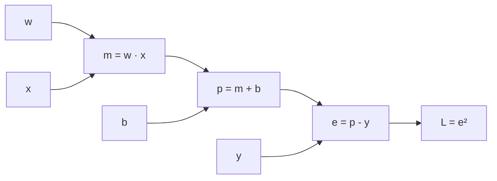
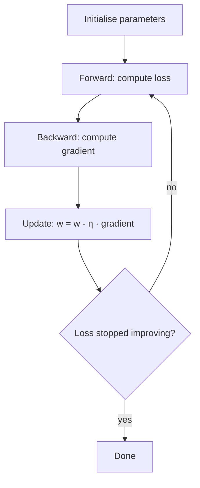

Session 7.2.1 ended with a problem: numerical gradients need two function evaluations per
parameter, hopeless for a model with millions of weights. This session gives the two ideas that
solve it and that, together, train essentially every neural network: the **chain rule**, which
lets a computer get all the gradients in roughly one backward sweep (backpropagation), and
**gradient descent**, which uses those gradients to walk downhill on the loss. The intuition follows
[3Blue1Brown's Essence of Calculus](https://www.3blue1brown.com/topics/calculus); the code-first
view is the one in [Karpathy's Neural Networks: Zero to Hero](https://karpathy.ai/zero-to-hero.html),
whose first lecture builds a tiny autograd engine, micrograd, from scratch.

> [!TIP]
> After this lesson, watch the first Zero to Hero video. It turns everything below into about a
> hundred lines of Python and is the best bridge from maths to PyTorch.

## The chain rule and computational graphs

**Analogy: gears.** Gear A turns gear B, which turns gear C. If B turns 3 times per turn of A, and
C turns 2 times per turn of B, then C turns 3 × 2 = 6 times per turn of A. Rates of change
**multiply** along a chain.

That's the **chain rule**. If `y = f(g(x))`, write `u = g(x)`; then

```text
dy/dx = dy/du · du/dx = f'(g(x)) · g'(x)
```

> [!EXAMPLE]
> `y = (3x + 1)²`. Inner: `u = 3x + 1`, so `du/dx = 3`. Outer: `y = u²`, so `dy/du = 2u`.
> Multiply: `dy/dx = 2(3x + 1) · 3 = 6(3x + 1)`. At `x = 1`: `24`.

**Computational graphs.** A computer sees any formula as a graph of tiny operations. Take a
one-neuron model with squared-error loss, for one data point `(x, y)`:



**Forward pass:** compute left to right and remember each intermediate value. **Backward pass:**
start at the end with `dL/dL = 1` and walk right to left, multiplying by each node's **local
derivative**:

```text
dL/de = 2e
dL/dp = dL/de · de/dp = 2e · 1
dL/db = dL/dp · dp/db = 2e · 1
dL/dm = dL/dp · dp/dm = 2e · 1
dL/dw = dL/dm · dm/dw = 2e · x
```

Each node only needs to know its own simple derivative; the chain rule stitches them together.
When a value feeds several later nodes, the gradients arriving from each path are **added**.

This backward walk is **backpropagation**, and doing it automatically is **automatic
differentiation** (autodiff). The key fact: one forward pass plus one backward pass gives the
gradient for **all** parameters, at a cost of a small constant multiple of the forward pass,
whether there are 2 parameters or 2 billion. That's what PyTorch's `loss.backward()` does.

> [!NOTE]
> Vanishing gradients, from 7.2.1, are the chain rule's downside: multiply many local derivatives
> smaller than 1 (like sigmoid's ≤ 0.25) and the product shrinks towards zero, so early layers barely
> learn. ReLU activations, careful initialisation and residual connections are all fixes.

## Gradient descent and learning rate

You have a **loss function** `L(w)` that measures how wrong the model is, and its gradient `∇L(w)`
that points uphill. **Gradient descent** repeats one step:

```text
w ← w - η · ∇L(w)
```

`η` (eta) is the **learning rate**: how big a step to take. Analogy: descending a foggy mountain
by feeling the slope under your feet. Each step goes downhill; step size is your choice.



The learning rate is the single most important knob:

| Learning rate | What you see in the loss curve |
| --- | --- |
| Too small | Loss falls painfully slowly; training takes forever |
| About right | Loss falls quickly, then flattens |
| Too large | Loss bounces around or zig-zags without settling |
| Far too large | Loss explodes to `inf` or `nan` |

> [!EXAMPLE]
> Minimise `L(w) = (w - 3)²`, gradient `2(w - 3)`, start at `w = 0`.
> With η = 0.1: `w` goes 0 → 0.6 → 1.08 → 1.46 → … smoothly approaching 3.
> With η = 1.1: `w` goes 0 → 6.6 → -1.32 → 8.18 → … overshooting further each time: divergence.

> [!WARNING]
> Gradient descent finds a **local** minimum: the bottom of whatever valley you start in. For
> convex losses like linear regression's there's only one valley, so that's fine. For neural
> networks there are many, but in practice the minima found by modern training work well enough.

Practitioners rarely use the plain update. **Momentum** keeps a running average of past gradients
(like a ball rolling downhill that builds speed and smooths out zig-zags), and **Adam** additionally
adapts the step size per parameter. Learning-rate **schedules** start larger and decay over time.
All are refinements of the same `w ← w - η · gradient` idea.

## Stochastic and mini-batch gradient descent

The loss of a model is usually an **average over the training set**:
`L = (1/N) · Σ loss(example i)`. Its gradient is the average of per-example gradients. With a
million examples, computing the exact gradient for **one** step means a pass over all million. Slow.

Three variants trade accuracy of each step for speed:

| Variant | Gradient computed on | Steps per pass over data | Character |
| --- | --- | --- | --- |
| **Batch** GD | All N examples | 1 | Exact, smooth, slow; memory-hungry |
| **Stochastic** GD (SGD) | 1 random example | N | Very noisy, very cheap steps |
| **Mini-batch** GD | B random examples (e.g. 32–512) | N / B | The practical default |

Analogy: estimating the average opinion of a city. Asking everyone (batch) is exact and slow; asking
one random person (SGD) is fast and unreliable; asking a random group of 64 (mini-batch) is a good
estimate at a fraction of the cost.

Why mini-batch wins:

- **Speed:** many cheap, slightly noisy steps beat few expensive exact ones.
- **Hardware:** GPUs process a batch of 64 examples in parallel almost as fast as one.
- **Noise helps:** the randomness jostles the parameters out of saddle points and shallow minima.

Vocabulary: one full pass over the training data is an **epoch**. Shuffle the data each epoch so
batches differ. "SGD" in libraries (`torch.optim.SGD`) almost always means mini-batch in practice.

> [!TIP]
> Batch size and learning rate interact: larger batches give less noisy gradients and usually
> tolerate a larger learning rate. If you change one, re-tune the other.

## Practice: fit a line with hand-written gradient descent

You'll fit `y = w·x + b` to noisy data using only NumPy, derive the gradients with the chain rule,
check them numerically, and compare full-batch with mini-batch. Allow about 1 to 1.5 hours.

### Step 1: Make data with a known answer

```python
import numpy as np

rng = np.random.default_rng(42)
N = 1_000
x = rng.uniform(-3, 3, size=N)
y = 2.5 * x - 1.0 + rng.normal(0, 0.5, size=N)   # true w = 2.5, b = -1.0
```

### Step 2: Loss and gradients via the chain rule

Mean squared error: `L = mean((w·x + b - y)²)`. With `e = w·x + b - y`, the graph from the first
section gives `dL/dw = mean(2·e·x)` and `dL/db = mean(2·e)`.

```python
def loss_and_grads(w, b, x, y):
    e = w * x + b - y
    return np.mean(e**2), np.mean(2 * e * x), np.mean(2 * e)
```

### Step 3: Gradient check

Reuse the idea from 7.2.1 to confirm the formulas before trusting them:

```python
w0, b0, h = 0.3, 0.7, 1e-6
_, gw, gb = loss_and_grads(w0, b0, x, y)
num_gw = (loss_and_grads(w0 + h, b0, x, y)[0] - loss_and_grads(w0 - h, b0, x, y)[0]) / (2 * h)
num_gb = (loss_and_grads(w0, b0 + h, x, y)[0] - loss_and_grads(w0, b0 - h, x, y)[0]) / (2 * h)
assert abs(gw - num_gw) < 1e-4 and abs(gb - num_gb) < 1e-4
```

### Step 4: Full-batch gradient descent

```python
w, b, lr = 0.0, 0.0, 0.05
history = []
for step in range(200):
    L, gw, gb = loss_and_grads(w, b, x, y)
    w, b = w - lr * gw, b - lr * gb
    history.append(L)
print(f"w={w:.3f} b={b:.3f} loss={history[-1]:.4f}")   # close to 2.5, -1.0
```

Compare with the exact least-squares answer: `np.polyfit(x, y, 1)`.

### Step 5: Mini-batch

```python
w, b, B = 0.0, 0.0, 32
mb_history = []
for epoch in range(5):
    idx = rng.permutation(N)
    for start in range(0, N, B):
        batch = idx[start:start + B]
        L, gw, gb = loss_and_grads(w, b, x[batch], y[batch])
        w, b = w - lr * gw, b - lr * gb
        mb_history.append(L)
print(f"mini-batch: w={w:.3f} b={b:.3f}")
```

### Step 6: Plot and experiment

```python
import matplotlib.pyplot as plt

plt.plot(history, label="full batch")
plt.plot(mb_history, label="mini-batch (32)", alpha=0.6)
plt.yscale("log"); plt.xlabel("update step"); plt.ylabel("loss"); plt.legend()
plt.savefig("gd.png", dpi=150)
```

The mini-batch curve is noisy but reaches a good fit in a handful of epochs. Then rerun full batch
with `lr = 0.001`, `0.2` and `0.5` and describe each curve using the learning-rate table above. Find
roughly the largest learning rate that still converges.
