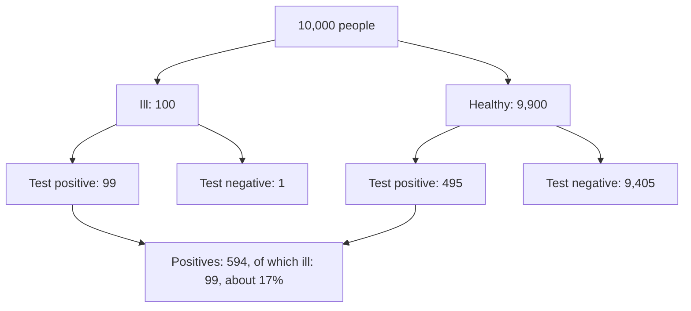

Machine learning models don't output facts; they output **beliefs**. A spam filter says "97% spam",
a language model assigns a probability to every possible next token, a medical classifier gives a
risk score. To build and judge such systems you need the language of uncertainty: probability.
This session covers the rules, conditional probability, the famous and frequently misunderstood
**Bayes' theorem**, and random variables. [Khan Academy's Statistics and
Probability](https://www.khanacademy.org/math/statistics-probability) has exercises for every
topic; Harvard's [CS50 AI](https://cs50.harvard.edu/ai/) devotes its "Uncertainty" lecture to the
same ideas applied to AI, including Bayesian networks.

> [!NOTE]
> Probability is a number between 0 (impossible) and 1 (certain). People often say percentages:
> 0.25 = 25%. Both are used below.

## Events, sample spaces and probability rules

**Analogy:** a probability problem is a game with a clear list of everything that could happen.

- The **sample space** `S` is the set of all possible outcomes. Rolling one die: `{1, 2, 3, 4, 5, 6}`.
- An **event** is a subset of outcomes you care about. "Roll an even number": `{2, 4, 6}`.
- If all outcomes are equally likely, `P(event) = outcomes in the event / total outcomes`. So
  `P(even) = 3/6 = 0.5`.

The rules that every probability obeys:

| Rule | Formula | Example (one die) |
| --- | --- | --- |
| Range | `0 ≤ P(A) ≤ 1` | |
| Certainty | `P(S) = 1` | something is rolled |
| **Complement** | `P(not A) = 1 - P(A)` | `P(not 6) = 5/6` |
| **Addition** (or) | `P(A or B) = P(A) + P(B) - P(A and B)` | `P(even or >4) = 3/6 + 2/6 - 1/6 = 4/6` |
| Mutually exclusive | if A and B can't both happen, `P(A or B) = P(A) + P(B)` | `P(1 or 2) = 2/6` |

The subtraction in the addition rule avoids counting the overlap twice: 6 is both even and greater
than 4.

> [!TIP]
> The complement rule is a shortcut for "at least one" questions. P(at least one 6 in four rolls)
> is awkward directly, but `1 - P(no 6 in four rolls) = 1 - (5/6)⁴ ≈ 0.52`.

## Conditional probability and independence

New information changes probabilities. **Conditional probability** `P(A | B)`, read "probability of
A given B", is the probability of A once you know B happened. You shrink the world to just the
outcomes where B is true:

```text
P(A | B) = P(A and B) / P(B)
```

> [!EXAMPLE]
> One die. `P(6) = 1/6`. But if someone tells you "it's even", the world shrinks to `{2, 4, 6}`
> and `P(6 | even) = 1/3`. With the formula: `P(6 and even) / P(even) = (1/6) / (3/6) = 1/3`.

Rearranging gives the **multiplication rule**: `P(A and B) = P(A | B) · P(B)`.

Two events are **independent** if knowing one tells you nothing about the other:
`P(A | B) = P(A)`, which is equivalent to `P(A and B) = P(A) · P(B)`. Two separate coin flips are
independent. "It's raining" and "people carry umbrellas" are not.

> [!WARNING]
> `P(A | B)` and `P(B | A)` are **different** numbers, and confusing them is the most common
> reasoning error in probability (the "prosecutor's fallacy"). The probability that a person who
> owns a passport is a pilot is tiny; the probability that a pilot owns a passport is near 1.

> [!NOTE]
> The **Naive Bayes** classifier, a classic spam filter, "naively" assumes words in an email are
> independent of each other given the class (spam or not). It's false, but the model often works
> surprisingly well anyway.

## Bayes' theorem

Bayes' theorem is how you flip a conditional probability around and **update a belief with
evidence**:

```text
P(H | E) = P(E | H) · P(H) / P(E)
```

Read it with names:

- `P(H)`: the **prior**, how plausible the hypothesis was before the evidence.
- `P(E | H)`: the **likelihood**, how expected the evidence is if the hypothesis is true.
- `P(E)`: the overall probability of the evidence, from all ways it could happen:
  `P(E) = P(E | H)·P(H) + P(E | not H)·P(not H)`.
- `P(H | E)`: the **posterior**, the updated belief.

> [!EXAMPLE]
> **The medical test.** A disease affects 1% of people. A test catches 99% of real cases
> (sensitivity) and has a 5% false-positive rate. You test positive. What's the chance you're ill?
>
> Most people guess about 95%. Count instead, with 10,000 people:
>
> - 100 are ill; 99 of them test positive.
> - 9,900 are healthy; 5% of them, 495, test positive anyway.
> - Total positives: 99 + 495 = 594. Of those, 99 are ill.
>
> `P(ill | positive) = 99 / 594 ≈ 16.7%`. The formula gives the same:
> `0.99 · 0.01 / (0.99 · 0.01 + 0.05 · 0.99) ≈ 0.167`.



The lesson: when the prior is small (a rare condition), even a good test produces mostly false
alarms. Ignoring the prior is called **base-rate neglect**. It matters for engineering too: a fraud
detector with a 1% false-positive rate, run on millions of mostly honest transactions, will flag far
more honest users than fraudsters.

> [!TIP]
> When Bayes feels slippery, use **natural frequencies**: imagine 10,000 concrete people and count,
> as above. It's the same maths, and it's much harder to get wrong.

## Random variables and expectation

A **random variable** is a number whose value depends on chance: the result of a die roll, the
number of users who sign up tomorrow, the time a request takes. It's a function from outcomes to
numbers. Its **distribution** lists each possible value and its probability (session 7.3.2 covers
the common ones).

The **expected value** `E[X]` is the probability-weighted average, the long-run average if you
repeated the experiment many times:

```text
E[X] = Σ value · P(value)
```

> [!EXAMPLE]
> One die: `E[X] = (1 + 2 + 3 + 4 + 5 + 6) · 1/6 = 3.5`. You can never roll 3.5, but the average of
> many rolls approaches it.
>
> A bet: pay 1 euro, roll a die; on a 6 you get 5 euros. Net winnings: +4 with probability 1/6, -1
> with probability 5/6. `E = 4·(1/6) - 1·(5/6) = -1/6`. On average you lose about 17 cents a game.

Useful properties:

- **Linearity:** `E[aX + b] = a·E[X] + b` and `E[X + Y] = E[X] + E[Y]`, always, even if X and Y are
  dependent. This makes expectations easy to compute in pieces.
- **Variance** `Var(X) = E[(X - E[X])²]` measures spread around the expectation; its square root is
  the **standard deviation**. More in 7.3.3.

Where ML uses it: a model's training loss is an **expected** loss over the data distribution,
estimated by averaging over a sample; reinforcement learning maximises expected reward; product
decisions compare the expected value of options.

## Practice: simulate a medical-test Bayes problem in Python

You'll compute the medical-test answer exactly, then confirm it by simulating a population, and see
how the answer depends on the prior. Allow about 45 minutes.

### Step 1: Exact answer

```python
def posterior(prior, sensitivity, false_positive_rate):
    p_pos = sensitivity * prior + false_positive_rate * (1 - prior)
    return sensitivity * prior / p_pos

print(posterior(0.01, 0.99, 0.05))   # ≈ 0.1667
```

### Step 2: Simulate a million people

```python
import numpy as np

rng = np.random.default_rng(0)
N = 1_000_000
ill = rng.random(N) < 0.01
positive = np.where(ill, rng.random(N) < 0.99, rng.random(N) < 0.05)

print("simulated P(ill | positive):", ill[positive].mean())
print("simulated P(positive | ill):", positive[ill].mean())
```

The first number should be close to 0.167, the second close to 0.99: the two conditionals are very
different, as warned.

### Step 3: The prior matters

```python
for prior in [0.001, 0.01, 0.1, 0.3, 0.5]:
    print(f"prior {prior:>5}: P(ill | +) = {posterior(prior, 0.99, 0.05):.3f}")
```

Plot the posterior against the prior with matplotlib for priors from 0.001 to 0.5. Note in a
sentence why doctors test high-risk groups first.

### Step 4: Two tests

Real practice retests positives. Assuming the second test is independent given the true state,
the posterior after the first test becomes the **prior** for the second:

```python
p1 = posterior(0.01, 0.99, 0.05)
p2 = posterior(p1, 0.99, 0.05)
print(p1, p2)   # ≈ 0.17, then ≈ 0.80
```

Verify `p2` by simulation: draw a second independent test result for everyone and compute
`ill[positive & positive2].mean()`.

### Step 5: Expected value check

Simulate 100,000 rounds of the die bet from the expectation section and confirm the average
winnings approach -1/6. Then change the payout until the game is fair (expected value 0).
