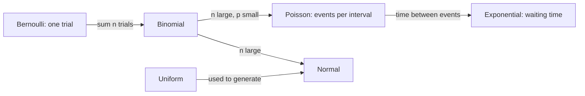
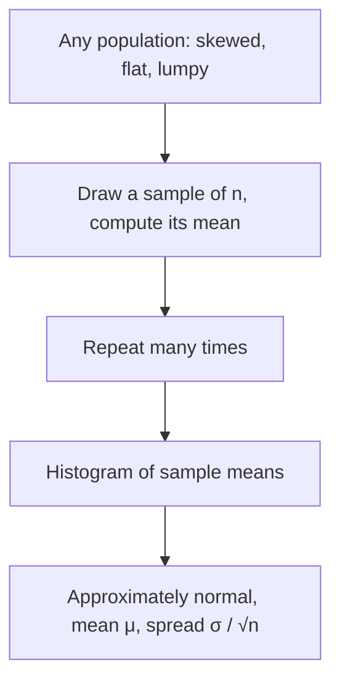

A **probability distribution** is the shape of randomness: a description of which values a random
variable can take and how likely each one is. A handful of named distributions turn up again and
again, in web traffic, user behaviour, measurement noise, model outputs and weight initialisation.
Recognising them lets you pick sensible models, spot when data looks wrong, and understand why so
much of statistics relies on the bell curve. The reference is [OpenStax Introductory
Statistics](https://openstax.org/details/books/introductory-statistics-2e) (chapters on discrete
and continuous random variables and the central limit theorem, free online); for short visual
explanations, [StatQuest](https://statquest.org/) has a video on almost every idea below.

> [!NOTE]
> Builds on 7.3.1: a random variable is a number decided by chance, and its expected value is the
> long-run average.

## Discrete: Bernoulli, binomial, Poisson

**Discrete** random variables take countable values: 0, 1, 2, … Their distribution is a
**probability mass function (PMF)**: a probability for each value, summing to 1.

**Bernoulli: one yes/no trial.** A single coin flip, a single user who clicks or doesn't, a single
email that is spam or not. One parameter `p`, the probability of "yes" (coded 1).

```text
P(X = 1) = p,  P(X = 0) = 1 - p        mean p,  variance p(1 - p)
```

**Binomial: count of yeses in n independent Bernoulli trials.** How many of 100 visitors click a
button with click rate 3%? Parameters `n` (trials) and `p`.

```text
P(X = k) = C(n, k) · pᵏ · (1 - p)ⁿ⁻ᵏ     mean n·p,  variance n·p·(1 - p)
```

`C(n, k)`, "n choose k", counts the ways to pick which k trials succeed.

> [!EXAMPLE]
> 100 visitors, p = 0.03. Expected clicks: `100 · 0.03 = 3`. Probability of zero clicks:
> `0.97¹⁰⁰ ≈ 0.048`. So roughly 1 time in 20, a perfectly fine button gets no clicks from 100
> visitors. Don't panic over small samples.

**Poisson: count of events in a fixed interval.** Requests per second to an API, support tickets per
hour, typos per page. Events happen independently at a constant average rate `λ` (lambda).

```text
P(X = k) = λᵏ · e⁻λ / k!                 mean λ,  variance λ
```

Poisson is what binomial becomes when `n` is huge and `p` tiny (many users, each rarely acting).
A signature: **mean equals variance**. If your count data has variance much larger than its mean
("overdispersion"), the Poisson assumption is breaking, often because events come in bursts.

| Distribution | Models | Parameters | Example |
| --- | --- | --- | --- |
| Bernoulli | one yes/no | p | did this user convert? |
| Binomial | yeses out of n tries | n, p | conversions out of 1,000 visitors |
| Poisson | events per interval | λ | requests per second |

> [!TIP]
> In ML, a binary classifier's output (e.g. sigmoid 0.8) is the `p` of a Bernoulli distribution,
> and a language model's softmax output is a **categorical** distribution, the many-outcome
> generalisation of Bernoulli, over its vocabulary.

## Continuous: uniform, normal, exponential

**Continuous** random variables take any value in a range: a height, a latency, a temperature.
The probability of any exact value (precisely 1.700000… m) is zero, so instead we have a
**probability density function (PDF)**: probabilities are **areas** under its curve. The total area
is 1.

**Uniform: every value in [a, b] equally likely.** A flat line. Python's `random.random()` is
uniform on [0, 1). It's the building block for generating other distributions, and the "no idea,
anything in this range" assumption.

**Normal (Gaussian): the bell curve.** Symmetric around its mean `μ` (mu), with spread set by the
standard deviation `σ` (sigma). Heights, measurement errors, test scores and many sums of small
effects look roughly normal. The **68–95–99.7 rule**: about 68% of values fall within 1σ of the
mean, 95% within 2σ, 99.7% within 3σ.

> [!EXAMPLE]
> Adult heights in some population: μ = 170 cm, σ = 8 cm. About 95% of people are between 154 and
> 186 cm. Someone at 202 cm is 4σ above the mean: rare. In monitoring, "more than 3σ from normal"
> is a classic anomaly alert.

The **standard normal** has μ = 0 and σ = 1; converting a value to "how many σ from the mean",
`z = (x - μ) / σ`, is **standardising**. That's exactly what you did to columns before PCA in
7.1.3.

**Exponential: waiting times.** Time until the next request, the next failure, the next customer.
It's the continuous partner of Poisson: if events arrive at rate λ per second, the gaps between them
are exponential with mean `1/λ`. It's **memoryless**: having waited 5 minutes for a bus that
arrives this way doesn't make it any more likely to arrive in the next minute.



> [!WARNING]
> Not everything is normal. Response latencies, incomes, file sizes and city populations are
> **right-skewed** with long tails: a few huge values. Averages of such data mislead, which is why
> latency is reported as p50, p95 and p99 percentiles rather than a mean.

## Central limit theorem

Here's why the normal distribution is everywhere. The **central limit theorem (CLT)** says:

> Take many independent samples from (almost) any distribution with a finite variance, and compute
> their average. Repeat. The distribution of those averages is approximately **normal**, centred on
> the true mean, with standard deviation `σ / √n`, and the approximation improves as `n` grows.

Analogy: one die roll is flat (each face 1/6). The average of two dice already peaks at 3.5. The
average of 30 dice is a smooth bell, though no single die is bell-shaped.



Why it matters:

- **Confidence intervals and hypothesis tests** (7.3.3) rely on sample means being roughly normal,
  even when individual data points aren't.
- **σ / √n** quantifies how precision grows with data: to halve the uncertainty of an average you
  need **four times** the data. That's the economics behind A/B test sample sizes.
- It explains why aggregated noise (many small independent errors) looks Gaussian.

> [!WARNING]
> The CLT needs independent samples and finite variance, and "large n" depends on how skewed the
> source is. For very heavy-tailed data (some revenue or latency data), you may need far more than
> the textbook rule of thumb of n ≈ 30.

## Practice: sample and plot distributions with NumPy

You'll sample each distribution, check the theoretical mean and variance, and watch the central
limit theorem happen. Allow about 1 hour.

### Step 1: Setup

```python
import numpy as np
import matplotlib.pyplot as plt

rng = np.random.default_rng(7)
N = 100_000
```

### Step 2: Sample and check the formulas

```python
samples = {
    "Bernoulli(p=0.3)":      (rng.binomial(1, 0.3, N),       0.3,       0.3 * 0.7),
    "Binomial(n=20, p=0.3)": (rng.binomial(20, 0.3, N),      20 * 0.3,  20 * 0.3 * 0.7),
    "Poisson(λ=4)":          (rng.poisson(4, N),             4,         4),
    "Uniform(0, 10)":        (rng.uniform(0, 10, N),         5,         100 / 12),
    "Normal(170, 8)":        (rng.normal(170, 8, N),         170,       64),
    "Exponential(mean=2)":   (rng.exponential(2, N),         2,         4),
}
for name, (x, mean, var) in samples.items():
    print(f"{name:<24} mean {x.mean():8.3f} (theory {mean:7.3f})  var {x.var():8.3f} (theory {var:7.3f})")
```

Note that NumPy's `exponential` takes the **mean** (scale = 1/λ), not the rate.

### Step 3: Plot them

```python
fig, axes = plt.subplots(2, 3, figsize=(12, 7))
for ax, (name, (x, _, _)) in zip(axes.flat, samples.items()):
    if np.issubdtype(x.dtype, np.integer):
        values, counts = np.unique(x, return_counts=True)
        ax.bar(values, counts / N)
    else:
        ax.hist(x, bins=60, density=True)
    ax.set_title(name)
fig.tight_layout(); fig.savefig("distributions.png", dpi=150)
```

Discrete distributions get bars; continuous ones get density histograms.

### Step 4: Check the 68–95–99.7 rule

```python
h = samples["Normal(170, 8)"][0]
for k in (1, 2, 3):
    print(k, np.mean(np.abs(h - 170) < k * 8).round(3))
```

### Step 5: Watch the CLT

Start from the very skewed exponential distribution and average samples of increasing size:

```python
fig, axes = plt.subplots(1, 4, figsize=(14, 3))
for ax, n in zip(axes, [1, 2, 10, 50]):
    means = rng.exponential(2, size=(20_000, n)).mean(axis=1)
    ax.hist(means, bins=60, density=True)
    ax.set_title(f"n={n}, std={means.std():.3f}, theory {2 / np.sqrt(n):.3f}")
fig.tight_layout(); fig.savefig("clt.png", dpi=150)
```

The histograms go from a skewed slope to a symmetric bell, and the spread shrinks like `σ / √n`
(for this exponential, σ = 2). Write one sentence connecting the result to why A/B tests need
large samples.
