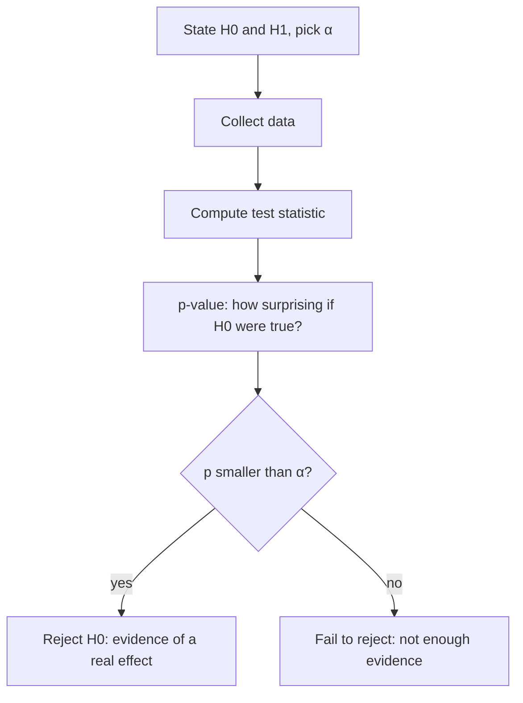

Statistics has two jobs. **Descriptive** statistics summarises the data you have: what's typical,
how spread out, what moves together. **Inferential** statistics reasons beyond it: from the 2,000
users in your experiment to all future users, with an honest statement of how sure you can be. That
second job is how product teams decide whether a new feature really helped or just got lucky. This
session follows [OpenStax Introductory
Statistics](https://openstax.org/details/books/introductory-statistics-2e) (descriptive statistics,
confidence intervals and hypothesis testing chapters) and [StatQuest](https://statquest.org/), whose
videos on p-values and confidence intervals are excellent companions.

> [!NOTE]
> Builds on 7.3.2: the central limit theorem says sample means are roughly normal with spread
> `σ / √n`. Nearly everything inferential below is that fact put to work.

## Mean, median, variance and correlation

**Centre.**

- **Mean**: add everything up, divide by the count. Sensitive to extreme values.
- **Median**: the middle value once sorted (50% below, 50% above). Robust to extremes.

> [!EXAMPLE]
> Nine employees earn 30k and the CEO earns 1,000k. Mean salary: 127k, a figure that describes
> nobody. Median: 30k. For skewed data such as salaries, house prices or page load times, report the
> median (and percentiles like p95).

**Spread.**

- **Variance**: the average squared distance from the mean. For a sample, divide by `n - 1`
  instead of `n` (Bessel's correction), because the sample mean sits slightly closer to the sample
  than the true mean does.
- **Standard deviation (SD)**: the square root of the variance, back in the original units. "Mean
  delivery time 30 min, SD 5 min" is easy to picture.
- **Interquartile range (IQR)**: the range of the middle 50% (p75 - p25). The robust partner of the
  median; box plots draw it.

**Relationship.** **Correlation** (Pearson's `r`) measures how strongly two variables move together
**in a straight line**, from -1 (perfect opposite) through 0 (no linear relation) to +1 (perfect
together). It's the cosine similarity from 7.1.1 applied to the two centred columns.

> [!WARNING]
> Two classic traps. **Correlation is not causation**: ice-cream sales and drownings correlate
> because both rise in summer, a **confounder**. And **r ≈ 0 doesn't mean unrelated**: a perfect
> U-shaped relationship can have zero linear correlation. Always plot the data.

## Sampling and confidence intervals

You can almost never measure everyone, so you take a **sample** and compute a **statistic** (e.g.
the sample mean) to estimate a population **parameter** (the true mean). Good samples are
**random**; a sample of users who answered an optional survey is biased toward people with strong
opinions (**selection bias**), and no formula fixes that.

Each sample gives a slightly different estimate. The **standard error (SE)** measures how much an
estimate wobbles from sample to sample. For a mean, `SE = s / √n` (s = sample SD), straight from the
CLT.

A **confidence interval (CI)** wraps the estimate in a range that reflects this wobble:

```text
95% CI ≈ estimate ± 1.96 · SE
```

> [!EXAMPLE]
> 400 users, mean session length 12.0 min, SD 6 min. `SE = 6 / √400 = 0.3`.
> 95% CI: `12.0 ± 1.96 · 0.3 = [11.4, 12.6]` minutes.
> With only 25 users and the same SD: `SE = 1.2`, CI ≈ [9.6, 14.4]. Same estimate, far less
> certainty.

What "95%" means, precisely: if you repeated the whole sampling procedure many times, about 95% of
the intervals built this way would contain the true value. It does **not** mean "there's a 95%
probability the true value is in this particular interval", though in practice people read it that
way.

> [!TIP]
> Wide interval? You need more data. Because of `√n`, halving the width needs **4×** the sample.
> For small samples (roughly under 30) or unknown spread, use the t-distribution instead of 1.96;
> libraries do this automatically.

## Hypothesis testing and p-values

A hypothesis test is a structured way to ask: **could this result be just noise?** It works like a
court case: assume innocence, then see whether the evidence is too surprising to square with it.

1. **Null hypothesis H₀**: the boring explanation. "The new checkout has the same conversion rate as
   the old one."
2. **Alternative H₁**: what you suspect. "The rates differ."
3. Choose a **significance level** α before looking, usually 0.05.
4. Compute a **test statistic** from the data: how far the observed difference is from zero, in
   standard errors (`z = difference / SE`).
5. The **p-value**: assuming H₀ is true, the probability of seeing a result **at least as extreme**
   as the one observed.
6. If `p < α`, **reject H₀** ("statistically significant"). Otherwise, you **fail to reject** it.



Two ways to be wrong:

| | H₀ actually true | H₀ actually false |
| --- | --- | --- |
| **Reject H₀** | Type I error, false positive (rate α) | Correct |
| **Don't reject** | Correct | Type II error, false negative |

**Power** is the probability of detecting a real effect when there is one (1 - Type II rate);
it grows with sample size and effect size. 80% is a common target.

> [!WARNING]
> What a p-value is **not**: it's not the probability H₀ is true, not the probability your result is
> a fluke, and not a measure of how big or important the effect is. A tiny, useless effect becomes
> "significant" with enough data. Always report the **effect size with a confidence interval**
> alongside the p-value. (It's Bayes from 7.3.1 again: `P(data | H₀)` is not `P(H₀ | data)`.)

## A/B testing in product work

An **A/B test** is a randomised controlled experiment on a product: users are randomly split, group
A sees the current version (**control**), group B the change (**treatment**), and you compare a
pre-chosen **metric**. Randomisation is the magic ingredient: it balances confounders (device,
country, mood) across groups, so a difference in outcomes can be attributed to the change.

The workflow:

1. **Hypothesis and primary metric.** "A one-page checkout increases purchase conversion." Pick one
   primary metric up front, plus **guardrail metrics** that must not get worse (revenue per user,
   error rate, page load time).
2. **Sample size.** Decide the **minimum detectable effect** (e.g. +0.5 percentage points) and use a
   power calculation to get the users needed per group. Small effects need large samples.
3. **Randomise and run** for the planned duration, ideally whole weeks to cover weekday/weekend
   behaviour.
4. **Analyse once**, at the planned end: difference, confidence interval, p-value.
5. **Decide** using the effect size and its business value, not just "significant or not".

> [!WARNING]
> **Peeking** (checking the p-value daily and stopping as soon as it dips below 0.05) inflates the
> false-positive rate far above 5%. Fix the sample size in advance, or use methods designed for
> continuous monitoring (sequential testing). Similarly, testing 20 metrics and celebrating the one
> with p < 0.05 is the **multiple comparisons** problem: at α = 0.05, about 1 in 20 null effects
> looks significant by chance.

Other pitfalls: **novelty effects** (users click a new thing because it's new), **sample ratio
mismatch** (a 50/50 split that came out 52/48 signals a bug in assignment, so don't trust the
results), and users seeing both variants across devices.

## Practice: analyse an A/B test result

A checkout experiment ran for two weeks. Control: 10,000 users, 520 purchases. Treatment: 10,000
users, 590 purchases. Did the change work? Allow about 1 hour.

### Step 1: Describe

```python
n_a, conv_a = 10_000, 520
n_b, conv_b = 10_000, 590
p_a, p_b = conv_a / n_a, conv_b / n_b
diff = p_b - p_a
print(f"A {p_a:.2%}  B {p_b:.2%}  diff {diff:+.2%}  relative lift {diff / p_a:+.1%}")
```

Conversion 5.20% vs 5.90%: +0.70 points, a relative lift of about 13%.

### Step 2: Confidence interval for the difference

```python
import math

se = math.sqrt(p_a * (1 - p_a) / n_a + p_b * (1 - p_b) / n_b)
lo, hi = diff - 1.96 * se, diff + 1.96 * se
print(f"95% CI for the difference: [{lo:+.2%}, {hi:+.2%}]")
```

The interval should lie entirely above zero, roughly [+0.07, +1.33] points.

### Step 3: Two-proportion z-test

```python
from scipy import stats

p_pool = (conv_a + conv_b) / (n_a + n_b)
se_pool = math.sqrt(p_pool * (1 - p_pool) * (1 / n_a + 1 / n_b))
z = diff / se_pool
p_value = 2 * (1 - stats.norm.cdf(abs(z)))
print(f"z = {z:.2f}, p = {p_value:.4f}")
```

Expect z ≈ 2.2 and p ≈ 0.03. Cross-check with
`statsmodels.stats.proportion.proportions_ztest([conv_b, conv_a], [n_b, n_a])` if you have
statsmodels installed.

### Step 4: Simulate the null

Check the p-value without formulas: pretend there's no difference and see how often chance alone
produces a gap this big.

```python
import numpy as np

rng = np.random.default_rng(1)
sims = rng.binomial(n_b, p_pool, 100_000) / n_b - rng.binomial(n_a, p_pool, 100_000) / n_a
print("simulated p-value:", np.mean(np.abs(sims) >= abs(diff)))
```

### Step 5: Sample ratio and guardrails

The split was exactly 10,000 / 10,000, so no sample ratio mismatch. In a real analysis, also check
guardrail metrics; here, invent an average order value of 48 euros in A and 46 in B and discuss
whether higher conversion with smaller orders is still a win.

### Step 6: Write the decision

Write a five-line summary for a product manager: the effect with its confidence interval, the
p-value in plain words ("if the change did nothing, a gap this large would happen about 3% of the
time"), the caveats (one primary metric, no peeking, novelty), and your recommendation.
