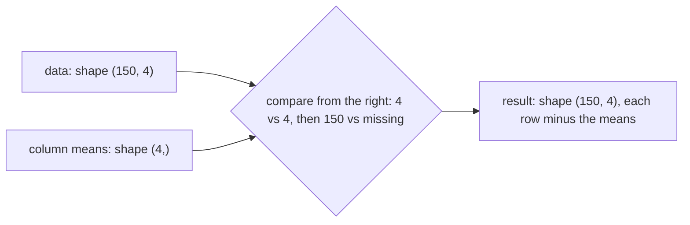

Every maths session in this track ended in NumPy, and for good reason: it is the foundation of
Python's data and ML ecosystem. pandas DataFrames are built on NumPy arrays, scikit-learn takes them
as input, and PyTorch tensors deliberately mirror NumPy's interface. This session makes the tool
itself explicit: what an array is, how to pick out the parts you want, and the two ideas that make
NumPy both fast and concise, **broadcasting** and **vectorisation**. The reference is the official
[NumPy: the absolute basics for beginners](https://numpy.org/doc/stable/user/absolute_beginners.html)
guide, which the examples below follow.

> [!NOTE]
> Convention: `import numpy as np`. Everyone uses the `np` alias, and the docs assume it.

## ndarrays, shapes and dtypes

NumPy's core object is the **ndarray** (n-dimensional array): a grid of values, all of the **same
type**, stored in one contiguous block of memory.

Analogy: a Python list is a bookshelf of labelled boxes, each of which can hold anything (a number,
a string, another list), and finding the contents means opening each box. An ndarray is an egg tray:
every slot the same size, holding the same kind of thing, packed side by side. The tray is far more
rigid, and that's why machines can process it so fast.

```python
import numpy as np

a = np.array([1, 2, 3])                 # 1D: a vector
M = np.array([[1, 2, 3], [4, 5, 6]])    # 2D: a matrix
print(a.ndim, a.shape, a.dtype)         # 1 (3,) int64
print(M.ndim, M.shape, M.size)          # 2 (2, 3) 6
```

Key attributes:

| Attribute | Meaning | `M` above |
| --- | --- | --- |
| `ndim` | number of dimensions (**axes**) | 2 |
| `shape` | length along each axis, as a tuple | `(2, 3)`: 2 rows, 3 columns |
| `size` | total number of elements | 6 |
| `dtype` | element type | `int64` |

**Shapes are the grammar of NumPy.** A greyscale image is `(height, width)`; a colour image
`(height, width, 3)`; a batch of 32 colour images `(32, height, width, 3)`; 150 flowers with 4
measurements `(150, 4)`. Axis 0 is rows (or "samples"), axis 1 is columns (or "features").

Creating arrays:

```python
np.zeros((2, 3)); np.ones(4); np.full((2, 2), 7)
np.arange(0, 10, 2)          # [0 2 4 6 8]  like range()
np.linspace(0, 1, 5)         # [0. 0.25 0.5 0.75 1.]  5 evenly spaced points
rng = np.random.default_rng(0)
rng.normal(size=(3, 3))      # random normal values
np.arange(12).reshape(3, 4)  # same 12 numbers, viewed as 3×4
```

**dtypes.** Common ones: `int64`, `float64` (the default for decimals), `float32` (half the memory;
standard in deep learning), `bool`. Choosing `float32` for a 10-million-element array saves 40 MB.

> [!WARNING]
> dtypes can surprise you. `np.array([1, 2, 3])` is integer, so assigning `a[0] = 2.7` silently
> stores `2`. And mixing types upcasts: `np.array([1, "a"])` turns everything into strings. Pass
> `dtype=float` when you mean decimals, and check `arr.dtype` when results look wrong.

## Indexing and slicing

Indexing works like Python lists, extended to several axes. Indices start at 0, negative indices
count from the end, and slices are `start:stop:step` with `stop` excluded.

```python
x = np.arange(10)          # [0 1 2 3 4 5 6 7 8 9]
x[0], x[-1]                # 0, 9
x[2:5]                     # [2 3 4]
x[::2]                     # [0 2 4 6 8]
x[::-1]                    # reversed

M = np.arange(12).reshape(3, 4)
# [[ 0  1  2  3]
#  [ 4  5  6  7]
#  [ 8  9 10 11]]
M[1, 2]        # 6        row 1, column 2
M[0]           # [0 1 2 3]   first row
M[:, 1]        # [1 5 9]     second column (":" means "all rows")
M[:2, 2:]      # [[2 3] [6 7]]  top-right block
```

Two more powerful kinds of indexing:

- **Boolean masks**: a comparison produces an array of `True`/`False`; using it as an index keeps
  only the `True` positions. This is how you filter.

  ```python
  scores = np.array([55, 82, 91, 47, 78])
  scores[scores >= 60]                  # [82 91 78]
  scores[(scores > 50) & (scores < 80)] # [55 78]  use & | ~, not and/or/not, with parentheses
  ```

- **Fancy indexing**: index with an array of positions. `scores[[0, 2, 4]]` gives `[55 91 78]`.

> [!WARNING]
> **Slices are views, not copies.** `top = M[:2]` shares memory with `M`; setting `top[0, 0] = 99`
> changes `M` too. That's what makes slicing cheap, but it can cause baffling bugs. Use
> `M[:2].copy()` when you need independent data. Boolean and fancy indexing always return copies.

## Broadcasting and vectorisation

**Vectorisation** means expressing an operation on whole arrays instead of writing a Python loop
over elements:

```python
prices = np.array([10.0, 20.0, 30.0])
with_vat = prices * 1.22            # no loop
total = (prices * [2, 1, 3]).sum()  # element-wise multiply, then sum
```

Why it's faster: a Python loop runs the interpreter for every element (type checks, object lookups).
A vectorised operation makes **one** call into compiled C code that runs a tight loop over the
contiguous egg-tray memory, often using CPU instructions that process several numbers at once.
Speed-ups of 10 to 100 times are routine.

Useful vectorised building blocks: arithmetic (`+ - * / **`), comparisons, `np.sqrt`, `np.exp`,
`np.log`, `np.where(cond, a, b)` (a vectorised if/else), and **aggregations** with an `axis`:

```python
M = np.array([[1, 2, 3], [4, 5, 6]])
M.sum()          # 21   everything
M.sum(axis=0)    # [5 7 9]   collapse rows: one value per column
M.mean(axis=1)   # [2. 5.]   collapse columns: one value per row
```

> [!TIP]
> Think of `axis=k` as "the axis that disappears". `M` has shape `(2, 3)`; `M.sum(axis=0)` has
> shape `(3,)`.

**Broadcasting** is the rule that lets NumPy combine arrays of **different shapes** without
copying data. `prices * 1.22` already used it: the scalar was "stretched" to match. The rule:
compare shapes from the **right**; two dimensions are compatible if they're **equal or one of them
is 1**. A dimension of 1 (or a missing one) is stretched to match.



```python
X = rng.normal(size=(150, 4))
Xc = X - X.mean(axis=0)            # (150, 4) - (4,)  -> centre every column
Xs = Xc / X.std(axis=0)            # standardise, as in PCA (7.1.3)

col = np.array([[1], [2], [3]])    # shape (3, 1)
row = np.array([10, 20])           # shape (2,)
col + row                          # shape (3, 2): every pair added
```

> [!EXAMPLE]
> Pairwise distances without loops. Points `P` of shape `(n, 2)`. `P[:, None, :]` has shape
> `(n, 1, 2)` and `P[None, :, :]` has shape `(1, n, 2)`; subtracting broadcasts to `(n, n, 2)`, all
> pairwise differences. Then `np.sqrt((diff**2).sum(axis=-1))` gives the `(n, n)` distance matrix.

> [!WARNING]
> Broadcasting can succeed when you didn't mean it to. Subtracting a `(3,)` array from a `(3, 1)`
> array gives a `(3, 3)` result, not an error. When a result's shape surprises you, print the shapes
> of every operand.

## Practice: rewrite loops as vectorised NumPy

You'll take four loop-based functions, rewrite each with NumPy, verify the results match and
measure the speed-up. Allow about 1 hour.

### Step 1: A timing helper

```python
import time
import numpy as np

rng = np.random.default_rng(0)

def timeit(fn, *args, repeat=3):
    times = []
    for _ in range(repeat):
        start = time.perf_counter()
        fn(*args)
        times.append(time.perf_counter() - start)
    return min(times)   # the best run is the least disturbed by other processes
```

### Step 2: Sum of squares

```python
def sumsq_loop(xs):
    total = 0.0
    for x in xs:
        total += x * x
    return total

def sumsq_vec(xs):
    return np.sum(xs ** 2)       # or xs @ xs

xs = rng.normal(size=1_000_000)
assert np.isclose(sumsq_loop(xs), sumsq_vec(xs))
print(timeit(sumsq_loop, xs) / timeit(sumsq_vec, xs), "x faster")
```

### Step 3: Clip negatives (if/else in a loop)

```python
def relu_loop(xs):
    return [x if x > 0 else 0.0 for x in xs]

def relu_vec(xs):
    return np.where(xs > 0, xs, 0.0)   # or np.maximum(xs, 0)

assert np.allclose(relu_loop(xs), relu_vec(xs))
```

That's the ReLU activation from 7.2.1, vectorised the way deep learning libraries do it.

### Step 4: Standardise columns (nested loops)

```python
def standardise_loop(X):
    n, d = len(X), len(X[0])
    out = [[0.0] * d for _ in range(n)]
    for j in range(d):
        col = [X[i][j] for i in range(n)]
        mean = sum(col) / n
        std = (sum((c - mean) ** 2 for c in col) / n) ** 0.5
        for i in range(n):
            out[i][j] = (X[i][j] - mean) / std
    return out

def standardise_vec(X):
    return (X - X.mean(axis=0)) / X.std(axis=0)   # broadcasting

X = rng.normal(5, 2, size=(20_000, 8))
assert np.allclose(standardise_loop(X.tolist()), standardise_vec(X))
```

### Step 5: Cosine similarity of every pair

Use the pairwise idea from the example: normalise rows, then a single matrix product gives every
cosine similarity at once (the trick from 7.1.1).

```python
def cos_matrix_loop(V):
    n = len(V)
    S = np.zeros((n, n))
    for i in range(n):
        for j in range(n):
            S[i, j] = V[i] @ V[j] / (np.linalg.norm(V[i]) * np.linalg.norm(V[j]))
    return S

def cos_matrix_vec(V):
    U = V / np.linalg.norm(V, axis=1, keepdims=True)   # (n, d) / (n, 1)
    return U @ U.T

V = rng.normal(size=(300, 64))
assert np.allclose(cos_matrix_loop(V), cos_matrix_vec(V))
```

### Step 6: Record the results

Make a small table of each function's loop time, vectorised time and speed-up. Then note which
step relied on broadcasting and write the shape of every intermediate array in Step 5.
