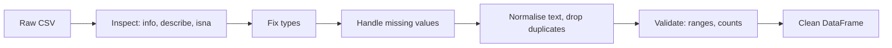
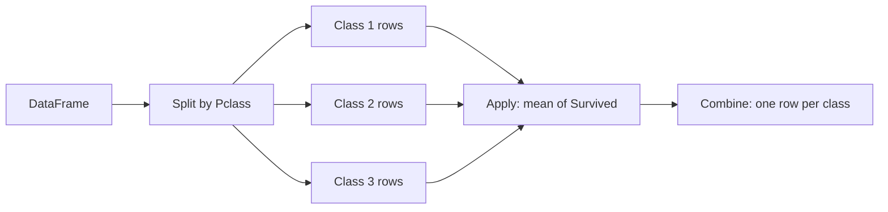

Real-world data rarely arrives as a clean NumPy matrix. It comes as a CSV export or a database
table with named columns of different types, missing values, typos and duplicates. **pandas** is
Python's tool for that kind of tabular data: think "a spreadsheet you drive with code", built on
the NumPy arrays from 7.4.1. **Matplotlib** is the plotting library underneath most Python charts,
including pandas' own `.plot()`. Together they cover the first stage of almost every data or ML
project: **exploratory data analysis (EDA)**, getting to know the data before modelling it. This
session follows [pandas — Getting started](https://pandas.pydata.org/docs/getting_started/index.html)
(especially its "10 minutes to pandas" and intro tutorials) and the [Matplotlib
tutorials](https://matplotlib.org/stable/tutorials/index.html).

> [!NOTE]
> Conventions: `import pandas as pd` and `import matplotlib.pyplot as plt`. Install with
> `pip install pandas matplotlib`.

## DataFrames, selection and filtering

pandas has two main objects:

- A **Series**: one labelled column, a 1D NumPy array plus an **index** (row labels).
- A **DataFrame**: a table of Series sharing the same index. Each column has its own dtype; unlike
  a NumPy matrix, one column can be text and the next numbers.

```python
import pandas as pd

df = pd.read_csv("titanic.csv")   # also read_excel, read_json, read_sql, read_parquet
df.head()          # first 5 rows
df.shape           # (rows, columns)
df.info()          # column names, dtypes, non-null counts: the first thing to run
df.describe()      # count, mean, std, min, quartiles, max for numeric columns
```

**Selecting columns.**

```python
df["Age"]                 # one column -> Series
df[["Name", "Age"]]       # list of columns -> DataFrame
```

**Selecting rows: `loc` and `iloc`.**

| Accessor | Selects by | Example |
| --- | --- | --- |
| `df.loc[rows, cols]` | **labels** (index values, column names); slices include the end | `df.loc[0:4, ["Name", "Age"]]` |
| `df.iloc[rows, cols]` | **positions** (0, 1, 2…); slices exclude the end, like Python | `df.iloc[:5, :3]` |

**Filtering** uses boolean masks, exactly like NumPy in 7.4.1:

```python
adults = df[df["Age"] >= 18]
first_class_women = df[(df["Pclass"] == 1) & (df["Sex"] == "female")]
southampton_or_cherbourg = df[df["Embarked"].isin(["S", "C"])]
df.loc[df["Fare"] > 100, ["Name", "Fare"]]     # filter rows and pick columns at once
```

> [!WARNING]
> Chained assignment such as `df[df["Age"] > 60]["Fare"] = 0` may modify a temporary copy and leave
> `df` unchanged (pandas warns with `SettingWithCopyWarning`, and newer versions with Copy-on-Write
> simply never update the original). Do it in one step: `df.loc[df["Age"] > 60, "Fare"] = 0`.

New columns come from vectorised expressions: `df["FamilySize"] = df["SibSp"] + df["Parch"] + 1`.

## Cleaning missing and messy data

Messy data is the norm. The usual suspects and their fixes:

**Missing values.** pandas marks them as `NaN` (or `NA`/`NaT`).

```python
df.isna().sum()                    # missing count per column
df.dropna(subset=["Embarked"])     # drop rows missing a critical field
df["Age"] = df["Age"].fillna(df["Age"].median())   # impute with a typical value
```

There is no universal right answer: drop when few rows are affected and the field is essential;
impute (median for skewed numbers, most frequent value for categories) when dropping would lose too
much; or keep a flag column `AgeMissing` because missingness itself can be informative.

**Wrong types.** Numbers stored as text, dates as strings:

```python
df["price"] = pd.to_numeric(df["price"].str.replace("€", "").str.strip(), errors="coerce")
df["signup"] = pd.to_datetime(df["signup"], errors="coerce")
```

`errors="coerce"` turns unparseable values into `NaN`, so you can count and inspect them instead of
crashing.

**Inconsistent text.** `"Rome"`, `" rome"`, `"ROMA"`:

```python
df["city"] = df["city"].str.strip().str.lower().replace({"roma": "rome"})
```

**Duplicates and impossible values.** `df.duplicated().sum()`, `df.drop_duplicates()`; and sanity
checks such as `df[df["Age"] < 0]`.



> [!TIP]
> Never overwrite the raw file. Keep cleaning as a script or a function (`raw -> clean`) you can
> re-run end to end, and record the row count after each step so you notice when a filter throws
> away more than expected.

## Grouping and aggregation

Most interesting questions are "per something": survival rate **per class**, revenue **per
month**, average latency **per endpoint**. pandas answers them with **split-apply-combine**:
**split** rows into groups by a key, **apply** an aggregation to each group, **combine** the results
into a table.



```python
df.groupby("Pclass")["Survived"].mean()            # survival rate per class
df.groupby(["Pclass", "Sex"])["Survived"].mean()   # two keys
df.groupby("Pclass").agg(
    passengers=("PassengerId", "count"),
    survival_rate=("Survived", "mean"),
    median_fare=("Fare", "median"),
)                                                  # named aggregations: tidy column names
df["Embarked"].value_counts()                      # frequency of each category
pd.crosstab(df["Pclass"], df["Survived"], normalize="index")   # two-way table of proportions
```

It's SQL's `GROUP BY` in Python; if you know `SELECT pclass, AVG(survived) FROM t GROUP BY pclass`,
you know the idea.

> [!EXAMPLE]
> On the Titanic data, `groupby("Sex")["Survived"].mean()` shows roughly 74% of women survived
> against about 19% of men: "women and children first" visible in two lines of code.

## Plotting with matplotlib

Matplotlib has a **Figure** (the whole canvas) containing one or more **Axes** (individual plots,
each with its own x and y axis). The explicit, object-oriented style is the one to learn:

```python
import matplotlib.pyplot as plt

fig, ax = plt.subplots(figsize=(8, 5))
ax.hist(df["Age"].dropna(), bins=30)
ax.set_title("Passenger ages"); ax.set_xlabel("Age"); ax.set_ylabel("Count")
fig.savefig("ages.png", dpi=150, bbox_inches="tight")
```

Pick the chart from the question:

| Question | Chart | Matplotlib |
| --- | --- | --- |
| How is one numeric variable distributed? | Histogram, box plot | `ax.hist`, `ax.boxplot` |
| How do categories compare? | Bar chart | `ax.bar`, `ax.barh` |
| How do two numeric variables relate? | Scatter plot | `ax.scatter` |
| How does something change over time? | Line chart | `ax.plot` |

Several plots side by side: `fig, axes = plt.subplots(1, 3, figsize=(15, 4))`, then draw on
`axes[0]`, `axes[1]`, `axes[2]`. pandas wraps matplotlib, so
`df.groupby("Pclass")["Survived"].mean().plot.bar(ax=ax)` is a one-liner that returns an Axes you
can keep customising.

> [!WARNING]
> Charts can mislead. A bar chart whose y-axis starts at 90 instead of 0 makes a 2% difference look
> enormous; a histogram's shape changes with its bin count; and a scatter of 100,000 points becomes an
> opaque blob (use `alpha=0.1` or smaller markers). Always label axes and units.

## Practice: exploratory data analysis of a public dataset

You'll explore the Titanic passenger dataset, a classic, small public dataset, end to end. Allow
about 2 hours. A copy is published in the pandas documentation's own tutorial data:
`https://raw.githubusercontent.com/pandas-dev/pandas/main/doc/data/titanic.csv` (used in the
[pandas getting started tutorials](https://pandas.pydata.org/docs/getting_started/index.html)).

### Step 1: Load and inspect

```python
import pandas as pd
import matplotlib.pyplot as plt

url = "https://raw.githubusercontent.com/pandas-dev/pandas/main/doc/data/titanic.csv"
df = pd.read_csv(url)
print(df.shape)
df.info()
print(df.describe())
print(df.isna().sum().sort_values(ascending=False))
```

Write down: how many rows and columns? Which columns have missing values, and how many?

### Step 2: Clean

```python
clean = df.copy()
clean["AgeMissing"] = clean["Age"].isna()
clean["Age"] = clean["Age"].fillna(clean.groupby(["Pclass", "Sex"])["Age"].transform("median"))
clean = clean.dropna(subset=["Embarked"])
clean = clean.drop(columns=["Cabin"])              # mostly missing
clean["FamilySize"] = clean["SibSp"] + clean["Parch"] + 1
print(len(df), "->", len(clean), "rows")
```

Imputing age by class-and-sex median is more realistic than one global median. Justify (in a
comment) why you dropped `Cabin` instead of imputing it.

### Step 3: Ask questions with groupby

```python
print(clean.groupby("Sex")["Survived"].mean())
print(clean.groupby("Pclass")["Survived"].mean())
print(clean.groupby(["Pclass", "Sex"])["Survived"].mean().unstack())
clean["AgeBand"] = pd.cut(clean["Age"], bins=[0, 12, 18, 35, 60, 80])
print(clean.groupby("AgeBand", observed=True)["Survived"].agg(["mean", "count"]))
```

### Step 4: Visualise

Create a 2×2 figure:

```python
fig, axes = plt.subplots(2, 2, figsize=(12, 9))
axes[0, 0].hist(clean["Age"], bins=30); axes[0, 0].set_title("Age distribution")
clean.groupby("Pclass")["Survived"].mean().plot.bar(ax=axes[0, 1], title="Survival rate by class")
clean.groupby("Sex")["Survived"].mean().plot.bar(ax=axes[1, 0], title="Survival rate by sex")
axes[1, 1].scatter(clean["Age"], clean["Fare"], c=clean["Survived"], alpha=0.4)
axes[1, 1].set(title="Age vs fare (colour = survived)", xlabel="Age", ylabel="Fare")
fig.tight_layout(); fig.savefig("titanic_eda.png", dpi=150)
```

### Step 5: Connect to the statistics sessions

Use 7.3.3: compute the correlation between `Fare` and `Survived` with
`clean[["Fare", "Survived", "Pclass", "Age"]].corr()`. Is fare's correlation with survival explained
by class? (Hint: compare survival by fare band **within** each class.) That's a confounder check.

### Step 6: Write up

Finish with five bullet-point findings in a Markdown cell or notes file, each backed by a number or
a chart, plus one data-quality caveat (e.g. how imputation might bias age results). This short
"what I found, how sure I am" summary is what a real EDA delivers.
