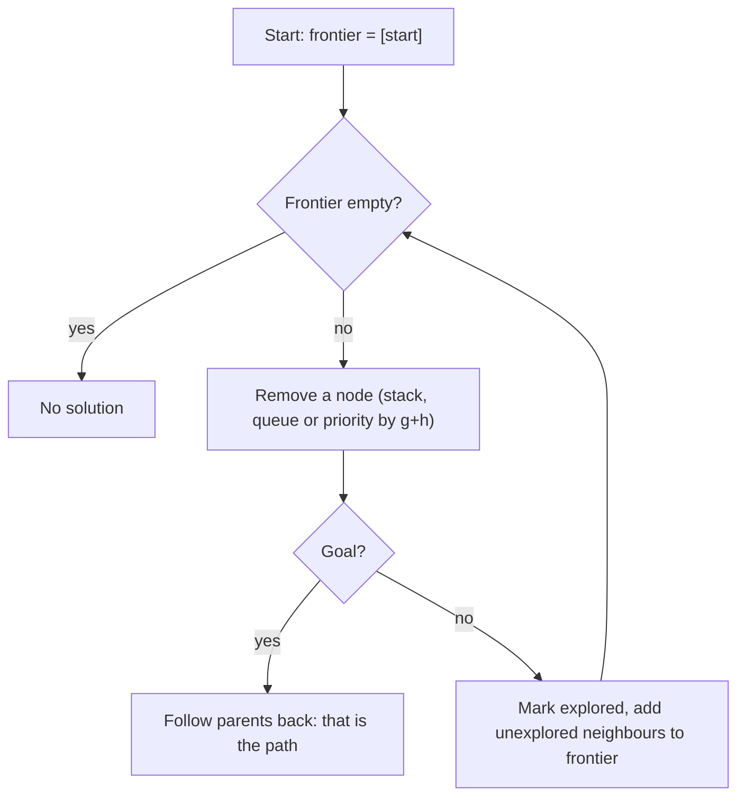
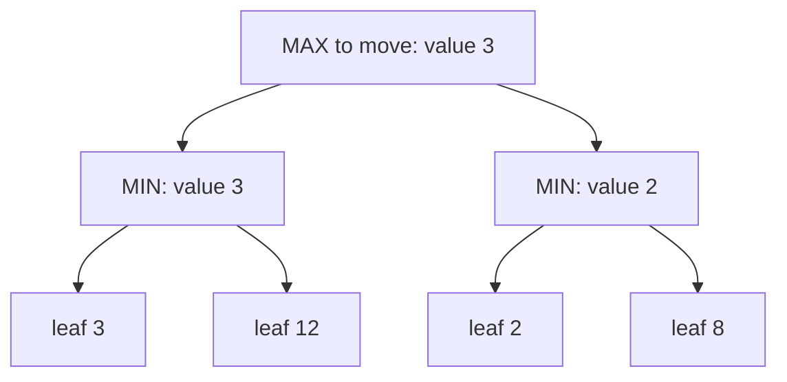
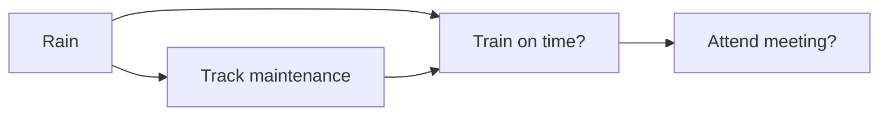

Before machine learning took over, "artificial intelligence" mostly meant something else: programs
that **search** through possibilities, **reason** with explicit rules, and **weigh uncertain
evidence** with probability. These classical techniques have not gone away. Route planners, game
engines, schedulers, type checkers and spam filters still use them, and modern AI agents are often
an LLM wrapped around a classic search loop. This session follows the first lectures of Harvard's
[CS50 AI](https://cs50.harvard.edu/ai/), and the standard textbook behind them is Russell and
Norvig's [Artificial Intelligence: A Modern Approach (AIMA)](https://aima.cs.berkeley.edu/).

> [!NOTE]
> Classical AI writes the knowledge in by hand: states, rules, probabilities. Machine learning
> (from session 8.2.1 onwards) learns that knowledge from data. Knowing both helps you choose: if
> you can write the rules down, you often don't need a model.

## Uninformed and informed search (BFS, A*)

Many problems can be stated as **search**: a starting **state**, a set of **actions**, a
**transition model** (what state an action leads to), a **goal test**, and a **path cost**. Solving
a maze, finding a route on a map, or solving a sliding puzzle all fit this shape.

Analogy: you are lost in a city. You can try streets systematically (uninformed), or you can use
the fact that the cathedral spire is visible to the north and head roughly that way (informed).

Every search algorithm keeps a **frontier** (states discovered but not yet explored) and an
**explored set** (so you don't loop forever). The only difference between them is **which state
you take out of the frontier next**.

| Algorithm | Frontier | Takes next | Finds shortest path? |
| --- | --- | --- | --- |
| Depth-first search (DFS) | Stack | Most recently added | No |
| Breadth-first search (BFS) | Queue | Oldest added | Yes, if every step costs the same |
| Greedy best-first | Priority queue | Smallest heuristic `h(n)` | No |
| **A\*** | Priority queue | Smallest `g(n) + h(n)` | Yes, with an admissible heuristic |

**Uninformed** search (DFS, BFS) knows nothing about where the goal is. **Informed** search uses a
**heuristic** `h(n)`: an estimate of the remaining cost from state `n` to the goal. In a grid maze,
the Manhattan distance (rows apart + columns apart) is a classic heuristic.

**A\*** combines the cost so far `g(n)` with the estimate `h(n)`. If the heuristic is
**admissible** (never overestimates the true cost) and **consistent** (never drops by more than the
step cost between neighbours), A* returns an optimal path while usually exploring far fewer states
than BFS.



> [!EXAMPLE]
> Here is BFS in Python. Swap `popleft()` for `pop()` and it becomes DFS; swap the deque for a
> `heapq` keyed by `g + h` and it becomes A*.
>
> ```python
> from collections import deque
>
> def bfs(start, goal, neighbours):
>     frontier = deque([start])
>     parent = {start: None}
>     while frontier:
>         node = frontier.popleft()
>         if node == goal:
>             path = []
>             while node is not None:
>                 path.append(node)
>                 node = parent[node]
>             return path[::-1]
>         for nxt in neighbours(node):
>             if nxt not in parent:
>                 parent[nxt] = node
>                 frontier.append(nxt)
>     return None
> ```

> [!TIP]
> "Six degrees of Kevin Bacon" is BFS on a graph of actors and films. That is exactly CS50 AI's
> first project, *Degrees*.

## Adversarial search (minimax)

In games like tic-tac-toe or chess, another agent is working **against** you. You can't plan a
single path; you have to plan for every reply.

**Minimax** models this. One player (MAX) wants the highest score, the other (MIN) the lowest. A
terminal state has a **utility**: +1 for a MAX win, -1 for a MIN win, 0 for a draw. The value of any
other state is computed recursively:

- On MAX's turn: the **maximum** value over all moves.
- On MIN's turn: the **minimum** value over all moves.

Analogy: before you move, imagine your opponent is perfect and will always pick the reply that
hurts you most. Pick the move whose worst case is best.



MIN will pick 3 on the left and 2 on the right, so MAX picks the left move worth 3.

The game tree grows exponentially, so two tricks make minimax practical:

- **Alpha-beta pruning**: skip branches that can't change the decision. If MAX already has a move
  worth 3, and a MIN node has already found a reply worth 2, MAX will never choose that node, so
  its other children need not be explored. Same answer, far less work.
- **Depth-limited search with an evaluation function**: stop at a fixed depth and estimate the
  value (in chess: material count, piece mobility). This is how classical chess engines worked for
  decades.

> [!WARNING]
> Minimax assumes an optimal opponent. Against a random or weak player it can be overly cautious;
> games with dice need **expectiminimax**, which averages over chance nodes instead of minimising.

## Knowledge representation and logic

A **knowledge-based agent** stores facts in a **knowledge base** (KB) and derives new facts by
**inference**. The simplest language for this is **propositional logic**: symbols (`P` = "it is
raining") joined by connectives.

| Connective | Symbol | Meaning |
| --- | --- | --- |
| Not | ¬P | P is false |
| And | P ∧ Q | Both true |
| Or | P ∨ Q | At least one true |
| Implication | P → Q | If P then Q (false only when P is true and Q false) |
| Biconditional | P ↔ Q | Same truth value |

The key question is **entailment**: does the KB guarantee a sentence α (written KB ⊨ α)? Two ways to
answer it:

1. **Model checking**: enumerate every possible assignment of true/false to the symbols (every
   "model"). If α is true in every model where the KB is true, the KB entails α. Simple but
   exponential: `n` symbols give `2^n` models.
2. **Inference rules**: apply sound rules such as *modus ponens* (from P → Q and P, conclude Q) or
   **resolution** (from P ∨ Q and ¬P, conclude Q). Resolution plus proof by contradiction is a
   complete method for propositional logic.

> [!EXAMPLE]
> KB: "If it's Tuesday, Harry goes to the lab" (T → L), "It's Tuesday" (T). Modus ponens gives L.
> CS50 AI's *Knights* project encodes "knights always tell the truth, knaves always lie" puzzles as
> logic sentences and lets model checking find who is who.

Propositional logic gets verbose fast: you need a separate symbol for every fact about every
object. **First-order logic** adds **objects**, **predicates** and **quantifiers** ("for all x",
"there exists x"), so "every person who studies passes" is one sentence rather than one per person.

Where you meet this today: SQL `WHERE` clauses, Datalog and Prolog, rule engines, SAT and SMT solvers
used in package managers and program verification, and policy languages for authorisation.

## Probabilistic reasoning

Logic is all-or-nothing, but the real world is uncertain: sensors are noisy, symptoms have
several causes. **Probabilistic reasoning** keeps degrees of belief between 0 and 1 and updates
them with evidence (the probability basics from Track 7 are exactly what you need here).

The workhorse is **Bayes' rule**:

```text
P(cause | evidence) = P(evidence | cause) * P(cause) / P(evidence)
```

Analogy: a smoke alarm goes off. How likely is a fire? It depends on how often the alarm fires
when there is a fire, how often it fires anyway (toast), and how rare fires are to begin with.

A **Bayesian network** is a directed graph where each node is a random variable and each edge
means "directly influences". Each node stores a conditional probability table given its parents.
The graph lets you write a huge joint distribution as a product of small local tables.



You query it by **inference**: exact enumeration for small networks, or **sampling** (simulate many
worlds, count how often the query holds) for big ones.

For things that change over time, **Markov models** assume the next state depends only on the
current one. A **hidden Markov model** adds observations you can see (an umbrella) generated by
states you can't (the weather). Speech recognition and part-of-speech tagging used HMMs for years.

> [!NOTE]
> CS50 AI's *PageRank* project models a "random surfer" as a Markov chain; *Heredity* is a
> Bayesian network inferring who carries a gene. Both are good warm-ups for thinking about ML
> models as probability distributions.

## Practice: complete one CS50 AI project

Pick **one** project from the first three CS50 AI lectures (Search, Knowledge, Uncertainty). The
course page lists each project's specification, starter code and the `check50` tests. Allow 3 to
5 hours.

| Lecture | Project | What you implement |
| --- | --- | --- |
| Search | Degrees | BFS shortest path between two actors |
| Search | Tic-Tac-Toe | Minimax for an unbeatable player |
| Knowledge | Knights | Logic sentences for knight/knave puzzles |
| Knowledge | Minesweeper | An AI that infers safe cells from clues |
| Uncertainty | PageRank | Sampling and iterative PageRank |
| Uncertainty | Heredity | Joint probabilities in a Bayesian network |

### Step 1: Watch the lecture first

Watch the lecture for your chosen project on [CS50 AI](https://cs50.harvard.edu/ai/). Pause at
each algorithm and predict the next step before it's shown.

### Step 2: Read the spec twice and the starter code once

Write down which functions you must implement, their inputs and outputs, and which are already
done. For Tic-Tac-Toe that's `player`, `actions`, `result`, `winner`, `terminal`, `utility` and
`minimax`.

### Step 3: Implement the small helpers first, with tests

Write a few `assert` checks for each helper before moving on. For minimax, test `winner` on boards
with a row, a column, a diagonal and no winner.

### Step 4: Implement the core algorithm

Write it plainly first. Then, if it's slow, add one optimisation (alpha-beta pruning, or caching
already-seen states) and measure the difference.

### Step 5: Reflect

Write a short note in your learning journal: what does the algorithm assume (perfect opponent,
admissible heuristic, independent evidence)? Where would those assumptions break in a real product?
If you want to go deeper, the matching chapters of [AIMA](https://aima.cs.berkeley.edu/) give the
proofs and many more variants.
