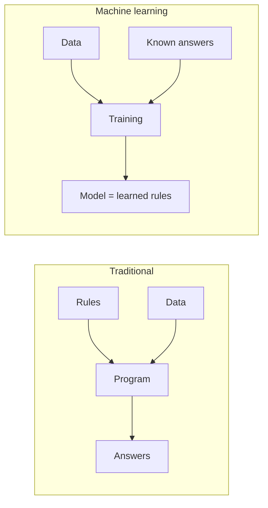
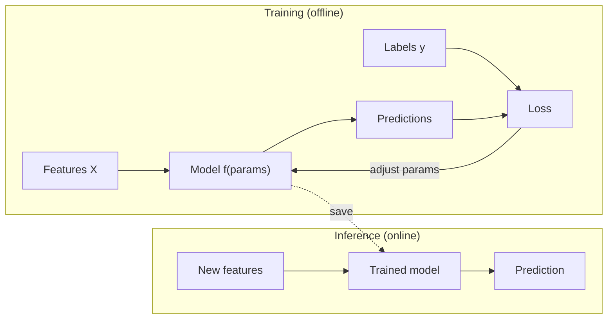
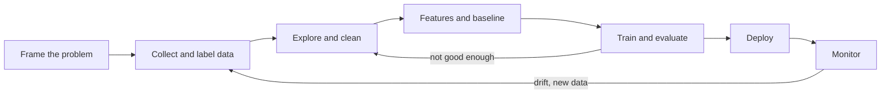

Traditional programming means you write the rules. **Machine learning (ML)** flips that: you
supply examples and let an algorithm find the rules. This session builds the vocabulary for
everything that follows in Track 8: what kinds of learning exist, what features and labels are, the
difference between training and inference, and how a real ML project moves from an idea to a
running system. The [Google Machine Learning Crash Course](https://developers.google.com/machine-learning/crash-course)
and [StatQuest](https://statquest.org/) videos are good companions throughout.

## Learning from data vs writing rules

Imagine you must sort incoming email into "spam" and "not spam".

- **Rules approach**: you write `if "free money" in subject: spam`. Then spammers write "fr3e
  m0ney". You add a rule. They adapt. Your rule file grows forever.
- **ML approach**: you collect 10,000 emails already labelled spam or not, and train a model that
  learns which patterns predict spam. When spammers adapt, you collect new examples and retrain.



Analogy: teaching a child to recognise dogs. You don't give them a definition ("four legs, fur,
barks"); you point at many dogs and non-dogs until they get it. A **model** is the result: a
function with many adjustable numbers (**parameters** or **weights**) tuned so its outputs match the
examples.

ML is a good fit when:

- The rules are too complex or numerous to write by hand (recognising faces, translating text).
- The rules change over time (fraud, spam, recommendations).
- You have, or can get, enough representative examples.

ML is a poor fit when a simple rule works, when you can't tolerate any error without
explanation, or when you have no data.

> [!WARNING]
> A model is only as good as its data. If the examples are biased, noisy or unrepresentative of the
> real world, the model learns those flaws faithfully. "Garbage in, garbage out" is the first law of
> ML.

## Supervised, unsupervised, reinforcement learning

There are three broad families, distinguished by **what feedback the algorithm gets**.

| Family | Feedback | Typical tasks | Example |
| --- | --- | --- | --- |
| **Supervised** | Each example has the correct answer (a label) | Classification, regression | Predict a house price; detect spam |
| **Unsupervised** | No labels at all | Clustering, dimensionality reduction, anomaly detection | Group customers by behaviour |
| **Reinforcement** | A reward signal after actions, often delayed | Control, games, sequential decisions | A robot learns to walk; a game agent learns to win |

Within supervised learning:

- **Classification** predicts a category: spam/not spam, which digit 0–9, which of 1,000 objects.
- **Regression** predicts a number: a price, a temperature, minutes until delivery.

Analogies:

- Supervised: studying with an answer key.
- Unsupervised: sorting a box of mixed buttons into piles without being told the categories.
- Reinforcement: learning to ride a bike. Nobody labels each muscle movement; you only find out
  whether you fell over.

> [!NOTE]
> Modern systems mix these. Large language models are first trained **self-supervised** (the
> "label" is just the next word in the text, so no human labelling is needed), then fine-tuned with
> supervised examples and reinforcement learning from human feedback. You'll meet this in session
> 8.5.4.

## Features, labels, training and inference

Some precise terms you will see in every ML library:

- **Example** (or sample, row): one data point. One house, one email.
- **Features** (inputs, usually `X`): the measurable properties of an example. For a house: area,
  number of rooms, postcode, year built.
- **Label** (target, usually `y`): the answer to predict. The sale price.
- **Model**: a function `f(X) → y_hat` with parameters. `y_hat` is the prediction.
- **Loss**: a number measuring how wrong the predictions are on the training examples.
- **Training**: adjusting parameters to minimise the loss. Expensive, done occasionally.
- **Inference** (prediction, serving): using the trained model on new inputs. Cheap, done
  constantly, often inside an API.



In scikit-learn, the whole idea fits in three lines, and this `fit` / `predict` pattern is shared by
almost every estimator:

```python
from sklearn.linear_model import LinearRegression

model = LinearRegression()
model.fit(X_train, y_train)          # training
predictions = model.predict(X_new)   # inference
```

> [!TIP]
> Features must be available **at prediction time**. A model predicting whether a customer will
> cancel can't use "date they cancelled" as a feature: that's the answer leaking in. Session 8.2.4
> covers this trap (data leakage) in detail.

## The ML project lifecycle

Training the model is a small part of a real ML project. Most of the effort sits before and after.



1. **Frame the problem.** What decision will the prediction support? What does success look like
   in business terms (fewer support tickets, less fraud), and what metric approximates it? Is ML
   even needed? Start with the simplest thing that might work.
2. **Collect and label data.** Where does it come from? Who labels it? Is it representative of
   the people and situations the model will face?
3. **Explore and clean.** Plot distributions, find missing values, duplicates, outliers and
   mislabelled rows (pandas from Track 7 earns its keep here).
4. **Features and a baseline.** Build a trivial baseline first: "always predict the average price"
   or "always predict not-spam". Every model must beat it.
5. **Train and evaluate** on data the model has never seen, with a metric that matches the goal.
6. **Deploy** behind an API or in a batch job, with versioning so you can roll back.
7. **Monitor.** The world changes (**data drift**): new spam tricks, new products, a pandemic.
   Track input distributions and accuracy, and retrain when they slip.

> [!WARNING]
> The most common failure is not a bad algorithm; it's solving the wrong problem or measuring the
> wrong thing. A fraud model that's "99% accurate" when 99% of transactions are legitimate may catch
> no fraud at all.

## Practice: frame three real problems as ML tasks

You won't write code today. You'll practise the most underrated ML skill: **framing**. Allow about
an hour.

### Step 1: Pick three problems

Choose three from your own life or work, ideally of different kinds. Some ideas: predicting how
long a pull request will wait for review; flagging support emails that need urgent attention;
grouping your saved articles by topic; recommending which YouCanDoIt session to do next; deciding
when a home thermostat should switch on.

### Step 2: Fill in a framing card for each

| Question | Your answer |
| --- | --- |
| What decision does the prediction support? | |
| Supervised, unsupervised or reinforcement? Why? | |
| If supervised: classification or regression? What exactly is the label? | |
| What features would be available **at prediction time**? | |
| Where does the data come from, and who labels it? | |
| What's the simplest baseline (a rule or a constant)? | |
| What metric would you use, and what business outcome does it stand for? | |
| What happens when the model is wrong? Which error is worse? | |
| Could a simple rule do this instead? | |

### Step 3: Worked example

> [!EXAMPLE]
> **Urgent support emails.** Decision: which emails a human reads first. Type: supervised binary
> classification; label = "was escalated within 1 hour" from past tickets. Features: subject and
> body text, customer plan, number of previous tickets. Baseline: keyword rule ("outage", "down",
> "refund"). Metric: recall on urgent emails (missing one is costly) while keeping precision high
> enough that the urgent queue stays small. Wrong answer cost: a missed outage report is far worse
> than a false alarm.

### Step 4: Sanity check

For each card, ask: would I bet that a model beats the baseline by enough to justify building and
maintaining it? If not, write down what data you'd need to change your mind. Keep the cards: you'll
reuse one of them in later sessions.
