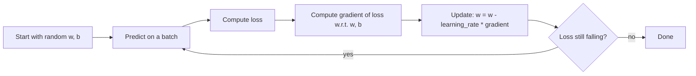

**Regression** predicts a number: a price, a duration, a temperature. It's the simplest supervised
learning task and the best place to see every moving part of ML clearly: a model with parameters, a
loss that measures error, an optimiser that reduces it, regularisation that keeps it honest, and
metrics that tell you whether it's any good. Everything here reappears, scaled up, in neural
networks. The [Google ML Crash Course](https://developers.google.com/machine-learning/crash-course)
covers linear regression and gradient descent step by step, and the
[scikit-learn User Guide](https://scikit-learn.org/stable/user_guide.html) documents the linear
models used below.

## Linear regression and loss functions

Analogy: you scatter dots on a chart (house size on the x-axis, price on the y-axis) and lay a ruler
through them so it passes as close to all the dots as possible. That ruler is a linear regression
model.

With one feature the model is a line:

```text
y_hat = w * x + b
```

`w` is the **weight** (slope: how much the price rises per extra square metre) and `b` the **bias**
(intercept). With many features it's a weighted sum, one weight per feature:

```text
y_hat = w1*x1 + w2*x2 + ... + wn*xn + b
```

How close is "close"? A **loss function** turns the errors into one number. For each example the
**residual** is `y - y_hat`. The common losses:

| Loss | Formula (averaged over examples) | Behaviour |
| --- | --- | --- |
| **MSE** (mean squared error, L2 loss) | mean of `(y - y_hat)^2` | Punishes big errors heavily; smooth, easy to optimise |
| **MAE** (mean absolute error, L1 loss) | mean of `abs(y - y_hat)` | Treats all errors linearly; robust to outliers |
| Huber | MSE for small errors, MAE for large | A compromise |

Linear regression usually minimises MSE. Training means finding the `w` and `b` that make the loss
as small as possible.

> [!NOTE]
> **Polynomial regression** is still linear regression: you add features like `x^2` and `x^3`, and
> the model stays a weighted sum of them. The curve bends, but the maths and the code don't change.
> In scikit-learn, `PolynomialFeatures` generates the extra columns.

## Training with gradient descent

For plain linear regression there's a closed-form solution, but it doesn't scale to millions of
features or to neural networks. The general method is **gradient descent**.

Analogy: you're on a foggy hillside and want to reach the valley floor. You can't see far, but you
can feel the slope under your feet. Take a small step downhill. Repeat. The "hill" is the loss as a
function of the parameters, and the slope is the **gradient** (the derivatives from Track 7).



Key knobs:

- **Learning rate**: the step size. Too small and training crawls; too large and the loss bounces
  around or explodes.
- **Batch size**: how many examples per gradient estimate. All of them is *batch* gradient descent;
  one at a time is *stochastic* (SGD); a few dozen to a few thousand is *mini-batch*, the usual
  choice.
- **Epoch**: one full pass over the training data.

> [!EXAMPLE]
> Gradient descent for one feature in NumPy:
>
> ```python
> import numpy as np
>
> w, b, lr = 0.0, 0.0, 0.01
> for epoch in range(1000):
>     y_hat = w * x + b
>     error = y_hat - y
>     dw = 2 * np.mean(error * x)   # d(MSE)/dw
>     db = 2 * np.mean(error)       # d(MSE)/db
>     w -= lr * dw
>     b -= lr * db
> ```

> [!TIP]
> Gradient descent converges much faster when features are on similar scales. If one feature is in
> square metres (hundreds) and another is a 0/1 flag, standardise them first (subtract the mean,
> divide by the standard deviation). `StandardScaler` does this in scikit-learn.

## Regularisation (L1, L2)

Give a model enough features, especially high-degree polynomials, and it can thread a curve through
every training point, noise included. It will then predict badly on new data. That is
**overfitting**, and session 8.2.4 is all about it.

**Regularisation** adds a penalty for large weights to the loss, so the model prefers simpler
explanations:

```text
loss = MSE + lambda * penalty(weights)
```

| Type | Penalty | scikit-learn | Effect |
| --- | --- | --- | --- |
| **L2** (ridge) | sum of `w^2` | `Ridge(alpha=...)` | Shrinks all weights smoothly towards zero |
| **L1** (lasso) | sum of `abs(w)` | `Lasso(alpha=...)` | Drives some weights exactly to zero: built-in feature selection |
| Both | mix | `ElasticNet` | Balance between the two |

`lambda` (called `alpha` in scikit-learn) controls the strength: zero means no regularisation, very
large means the model barely uses its features. You choose it on validation data, not training data.

Analogy: a judge who asks witnesses to explain with as few assumptions as possible. L2 tells every
witness to tone it down; L1 dismisses the least useful witnesses entirely.

> [!WARNING]
> Regularisation penalises weight size, so it's unfair if features are on different scales: a
> feature measured in millimetres needs a much smaller weight than the same thing in metres. Always
> scale before using `Ridge` or `Lasso`.

## Metrics: MAE, MSE, R²

The loss you train on and the metric you report don't have to be the same. Metrics are for humans
and decisions.

| Metric | Unit | Read it as | scikit-learn |
| --- | --- | --- | --- |
| **MAE** | Same as target (euros) | "On average we're off by this much" | `mean_absolute_error` |
| **MSE** | Target squared | Hard to read; penalises big misses | `mean_squared_error` |
| **RMSE** | Same as target | Like MAE but big misses weigh more | `root_mean_squared_error` (recent versions) or `sqrt` of MSE |
| **R²** | None | Share of variance explained: 1 is perfect, 0 is "no better than predicting the mean", negative is worse than that | `r2_score` |

> [!EXAMPLE]
> A model predicting house prices has MAE 18,000 EUR and R² 0.78. Translation for a stakeholder:
> "Typical error is about 18k, and the model explains roughly three quarters of the variation in
> price." Whether 18k is acceptable depends on the use: fine for a rough valuation widget, not for a
> mortgage decision.

Always compare to a **baseline**. `DummyRegressor(strategy="mean")` predicts the training average
for everything; if your model's MAE isn't clearly better, the features aren't helping.

## Practice: predict house prices

Use scikit-learn's California housing dataset (district-level median house values from the 1990
US census). Allow 1.5 to 2 hours.

### Step 1: Load and explore

```python
from sklearn.datasets import fetch_california_housing

data = fetch_california_housing(as_frame=True)
df = data.frame
print(df.describe())
print(df.corr()["MedHouseVal"].sort_values())
```

Plot `MedInc` (median income) against `MedHouseVal`. Notice the cap at 5 (values above 500k were
clipped): a real-world quirk worth noting.

### Step 2: Split

```python
from sklearn.model_selection import train_test_split

X = df.drop(columns="MedHouseVal")
y = df["MedHouseVal"]
X_train, X_test, y_train, y_test = train_test_split(X, y, test_size=0.2, random_state=42)
```

### Step 3: Baseline, then linear models

```python
from sklearn.dummy import DummyRegressor
from sklearn.linear_model import LinearRegression, Ridge, Lasso
from sklearn.pipeline import make_pipeline
from sklearn.preprocessing import StandardScaler
from sklearn.metrics import mean_absolute_error, r2_score

models = {
    "baseline": DummyRegressor(),
    "linear": make_pipeline(StandardScaler(), LinearRegression()),
    "ridge": make_pipeline(StandardScaler(), Ridge(alpha=1.0)),
    "lasso": make_pipeline(StandardScaler(), Lasso(alpha=0.01)),
}
for name, model in models.items():
    model.fit(X_train, y_train)
    pred = model.predict(X_test)
    print(f"{name:9} MAE={mean_absolute_error(y_test, pred):.3f} R2={r2_score(y_test, pred):.3f}")
```

### Step 4: Add polynomial features

Add `PolynomialFeatures(degree=2)` before the scaler and compare. Then try `degree=3`. Does test
R² keep improving, or does it drop while training R² rises? That gap is overfitting, and stronger
`Ridge` regularisation should close it.

### Step 5: Write gradient descent yourself

Train a linear model on standardised `X_train` with your own NumPy gradient descent loop (extend the
example above to a weight vector). Plot loss against epoch for three learning rates. Confirm your
weights end up close to `LinearRegression().coef_`.

### Step 6: Report

Write five lines: best model, its MAE in dollars (the target is in units of 100,000), how it
compares with the baseline, which features Lasso kept, and one idea for improvement.
