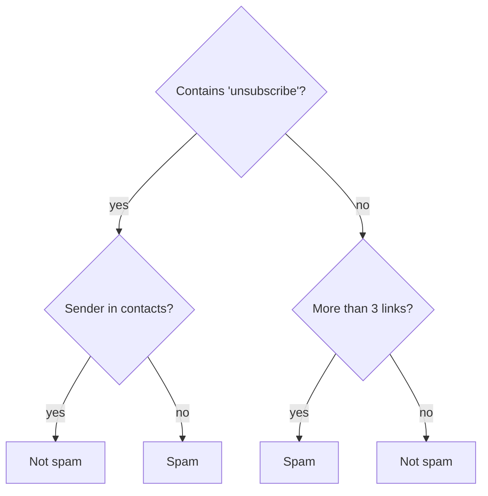
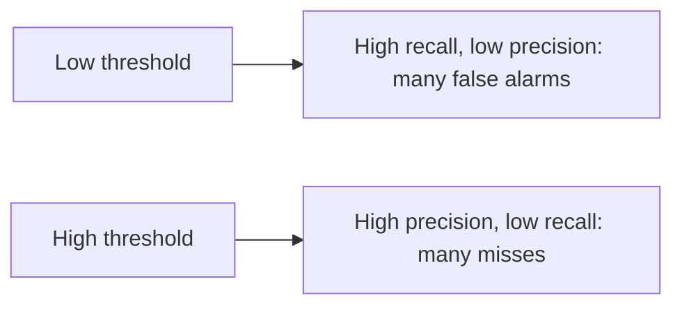

**Classification** predicts a category: spam or not, fraud or not, which of ten digits, which
product category. It's the most common ML task in industry. This session covers the two big
families of classifiers you'll use on tabular data (linear models and tree ensembles), then the part
people most often get wrong: choosing a metric that reflects what the business actually cares
about. Sources: the [Google ML Crash Course](https://developers.google.com/machine-learning/crash-course),
the [scikit-learn User Guide](https://scikit-learn.org/stable/user_guide.html) and
[StatQuest](https://statquest.org/), whose videos on logistic regression, trees and ROC curves are
excellent.

## Logistic regression

Despite the name, **logistic regression** is a classifier. It takes the weighted sum from linear
regression and squeezes it into a probability between 0 and 1 with the **sigmoid** function:

```text
z = w1*x1 + ... + wn*xn + b
p = sigmoid(z) = 1 / (1 + e^(-z))
```

Analogy: a dimmer switch instead of an on/off switch. Large positive `z` gives a probability near 1,
large negative near 0, and `z = 0` gives exactly 0.5.

To get a class you apply a **threshold**: predict "spam" if `p >= 0.5`. The threshold is a business
choice, not a law of nature (more on that below).

The loss is **log loss** (binary cross-entropy): it punishes confident wrong answers very hard. Being
90% sure an email is spam when it isn't costs much more than being 55% sure.

```python
from sklearn.linear_model import LogisticRegression

clf = LogisticRegression(max_iter=1000)
clf.fit(X_train, y_train)
proba = clf.predict_proba(X_test)[:, 1]   # probability of the positive class
labels = clf.predict(X_test)              # uses threshold 0.5
```

> [!TIP]
> Logistic regression is the best first model for almost any classification problem: fast,
> regularised by default in scikit-learn, and interpretable. Each weight tells you how a feature
> pushes the log-odds up or down. Beat it before reaching for anything fancier.

For more than two classes, **softmax** generalises the sigmoid: one score per class, turned into
probabilities that sum to 1. You'll see softmax again at the output of every neural classifier and
every LLM.

## Decision trees, random forests and gradient boosting

A **decision tree** asks a sequence of yes/no questions about features, like a game of twenty
questions.



Training picks, at each node, the question that best separates the classes (measured by **Gini
impurity** or **entropy**). Trees handle mixed feature types, need no scaling, and are easy to
explain. But a single deep tree memorises its training data: it **overfits** badly.

Two ensemble ideas fix this:

| Method | Idea | Analogy | scikit-learn |
| --- | --- | --- | --- |
| **Random forest** | Train many deep trees on random samples of rows and features; average their votes | Ask a crowd of independent experts | `RandomForestClassifier` |
| **Gradient boosting** | Train shallow trees one after another, each correcting the previous ones' errors | A student who reviews only the questions they got wrong | `HistGradientBoostingClassifier`, XGBoost, LightGBM |

Random forests are hard to break and need little tuning. Gradient boosting usually wins on accuracy
for tabular data, at the cost of more hyperparameters (learning rate, number of trees, depth).

> [!NOTE]
> On tabular business data (rows and columns, like a spreadsheet), gradient-boosted trees remain
> the strongest default, often beating neural networks. Neural networks shine on images, audio and
> text.

## Precision, recall, F1, ROC-AUC

Start with the **confusion matrix**, which counts the four possible outcomes:

| | Predicted positive | Predicted negative |
| --- | --- | --- |
| **Actually positive** | True positive (TP) | False negative (FN): missed |
| **Actually negative** | False positive (FP): false alarm | True negative (TN) |

From it:

- **Accuracy** = (TP + TN) / all. Misleading when classes are imbalanced.
- **Precision** = TP / (TP + FP). "When I say spam, how often am I right?"
- **Recall** (sensitivity) = TP / (TP + FN). "Of all the spam, how much did I catch?"
- **F1** = harmonic mean of precision and recall. One number that is high only when both are high.

Analogy: a fishing net. Recall is how many of the fish in the lake you caught; precision is how much
of what's in your net is actually fish rather than old boots.

Precision and recall trade off through the threshold. Raise the threshold and you flag fewer emails:
precision goes up, recall goes down.



**ROC-AUC** measures ranking quality across *all* thresholds. The ROC curve plots the true positive
rate against the false positive rate as the threshold moves; the area under it (AUC) is 0.5 for
random guessing and 1.0 for perfect ranking. Read AUC as: "the probability that a random positive
example scores higher than a random negative one". For heavily imbalanced data the
**precision-recall curve** (and its average precision) is often more informative.

> [!EXAMPLE]
> Matching metric to business: a **cancer screening** test should maximise recall (a miss is
> catastrophic; a false alarm means a follow-up test). A **spam filter** should favour precision (a
> real email lost in spam is worse than one spam in the inbox). A **fraud** system often fixes a
> budget: "our team can review 200 alerts a day", then maximises recall within it.

## Class imbalance

In many real problems the interesting class is rare: fraud in 0.1% of transactions, defects in 1%
of parts. A model that always predicts "normal" scores 99.9% accuracy and is useless.

Remedies, in the order to try them:

1. **Use the right metric**: precision, recall, F1, PR-AUC, never plain accuracy.
2. **Tune the threshold** on validation data to the precision/recall balance you need.
3. **Class weights**: tell the loss that mistakes on the rare class cost more.
   `LogisticRegression(class_weight="balanced")` and most tree models support this.
4. **Resampling**: undersample the majority class or oversample the minority (the
   `imbalanced-learn` library offers SMOTE and others). Resample **only the training set**.
5. **Get more positive examples**, if at all possible. It beats any trick.

> [!WARNING]
> Use a **stratified** split (`train_test_split(..., stratify=y)`) so the rare class appears in the
> same proportion in training and test sets. With 50 fraud cases, a random split can leave the test
> set with almost none.

## Practice: spam classifier

Build a text classifier on a labelled SMS or email spam dataset (the SMS Spam Collection, about
5,500 messages, is a common choice and easy to find). Allow about 2 hours.

### Step 1: Load and inspect

```python
import pandas as pd

df = pd.read_csv("spam.csv")          # columns: label ("ham"/"spam"), text
print(df["label"].value_counts(normalize=True))
y = (df["label"] == "spam").astype(int)
```

Note the class balance: you'll need it to judge your metrics.

### Step 2: Turn text into features

Models need numbers. **TF-IDF** turns each message into a vector of word weights: frequent in this
message, rare across messages, means high weight.

```python
from sklearn.model_selection import train_test_split
from sklearn.feature_extraction.text import TfidfVectorizer
from sklearn.pipeline import make_pipeline
from sklearn.linear_model import LogisticRegression

X_train, X_test, y_train, y_test = train_test_split(
    df["text"], y, test_size=0.2, stratify=y, random_state=42
)
model = make_pipeline(TfidfVectorizer(ngram_range=(1, 2), min_df=2),
                      LogisticRegression(max_iter=1000))
model.fit(X_train, y_train)
```

### Step 3: Evaluate properly

```python
from sklearn.metrics import classification_report, confusion_matrix, roc_auc_score

pred = model.predict(X_test)
proba = model.predict_proba(X_test)[:, 1]
print(confusion_matrix(y_test, pred))
print(classification_report(y_test, pred, target_names=["ham", "spam"]))
print("ROC-AUC", roc_auc_score(y_test, proba))
```

### Step 4: Compare models

Swap the classifier for `MultinomialNB()` (naive Bayes, a classic for spam) and for
`RandomForestClassifier()`. Put precision, recall and F1 for the spam class in a table.

### Step 5: Choose a threshold

Decide that losing a real message is worse than seeing spam. Use `precision_recall_curve` to find
the lowest threshold that keeps spam precision at or above 0.99, and report the recall you get
there.

### Step 6: Inspect errors

Print ten false positives and ten false negatives. Are there patterns (short messages, numbers,
another language)? Write down one feature idea that might fix them.
