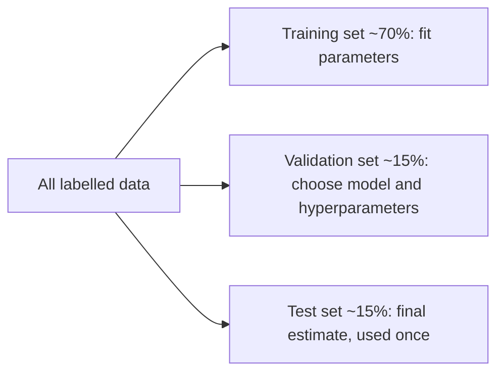
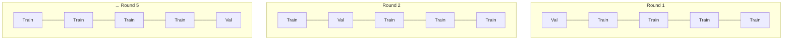
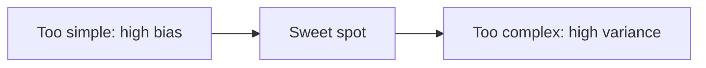

A model that scores 99% on the data it was trained on has proved almost nothing. The question that
matters is: **how will it do on data it has never seen?** That's **generalisation**, and measuring
it honestly is harder than it sounds. This session covers how to split data, how cross-validation
gives more reliable estimates, why models underfit or overfit, and the silent killer of ML
projects: data leakage. The [Google ML Crash Course](https://developers.google.com/machine-learning/crash-course)
covers splits and overfitting; the [scikit-learn User Guide](https://scikit-learn.org/stable/user_guide.html)
has whole chapters on cross-validation and common pitfalls.

## Train, validation and test splits

Analogy: a student preparing for an exam.

- The **training set** is the textbook exercises they practise on.
- The **validation set** is the mock exams they use to decide how to study (more of this chapter,
  less of that).
- The **test set** is the real exam, seen once, at the very end.

If the student sees the real exam questions while studying, their score says nothing about what
they learned. Same for models.



- **Parameters** (weights) are learned from the training set.
- **Hyperparameters** (regularisation strength, tree depth, learning rate) are chosen by comparing
  validation scores.
- The **test set** gives a final, unbiased estimate. If you look at test scores and go back to
  tweak, it becomes another validation set and stops being honest.

```python
from sklearn.model_selection import train_test_split

X_temp, X_test, y_temp, y_test = train_test_split(X, y, test_size=0.15, random_state=0)
X_train, X_val, y_train, y_val = train_test_split(X_temp, y_temp, test_size=0.18, random_state=0)
```

> [!WARNING]
> A random split is not always right. If the model will predict the **future**, split by **time**:
> train on January–September, test on October–December. If one customer has many rows, split by
> **customer** so the same person isn't on both sides (`GroupShuffleSplit`). The split must imitate
> how the model will be used.

## Cross-validation

A single validation split is noisy, especially with small datasets: a lucky or unlucky split can
swing your score by several points. **k-fold cross-validation** reuses the data more efficiently.

1. Split the training data into `k` equal **folds** (often 5 or 10).
2. Train `k` times, each time holding out a different fold for validation.
3. Report the mean and standard deviation of the `k` scores.



```python
from sklearn.model_selection import cross_val_score, StratifiedKFold
from sklearn.linear_model import LogisticRegression

cv = StratifiedKFold(n_splits=5, shuffle=True, random_state=0)
scores = cross_val_score(LogisticRegression(max_iter=1000), X_train, y_train, cv=cv, scoring="f1")
print(f"F1 = {scores.mean():.3f} ± {scores.std():.3f}")
```

Variants in scikit-learn: `StratifiedKFold` keeps class proportions (use it for classification),
`GroupKFold` keeps groups together, `TimeSeriesSplit` always validates on data after the training
window.

> [!TIP]
> The standard deviation matters as much as the mean. If model A scores 0.84 ± 0.03 and model B
> 0.85 ± 0.04, you have no evidence that B is better. Prefer the simpler one.

Cross-validation is for choosing between models and hyperparameters. You still keep a separate test
set for the final number.

## Bias–variance trade-off

Prediction error on new data comes from two main sources (plus irreducible noise):

- **Bias**: the model is too simple to capture the pattern. A straight line through a curved
  relationship. It's wrong in the same way on training and test data: **underfitting**.
- **Variance**: the model is so flexible it fits the noise in this particular training set. Change
  the training set slightly and its predictions change a lot: **overfitting**.

Analogy: archery. High bias means all arrows land tightly together but off-centre. High variance
means they're centred on average but scattered everywhere.

| Symptom | Training score | Validation score | Diagnosis | Remedies |
| --- | --- | --- | --- | --- |
| Both bad | Low | Low | High bias (underfitting) | More features, more flexible model, less regularisation |
| Big gap | High | Much lower | High variance (overfitting) | More data, simpler model, more regularisation, early stopping |
| Both good, small gap | High | High | Good fit | Ship it (after the test set agrees) |



A **learning curve** (score against training set size) and a **validation curve** (score against a
hyperparameter like tree depth) make this visible. scikit-learn has `learning_curve` and
`validation_curve` helpers.

> [!NOTE]
> Very large neural networks sometimes generalise well despite being able to memorise their training
> data, which complicates the classic picture. The practical rule still holds: compare training and
> validation scores and act on the gap.

## Data leakage

**Data leakage** is when information that won't be available at prediction time sneaks into
training or evaluation. The result: excellent scores in the notebook, disappointment in production.

Analogy: a student who scores 100% because the answer sheet was stapled to the back of the exam.

Common forms:

| Leak | Example | Fix |
| --- | --- | --- |
| **Preprocessing on all data** | Fitting `StandardScaler` or an imputer on the whole dataset before splitting: the test set's statistics leak into training | Split first; fit preprocessing on training data only, ideally inside a `Pipeline` |
| **Target leakage** | Predicting churn with a feature "number of retention calls", which only happens after customers say they'll leave | Ask of every feature: "would I know this at the moment of prediction?" |
| **Duplicate or related rows** | The same patient's scans in train and test | Group-aware splits |
| **Time travel** | Random split on time-series data; features computed with future values | Time-based splits; compute features with past data only |
| **Tuning on test** | Choosing hyperparameters by test score | Tune on validation or cross-validation; touch test once |

> [!WARNING]
> A suspiciously good score is a bug report. If your first model hits 0.99 AUC on a hard problem,
> look for leakage before celebrating. Check which features matter most: a leaky one often dominates.

The best defence is a scikit-learn **`Pipeline`**: preprocessing and model are fitted together, and
cross-validation refits the whole pipeline on each training fold, so validation folds never
influence preprocessing. Session 8.2.6 builds pipelines properly.

## Practice: fix a leaky evaluation

You'll create a leak on purpose, measure its effect, and fix it. Allow about 1.5 hours.

### Step 1: The leaky version

This uses scikit-learn's breast cancer dataset and does feature selection **before** splitting, a
classic leak.

```python
import numpy as np
from sklearn.datasets import load_breast_cancer
from sklearn.feature_selection import SelectKBest, f_classif
from sklearn.linear_model import LogisticRegression
from sklearn.model_selection import cross_val_score
from sklearn.preprocessing import StandardScaler

X, y = load_breast_cancer(return_X_y=True)
rng = np.random.default_rng(0)
X = np.hstack([X, rng.normal(size=(X.shape[0], 5000))])   # add 5,000 pure-noise features
y_random = rng.permutation(y)                               # labels with NO real signal

X_scaled = StandardScaler().fit_transform(X)                       # leak 1
X_sel = SelectKBest(f_classif, k=20).fit_transform(X_scaled, y_random)  # leak 2
print(cross_val_score(LogisticRegression(max_iter=1000), X_sel, y_random, cv=5).mean())
```

The labels are shuffled, so no honest model can beat roughly the majority-class rate (about 0.63
here). Note the score you get.

### Step 2: Explain the leak

Write two sentences: why does choosing the 20 "best" features on all rows make random labels look
predictable? (Hint: with 5,000 noise columns, some correlate with the labels by chance, including on
the rows that later become validation folds.)

### Step 3: Fix it with a pipeline

```python
from sklearn.pipeline import make_pipeline

pipe = make_pipeline(StandardScaler(), SelectKBest(f_classif, k=20),
                     LogisticRegression(max_iter=1000))
print(cross_val_score(pipe, X, y_random, cv=5).mean())
```

The score should drop to chance level. Now run the fixed pipeline with the real `y` and confirm it
still learns well.

### Step 4: Find a target leak

Load any tabular dataset you know (or the housing data from session 8.2.2), add a column derived
from the target (for example the target plus small noise), and watch the score jump. Then check
which feature the model relies on most (`coef_` or `feature_importances_`). This is how you spot
leaks in real projects.

### Step 5: Write a checklist

Write a five-line "honest evaluation" checklist for your own future projects: split strategy,
preprocessing inside pipelines, feature availability check, test set used once, and suspicion of
scores that look too good.
