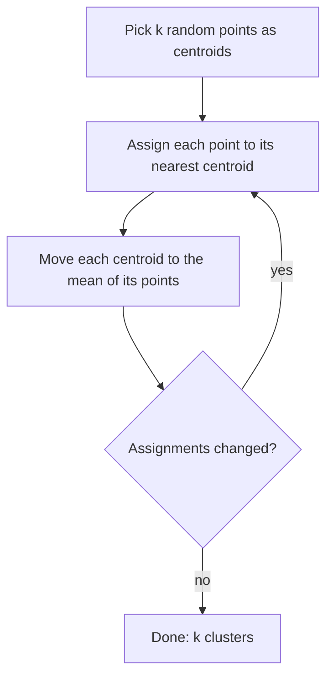

Most of the world's data has no labels. Nobody has tagged your saved articles by topic, your
customers by behaviour, or your server logs as normal or strange. **Unsupervised learning** finds
structure without answers to learn from: groups (**clustering**), simpler representations
(**dimensionality reduction**), and things that don't fit (**anomaly detection**). These techniques
are everywhere in AI engineering: you'll cluster embeddings, visualise them in 2D, and flag odd
inputs. The [scikit-learn User Guide](https://scikit-learn.org/stable/user_guide.html) has chapters
on each, and [StatQuest](https://statquest.org/) explains k-means, PCA and t-SNE visually.

## k-means and hierarchical clustering

Analogy: you tip a jar of mixed buttons onto a table and push them into piles of similar ones. No
one told you the categories; you discover them.

**k-means** is the classic algorithm. You choose `k`, the number of clusters, then:



It's fast and simple, but it has assumptions you should know:

- You must pick `k`. Try several values and use the **elbow method** (plot within-cluster
  distance, look for the bend) or the **silhouette score** (how much closer points are to their own
  cluster than to the next one; from -1 to 1, higher is better).
- It assumes roughly round, similar-sized clusters, because it uses distance to a centre.
- It depends on scale: standardise features first (or, for embeddings, normalise vectors).
- Random starts can give different answers; scikit-learn runs several (`n_init`) and keeps the best.

**Hierarchical (agglomerative) clustering** builds a tree instead: start with every point as its own
cluster and repeatedly merge the two closest clusters. The result is a **dendrogram**, which you can
cut at any height to get as many clusters as you like. The **linkage** decides what "closest" means
between clusters: `ward` (minimise variance, a good default), `average`, `complete`, `single`.

| | k-means | Agglomerative | DBSCAN |
| --- | --- | --- | --- |
| Choose number of clusters? | Yes, up front | Cut the tree later | No; choose density parameters |
| Cluster shape | Round | Depends on linkage | Any shape |
| Handles noise points | No | No | Yes, labels them as noise |
| Scales to large data | Well | Poorly (quadratic memory) | Moderately |

> [!TIP]
> **DBSCAN** and its successor **HDBSCAN** (both in scikit-learn) find clusters as dense regions and
> leave sparse points unassigned. They're often a better fit for embeddings, where some items simply
> don't belong to any group.

## Dimensionality reduction (PCA, t-SNE, UMAP)

Data often has many features: a text embedding from `nomic-embed-text` (the model YouCanDoIt uses)
has 768 dimensions. You can't plot that, distance calculations get slow, and many dimensions are
redundant. **Dimensionality reduction** maps data to fewer dimensions while keeping as much structure
as possible.

Analogy: a shadow. A 3D object casts a 2D shadow; a good light angle keeps the shape recognisable.

| Method | Type | Preserves | Use for |
| --- | --- | --- | --- |
| **PCA** | Linear | Global variance | Compression, denoising, speed-up before other models, quick 2D plots |
| **t-SNE** | Non-linear | Local neighbourhoods | Visualising clusters in 2D |
| **UMAP** | Non-linear | Local and some global structure | Visualisation, and as a preprocessing step for clustering |

**PCA (principal component analysis)** finds the directions along which data varies most (the
eigenvectors of the covariance matrix, from Track 7) and projects onto the top few. It's
deterministic, fast, and reversible-ish: `explained_variance_ratio_` tells you how much information
each component keeps.

**t-SNE** places points in 2D so that neighbours in high-dimensional space stay neighbours. It makes
beautiful cluster plots, but:

> [!WARNING]
> In t-SNE (and to a lesser extent UMAP) plots, **cluster sizes and the distances between clusters
> mean little**. Results also change with the `perplexity` setting and the random seed. Use them to
> explore, never as evidence on their own.

**UMAP** (the `umap-learn` package, not part of scikit-learn) is faster than t-SNE on large data and
tends to keep more of the global layout.

```python
from sklearn.decomposition import PCA
from sklearn.manifold import TSNE

X_pca = PCA(n_components=50).fit_transform(X)       # compress first
X_2d = TSNE(n_components=2, perplexity=30).fit_transform(X_pca)
```

## Anomaly detection

**Anomaly detection** (outlier detection) flags items that don't look like the rest: fraudulent
transactions, failing machines, attacks in network logs, a corrupted record.

Analogy: a security guard who doesn't know what a burglar looks like, but knows very well what the
normal evening crowd looks like.

Approaches, from simple to sophisticated:

1. **Statistical rules**: values more than 3 standard deviations from the mean, or outside the
   interquartile range. Great for single metrics.
2. **Distance and density**: points far from their neighbours. `LocalOutlierFactor` compares each
   point's local density with its neighbours'.
3. **Isolation Forest**: random trees split the data; anomalies get isolated in fewer splits because
   they're few and different. `IsolationForest` is a strong default for tabular data.
4. **Reconstruction error**: compress with PCA or an autoencoder and rebuild; anomalies rebuild
   badly.

```python
from sklearn.ensemble import IsolationForest

detector = IsolationForest(contamination=0.01, random_state=0).fit(X_train)
flags = detector.predict(X_new)          # -1 = anomaly, 1 = normal
scores = detector.score_samples(X_new)   # lower = more anomalous
```

> [!NOTE]
> `contamination` is your guess at the share of anomalies; it sets the threshold. In practice you
> rank by score and have a human review the top of the list, then use their verdicts as labels to
> improve the system: unsupervised often turns into supervised over time.

## Practice: cluster articles by topic using embeddings

You'll embed a set of articles, cluster them, and inspect whether the clusters make sense. This
previews semantic search and RAG in Track 9. Allow about 2 hours.

### Step 1: Collect texts

Gather 100 to 300 short texts: article titles and summaries from your reading list, RSS feeds or
your own notes. Aim for 4 to 6 rough topics so you can judge the result. Save them as a list of
strings.

### Step 2: Embed them

Use a local embedding model with Ollama (the same one this platform uses):

```sh
ollama pull nomic-embed-text
```

```python
import httpx
import numpy as np

def embed(texts):
    r = httpx.post("http://localhost:11434/api/embed",
                   json={"model": "nomic-embed-text", "input": texts}, timeout=120)
    r.raise_for_status()
    return np.array(r.json()["embeddings"])

X = embed(texts)
X = X / np.linalg.norm(X, axis=1, keepdims=True)   # unit length: Euclidean ~ cosine
```

### Step 3: Choose k and cluster

```python
from sklearn.cluster import KMeans
from sklearn.metrics import silhouette_score

for k in range(2, 11):
    labels = KMeans(n_clusters=k, n_init=10, random_state=0).fit_predict(X)
    print(k, round(silhouette_score(X, labels), 3))
```

Pick the `k` with a good silhouette score that also makes sense to you.

### Step 4: Name the clusters

For each cluster, print the five texts closest to its centroid. Write a one-line topic name for
each. Are any clusters mixed, or is one topic split in two?

### Step 5: Visualise

Project to 2D with `PCA` then `TSNE` (or UMAP) and scatter-plot coloured by cluster, with your topic
names in the legend. Remember the warning: judge clusters by reading their texts, not by how
separated the blobs look.

### Step 6: Compare and find outliers

Run `AgglomerativeClustering` and `HDBSCAN` on the same vectors and compare. Then use
`IsolationForest` or HDBSCAN's noise label to list the five most "unusual" articles. Are they truly
off-topic?
