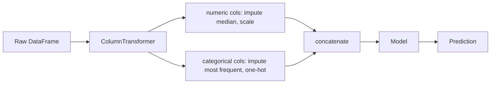
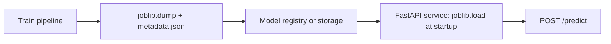

Real datasets are messy: text categories, missing values, numbers on wildly different scales. Models
want clean numeric matrices. The work of turning one into the other is **feature engineering**, and
doing it in a way that is reproducible, leak-free and deployable is what separates a notebook
experiment from an ML system. This session uses scikit-learn's preprocessing tools, `Pipeline` and
`ColumnTransformer`, hyperparameter search, and model persistence, all documented in the
[scikit-learn User Guide](https://scikit-learn.org/stable/user_guide.html).

## Encoding, scaling and missing values

Analogy: preparing ingredients before cooking. Vegetables are washed and chopped to similar sizes,
anything missing is substituted, and everything goes in the pan in a form it can cook evenly.

### Categorical features: encoding

Models need numbers, but "city = Rome" is a word.

| Encoder | Output | Use when |
| --- | --- | --- |
| `OneHotEncoder` | One 0/1 column per category | Nominal categories with no order (city, colour) |
| `OrdinalEncoder` | One integer column | Ordered categories (small < medium < large), or for tree models |
| `TargetEncoder` | Mean of the target per category, computed with internal cross-fitting | Categories with many values (thousands of postcodes) |

> [!WARNING]
> Encoding "Rome, Milan, Turin" as 0, 1, 2 for a linear model invents an order and a distance (Turin
> is "twice" Milan). Use one-hot for linear models. Set `handle_unknown="ignore"` so a city that
> never appeared in training doesn't crash prediction in production.

### Numeric features: scaling

Linear models, k-NN, SVMs and neural networks care about feature scale; tree models don't.

- `StandardScaler`: subtract the mean, divide by the standard deviation. The default choice.
- `MinMaxScaler`: squeeze into 0–1.
- `RobustScaler`: uses median and quartiles, so outliers distort it less.
- Log transforms (`FunctionTransformer(np.log1p)`) for skewed values like income or prices.

### Missing values

Options, roughly in order of sophistication:

1. Drop rows or columns (only if few are affected and they are missing at random).
2. `SimpleImputer`: fill with mean, median, most frequent value or a constant.
3. Add an indicator column (`add_indicator=True`): "was missing" is often itself predictive.
4. `KNNImputer` or `IterativeImputer`: estimate from other features.

`HistGradientBoostingClassifier` and `HistGradientBoostingRegressor` handle missing values natively,
which is one reason they make strong baselines.

## Pipelines and ColumnTransformer

Every preprocessing step **learns** something from data: the scaler learns means, the imputer
learns medians, the encoder learns the category list. Those must be learned from training data only
(session 8.2.4) and then applied identically at prediction time. Doing that by hand invites bugs.

A **`Pipeline`** chains steps into one estimator with a single `fit` and `predict`. A
**`ColumnTransformer`** applies different steps to different columns, then concatenates the results.



```python
from sklearn.compose import ColumnTransformer
from sklearn.impute import SimpleImputer
from sklearn.linear_model import LogisticRegression
from sklearn.pipeline import Pipeline
from sklearn.preprocessing import OneHotEncoder, StandardScaler

numeric = ["age", "fare"]
categorical = ["sex", "embarked", "pclass"]

preprocess = ColumnTransformer([
    ("num", Pipeline([("impute", SimpleImputer(strategy="median")),
                      ("scale", StandardScaler())]), numeric),
    ("cat", Pipeline([("impute", SimpleImputer(strategy="most_frequent")),
                      ("onehot", OneHotEncoder(handle_unknown="ignore"))]), categorical),
])

model = Pipeline([("prep", preprocess), ("clf", LogisticRegression(max_iter=1000))])
model.fit(X_train, y_train)
```

Benefits:

- **No leakage**: in cross-validation the whole pipeline is refitted per fold.
- **One artefact to deploy**: raw input in, prediction out. The API doesn't reimplement preprocessing.
- **Tunable end to end**: you can search over preprocessing choices too.

> [!TIP]
> Add custom steps with `FunctionTransformer` for stateless transforms (log, extracting the hour
> from a timestamp). For stateful custom steps, write a small class with `fit` and `transform`
> inheriting from `BaseEstimator` and `TransformerMixin`.

## Hyperparameter search

**Hyperparameters** are settings you choose rather than learn: `C` in logistic regression, tree
depth, learning rate, even which imputer strategy to use. Pick them by cross-validated search.

| Method | How | When |
| --- | --- | --- |
| `GridSearchCV` | Tries every combination | Few parameters with a handful of values |
| `RandomizedSearchCV` | Samples `n_iter` combinations from distributions | Many parameters; usually finds good values faster |
| `HalvingGridSearchCV` / `HalvingRandomSearchCV` | Starts many candidates on little data, keeps the best | Large search spaces (marked experimental: needs an explicit import) |
| Optuna and similar libraries | Bayesian-style search that learns from earlier trials | Expensive models, many parameters |

Inside a pipeline, parameters are named `<step>__<parameter>` (two underscores):

```python
from scipy.stats import loguniform
from sklearn.model_selection import RandomizedSearchCV

search = RandomizedSearchCV(
    model,
    {"clf__C": loguniform(1e-3, 1e2),
     "prep__num__impute__strategy": ["mean", "median"]},
    n_iter=30, cv=5, scoring="roc_auc", random_state=0, n_jobs=-1,
)
search.fit(X_train, y_train)
print(search.best_params_, search.best_score_)
best = search.best_estimator_   # refitted on all of X_train
```

> [!NOTE]
> `best_score_` is a cross-validation score that was used to choose the winner, so it's slightly
> optimistic. Report the final number from the untouched test set.

## Saving and loading models

A trained pipeline is a Python object. To serve it in an API you must save it to disk and load it
elsewhere.

```python
import joblib

joblib.dump(best, "model-v1.joblib")
model = joblib.load("model-v1.joblib")
model.predict(new_rows_df)
```

`joblib` (pickle under the hood) is the standard approach, with important caveats:

> [!WARNING]
> - **Never load a pickle or joblib file from an untrusted source**: unpickling can execute
>   arbitrary code. The `skops.io` format was designed for safer sharing of scikit-learn models.
> - **Versions must match**: load with the same scikit-learn version you saved with. Pin it in your
>   requirements and store it alongside the model.

Good practice for a model artefact:

- Version the file (`model-v1.joblib`) and keep a small metadata file: training date, data
  version, scikit-learn version, feature list, validation and test metrics.
- Save the **whole pipeline**, not just the final estimator.
- Write a smoke test: load the file, predict on a fixed sample, compare with known outputs.



## Practice: end-to-end pipeline for a tabular dataset

Build a complete, reproducible pipeline on the Titanic passenger dataset (mixed numeric and
categorical columns, missing values), then serve it. Allow 2 to 3 hours.

### Step 1: Load

```python
from sklearn.datasets import fetch_openml
from sklearn.model_selection import train_test_split

df = fetch_openml("titanic", version=1, as_frame=True).frame
X = df[["pclass", "sex", "age", "sibsp", "parch", "fare", "embarked"]]
y = (df["survived"] == "1").astype(int)
X_train, X_test, y_train, y_test = train_test_split(X, y, test_size=0.2, stratify=y, random_state=0)
print(X_train.isna().mean())
```

Note which columns have missing values and which are categorical. (Columns like `boat` and `body`
are left out on purpose: they're only known after the outcome, a target leak.)

### Step 2: Build the pipeline

Use the `ColumnTransformer` pattern above. Add one engineered feature with a `FunctionTransformer`,
for example `family_size = sibsp + parch + 1`.

### Step 3: Compare two models

Run 5-fold cross-validation for the logistic regression pipeline and for one with
`HistGradientBoostingClassifier`. Record mean and standard deviation of ROC-AUC.

### Step 4: Tune

Run a `RandomizedSearchCV` over the better model's main hyperparameters (for gradient boosting:
`learning_rate`, `max_depth`, `max_iter`). Evaluate `best_estimator_` once on the test set.

### Step 5: Save with metadata

Save the pipeline with `joblib` and write a `metadata.json` with the scikit-learn version, feature
names, parameters and test metrics.

### Step 6: Serve it

Write a tiny FastAPI endpoint that loads the model at startup and accepts a JSON passenger:

```python
import joblib
import pandas as pd
from fastapi import FastAPI
from pydantic import BaseModel

app = FastAPI()
model = joblib.load("model-v1.joblib")

class Passenger(BaseModel):
    pclass: int
    sex: str
    age: float | None = None
    sibsp: int = 0
    parch: int = 0
    fare: float | None = None
    embarked: str | None = None

@app.post("/predict")
def predict(p: Passenger):
    row = pd.DataFrame([p.model_dump()])
    return {"survival_probability": float(model.predict_proba(row)[0, 1])}
```

Send a request with a missing `age` and an unseen `embarked` value, and confirm the pipeline copes.
