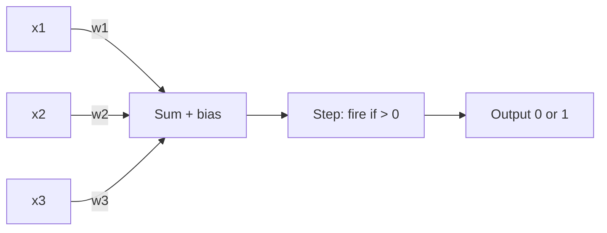
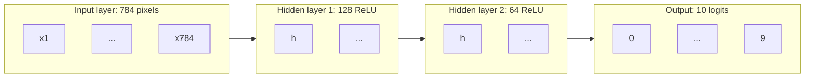

Neural networks power image recognition, speech, translation and every large language model. Under
the marketing, they are built from one tiny unit repeated millions of times: a weighted sum followed
by a simple non-linear function. This session starts from that single unit, shows exactly where it
fails, and explains why stacking units in layers fixes it. Grant Sanderson's
[3Blue1Brown neural network series](https://www.3blue1brown.com/topics/neural-networks) is the best
visual introduction (its first chapter uses the same digit-recognition example as the practice
below), and [StatQuest](https://statquest.org/) has clear videos on activations and network basics.

## The perceptron and linear separability

A biological neuron receives signals from others, and if the total is strong enough it fires. The
**perceptron**, proposed by Frank Rosenblatt in the late 1950s, is a crude mathematical version:

```text
z = w1*x1 + w2*x2 + ... + wn*xn + b
output = 1 if z > 0 else 0
```

You've seen this before: it's the linear model from session 8.2.2 with a hard on/off step at the
end. The weights say how much each input matters; the bias shifts the firing threshold.

Analogy: deciding whether to go to a party. Inputs: friends going (weight high), weather is good
(weight medium), it's far away (negative weight). Add them up; if the total clears your threshold,
you go.



The **perceptron learning rule** is simple: for each misclassified example, nudge the weights
towards the correct answer. If the classes can be separated by a straight line (a flat plane in
higher dimensions), this rule is guaranteed to find one.

That "if" is the catch. Data is **linearly separable** when a single straight boundary splits the
classes. AND and OR are separable. **XOR** (output 1 when exactly one input is 1) is not:

| x1 | x2 | XOR |
| --- | --- | --- |
| 0 | 0 | 0 |
| 0 | 1 | 1 |
| 1 | 0 | 1 |
| 1 | 1 | 0 |

Plot the four points: the two 1s sit on opposite corners, and no single line separates them from the
two 0s. Minsky and Papert's 1969 book *Perceptrons* made this limitation famous and helped cool
interest in neural networks for years.

> [!NOTE]
> The fix was known in principle: combine several perceptrons. One unit computes "x1 OR x2", another
> "x1 AND x2", and a third combines them into "OR but not AND", which is XOR. What was missing was a
> practical way to *train* the hidden units. That's backpropagation, in session 8.3.2.

## Activation functions

The step function has a problem for learning: its slope is zero everywhere (and undefined at 0), so
gradient descent gets no signal about which way to move. Modern networks use smooth or piecewise
**activation functions** instead.

There's a deeper reason activations matter. Stack two linear layers without one and you get
`W2(W1 x) = (W2 W1) x`: still just one linear layer. **Without non-linear activations, depth adds
nothing.** The activation is what lets the network bend its decision boundary.

| Activation | Formula | Range | Notes |
| --- | --- | --- | --- |
| Sigmoid | `1 / (1 + e^-z)` | 0 to 1 | Historic; still used for binary outputs. Gradients vanish for large inputs |
| Tanh | `(e^z - e^-z) / (e^z + e^-z)` | -1 to 1 | Zero-centred sigmoid; used in RNNs |
| **ReLU** | `max(0, z)` | 0 to ∞ | The default for hidden layers: cheap, gradients don't vanish for positive inputs |
| Leaky ReLU | `max(0.01z, z)` | -∞ to ∞ | Avoids "dead" units stuck at 0 |
| GELU | Smooth ReLU-like curve | about -0.17 to ∞ | Standard in transformers (GPT, BERT) |
| Softmax | `e^zi / sum(e^zj)` | 0 to 1, sums to 1 | Output layer for multi-class probabilities |

Analogy: ReLU is a one-way valve. Negative pressure is blocked; positive pressure flows through
unchanged.

> [!TIP]
> Rule of thumb: ReLU (or GELU) in hidden layers; at the output, nothing for regression, sigmoid for
> binary classification, softmax for multi-class. In PyTorch, `nn.CrossEntropyLoss` applies softmax
> for you, so the model should output raw scores (**logits**).

## Multilayer perceptrons as function approximators

A **multilayer perceptron (MLP)** stacks layers of units. Every unit in one layer connects to every
unit in the next (**fully connected** or **dense** layers).



Each layer computes `activation(W x + b)`: a matrix multiplication (Track 7) plus a non-linearity.
The whole network is a function composed of these layers, with thousands to billions of parameters.

The **universal approximation theorem** says that an MLP with one hidden layer and enough units can
approximate any continuous function on a bounded region as closely as you like. Analogy: with enough
small Lego bricks you can approximate any shape. The theorem says the bricks are sufficient; it
doesn't say how many you'll need or how to find the right arrangement.

**Why depth helps** in practice:

- **Hierarchy**: early layers learn simple features, later layers combine them. In images: edges,
  then corners and strokes, then digit parts, then digits. 3Blue1Brown's first video describes the
  network you'd *hope* to get in exactly these terms (and is honest that the real learned features
  look much messier).
- **Efficiency**: some functions need exponentially many units in a shallow network but far fewer
  when spread across several layers.
- **Reuse**: a feature computed once in an early layer is used by many later units.

> [!WARNING]
> Depth isn't free. Deeper networks are harder to train (gradients can vanish or explode) and
> overfit more easily. Techniques you'll meet later, such as ReLU, careful initialisation,
> normalisation layers and residual connections, are what made very deep networks trainable.

## Practice: classify handwritten digits with an MLP

MNIST is 70,000 greyscale images of handwritten digits, 28×28 pixels each, split into 60,000 for
training and 10,000 for testing. It's the "hello world" of neural networks. You'll train an MLP
with scikit-learn first (no new library to learn), then examine what it gets wrong. Allow about 2
hours.

### Step 1: Load the data

```python
from sklearn.datasets import fetch_openml

X, y = fetch_openml("mnist_784", version=1, return_X_y=True, as_frame=False)
X = X / 255.0                         # pixels 0..255 -> 0..1
X_train, X_test = X[:60000], X[60000:]
y_train, y_test = y[:60000], y[60000:]
```

Display a few images with `matplotlib` (`plt.imshow(X_train[0].reshape(28, 28), cmap="gray")`).

### Step 2: A linear baseline

Train `LogisticRegression(max_iter=200)` on a 10,000-row subset and note test accuracy. This is a
single layer with softmax: a "perceptron with probabilities".

### Step 3: Train an MLP

```python
from sklearn.neural_network import MLPClassifier

mlp = MLPClassifier(hidden_layer_sizes=(128, 64), activation="relu",
                    max_iter=20, early_stopping=True, random_state=0, verbose=True)
mlp.fit(X_train, y_train)
print("test accuracy", mlp.score(X_test, y_test))
```

An MLP like this typically reaches around 97% test accuracy, clearly ahead of the linear baseline.

### Step 4: Experiment

Change one thing at a time and record test accuracy and training time in a table:

- One hidden layer of 32 units, then of 512 units.
- Three hidden layers.
- `activation="logistic"` (sigmoid) instead of ReLU.

Which change helped most? Did any make it worse?

### Step 5: Look at mistakes

```python
import numpy as np
from sklearn.metrics import confusion_matrix

pred = mlp.predict(X_test)
print(confusion_matrix(y_test, pred))
wrong = np.where(pred != y_test)[0][:16]
```

Plot the 16 misclassified images with their true and predicted labels. Which digit pairs are most
confused? Would you have got some of them wrong yourself?

### Step 6: Peek inside

`mlp.coefs_[0]` has shape `(784, 128)`. Reshape a few columns to 28×28 and plot them: these are the
patterns the first-layer units respond to. Compare them with what 3Blue1Brown's video suggests a
network "should" learn.
