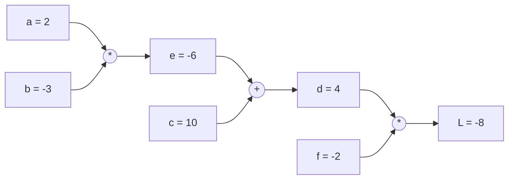
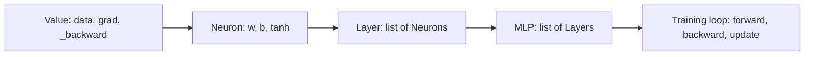

Training a neural network means gradient descent: nudge every weight in the direction that lowers
the loss. With millions of weights, you need every one of those gradients, fast. **Backpropagation**
is the algorithm that computes them all in a single backward sweep, and it's simply the chain rule
from calculus applied systematically. In this session you'll build it yourself, following Andrej
Karpathy's first [Zero to Hero](https://karpathy.ai/zero-to-hero.html) lecture, *building
micrograd*: a tiny autograd engine of about a hundred lines that can train a real neural network.
[3Blue1Brown's chapters on backpropagation](https://www.3blue1brown.com/topics/neural-networks) give
the visual intuition.

## Computational graphs

Any calculation can be drawn as a graph: **nodes** are values, and each operation connects its
inputs to its output. Take:

```text
a = 2.0
b = -3.0
c = 10.0
e = a * b        # -6
d = e + c        # 4
L = d * f        # with f = -2.0, L = -8
```



The **forward pass** computes values left to right. The question backpropagation answers is the
reverse: **if I nudge `a` a tiny bit, how much does `L` change?** That's the derivative `dL/da`,
called the **gradient** of `L` with respect to `a`.

A neural network is the same thing, just bigger: inputs and weights at the left, a loss at the
right, and millions of multiplications, additions and activations in between. PyTorch, JAX and
TensorFlow all build this graph (explicitly or while your code runs) so they can walk it backwards.

> [!NOTE]
> A gradient is a sensitivity. `dL/da = 6` means "increase `a` by 0.001 and `L` rises by about
> 0.006". For training, we compute the gradient of the loss for every weight and step each weight the
> opposite way.

## Backpropagation via the chain rule

The **chain rule**: if `L` depends on `d`, and `d` depends on `e`, then
`dL/de = dL/dd * dd/de`. Sensitivities multiply along a path.

Analogy: a chain of gears. If gear C turns 3 times per turn of B, and B turns 2 times per turn of A,
then C turns 6 times per turn of A.

Backprop starts at the output with `dL/dL = 1` and walks backwards. Each operation only needs to know
its **local derivative** and pass on `local * upstream`:

| Operation | Forward | Local gradient rule |
| --- | --- | --- |
| Addition `out = x + y` | sum | Gradient flows to both inputs unchanged (`x.grad += out.grad`) |
| Multiplication `out = x * y` | product | Each input gets the *other* input times upstream (`x.grad += y * out.grad`) |
| `tanh` `out = tanh(x)` | squash | `x.grad += (1 - out^2) * out.grad` |
| ReLU `out = max(0, x)` | clip | Passes the gradient if `x > 0`, else 0 |

For the example above:

- `dL/dd = f = -2`, `dL/df = d = 4`
- `dL/de = dL/dd * 1 = -2`, `dL/dc = -2`
- `dL/da = dL/de * b = -2 * -3 = 6`, `dL/db = dL/de * a = -2 * 2 = -4`

> [!WARNING]
> When a value is used more than once, its gradients from each use must be **added**, not
> overwritten. That's why the rules use `+=`. Forgetting this is the most common bug in hand-written
> backprop, and it's also why you must reset gradients to zero before each training step.

To process nodes in the right order (every node after all nodes that depend on it), you sort the
graph **topologically** and walk it in reverse.

## Building micrograd

micrograd wraps a single number in a `Value` object that remembers how it was created. Here is the
core, closely following Karpathy's version:

```python
import math

class Value:
    def __init__(self, data, _children=(), _op=""):
        self.data = data
        self.grad = 0.0
        self._backward = lambda: None
        self._prev = set(_children)
        self._op = _op

    def __add__(self, other):
        other = other if isinstance(other, Value) else Value(other)
        out = Value(self.data + other.data, (self, other), "+")
        def _backward():
            self.grad += out.grad
            other.grad += out.grad
        out._backward = _backward
        return out

    def __mul__(self, other):
        other = other if isinstance(other, Value) else Value(other)
        out = Value(self.data * other.data, (self, other), "*")
        def _backward():
            self.grad += other.data * out.grad
            other.grad += self.data * out.grad
        out._backward = _backward
        return out

    def __pow__(self, k):  # k is a plain number
        out = Value(self.data ** k, (self,), f"**{k}")
        def _backward():
            self.grad += k * self.data ** (k - 1) * out.grad
        out._backward = _backward
        return out

    def tanh(self):
        t = math.tanh(self.data)
        out = Value(t, (self,), "tanh")
        def _backward():
            self.grad += (1 - t ** 2) * out.grad
        out._backward = _backward
        return out

    def __neg__(self): return self * -1
    def __sub__(self, other): return self + (-other)
    def __radd__(self, other): return self + other
    def __rmul__(self, other): return self * other

    def backward(self):
        topo, visited = [], set()
        def build(v):
            if v not in visited:
                visited.add(v)
                for child in v._prev:
                    build(child)
                topo.append(v)
        build(self)
        self.grad = 1.0
        for v in reversed(topo):
            v._backward()
```

Then neurons, layers and an MLP are just `Value` arithmetic:

```python
import random

class Neuron:
    def __init__(self, n_in):
        self.w = [Value(random.uniform(-1, 1)) for _ in range(n_in)]
        self.b = Value(0.0)
    def __call__(self, x):
        return sum((wi * xi for wi, xi in zip(self.w, x)), self.b).tanh()
    def parameters(self):
        return self.w + [self.b]

class Layer:
    def __init__(self, n_in, n_out):
        self.neurons = [Neuron(n_in) for _ in range(n_out)]
    def __call__(self, x):
        out = [n(x) for n in self.neurons]
        return out[0] if len(out) == 1 else out
    def parameters(self):
        return [p for n in self.neurons for p in n.parameters()]

class MLP:
    def __init__(self, n_in, sizes):
        dims = [n_in] + sizes
        self.layers = [Layer(dims[i], dims[i + 1]) for i in range(len(sizes))]
    def __call__(self, x):
        for layer in self.layers:
            x = layer(x)
        return x
    def parameters(self):
        return [p for layer in self.layers for p in layer.parameters()]
```



> [!TIP]
> Check your engine against a **numerical gradient**: compute `(f(x + h) - f(x - h)) / (2h)` with
> `h = 1e-5` and compare with `x.grad`. If they disagree beyond a few decimal places, a `_backward`
> rule is wrong. This "gradient check" is how library authors test their code too.

## Practice: train a small network with your own autograd

Allow 2 to 3 hours, and watch the matching Zero to Hero lecture alongside if you get stuck.

### Step 1: Type it, don't paste it

Write the `Value` class above yourself, adding one operation at a time. After each, verify the
worked example from the chain-rule section: `L.backward()` must give `a.grad == 6` and
`b.grad == -4`.

### Step 2: Gradient check

Write a helper that compares `.grad` with the numerical gradient for a random expression mixing
`+`, `*`, `**` and `tanh`. Make sure a value used twice (`x * x`) gets the right gradient.

### Step 3: Train on a tiny dataset

```python
xs = [[2.0, 3.0, -1.0], [3.0, -1.0, 0.5], [0.5, 1.0, 1.0], [1.0, 1.0, -1.0]]
ys = [1.0, -1.0, -1.0, 1.0]
model = MLP(3, [4, 4, 1])

for step in range(100):
    preds = [model(x) for x in xs]
    loss = sum((p - y) ** 2 for p, y in zip(preds, ys))
    for p in model.parameters():
        p.grad = 0.0                     # reset, because gradients accumulate
    loss.backward()
    for p in model.parameters():
        p.data -= 0.05 * p.grad
    if step % 10 == 0:
        print(step, loss.data)
```

The loss should drop close to zero and the predictions approach the targets.

### Step 4: Break it on purpose

Remove the `p.grad = 0.0` line and rerun. Then try learning rates of 0.5 and 0.001. Describe what
happens in your notes: this builds the instincts you'll need when PyTorch training goes wrong.

### Step 5: A real (small) problem

Generate a 2D "two moons" dataset with `sklearn.datasets.make_moons(n_samples=100, noise=0.1)`, map
labels to -1 and +1, add a `relu` operation to `Value`, and train an `MLP(2, [16, 16, 1])`. Plot the
decision boundary over a grid. A curved boundary that splits the moons is proof that your own
backprop works.
