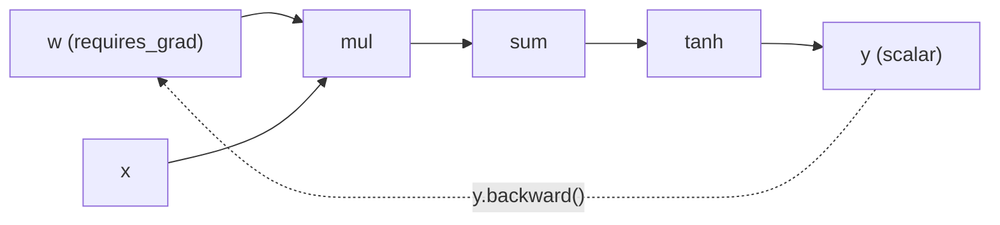
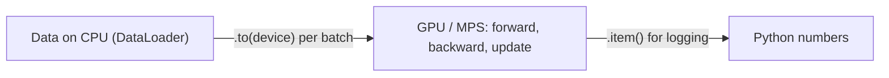

Your micrograd engine from session 8.3.2 works on one number at a time. Real networks push millions
of numbers through each layer, so they need two things micrograd lacks: **fast array maths**
(ideally on a GPU) and **automatic gradients over whole arrays**. PyTorch gives you both. Its core
idea is the same as micrograd's, just vectorised and heavily optimised. This session covers tensors,
autograd and devices, following the "Learn the Basics" and autograd material in the
[PyTorch tutorials](https://docs.pytorch.org/tutorials/).

## Tensors and operations

A **tensor** is PyTorch's n-dimensional array, very close to a NumPy array (Track 7). Analogy: a
scalar is a single box, a vector a row of boxes, a matrix a grid, and a tensor a stack of grids of
any depth.

| Rank | Example | Shape |
| --- | --- | --- |
| 0 (scalar) | A loss value | `()` |
| 1 (vector) | One embedding | `(768,)` |
| 2 (matrix) | A batch of embeddings | `(32, 768)` |
| 3 | A batch of token sequences of embeddings | `(32, 128, 768)` |
| 4 | A batch of RGB images | `(32, 3, 224, 224)` |

```python
import torch

a = torch.tensor([[1.0, 2.0], [3.0, 4.0]])
b = torch.ones(2, 2)
x = torch.randn(32, 784)            # batch of 32 random "images"
print(a.shape, a.dtype, a.device)   # torch.Size([2, 2]) torch.float32 cpu

a + b            # element-wise
a * b            # element-wise (NOT matrix multiplication)
a @ b            # matrix multiplication
a.sum(dim=0)     # reduce along rows -> shape (2,)
x.view(32, 28, 28)   # reshape (shares memory)
a.T              # transpose
```

Key ideas carried over from NumPy:

- **Shape** is everything. Most bugs are shape bugs; print `.shape` often.
- **Broadcasting**: a `(32, 10)` tensor plus a `(10,)` tensor adds the vector to every row.
- **dtype**: `float32` is the default for training; `float16` and `bfloat16` save memory; integer
  tensors (`int64`, also called `long`) hold class labels and token ids.

```python
import numpy as np
t = torch.from_numpy(np.arange(6))   # shares memory with the NumPy array
n = t.numpy()                        # back to NumPy (CPU tensors only)
```

> [!TIP]
> Think "batch first". PyTorch layers expect the first dimension to be the batch. A single example
> often needs `x.unsqueeze(0)` to become a batch of one.

## Autograd

**Autograd** is PyTorch's built-in micrograd. Set `requires_grad=True` on a tensor and PyTorch
records every operation on it in a computational graph as your code runs. Calling `.backward()` on a
scalar result walks that graph in reverse and fills in `.grad` for every leaf tensor that requires
gradients.

```python
w = torch.tensor([2.0, -3.0], requires_grad=True)
x = torch.tensor([1.0, 4.0])
y = (w * x).sum().tanh()
y.backward()
print(w.grad)   # dy/dw for each weight
```



Things you'll need constantly:

| Tool | Why |
| --- | --- |
| `loss.backward()` | Compute gradients for all parameters |
| `param.grad` | Read them (micrograd's `.grad`) |
| `optimizer.zero_grad()` or `param.grad = None` | Gradients **accumulate**, exactly like micrograd's `+=`; reset each step |
| `with torch.no_grad():` | Turn off graph recording: for weight updates by hand and for inference |
| `tensor.detach()` | A copy cut off from the graph |
| `tensor.item()` | A Python number from a one-element tensor (for logging) |

> [!WARNING]
> Logging `total_loss += loss` (instead of `loss.item()`) keeps every step's graph alive, and memory
> grows until you run out. Always convert to a Python number for bookkeeping.

> [!NOTE]
> Autograd builds the graph dynamically, on each forward pass. That's why you can use ordinary
> Python `if` statements and loops inside a model: the graph is whatever actually ran.

## Devices: CPU, CUDA, Apple MPS

Every tensor lives on a **device**. Operations need all their inputs on the same device.

| Device | Hardware | Check |
| --- | --- | --- |
| `cpu` | Any machine | Always available |
| `cuda` | NVIDIA GPUs | `torch.cuda.is_available()` |
| `mps` | Apple Silicon GPU (Metal Performance Shaders) | `torch.backends.mps.is_available()` |

GPUs run thousands of simple arithmetic operations in parallel, which is exactly what matrix
multiplication needs. Analogy: a CPU is a few brilliant chefs; a GPU is a stadium full of line cooks
who can each only chop, but all chop at once.

```python
device = (
    "cuda" if torch.cuda.is_available()
    else "mps" if torch.backends.mps.is_available()
    else "cpu"
)
model = model.to(device)             # moves parameters
x, y = x.to(device), y.to(device)    # move each batch too
```

> [!WARNING]
> - `RuntimeError: Expected all tensors to be on the same device` means you forgot to move a
>   tensor (often the labels, or a tensor created inside `forward`). Create new tensors with
>   `device=x.device`.
> - Moving data between CPU and GPU is slow. Move once per batch, not inside inner loops, and avoid
>   calling `.item()` or `print` on GPU tensors every step.
> - For tiny models, the CPU can be faster than a GPU because transfer overhead dominates. Measure.



## Practice: reimplement your micrograd network in PyTorch

Take the network you trained with your own autograd in session 8.3.2 and rebuild it in PyTorch, first
"by hand" with raw tensors, then the idiomatic way. Allow about 1.5 hours.

### Step 1: Same data

```python
import torch

xs = torch.tensor([[2.0, 3.0, -1.0], [3.0, -1.0, 0.5], [0.5, 1.0, 1.0], [1.0, 1.0, -1.0]])
ys = torch.tensor([1.0, -1.0, -1.0, 1.0])
```

### Step 2: Raw tensors and autograd

Build the 3 → 4 → 4 → 1 MLP with weight matrices instead of `Neuron` objects:

```python
torch.manual_seed(0)
sizes = [3, 4, 4, 1]
params = []
for n_in, n_out in zip(sizes, sizes[1:]):
    W = (torch.rand(n_in, n_out) * 2 - 1).requires_grad_()
    b = torch.zeros(n_out, requires_grad=True)
    params += [W, b]

def forward(x):
    for i in range(0, len(params), 2):
        x = torch.tanh(x @ params[i] + params[i + 1])
    return x.squeeze(-1)

for step in range(100):
    loss = ((forward(xs) - ys) ** 2).sum()
    for p in params:
        p.grad = None
    loss.backward()
    with torch.no_grad():
        for p in params:
            p -= 0.05 * p.grad
    if step % 10 == 0:
        print(step, loss.item())
```

Compare with micrograd: one matrix multiplication replaces a whole layer of `Neuron` loops.

### Step 3: Check the gradients agree

Copy the same initial weights into your micrograd network (set each `Value.data` from the tensors),
run one forward and backward pass in both, and compare every gradient. They should match to about six
decimal places. This proves you really understood what autograd does.

### Step 4: The idiomatic version

```python
import torch.nn as nn

model = nn.Sequential(nn.Linear(3, 4), nn.Tanh(), nn.Linear(4, 4), nn.Tanh(),
                      nn.Linear(4, 1), nn.Tanh())
opt = torch.optim.SGD(model.parameters(), lr=0.05)
for step in range(100):
    loss = ((model(xs).squeeze(-1) - ys) ** 2).sum()
    opt.zero_grad()
    loss.backward()
    opt.step()
```

`nn.Linear` holds `W` and `b`; the optimiser does the update loop for you. Session 8.4.2 builds on
this.

### Step 5: Try a device

Pick a device with the snippet above, move the model and data, and time 1,000 training steps on CPU
and on GPU/MPS if you have one. On a model this tiny the CPU will likely win; now repeat with a
`(4096, 4096)` matrix multiplication and see the GPU pull ahead.
