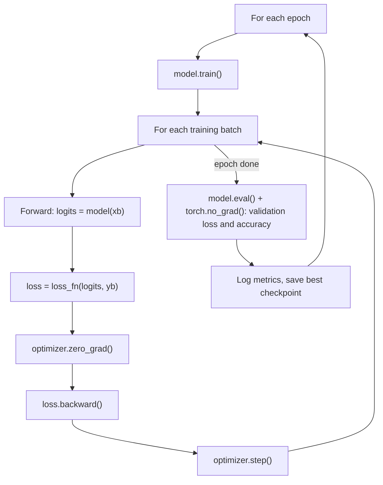

Every PyTorch project, from a digit classifier to a language model, has the same skeleton: data
flows in batches from a `DataLoader`, through an `nn.Module`, into a loss; the optimiser updates the
weights; and you watch training and validation loss to decide what to change. This session builds
that skeleton properly and teaches you to read loss curves and fight overfitting. It follows the
[PyTorch tutorials](https://docs.pytorch.org/tutorials/) ("Learn the Basics") and the training
habits Karpathy demonstrates throughout [Zero to Hero](https://karpathy.ai/zero-to-hero.html).

## Datasets and DataLoaders

A **`Dataset`** answers two questions: how many examples are there (`__len__`) and what is example
number `i` (`__getitem__`)? A **`DataLoader`** wraps it and handles batching, shuffling and
parallel loading.

Analogy: the `Dataset` is the library catalogue; the `DataLoader` is the librarian who brings you
books 64 at a time, in random order, while assistants fetch the next pile.

```python
import torch
from torch.utils.data import Dataset, DataLoader

class TabularDataset(Dataset):
    def __init__(self, X, y):
        self.X = torch.tensor(X, dtype=torch.float32)
        self.y = torch.tensor(y, dtype=torch.long)
    def __len__(self):
        return len(self.y)
    def __getitem__(self, i):
        return self.X[i], self.y[i]

train_loader = DataLoader(TabularDataset(X_train, y_train), batch_size=64, shuffle=True)
val_loader = DataLoader(TabularDataset(X_val, y_val), batch_size=256)
```

For common datasets, `torchvision.datasets` (images), `torchaudio` and the Hugging Face `datasets`
library provide ready-made ones, with `transform` arguments for preprocessing such as `ToTensor()`
and normalisation.

| Argument | Purpose |
| --- | --- |
| `batch_size` | Examples per step. Larger is faster per epoch but uses more memory |
| `shuffle=True` | For training only: a new random order each epoch |
| `num_workers` | Background processes loading data, so the GPU isn't waiting |
| `drop_last` | Skip a final incomplete batch |

> [!TIP]
> Before training anything, take one batch (`xb, yb = next(iter(train_loader))`), print shapes and
> dtypes, and plot a few examples with their labels. Many "the model won't learn" bugs are actually
> "the labels are misaligned" bugs.

## nn.Module, optimisers and loss functions

An **`nn.Module`** is a container for parameters plus a `forward` method. Layers you define in
`__init__` are registered automatically, so `model.parameters()` finds them all.

```python
import torch.nn as nn

class MLP(nn.Module):
    def __init__(self, n_in, n_hidden, n_classes, p_drop=0.2):
        super().__init__()
        self.net = nn.Sequential(
            nn.Flatten(),
            nn.Linear(n_in, n_hidden), nn.ReLU(), nn.Dropout(p_drop),
            nn.Linear(n_hidden, n_classes),
        )
    def forward(self, x):
        return self.net(x)   # raw scores (logits)
```

**Loss functions** (in `torch.nn`):

| Task | Loss | Model output |
| --- | --- | --- |
| Multi-class classification | `nn.CrossEntropyLoss` | Logits, shape `(batch, classes)`; targets are class indices |
| Binary / multi-label | `nn.BCEWithLogitsLoss` | Logits; targets are 0/1 floats |
| Regression | `nn.MSELoss`, `nn.L1Loss`, `nn.HuberLoss` | Raw numbers |

**Optimisers** (in `torch.optim`) apply the update rule:

- `SGD(lr, momentum=0.9)`: classic, still strong with a good schedule.
- `Adam` / **`AdamW`**: adaptive per-parameter step sizes; `AdamW` handles weight decay correctly
  and is the usual default (it's what most transformers are trained with).
- **Learning-rate schedulers** (`torch.optim.lr_scheduler`) change the rate over time, such as a
  warm-up then cosine decay.

> [!WARNING]
> Don't put a softmax at the end of a model trained with `nn.CrossEntropyLoss`: the loss already
> includes it. Doing it twice makes training slow and unstable.

## Training/validation loops and loss curves

The loop every PyTorch project shares:



```python
def run_epoch(model, loader, loss_fn, optimizer=None, device="cpu"):
    training = optimizer is not None
    model.train(training)
    total_loss, correct, n = 0.0, 0, 0
    with torch.set_grad_enabled(training):
        for xb, yb in loader:
            xb, yb = xb.to(device), yb.to(device)
            logits = model(xb)
            loss = loss_fn(logits, yb)
            if training:
                optimizer.zero_grad()
                loss.backward()
                optimizer.step()
            total_loss += loss.item() * len(yb)
            correct += (logits.argmax(1) == yb).sum().item()
            n += len(yb)
    return total_loss / n, correct / n
```

`model.train()` and `model.eval()` matter: dropout and batch normalisation behave differently in
each mode.

**Reading loss curves** (training and validation loss per epoch):

| Pattern | Meaning | Try |
| --- | --- | --- |
| Both falling | Still learning | Train longer |
| Both flat and high | Underfitting, or learning rate too low/high | Bigger model, tune learning rate |
| Training falls, validation rises | Overfitting | Remedies below |
| Loss jumps or becomes `nan` | Learning rate too high, or bad data | Lower the rate, check inputs, clip gradients |

> [!TIP]
> Karpathy's favourite sanity check: before a full run, **overfit a single small batch**. A
> correct model and loop should drive the loss on, say, 32 examples close to zero. If it can't, there
> is a bug, and no amount of tuning will fix it.

## Overfitting remedies: dropout, weight decay, early stopping

Neural networks have enough capacity to memorise training data. Three standard defences:

- **Dropout** (`nn.Dropout(p)`): during training, randomly zero a fraction `p` of activations.
  The network can't rely on any single unit, so it learns redundant, more general features.
  Analogy: a team where anyone might be off sick on a given day, so everyone has to know the basics
  of everyone else's job. Dropout switches off automatically in `eval()` mode.
- **Weight decay** (`AdamW(..., weight_decay=0.01)`): the L2-style penalty from session 8.2.2, pulling
  weights towards zero so the function stays smooth.
- **Early stopping**: keep the checkpoint with the best validation loss and stop when it hasn't
  improved for `patience` epochs.

```python
best, patience, bad = float("inf"), 5, 0
for epoch in range(100):
    run_epoch(model, train_loader, loss_fn, opt, device)
    val_loss, val_acc = run_epoch(model, val_loader, loss_fn, device=device)
    if val_loss < best:
        best, bad = val_loss, 0
        torch.save(model.state_dict(), "best.pt")
    else:
        bad += 1
        if bad >= patience:
            break
model.load_state_dict(torch.load("best.pt"))
```

Other effective remedies: **more data**, **data augmentation** (random crops and flips for images),
and a smaller model.

## Practice: train a network and track loss with TensorBoard

Train an MLP on FashionMNIST (70,000 small greyscale images of clothing in 10 classes, harder than
digits) and watch it in TensorBoard. Allow about 2 hours.

### Step 1: Data

```python
from torchvision import datasets, transforms
from torch.utils.data import DataLoader, random_split

tf = transforms.ToTensor()
full = datasets.FashionMNIST("data", train=True, download=True, transform=tf)
test = datasets.FashionMNIST("data", train=False, download=True, transform=tf)
train, val = random_split(full, [50000, 10000])
train_loader = DataLoader(train, batch_size=128, shuffle=True)
val_loader = DataLoader(val, batch_size=512)
```

### Step 2: Log to TensorBoard

```python
from torch.utils.tensorboard import SummaryWriter

writer = SummaryWriter("runs/mlp-baseline")
model = MLP(28 * 28, 256, 10, p_drop=0.0).to(device)
opt = torch.optim.AdamW(model.parameters(), lr=1e-3, weight_decay=0.0)
loss_fn = nn.CrossEntropyLoss()
for epoch in range(30):
    tr_loss, tr_acc = run_epoch(model, train_loader, loss_fn, opt, device)
    va_loss, va_acc = run_epoch(model, val_loader, loss_fn, device=device)
    writer.add_scalars("loss", {"train": tr_loss, "val": va_loss}, epoch)
    writer.add_scalars("acc", {"train": tr_acc, "val": va_acc}, epoch)
writer.close()
```

Start the dashboard with `tensorboard --logdir runs` and open the URL it prints.

### Step 3: Overfit on purpose

The baseline above (no dropout, no weight decay, wide layer, 30 epochs) should show validation loss
bottoming out and then rising. Note the epoch where it turns.

### Step 4: Apply remedies, one run each

Run again with a new `SummaryWriter` name each time: `p_drop=0.3`; `weight_decay=0.05`; both
together; and early stopping. TensorBoard overlays the runs so you can compare curves directly.

### Step 5: Final test

Pick the best run by validation loss, load its checkpoint, evaluate once on the test set, and write
three sentences: what the curves showed, which remedy helped most, and the final test accuracy.
