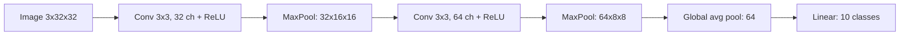
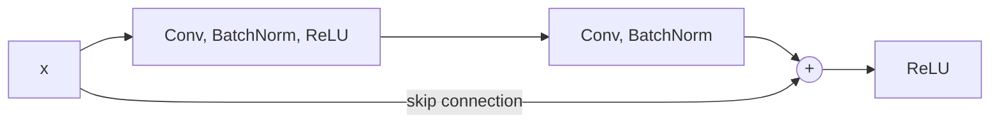

An MLP treats an image as a flat list of pixels: it has no idea that pixel 100 sits next to pixel
101, and a cat in the top-left corner is, to it, unrelated to the same cat in the bottom-right.
**Convolutional neural networks (CNNs)** build in two facts about images: nearby pixels belong
together, and a pattern means the same thing wherever it appears. That made them the workhorse of
computer vision for a decade. This session explains convolutions and pooling, the ResNet idea that
made very deep networks trainable, and **transfer learning**, which lets you build a good image
classifier from a few hundred photos. Sources: the [PyTorch tutorials](https://docs.pytorch.org/tutorials/)
(including the transfer learning tutorial) and the CNN chapters of
[Dive into Deep Learning](https://d2l.ai/).

## Convolutions and pooling

A **convolution** slides a small grid of weights, a **kernel** or **filter** (often 3×3), across the
image. At each position it multiplies the kernel by the patch underneath and sums the result into
one output number. The output grid is a **feature map**: it lights up where the patch looks like the
kernel's pattern.

Analogy: sliding a stencil of a small shape over a picture and noting, at each spot, how well the
picture matches the stencil.

```text
input patch      kernel (vertical edge)    output
1 1 0            1 0 -1
1 1 0      *     1 0 -1          =   1+1+1 - 0-0-0 = 3  (strong edge)
1 1 0            1 0 -1
```

Why this beats an MLP for images:

- **Local connectivity**: each output looks only at a small neighbourhood.
- **Weight sharing**: the same kernel is used at every position, so a 3×3 kernel has 9 weights (plus
  a bias) whether the image is 32×32 or 1000×1000. An MLP layer on a 224×224×3 image would need
  150,528 weights *per unit*.
- **Translation equivariance**: shift the input and the feature map shifts with it.

A convolutional layer learns many kernels at once. `nn.Conv2d(3, 32, kernel_size=3, padding=1)`
takes 3 input channels (RGB) and produces 32 feature maps.

| Setting | Meaning | Effect on output size |
| --- | --- | --- |
| Kernel size `K` | Width of the window | Larger kernel, smaller output |
| Stride `S` | Step between positions | Stride 2 halves the size |
| Padding `P` | Zeros around the border | `padding=1` with `K=3` keeps the size |

Output size = `(W - K + 2P) / S + 1`.

**Pooling** shrinks feature maps. **Max pooling** (`nn.MaxPool2d(2)`) keeps the largest value in
each 2×2 block, halving width and height. It makes the network cheaper and a little tolerant of small
shifts. Many modern designs use strided convolutions instead, and end with **global average
pooling**, which averages each feature map to one number before the classifier.



Stacking layers grows the **receptive field**: early layers see 3×3 pixels and detect edges and
colours; deeper layers see large regions and respond to textures, parts and whole objects.

## Classic architectures (ResNet)

A quick history of milestones, all trained on **ImageNet** (over a million images, 1,000 classes):

| Year | Network | Key idea |
| --- | --- | --- |
| 1998 | LeNet | Conv + pool for digit recognition |
| 2012 | AlexNet | Deep CNN on GPUs with ReLU and dropout; won ImageNet by a wide margin and started the deep-learning boom |
| 2014 | VGG | Just stack many 3×3 convolutions |
| 2015 | **ResNet** | Residual connections make 100+ layer networks trainable |

The problem ResNet solved: adding more layers to a plain CNN eventually made it *worse*, even on
training data. Gradients had to pass through too many layers and faded away, and the extra layers
couldn't even learn to do nothing.

The **residual connection** (skip connection) fixes this. Instead of a block learning a full mapping
`H(x)`, it learns a correction `F(x)` that is added to its input:

```text
output = ReLU(F(x) + x)
```



Analogy: editing a document with tracked changes rather than rewriting it from scratch. If a block
has nothing useful to add, it learns `F(x) ≈ 0` and passes `x` through untouched. And the `+ x` path
gives gradients a direct highway backwards through the network.

**Batch normalisation** (the BatchNorm in the diagram) normalises each channel's activations within a
batch, which stabilises and speeds up training. ResNets come in standard depths: ResNet-18, -34, -50,
-101, -152.

> [!NOTE]
> Residual connections are one of the most reused ideas in deep learning. Every transformer block
> (session 8.5.1) has two of them. Vision Transformers now compete with CNNs on large datasets, but
> CNNs like ResNet remain excellent, efficient choices, especially with limited data.

## Transfer learning

Training a ResNet from scratch takes a lot of images and compute. But the early layers of any network
trained on ImageNet have learned general features (edges, textures, shapes) that are useful for
almost any image task. **Transfer learning** reuses them.

Analogy: a trained chef learning a new cuisine. They don't relearn knife skills; they learn new
recipes on top.

Two strategies:

| Strategy | What you train | When |
| --- | --- | --- |
| **Feature extraction** | Freeze the pretrained network, replace and train only the final classifier layer | Little data (tens to hundreds of images per class); fast |
| **Fine-tuning** | Start from pretrained weights, train all (or the last few) layers with a small learning rate | More data, or images quite different from ImageNet |

```python
import torch.nn as nn
from torchvision.models import resnet18, ResNet18_Weights

weights = ResNet18_Weights.DEFAULT
model = resnet18(weights=weights)
for p in model.parameters():
    p.requires_grad = False                                  # freeze the backbone
model.fc = nn.Linear(model.fc.in_features, num_classes)     # new head, trainable
preprocess = weights.transforms()                           # the resize/normalise it was trained with
```

> [!WARNING]
> Preprocess your images exactly as the pretrained model expects (same size, same normalisation
> mean and standard deviation). `weights.transforms()` gives you the right pipeline. Wrong
> normalisation silently ruins accuracy.

> [!TIP]
> When fine-tuning the whole network, use a learning rate around 10× smaller than for training from
> scratch, or a smaller rate for the backbone than for the new head. Large updates destroy the
> pretrained features you're trying to reuse.

## Practice: fine-tune a pretrained CNN on your own images

Build a classifier for 2 to 4 categories of your choice, using your own photos (houseplants, your
pets, types of coffee cup, handwritten vs printed notes). Allow 2 to 3 hours.

### Step 1: Collect and organise images

Take or gather 50 to 150 images per class. Put them in the folder layout `ImageFolder` expects:

```text
data/
  train/
    cat/  img001.jpg ...
    dog/  ...
  val/
    cat/  ...
    dog/  ...
```

Use roughly 80% for `train` and 20% for `val`. Keep near-duplicate photos (burst shots) in the same
split to avoid leakage.

### Step 2: Datasets with augmentation

```python
from torchvision import datasets, transforms
from torch.utils.data import DataLoader

norm = transforms.Normalize([0.485, 0.456, 0.406], [0.229, 0.224, 0.225])  # ImageNet stats
train_tf = transforms.Compose([transforms.RandomResizedCrop(224), transforms.RandomHorizontalFlip(),
                               transforms.ToTensor(), norm])
val_tf = transforms.Compose([transforms.Resize(256), transforms.CenterCrop(224),
                             transforms.ToTensor(), norm])
train_ds = datasets.ImageFolder("data/train", train_tf)
val_ds = datasets.ImageFolder("data/val", val_tf)
train_loader = DataLoader(train_ds, batch_size=32, shuffle=True)
val_loader = DataLoader(val_ds, batch_size=64)
print(train_ds.classes)
```

### Step 3: Feature extraction

Load `resnet18` with frozen weights and a new `fc` layer as above. Train only `model.fc.parameters()`
with `AdamW(lr=1e-3)` for 5 to 10 epochs, reusing the `run_epoch` loop from session 8.4.2. Record
validation accuracy.

### Step 4: Fine-tune

Unfreeze `model.layer4` (the last residual stage), and train it together with `fc` using a learning
rate of `1e-4`. Compare validation accuracy with step 3.

### Step 5: A from-scratch comparison

Train `resnet18(weights=None)` on the same data for the same number of epochs. With this little data
it should do far worse, which is the whole case for transfer learning.

### Step 6: Inspect errors

Show the misclassified validation images. Are the mistakes reasonable (blurry, ambiguous, unusual
angle)? Save the best model with `torch.save(model.state_dict(), "classifier.pt")` and write a
function that classifies a single new photo.
