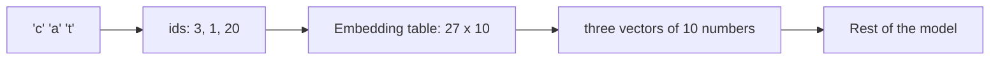
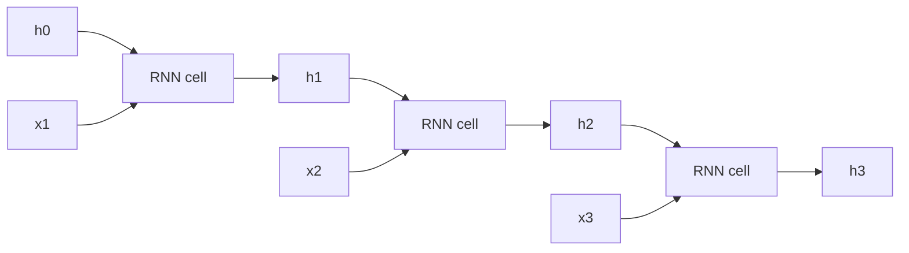
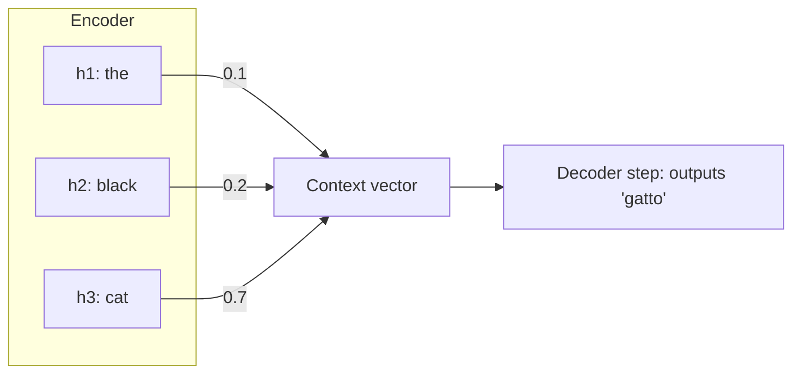

Text, speech, music, logs and stock prices are **sequences**: order matters and the length varies.
"Dog bites man" and "man bites dog" use the same words. This session covers how neural networks
represent tokens as vectors, how **recurrent neural networks (RNNs)** process sequences one step at a
time, why they struggle with long-range memory, and how **attention** arrived to fix that, setting
the stage for transformers in Module 8.5. You'll build a character-level language model following
Karpathy's *makemore* lectures in [Zero to Hero](https://karpathy.ai/zero-to-hero.html); the RNN and
attention chapters of [Dive into Deep Learning](https://d2l.ai/) give the formal treatment.

## Embeddings for tokens

Networks need numbers, but text is made of **tokens**: characters, words or word pieces (session
8.5.3). The naive encoding is **one-hot**: a vector the size of the vocabulary with a single 1. It's
huge, and every token is equally different from every other: "cat" is as far from "kitten" as from
"carburettor".

An **embedding** maps each token id to a learned dense vector of, say, 64 or 768 numbers. It's just
a lookup table: row `i` of a matrix is the vector for token `i`, and those rows are trained by
backprop like any other weights.

```python
import torch.nn as nn

emb = nn.Embedding(num_embeddings=27, embedding_dim=10)   # 26 letters + "end" token
vectors = emb(token_ids)   # (batch, seq_len) -> (batch, seq_len, 10)
```

Analogy: assigning every word a position on a map with many dimensions. Training moves words used in
similar contexts closer together, so "Paris" ends up near "Rome", and directions in the space can
carry meaning.



> [!NOTE]
> Mathematically, an embedding lookup equals multiplying a one-hot vector by the embedding matrix.
> Bengio and colleagues' 2003 neural language model, which Karpathy reimplements in makemore part 2,
> was an influential early use of learned word embeddings.

## RNNs, LSTMs and vanishing gradients

An **RNN** reads a sequence one token at a time, carrying a **hidden state**: a vector summarising
everything seen so far. At each step it mixes the new input with the previous state:

```text
h_t = tanh(W_xh @ x_t + W_hh @ h_(t-1) + b)
y_t = W_hy @ h_t
```

The same weights are reused at every step, so one RNN handles sequences of any length.

Analogy: reading a novel and keeping a running mental summary. Each new sentence updates the summary;
you never reread earlier pages.



Training "unrolls" the network across time and backpropagates through all the steps
(**backpropagation through time**). That exposes the RNN's big weakness. The gradient reaching step 1
from step 100 is a product of 100 factors. If they're mostly below 1, it shrinks towards zero
(**vanishing gradients**); above 1, it explodes. In practice, plain RNNs struggle to learn
dependencies more than a few dozen steps apart, like a pronoun referring to a name three sentences
back.

**LSTMs** (long short-term memory, 1997) add a separate **cell state**, a conveyor belt of memory,
with **gates** that learn what to forget, what to write and what to output:

| Gate | Question it answers |
| --- | --- |
| Forget gate | Which parts of the old memory should I erase? |
| Input gate | Which new information should I store? |
| Output gate | Which part of the memory should I reveal now? |

Because the cell state is updated mostly by addition rather than repeated multiplication, gradients
travel much further, the same trick as ResNet's skip connection (session 8.4.3). **GRUs** are a
simpler two-gate variant. LSTMs powered speech recognition, translation and text prediction in the
2010s.

> [!WARNING]
> Even LSTMs process tokens strictly one after another, so training can't be parallelised across a
> sequence, and very long-range memory remains hard. These two limits are exactly what transformers
> remove.

## From sequence-to-sequence to attention

Translation maps a sequence to another sequence of different length. The **sequence-to-sequence**
(seq2seq) design (2014) uses two RNNs:

- An **encoder** reads the source sentence and compresses it into its final hidden state.
- A **decoder** starts from that state and generates the translation token by token.

The weakness is the **bottleneck**: the entire sentence, however long, must squeeze through one
fixed-size vector. Quality dropped sharply on long sentences.

**Attention** (Bahdanau and colleagues, 2014) removed the bottleneck. The decoder keeps access to
*all* encoder hidden states, and at each output step it computes a weighted average of them, with
weights saying how relevant each source position is right now.

Analogy: a human translator doesn't memorise the whole sentence and then write; while writing each
word, they glance back at the relevant part of the source.



The weights are learned and change at every step, and visualising them shows sensible alignments
between source and target words. In 2017, *Attention Is All You Need* asked: what if we drop the RNN
entirely and build the whole model from attention? That's the transformer, next module.

## Practice: character-level language model (makemore)

Follow makemore: given a list of names, learn to generate new, plausible-sounding ones. Karpathy's
dataset is `names.txt` (about 32,000 names) from his makemore repository; any list of words works.
Allow 3 to 4 hours, alongside the first two makemore lectures.

### Step 1: Load and build the vocabulary

```python
words = open("names.txt").read().splitlines()
chars = sorted(set("".join(words)))
stoi = {c: i + 1 for i, c in enumerate(chars)}
stoi["."] = 0                                  # start/end token
itos = {i: c for c, i in stoi.items()}
```

### Step 2: The bigram model by counting

Count how often each character follows each other one (a 27×27 table), normalise rows into
probabilities, and sample names by repeatedly drawing the next character. Compute the average
**negative log-likelihood** on the data: this is your loss baseline.

### Step 3: The same bigram as a neural network

```python
import torch
import torch.nn.functional as F

xs, ys = [], []
for w in words:
    seq = ["."] + list(w) + ["."]
    for a, b in zip(seq, seq[1:]):
        xs.append(stoi[a]); ys.append(stoi[b])
xs, ys = torch.tensor(xs), torch.tensor(ys)

W = torch.randn(27, 27, requires_grad=True)
for step in range(200):
    logits = W[xs]                         # embedding lookup = one-hot @ W
    loss = F.cross_entropy(logits, ys)
    W.grad = None
    loss.backward()
    W.data -= 50 * W.grad
print(loss.item())
```

The loss should approach the counting baseline: gradient descent rediscovers the count table.

### Step 4: An MLP with embeddings and context

Following makemore part 2, use the previous 3 characters as context: embed each into a 10-dimensional
vector with `nn.Embedding`, concatenate, pass through a hidden layer of 200 tanh units, and output 27
logits. Train with mini-batches and keep a validation split. The loss should beat the bigram.

### Step 5: Try an RNN

Replace the fixed context window with `nn.GRU` or `nn.LSTM` over the whole name so far. Compare
validation loss with the MLP.

### Step 6: Sample and judge

Generate 20 names from each model. Which sound most plausible? Write a short note connecting what you
saw to the limits of fixed context windows and RNN memory.
