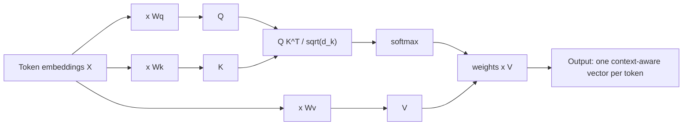
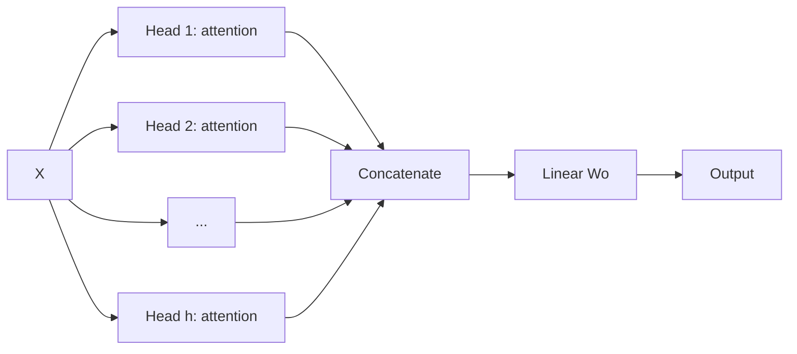
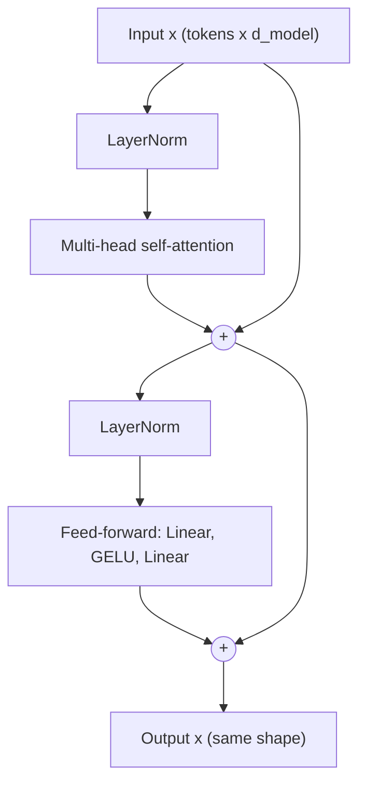

In 2017 a Google team published [Attention Is All You Need](https://arxiv.org/abs/1706.03762),
introducing the **transformer**: a sequence model built entirely from attention, with no recurrence.
It trained faster than RNNs because every position is processed in parallel, and it handled long-range
relationships better because any token can look directly at any other. Every major LLM today, Claude
included, is built on transformer blocks. This session explains each part. Jay Alammar's
[The Illustrated Transformer](https://jalammar.github.io/illustrated-transformer/) and the attention
chapters of [3Blue1Brown's neural network series](https://www.3blue1brown.com/topics/neural-networks)
are superb visual companions; read or watch one of them alongside.

## Queries, keys and values

Attention lets each token gather information from other tokens, weighted by relevance. To decide
"relevant", each token's embedding is projected into three vectors by learned weight matrices:

- **Query (Q)**: what am I looking for?
- **Key (K)**: what do I contain, as an advertisement to others?
- **Value (V)**: what information will I hand over if someone attends to me?

Analogy: a library search. Your query is what you type into the catalogue; each book's key is its
catalogue entry; its value is the actual contents. You compare your query with every key, and read
mostly the books whose keys match best.

The computation, **scaled dot-product attention**:

```text
scores  = Q @ K.T / sqrt(d_k)      # how well each query matches each key
weights = softmax(scores)           # each row sums to 1
output  = weights @ V               # weighted average of values
```

- The **dot product** measures similarity: aligned vectors give a large score (Track 7).
- Dividing by `sqrt(d_k)` (the key dimension) stops scores from growing with dimension and pushing
  softmax into extreme, nearly one-hot outputs with tiny gradients.
- **Softmax** turns scores into weights that sum to 1.



> [!EXAMPLE]
> In "The animal didn't cross the street because **it** was too tired", the query for "it" should
> match the key for "animal" strongly. The output vector for "it" then contains a large share of
> "animal"'s value: the model has resolved what "it" refers to. The Illustrated Transformer shows
> exactly this example as an attention visualisation.

## Self-attention and multi-head attention

When Q, K and V all come from the **same** sequence, it's **self-attention**: every token looks at
every token in its own sentence, including itself. (In the original encoder-decoder transformer, the
decoder also uses **cross-attention**, where queries come from the decoder and keys and values from
the encoder, the descendant of the seq2seq attention in session 8.4.4.)

Self-attention gives each token a new representation that depends on context: "bank" next to "river"
and "bank" next to "loan" start with the same embedding but come out different.

One attention pattern can't capture everything at once: syntax, coreference, nearby words, topic.
**Multi-head attention** runs several attention operations in parallel, each with its own smaller
Q/K/V projections, then concatenates the results and mixes them with one more linear layer.

Analogy: a panel of specialists reading the same sentence: one tracks grammar, one tracks who "it"
refers to, one tracks the topic. Their notes are combined at the end.



The original paper used model dimension 512 split into 8 heads of 64 dimensions each, so multi-head
attention costs about the same as one full-size head.

> [!NOTE]
> Attention compares every token with every other, so its cost grows with the **square** of the
> sequence length. Doubling the context quadruples the attention work. Much research on long context
> windows (session 8.5.4) is about taming this.

## Positional encoding

Attention is a weighted average, and averages don't care about order. Without help, "dog bites man"
and "man bites dog" would look identical to the model. **Positional encoding** injects order
information.

| Approach | How | Used in |
| --- | --- | --- |
| Sinusoidal | Add fixed sine and cosine waves of different frequencies to each embedding | The original transformer |
| Learned absolute | Add a trainable vector per position (an `nn.Embedding` of positions) | GPT-2, BERT |
| Rotary (RoPE) | Rotate query and key vectors by an angle that depends on position, so attention scores depend on relative distance | Many modern open LLMs |

Analogy: page numbers in a shuffled stack of pages. The content is unchanged, but each page now
carries where it belongs.

The sinusoidal version gives each position a unique pattern, like the hands of many clocks ticking at
different speeds, and lets the model compute relative offsets easily.

## The transformer block: residuals and layer norm

A transformer is a stack of identical **blocks**. Each block has two sub-layers:

1. **Multi-head self-attention**: tokens exchange information ("communication").
2. **Feed-forward network (FFN)**: a small MLP applied to each token independently ("computation").
   Typically it expands to 4× the model dimension and back (512 → 2048 → 512 in the paper).

Each sub-layer is wrapped with two tricks you've met before:

- A **residual connection** (session 8.4.3): the sub-layer's output is *added* to its input, so the
  block only learns a correction and gradients flow straight through deep stacks.
- **Layer normalisation**: rescales each token's vector to zero mean and unit variance (with learned
  scale and shift), keeping activations stable.



This diagram shows the **pre-norm** arrangement (normalise before each sub-layer) that most modern
models use because it trains more stably. The original paper used **post-norm** (add, then
normalise).

The full original architecture had an **encoder** (6 blocks) and a **decoder** (6 blocks, with
masking and cross-attention). Later families kept one half:

| Family | Uses | Good at | Examples |
| --- | --- | --- | --- |
| Encoder-only | Encoder blocks | Understanding: classification, embeddings | BERT |
| Decoder-only | Decoder blocks with causal masking | Generation | GPT series, Claude, Llama |
| Encoder-decoder | Both | Translation, summarisation | Original transformer, T5 |

> [!TIP]
> The shape stays `(tokens, d_model)` through every block. That's why you can stack 12 or 100 of
> them: the block is a function from "a sequence of vectors" to "a better sequence of vectors".

## Practice: draw the transformer from memory and explain each part

Understanding is proven by reconstruction. Allow about 1.5 hours.

### Step 1: Study once, carefully

Read [The Illustrated Transformer](https://jalammar.github.io/illustrated-transformer/) end to end,
and look at Figure 1 of [the paper](https://arxiv.org/abs/1706.03762). Don't take notes; just
understand.

### Step 2: Draw from memory

Close everything. On paper (or in a Mermaid diagram), draw the full encoder-decoder transformer:
input embeddings, positional encoding, encoder block internals, decoder block internals (masked
self-attention, cross-attention, FFN), residuals, layer norms, the final linear layer and softmax.

### Step 3: Annotate

Next to each part, write one sentence: what it does and what would break without it. For example:
"Positional encoding: without it, word order is invisible to attention."

### Step 4: Compute attention by hand

Take three tokens with 2-dimensional Q, K and V vectors of your choice. Compute `Q @ K.T`, scale by
`sqrt(2)`, apply softmax row by row, and multiply by V. Then check with a few lines of PyTorch:

```python
import torch
Q = torch.tensor([[1.0, 0.0], [0.0, 1.0], [1.0, 1.0]])
K, V = Q.clone(), torch.tensor([[1.0, 2.0], [3.0, 4.0], [5.0, 6.0]])
w = torch.softmax(Q @ K.T / 2 ** 0.5, dim=-1)
print(w, w @ V)
```

### Step 5: Compare and fix

Open the sources again and mark every mistake or omission in your drawing in a different colour.
Redraw it cleanly. Keep the final diagram: you'll implement the decoder half in session 8.5.2.

### Step 6: Explain it aloud

Explain the transformer in five minutes to a friend or a recording, without slides. Note where you
hesitated; those are the parts to review.
