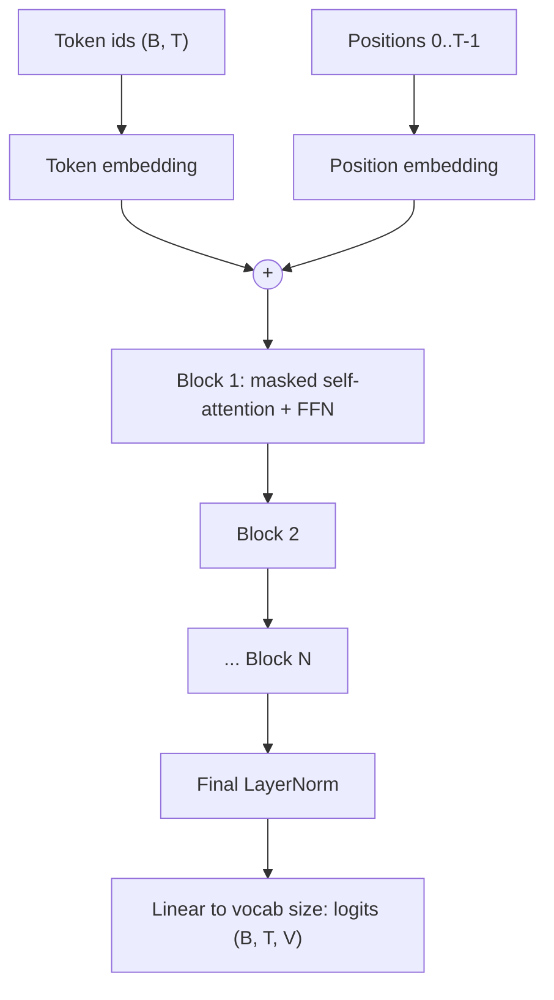

You've drawn the transformer; now you'll build one. A **GPT** (generative pre-trained transformer)
is a stack of decoder blocks trained on one task: predict the next token. In this session you'll
implement a small GPT in PyTorch, train it on a book on your laptop, and generate text in the
author's style. This follows Karpathy's lecture *Let's build GPT: from scratch, in code, spelled out*
in [Zero to Hero](https://karpathy.ai/zero-to-hero.html), which builds the model live on the "tiny
Shakespeare" dataset. Watch it alongside; the code below follows the same structure in compressed
form.

## Decoder-only architecture

A GPT keeps only the decoder half of the original transformer and drops cross-attention (there's no
encoder to attend to). What remains:



At each position, the output is a vector of **logits**: one score per vocabulary token, for "which
token comes next?". One forward pass over a sequence of `T` tokens gives `T` predictions at once,
which is why training is so efficient.

Analogy: an extremely well-read autocomplete. It has absorbed patterns from huge amounts of text, and
everything it does, from answering questions to writing code, is repeated next-token prediction.

Typical small configuration for this practice:

| Setting | Meaning | Tiny GPT value |
| --- | --- | --- |
| `vocab_size` | Number of distinct tokens | ~65 characters |
| `block_size` | Maximum context length | 256 |
| `n_embd` | Model dimension | 384 |
| `n_head` | Attention heads | 6 |
| `n_layer` | Number of blocks | 6 |

That's on the order of 10 million parameters: tiny next to production LLMs, but the same architecture.

## Causal masking

During training the model sees a whole sequence at once. If position 5 could attend to position 6, it
would simply read the answer it's supposed to predict. **Causal masking** forbids looking ahead:
position `t` may attend only to positions `0..t`.

The implementation sets scores for future positions to minus infinity before the softmax, so their
weights become exactly zero:

```python
T = 4
scores = torch.randn(T, T)
mask = torch.tril(torch.ones(T, T))           # lower-triangular matrix of 1s
scores = scores.masked_fill(mask == 0, float("-inf"))
weights = torch.softmax(scores, dim=-1)
```

```text
          attends to:  t0    t1    t2    t3
position t0            1.0   0     0     0
position t1            0.4   0.6   0     0
position t2            0.2   0.5   0.3   0
position t3            0.1   0.2   0.3   0.4
```

Analogy: reading a mystery novel with a sheet of paper covering everything below the current line.

Here is one attention head and the block, following the lecture's structure:

```python
import torch
import torch.nn as nn
import torch.nn.functional as F

class Head(nn.Module):
    def __init__(self, n_embd, head_size, block_size):
        super().__init__()
        self.key = nn.Linear(n_embd, head_size, bias=False)
        self.query = nn.Linear(n_embd, head_size, bias=False)
        self.value = nn.Linear(n_embd, head_size, bias=False)
        self.register_buffer("tril", torch.tril(torch.ones(block_size, block_size)))

    def forward(self, x):
        B, T, C = x.shape
        k, q, v = self.key(x), self.query(x), self.value(x)
        wei = q @ k.transpose(-2, -1) * k.shape[-1] ** -0.5
        wei = wei.masked_fill(self.tril[:T, :T] == 0, float("-inf"))
        return F.softmax(wei, dim=-1) @ v

class Block(nn.Module):
    def __init__(self, n_embd, n_head, block_size):
        super().__init__()
        hs = n_embd // n_head
        self.heads = nn.ModuleList(Head(n_embd, hs, block_size) for _ in range(n_head))
        self.proj = nn.Linear(n_embd, n_embd)
        self.ffn = nn.Sequential(nn.Linear(n_embd, 4 * n_embd), nn.GELU(),
                                 nn.Linear(4 * n_embd, n_embd))
        self.ln1, self.ln2 = nn.LayerNorm(n_embd), nn.LayerNorm(n_embd)

    def forward(self, x):
        h = self.ln1(x)
        x = x + self.proj(torch.cat([head(h) for head in self.heads], dim=-1))
        x = x + self.ffn(self.ln2(x))
        return x
```

> [!TIP]
> In real code, use `F.scaled_dot_product_attention(q, k, v, is_causal=True)`: it does the same
> maths with fused, much faster kernels. Write the explicit version first so you know what it hides.

## Training on a text corpus

Training data is just text turned into token ids (here, one id per character). Each training example
is a random window of `block_size + 1` tokens: the input is the first `block_size`, the target is the
same window shifted by one.

```text
text:    "To be or"
input:   T  o  _  b  e  _  o
target:  o  _  b  e  _  o  r
```

So one window gives `block_size` training signals: after "T" predict "o", after "To" predict " ",
and so on.

```python
class GPT(nn.Module):
    def __init__(self, vocab_size, block_size=256, n_embd=384, n_head=6, n_layer=6):
        super().__init__()
        self.block_size = block_size
        self.tok = nn.Embedding(vocab_size, n_embd)
        self.pos = nn.Embedding(block_size, n_embd)
        self.blocks = nn.Sequential(*[Block(n_embd, n_head, block_size) for _ in range(n_layer)])
        self.ln_f = nn.LayerNorm(n_embd)
        self.head = nn.Linear(n_embd, vocab_size)

    def forward(self, idx, targets=None):
        B, T = idx.shape
        x = self.tok(idx) + self.pos(torch.arange(T, device=idx.device))
        logits = self.head(self.ln_f(self.blocks(x)))
        loss = None
        if targets is not None:
            loss = F.cross_entropy(logits.view(B * T, -1), targets.view(B * T))
        return logits, loss

def get_batch(data, block_size, batch_size, device):
    ix = torch.randint(len(data) - block_size - 1, (batch_size,))
    x = torch.stack([data[i:i + block_size] for i in ix])
    y = torch.stack([data[i + 1:i + block_size + 1] for i in ix])
    return x.to(device), y.to(device)
```

The loss is cross-entropy over the vocabulary. A useful sanity check: at initialisation the loss
should be close to `ln(vocab_size)` (about 4.17 for 65 characters), because the model is guessing
uniformly. Hold out the last 10% of the text for validation.

> [!WARNING]
> Watch the gap between training and validation loss. A 10M-parameter model on a single 1 MB book
> will start memorising after a few thousand steps. Add dropout, shrink the model or stop early.

## Sampling: temperature, top-k, top-p

To generate, feed a prompt, take the logits at the **last** position, turn them into probabilities,
pick a token, append it, repeat.


How you pick the token shapes the output:

| Strategy | How | Effect |
| --- | --- | --- |
| Greedy | Always the most likely token | Deterministic, often repetitive |
| **Temperature** `T` | Divide logits by `T` before softmax | `T < 1` sharper and safer; `T > 1` flatter and more surprising |
| **Top-k** | Keep only the `k` most likely tokens | Cuts off the long tail of nonsense |
| **Top-p** (nucleus) | Keep the smallest set of tokens whose probabilities add up to `p` | Adapts: few options when confident, many when unsure |

```python
@torch.no_grad()
def generate(model, idx, max_new_tokens, temperature=1.0, top_k=None):
    model.eval()
    for _ in range(max_new_tokens):
        logits, _ = model(idx[:, -model.block_size:])
        logits = logits[:, -1, :] / temperature
        if top_k is not None:
            v, _ = torch.topk(logits, top_k)
            logits[logits < v[:, [-1]]] = float("-inf")
        next_id = torch.multinomial(F.softmax(logits, dim=-1), num_samples=1)
        idx = torch.cat([idx, next_id], dim=1)
    return idx
```

> [!NOTE]
> These are the same `temperature`, `top_k` and `top_p` parameters you'll pass to LLM APIs in Track
> 9. Now you know exactly what they do to the probability distribution.

## Practice: train a tiny GPT on your favourite author

Allow 3 to 5 hours, much of it waiting for training. A GPU or Apple MPS helps but a CPU works with
the smaller settings.

### Step 1: Get a corpus

Download one or more public-domain books by an author you like as plain text (Project Gutenberg is
the usual source). Strip the licence header and footer. Aim for at least 500 KB of text; combine
several books if needed.

### Step 2: Tokenise by character

```python
text = open("author.txt", encoding="utf-8").read()
chars = sorted(set(text))
stoi = {c: i for i, c in enumerate(chars)}
itos = {i: c for c, i in stoi.items()}
data = torch.tensor([stoi[c] for c in text], dtype=torch.long)
n = int(0.9 * len(data))
train_data, val_data = data[:n], data[n:]
```

### Step 3: Start small

Begin with `n_embd=128, n_head=4, n_layer=4, block_size=128`, batch size 32, `AdamW(lr=3e-4)`.
Check the initial loss is close to `ln(len(chars))`. Every 250 steps, print training and validation
loss averaged over a few batches, and a 200-character sample.

### Step 4: Scale up

Once it works, try the larger configuration in the table above (add `nn.Dropout(0.2)` in the
attention and FFN outputs). Record final validation loss for each run.

### Step 5: Play with sampling

Generate from the same prompt with temperature 0.5, 1.0 and 1.5, and with `top_k=10`. Put the
samples side by side and describe the differences.

### Step 6: Reflect

Write a paragraph: what did the model learn (spelling, punctuation, character names, style) and what
didn't it learn (plot, meaning)? Which parts of a production LLM are missing from yours? (Hint:
subword tokens, scale, and the alignment steps in sessions 8.5.3 and 8.5.4.)
