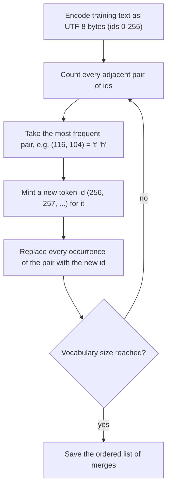
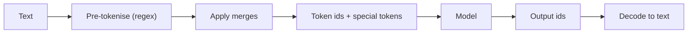

LLMs never see text. They see **tokens**: integers produced by a **tokeniser** before the model runs.
Your tiny GPT used one token per character; production models use **subword** tokens learned with
algorithms like **byte-pair encoding (BPE)**. Tokenisation decides what the model can "see", how
much text fits in the context window, what you pay per request, and the cause of many strange LLM
behaviours. This session follows Karpathy's [minbpe](https://github.com/karpathy/minbpe) repository
(and its companion lecture, *Let's build the GPT Tokenizer*) and the tokeniser chapters of the
[Hugging Face LLM Course](https://huggingface.co/learn/llm-course).

## Characters, words and subwords

There are three ways to split text, each with a trade-off between **vocabulary size** and
**sequence length**:

| Unit | Vocabulary | Sequence length | Problems |
| --- | --- | --- | --- |
| Characters (or bytes) | Tiny (~100, or 256 bytes) | Very long | The model spends capacity reassembling words; context fills up fast |
| Words | Huge (hundreds of thousands) | Short | Unknown words ("out of vocabulary"), typos, `run`/`running`/`runs` unrelated |
| **Subwords** | Moderate (tens of thousands to a few hundred thousand) | Moderate | A good compromise, with quirks |

Subword tokenisers keep common words whole and split rare ones into reusable pieces:

```text
"unbelievably"  ->  "un" "believ" "ably"
"tokenisation"  ->  "token" "isation"
" the"          ->  " the"        (one token, leading space included)
```

Analogy: a phrasebook. Common phrases have their own entry; rare words get spelled out from smaller
parts. You can always spell anything, but frequent things are cheap.

> [!NOTE]
> A rough rule for English text with modern tokenisers: one token is about three quarters of a word,
> or about 4 characters. Other languages and code can differ a lot, as you'll see below.

## Byte-pair encoding

**BPE** builds a vocabulary bottom-up from data. The byte-level version used by GPT models starts
from the 256 possible byte values, so any text in any language can be encoded with no unknown
tokens. Then:



The trained tokeniser is just the **ordered list of merges**. To **encode** new text, convert to
bytes and apply the merges in the order they were learned. To **decode**, map each id back to its
bytes and concatenate.

The core of minbpe's basic tokeniser is two small functions:

```python
def get_stats(ids):
    counts = {}
    for pair in zip(ids, ids[1:]):
        counts[pair] = counts.get(pair, 0) + 1
    return counts

def merge(ids, pair, idx):
    out, i = [], 0
    while i < len(ids):
        if i < len(ids) - 1 and (ids[i], ids[i + 1]) == pair:
            out.append(idx)
            i += 2
        else:
            out.append(ids[i])
            i += 1
    return out
```

> [!EXAMPLE]
> Text `aaabdaaabac`. The most common pair is `aa`: replace with `Z` to get `ZabdZabac`. Now `ab` is
> most common: replace with `Y` to get `ZYdZYac`. Then `ZY` becomes `X`: `XdXac`. Three merges
> shrank 11 symbols to 5.

GPT-2 added an important step: before BPE, a **regex pre-tokeniser** splits text into chunks (words,
numbers, punctuation, whitespace) so merges never cross those boundaries. That stops tokens like
`dog.` and `dog!` from forming as separate vocabulary entries. minbpe's `RegexTokenizer` implements
this, and its `GPT4Tokenizer` reproduces the GPT-4 tokeniser's behaviour.

Related algorithms you'll see in the Hugging Face course: **WordPiece** (BERT) and **Unigram**
(often via SentencePiece, used by T5 and many multilingual models).

## Tokenisers in practice (tiktoken, Hugging Face)

You rarely train a tokeniser; you use the one that matches your model. **A model only works with the
exact tokeniser it was trained with.**

**tiktoken** is OpenAI's fast BPE library:

```python
import tiktoken

enc = tiktoken.get_encoding("cl100k_base")   # the GPT-4 era encoding; o200k_base is newer
ids = enc.encode("Hello, tokenisation!")
print(ids, len(ids))
print([enc.decode([i]) for i in ids])
```

**Hugging Face tokenisers** load alongside any model on the Hub:

```python
from transformers import AutoTokenizer

tok = AutoTokenizer.from_pretrained("gpt2")
enc = tok("Hello, tokenisation!")
print(enc["input_ids"])
print(tok.convert_ids_to_tokens(enc["input_ids"]))   # 'Ġ' marks a leading space in GPT-2
```

Beyond splitting text, real tokenisers handle:

- **Special tokens**: markers like end-of-text, padding, and the role markers of **chat templates**
  (`tok.apply_chat_template(messages)` formats a conversation the way the model was trained on).
- **Padding and truncation** for batches, with an **attention mask** saying which positions are real.
- **Offsets**: mapping tokens back to character positions, useful for highlighting.



> [!TIP]
> Count tokens, not characters, when budgeting context windows and API costs. Every LLM API in Track
> 9 bills by tokens, and each provider's tokeniser counts differently.

## Tokenisation quirks: numbers, code, languages

Many "LLMs are bad at X" stories are really tokenisation stories. Karpathy's minbpe lecture lists a
gallery of them. The main ones:

- **Spelling and counting letters.** The model sees `" strawberry"` as one or a few tokens, not ten
  letters, so "how many r's?" requires knowledge it never directly observed.
- **Numbers.** Depending on the tokeniser, `1234` may be one token, `12` + `34`, or `123` + `4`, and
  the same digits split differently in different contexts. Arithmetic on inconsistent chunks is hard.
  Newer tokenisers often split numbers into groups of at most three digits to help.
- **Code and whitespace.** GPT-2's tokeniser turned each space of Python indentation into its own
  token, wasting context. Later tokenisers added tokens for runs of spaces, which is one reason code
  ability improved.
- **Languages.** Tokenisers trained mostly on English need more tokens for the same meaning in many
  other languages, especially those in non-Latin scripts. That means less effective context, higher
  cost and often worse quality for those users.
- **Leading spaces.** `"hello"` and `" hello"` are different tokens, so a trailing space at the end of
  a prompt can change the output.
- **Glitch tokens.** Tokens that were frequent when the tokeniser was trained but rare in the model's
  training data (the famous `SolidGoldMagikarp`, a Reddit username) got barely-trained embeddings and
  triggered bizarre behaviour.

> [!WARNING]
> Never assume one word equals one token, and never split or join token ids by hand. Always encode
> and decode with the model's own tokeniser.

## Practice: build a BPE tokenizer with minbpe

Allow 2 to 3 hours. Watch the minbpe lecture first or alongside.

### Step 1: Write the basic tokeniser yourself

Using `get_stats` and `merge` above, write a `BasicTokenizer` class with `train(text, vocab_size)`,
`encode(text)` and `decode(ids)`. Store `self.merges` (pair → new id) and `self.vocab` (id → bytes).
Encoding should repeatedly apply the **earliest-learned** merge present in the sequence.

### Step 2: Test the round-trip

```python
tok = BasicTokenizer()
tok.train(open("author.txt", encoding="utf-8").read(), vocab_size=512)
for s in ["hello world", "héllo wörld", "🙂 emoji", ""]:
    assert tok.decode(tok.encode(s)) == s
```

The non-ASCII cases matter: byte-level BPE must handle any UTF-8.

### Step 3: Compare with the reference

Clone [minbpe](https://github.com/karpathy/minbpe) and train its `BasicTokenizer` on the same text
with the same `vocab_size`. Your merges should match. Then train its `RegexTokenizer` and compare the
learned tokens: notice there are no tokens spanning words and punctuation.

### Step 4: Measure compression

For your tokeniser, minbpe's `RegexTokenizer`, and tiktoken's `cl100k_base`, compute
`len(text.encode("utf-8")) / len(ids)` (bytes per token) on the same sample. Which compresses best,
and why?

### Step 5: Explore the quirks

With tiktoken, print the token splits for: numbers like `127`, `1270`, `12700` and `3.14159`; a
Python snippet with 8-space indentation; the same sentence in English, Italian and a non-Latin
language. Record token counts in a table and write two sentences on what you'd tell a product
manager about multilingual cost.

### Step 6: Plug it in (optional)

Retrain your tiny GPT from session 8.5.2 using your BPE tokeniser (vocabulary of 512 to 1,024)
instead of characters. Compare samples and how much text fits in `block_size`.
