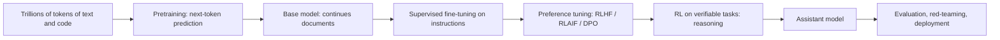

Your tiny GPT babbles in the style of its author. Claude answers questions, follows instructions,
writes code, declines harmful requests and reasons through problems. The architecture is the same
family; the difference is **how the model is trained**: enormous pretraining runs, then several
rounds of post-training that turn a text predictor into a helpful assistant. This session walks
through that life cycle. Sources: the [Hugging Face LLM Course](https://huggingface.co/learn/llm-course),
Karpathy's [Zero to Hero](https://karpathy.ai/zero-to-hero.html) (including his talks on how LLMs
are built), and [Anthropic research](https://www.anthropic.com/research), which publishes papers on
Constitutional AI, interpretability and alignment.

> [!NOTE]
> Labs publish only part of how their frontier models are trained. This lesson describes the
> well-documented, widely shared recipe; specific models differ in details that are often not public.

## Pretraining and scaling laws

**Pretraining** is your session 8.5.2 training loop at enormous scale: next-token prediction over a
huge corpus of web pages, books, code and other text, typically trillions of tokens, on thousands of
GPUs for weeks or months.

Analogy: a student who reads a vast library cover to cover. They absorb grammar, facts, styles,
reasoning patterns and code idioms, but nobody has taught them to answer questions politely; asked
something, they might just continue the text in whatever direction seems likely.

The result is a **base model**: give it the start of a document and it continues it. Most of the
model's knowledge and capability comes from this stage. The engineering challenges are mostly about
**data** (crawling, deduplication, quality filtering, removing harmful or private content, mixing
sources) and **scale** (distributing training across many machines, keeping it stable for months).

**Scaling laws** are empirical findings that loss falls smoothly and predictably as you increase
three things: model parameters, training tokens and compute.

- Kaplan and colleagues (OpenAI, 2020) showed these power-law relationships held across many orders of
  magnitude, which made it possible to predict a large model's loss from small experiments.
- Hoffmann and colleagues (DeepMind, 2022, the "Chinchilla" paper) found that many large models were
  under-trained for their size: for a fixed compute budget, it's better to train a smaller model on
  more data, roughly 20 tokens per parameter.

Since then, many models have been trained on far more tokens than that, because a smaller model that
was trained longer is cheaper to **serve** to millions of users.

## Instruction tuning and RLHF/RLAIF

**Supervised fine-tuning (SFT)**, also called instruction tuning: continue training the base model on
curated examples of conversations, a prompt and an ideal response written or checked by people. The
model learns the *format* of being an assistant: answer the question, follow the instruction, use the
chat template's roles. Tens of thousands of high-quality examples go a long way, because the
knowledge is already there from pretraining.

SFT alone has limits: writing perfect answers is expensive, and it's easier for people to say which
of two answers is better than to write the best one. **Reinforcement learning from human feedback
(RLHF)** exploits that, as popularised by OpenAI's InstructGPT work (2022):

1. Sample several responses to each prompt from the SFT model.
2. Humans rank or compare them.
3. Train a **reward model** to predict those preferences.
4. Optimise the language model with reinforcement learning (originally PPO) to produce responses the
   reward model scores highly, with a penalty for drifting too far from the SFT model.

Analogy: a trainee who has learned the job by shadowing (SFT), then improves from a supervisor's
feedback: "this answer was better than that one".

Variants you'll see:

| Method | Feedback source | Notes |
| --- | --- | --- |
| RLHF | Human preference comparisons | Expensive, the original recipe |
| **RLAIF** | An AI model judges responses, often guided by written principles | Scales feedback; used in Constitutional AI |
| **DPO** (direct preference optimisation) | Same preference pairs | Skips the separate reward model and RL loop; a simple, popular choice for open models |

> [!WARNING]
> Optimising for a learned reward can be gamed: the model learns what the reward model likes rather
> than what people actually want (**reward hacking**). Over-optimised models can become verbose,
> sycophantic (agreeing with the user too readily) or evasive. Careful reward design and evaluation
> are an active research area.

## Constitutional AI and safety

**Constitutional AI** is Anthropic's method, published in 2022 (see
[Anthropic research](https://www.anthropic.com/research)), for training a harmless and helpful
assistant with far fewer human labels of harmful content. Instead, the model is guided by a written
set of principles, the **constitution**.

It has two phases:

1. **Supervised phase**: the model drafts a response, **critiques** it against a principle (for
   example, "identify ways this response is harmful or unethical") and **revises** it. The model is
   then fine-tuned on the revised responses.
2. **RL phase (RLAIF)**: the model compares pairs of responses according to the constitution; these AI
   preferences train a preference model that's used for reinforcement learning, in place of human
   harmlessness labels.

Why it matters: the principles are explicit and inspectable, it scales better than human labelling of
disturbing content, and it aims for models that explain their objections instead of refusing
everything.

Safety work extends well beyond training:

- **Red-teaming**: deliberately attacking the model to find harmful behaviours before release.
- **Evaluations** for dangerous capabilities, with deployment safeguards tied to the results.
- **Interpretability**: research into what the model's internal activations represent.
- **Usage policies and classifiers** at deployment time.

> [!NOTE]
> For you as an engineer, alignment is not just the lab's job. Prompt injection, data leaks and unsafe
> tool use (Track 9) are application-level safety problems that no amount of model training fully
> removes.

## Context windows and reasoning models

The **context window** is the maximum number of tokens the model can attend to at once: prompt,
conversation history, documents and its own output. It grew from about 2,000 tokens in early GPT-3 to
hundreds of thousands, and in some models over a million.

Making that possible involved more efficient attention implementations, position schemes like RoPE
that can be extended to longer sequences, and training on long documents. Remember from session 8.5.1
that attention cost grows with the square of length, and during generation the **KV cache** (stored
keys and values of past tokens) grows with every token: long contexts are expensive in memory and
latency.

> [!TIP]
> A large window is not perfect memory. Models can use information in the middle of a very long
> context less reliably than information near the start or end, and cost grows with every token.
> Retrieval (RAG, Track 9) and careful prompt structure still matter.

**Reasoning models** are trained to produce a long chain of intermediate thinking before the final
answer. Key ideas:

- **Test-time compute**: spending more tokens thinking at inference improves accuracy on maths,
  coding and multi-step problems, a new scaling axis beyond model size.
- **Reinforcement learning on verifiable tasks**: problems whose answers can be checked automatically
  (maths with known answers, code with tests) provide a reward signal without human labels. The model
  learns to explore, check its work and backtrack. OpenAI's o1 (2024) and DeepSeek-R1 (2025, with a
  detailed public paper) brought this approach to wide attention.
- Several assistants, including Claude, offer **extended thinking** modes with a configurable
  thinking budget.

Analogy: the difference between blurting an answer and working it out on scrap paper first.

## Practice: explain the life of an LLM in a one-page diagram

Allow about 1.5 hours.

### Step 1: List the stages

From memory, list every stage from raw data to a deployed assistant: data collection and filtering,
tokeniser training, pretraining, SFT, preference tuning (RLHF, RLAIF or DPO), reasoning RL, safety
evaluation and red-teaming, deployment with a context window and sampling settings.

### Step 2: Draw one page

Draw the stages as a single Mermaid flowchart or on paper. For each stage, annotate:

- **Input**: what data goes in (web text, human-written demonstrations, preference pairs,
  verifiable problems).
- **Objective**: what is being optimised (next-token loss, reward score).
- **Output**: what kind of model comes out (base, instruct, aligned, reasoning).
- **Scale**: rough relative cost (pretraining dwarfs the rest).

### Step 3: Connect to your own work

Mark where your tiny GPT from session 8.5.2 sits (a miniature pretraining run) and where the
fine-tuning you'll do in session 8.6.3 would sit (SFT on a small model).

### Step 4: Check against sources

Compare your diagram with the Hugging Face LLM Course and one Anthropic research post on
Constitutional AI. Fix any stage you misplaced or missed.

### Step 5: Explain it

Write a 150-word explanation of your diagram for a non-technical friend, avoiding jargon. If you
can't explain a stage simply, revisit it.
