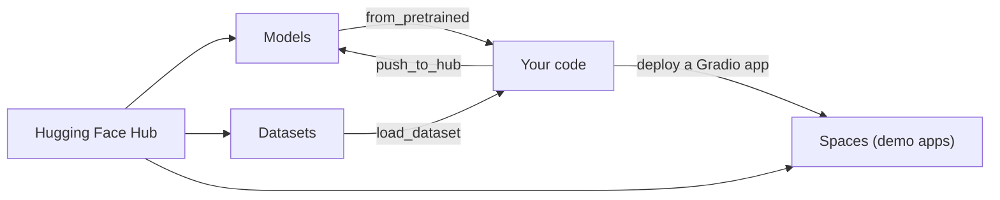
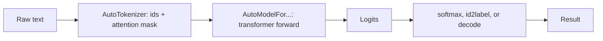

You don't need to pretrain a model to use one. Hundreds of thousands of trained models, for text,
images, audio and more, are shared openly on the **Hugging Face Hub**, and the **Transformers**
library loads most of them with a couple of lines. This session shows how to find a suitable model,
run it, read its model card and licence before you build on it, and share your own work. Sources: the
[Hugging Face Transformers docs](https://huggingface.co/docs/transformers/index) and the free courses
at [Hugging Face Learn](https://huggingface.co/learn).

## The Hub: models, datasets, Spaces

The Hub is like GitHub for machine learning: every model, dataset and demo app is a **Git
repository** (with large-file storage for weights), with a page, versions, discussions and pull
requests.

| Repo type | Contains | Example use |
| --- | --- | --- |
| **Models** | Weights, configuration, tokeniser files, a model card | Download a sentiment classifier or a small LLM |
| **Datasets** | Data files plus a dataset card, previewable in the browser | Load training data with the `datasets` library |
| **Spaces** | A small hosted app (Gradio, Streamlit, Docker, static) | Try a model in the browser; publish a demo |

Repositories are named `owner/name`, for example `distilbert/distilbert-base-uncased-finetuned-sst-2-english`
or `HuggingFaceTB/SmolLM2-135M-Instruct`.

How to find a model:

- Filter by **task** (text classification, summarisation, text generation, image classification),
  **library**, **language** and **licence**.
- Sort by downloads or trending, then read the card and check the files.
- Look at size: parameter count decides whether it runs on your laptop (session 8.6.2).



> [!TIP]
> Models download once to a local cache (by default under `~/.cache/huggingface`). Set the `HF_HOME`
> environment variable to move it, and remember the cache when a Docker image unexpectedly grows by
> several gigabytes.

To download gated models or upload your own, create an access token in your Hub settings and log in
with the `hf auth login` command (older versions use `huggingface-cli login`).

## Pipelines and AutoModel

The **`pipeline`** function is the quickest path from model to prediction. It bundles the
tokeniser, the model and the pre- and post-processing for a task:

```python
from transformers import pipeline

classifier = pipeline("sentiment-analysis")
print(classifier(["I love this course!", "The build broke again."]))
# [{'label': 'POSITIVE', 'score': 0.99...}, {'label': 'NEGATIVE', 'score': 0.99...}]

summariser = pipeline("summarization", model="facebook/bart-large-cnn")
generator = pipeline("text-generation", model="HuggingFaceTB/SmolLM2-135M-Instruct")
```

> [!WARNING]
> Without `model=...`, `pipeline` picks a default model for the task and prints a warning. Always pin
> the model id (and ideally a `revision`) in real code, so a changed default can't silently change
> your results.

When you need more control, use the **Auto classes** directly. They read the model's configuration
and instantiate the right architecture for you:

```python
import torch
from transformers import AutoTokenizer, AutoModelForSequenceClassification

model_id = "distilbert/distilbert-base-uncased-finetuned-sst-2-english"
tokenizer = AutoTokenizer.from_pretrained(model_id)
model = AutoModelForSequenceClassification.from_pretrained(model_id)

inputs = tokenizer(["I love this course!"], return_tensors="pt", padding=True, truncation=True)
with torch.no_grad():
    logits = model(**inputs).logits
probs = logits.softmax(dim=-1)
print({model.config.id2label[i]: float(p) for i, p in enumerate(probs[0])})
```

What happens under the hood is the sequence you already know from this track:



Common Auto classes:

| Class | Head on top of the transformer | Task |
| --- | --- | --- |
| `AutoModel` | None: returns hidden states | Embeddings, custom heads |
| `AutoModelForSequenceClassification` | Classifier | Sentiment, topic, spam |
| `AutoModelForTokenClassification` | Per-token classifier | Named entities |
| `AutoModelForCausalLM` | Next-token prediction | Text generation (GPT-style) |
| `AutoModelForSeq2SeqLM` | Encoder-decoder generation | Translation, summarisation |

For generation with chat models, format messages with the tokeniser's chat template, then call
`model.generate(...)` with sampling settings you met in session 8.5.2 (`temperature`, `top_k`,
`top_p`, `max_new_tokens`).

## Model cards and licences

A **model card** is the model's README: what it is, how it was trained, and how it should (and
shouldn't) be used. Read it before you build on a model, the way you'd read a library's docs and
licence before adding a dependency.

What to look for:

- **Intended use and out-of-scope uses.**
- **Training data**: what it saw, which languages, how recent.
- **Evaluation results** on benchmarks, and on what kind of data.
- **Limitations and biases**: known failure modes.
- **Prompt or chat format**, and any special tokens.
- **Licence**, shown in the card's metadata.

Licences vary a lot more than with typical open-source code:

| Licence type | Examples | Commercial use |
| --- | --- | --- |
| Permissive | Apache-2.0, MIT | Yes, with attribution and licence notice |
| Model-specific community licences | Llama, Gemma licences | Usually yes, with conditions (acceptable-use policies, sometimes user-count thresholds) |
| Responsible AI licences (RAIL) | OpenRAIL variants | Yes, with use-based restrictions |
| Non-commercial | CC BY-NC | No |

> [!WARNING]
> "Open weights" doesn't automatically mean "open source" or "free for any use". Check the licence of
> the model **and** of any dataset you fine-tune on, and record both in your project. If you
> fine-tune a model, your derived model usually inherits the base model's licence terms.

> [!TIP]
> Some models are **gated**: you must accept terms on the Hub page before downloading. Also check
> whether a repository contains custom code requiring `trust_remote_code=True`; that runs code from
> the repository on your machine, so only enable it for sources you trust.

## Practice: build a small app with an open-source model

Build a small web demo around an open model and, optionally, publish it as a Space. Allow 2 to 3
hours.

### Step 1: Pick a task and a model

Choose something useful to you: summarising your notes, classifying support emails by sentiment,
translating Italian to English, or answering questions about a paragraph. Find a model on the Hub
filtered by that task, small enough to run on CPU (under about 500 million parameters for a smooth
experience). Read its model card and write down its licence and limitations.

### Step 2: Try it in a script

```python
from transformers import pipeline

pipe = pipeline("summarization", model="sshleifer/distilbart-cnn-12-6")
print(pipe("Paste a few paragraphs here...", max_length=80, min_length=20)[0]["summary_text"])
```

Test it on five realistic inputs, including one that should be hard (very long, very short, another
language). Note where it fails.

### Step 3: Wrap it in Gradio

```python
import gradio as gr
from transformers import pipeline

pipe = pipeline("summarization", model="sshleifer/distilbart-cnn-12-6")

def summarise(text):
    return pipe(text, max_length=120, min_length=30, truncation=True)[0]["summary_text"]

gr.Interface(fn=summarise, inputs=gr.Textbox(lines=12), outputs="text",
             title="Note summariser").launch()
```

Run it and open the local URL.

### Step 4: Add a model card note to your app

In the interface description, say which model it uses, its licence, and one known limitation. This is
the habit that keeps users' expectations honest.

### Step 5: Publish (optional)

Create a new Gradio Space on the Hub, add `app.py` and a `requirements.txt` with `transformers`,
`torch` and `gradio`, and push. The Space builds and serves your app on free CPU hardware.

### Step 6: Reflect

Note latency per request and memory use. Would this model fit in your FastAPI service, or would you
call it as a separate service? You'll revisit this trade-off with local LLMs in the next session.
