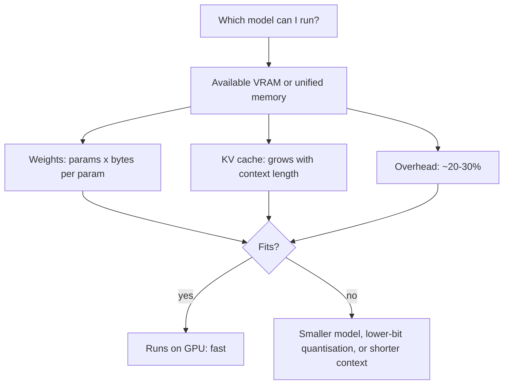

Running an LLM on your own machine means no API bills, no data leaving the laptop, and no rate
limits. YouCanDoIt itself does this: the Docker Compose stack includes an **Ollama** container that
serves embeddings and, when no Anthropic key is configured, chat. The catch is hardware: models are
big, and memory is the limit. This session explains how to estimate what fits, how **quantisation**
shrinks models with modest quality loss, and how to use Ollama and its REST API. Sources: the
[Ollama docs](https://docs.ollama.com/) and the [Ollama API reference](https://docs.ollama.com/api/introduction).

## Model sizes, memory and hardware

A model's size is its **parameter count**: 1B, 3B, 8B, 70B (billions). Each parameter is a number
stored with some precision. Memory needed just for the weights is roughly:

```text
memory ≈ parameters × bytes per parameter
```

| Precision | Bytes per parameter | 3B model | 8B model | 70B model |
| --- | --- | --- | --- | --- |
| FP32 | 4 | 12 GB | 32 GB | 280 GB |
| FP16 / BF16 | 2 | 6 GB | 16 GB | 140 GB |
| 8-bit | 1 | 3 GB | 8 GB | 70 GB |
| 4-bit | ~0.5 | ~1.5–2 GB | ~4.5–5 GB | ~35–40 GB |

On top of the weights you need memory for the **KV cache** (stored keys and values for every token in
the context, session 8.5.4), which grows with context length, plus runtime overhead. A practical rule:
leave 20–30% headroom beyond the weights.

Where the memory lives matters:

- **NVIDIA GPUs**: the model must fit in VRAM (for example 8, 12, 16 or 24 GB on consumer cards) to
  run fast. If it doesn't fit, layers spill to CPU RAM and speed collapses.
- **Apple Silicon**: CPU and GPU share **unified memory**, so a 32 GB Mac can run models that would
  need a large GPU elsewhere, though macOS reserves part of that memory for the system.
- **CPU only**: works for small models, but slowly.

Speed when generating is mostly limited by **memory bandwidth**: every new token requires reading all
the weights once. That's why smaller and more heavily quantised models generate faster.

> [!TIP]
> Quick sizing on a 16 GB laptop: 1–4B models at 4-bit are comfortable, 7–8B models at 4-bit fit
> with room for context, and anything much bigger will struggle. Check with `ollama ps`, which shows
> each loaded model's memory use and whether it's on GPU or CPU.



## Quantisation (GGUF, 4-bit)

**Quantisation** stores weights with fewer bits: 8, 5, 4 or even fewer instead of 16. Analogy: saving
a photo as a well-compressed JPEG instead of a raw file. It's a fraction of the size, and at sensible
settings you can barely tell the difference; push compression too far and artefacts appear.

How it works, roughly: weights are split into small blocks; each block stores a scale factor plus
low-bit integers. At run time, values are reconstructed as `integer × scale` on the fly.

**GGUF** is the file format from the **llama.cpp** project, which Ollama uses under the hood. A GGUF
file bundles quantised weights, the tokeniser and metadata in one file. Common quantisation labels:

| Label | Approximate bits per weight | Trade-off |
| --- | --- | --- |
| `Q8_0` | ~8 | Very close to the original quality; large |
| `Q6_K` | ~6.5 | Near-lossless for most uses |
| `Q5_K_M` | ~5.5 | Good balance |
| **`Q4_K_M`** | ~4.5–5 | The popular default: big savings, small quality loss |
| `Q3_K_M`, `Q2_K` | ~3–3.5 | Noticeable degradation; for very constrained hardware |

Other 4-bit approaches you'll meet: **GPTQ** and **AWQ** (GPU-oriented formats used with other
inference servers), and **bitsandbytes** 4-bit (NF4), which Hugging Face uses for loading models
and for QLoRA fine-tuning (session 8.6.3).

> [!NOTE]
> A bigger model at 4-bit usually beats a smaller model at 16-bit for the same memory. Quantisation
> hurts small models proportionally more than large ones, and tasks like maths and code tend to be
> more sensitive than chat.

## Ollama and its REST API

**Ollama** packages model download, quantised inference and an HTTP server into one tool, with a
library of ready-to-run models. Install it from the [Ollama docs](https://docs.ollama.com/), then:

```sh
ollama pull llama3.2           # download a model (default tag, usually a 4-bit quant)
ollama run llama3.2            # interactive chat in the terminal
ollama list                    # models on disk
ollama ps                      # models loaded in memory, with size and processor
ollama rm llama3.2             # delete
```

Model names have **tags** for size and quantisation, such as `llama3.2:1b` or a specific
quantisation tag; the model's library page lists them.

The server listens on `http://localhost:11434`. The main endpoints (see the
[API reference](https://docs.ollama.com/api/introduction)):

| Endpoint | Purpose |
| --- | --- |
| `POST /api/generate` | Complete a single prompt |
| `POST /api/chat` | Multi-turn chat with a `messages` list |
| `POST /api/embed` | Embeddings for one or more inputs |
| `GET /api/tags` | List local models |

Responses **stream** as newline-delimited JSON by default; set `"stream": false` for a single JSON
object.

```sh
curl http://localhost:11434/api/chat -d '{
  "model": "llama3.2",
  "messages": [{"role": "user", "content": "Explain quantisation in one sentence."}],
  "stream": false,
  "options": {"temperature": 0.2, "num_ctx": 4096}
}'
```

```python
import httpx

r = httpx.post("http://localhost:11434/api/chat", timeout=120, json={
    "model": "llama3.2",
    "messages": [{"role": "user", "content": "Give me three names for a cat."}],
    "stream": False,
})
data = r.json()
print(data["message"]["content"])
print(data["eval_count"], "tokens in", data["eval_duration"] / 1e9, "s")
```

`options` carries sampling and runtime settings such as `temperature`, `top_k`, `top_p` and `num_ctx`
(context length). A **Modelfile** lets you create a named variant with a system prompt and default
parameters (`ollama create my-tutor -f Modelfile`). Ollama also offers an OpenAI-compatible endpoint,
so many existing client libraries work by changing the base URL.


> [!WARNING]
> By default Ollama listens only on localhost, which is what you want. If you expose it on a network
> (as with `OLLAMA_HOST=0.0.0.0` or in a container), put it behind authentication: the API has none
> of its own, and anyone who can reach it can use your hardware.

> [!TIP]
> The first request after loading is slow because the model is being read into memory. Ollama unloads
> idle models after a few minutes; set `keep_alive` in a request to control this.

## Practice: compare three local models on the same prompts

Build a small benchmark script and compare three models of different sizes or families. Allow about 2
hours (plus download time).

### Step 1: Choose models that fit

Pick three models from the Ollama library that fit your memory, for example a 1B, a 3–4B and a 7–8B
model, or three families at similar size. Pull them and check `ollama ps` while each runs.

### Step 2: Write ten prompts

Cover different skills: a factual question, a summary of a paragraph you paste in, a short Python
function, a simple maths word problem, an Italian-to-English translation, a JSON extraction task, and
an instruction with a strict format ("answer in exactly three bullet points"). Keep them in a
`prompts.json` file.

### Step 3: Run the benchmark

```python
import json, time, httpx

models = ["llama3.2:1b", "llama3.2", "qwen2.5:7b"]   # replace with your choices
prompts = json.load(open("prompts.json"))
rows = []
for m in models:
    for p in prompts:
        t0 = time.time()
        r = httpx.post("http://localhost:11434/api/chat", timeout=300, json={
            "model": m, "messages": [{"role": "user", "content": p}],
            "stream": False, "options": {"temperature": 0},
        }).json()
        rows.append({"model": m, "prompt": p, "answer": r["message"]["content"],
                     "seconds": round(time.time() - t0, 1),
                     "tokens_per_s": round(r["eval_count"] / (r["eval_duration"] / 1e9), 1)})
json.dump(rows, open("results.json", "w"), indent=2)
```

### Step 4: Score the answers

For each answer, score correctness and instruction-following from 0 to 2. Put the totals, average
tokens per second and memory use (from `ollama ps`) in one table.

### Step 5: Compare quantisations (optional)

Pull the same model at two quantisation tags (for example a `q4_K_M` and a `q8_0` variant, if listed)
and rerun. Is the quality difference visible on your prompts? Is the speed difference?

### Step 6: Recommend

Write a short recommendation: which model would you use for YouCanDoIt's tutor on your machine, and
why? Mention quality, speed, memory and licence.
