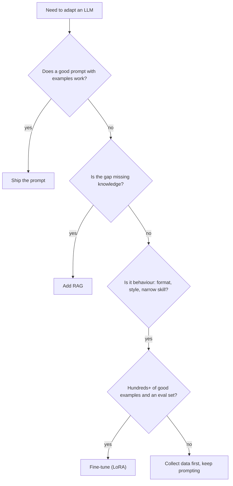
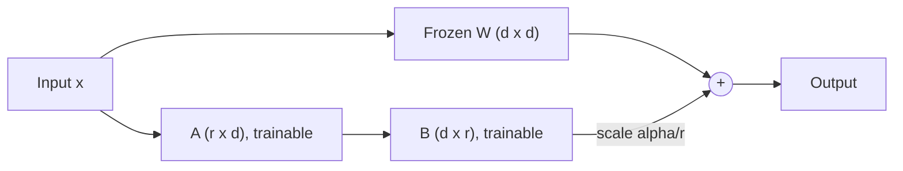

Fine-tuning means continuing to train a pretrained model on your own examples, so it adopts a
format, style or narrow skill. Done well, a small fine-tuned model can match a much larger general one
on a specific task, at a fraction of the cost. Done for the wrong reason, it's an expensive way to get
a worse result than a good prompt. This session covers when to fine-tune, how **parameter-efficient
fine-tuning** (LoRA, QLoRA) makes it possible on modest hardware, and how to run supervised
fine-tuning with Hugging Face's libraries. Sources: [Hugging Face PEFT](https://huggingface.co/docs/peft/index),
[Hugging Face TRL](https://huggingface.co/docs/trl/index) and the hands-on
[smol-course](https://github.com/huggingface/smol-course), which fine-tunes the small SmolLM2 models on
ordinary hardware.

## When to fine-tune vs prompt vs RAG

Three ways to adapt an LLM to your needs, in order of cost:

| Approach | Changes | Good for | Not good for |
| --- | --- | --- | --- |
| **Prompting** | The input: instructions, examples, format | Almost everything first; fast iteration | Very long instructions repeated at every call; strict, unusual formats a small model keeps breaking |
| **RAG** (retrieval-augmented generation, Track 9) | The input: relevant documents fetched at query time | Private, changing or large knowledge; citations | Teaching a new behaviour or style |
| **Fine-tuning** | The weights | Consistent format, tone or style; narrow tasks with many examples; making a small, cheap model good at one job | Adding fresh facts that change often; when you have few good examples |

Analogy: a new employee. **Prompting** is giving clear instructions for each task. **RAG** is giving
them access to the company wiki. **Fine-tuning** is sending them on a training course: worth it for
skills used every day, overkill for a one-off question, and useless for facts that change next week.



> [!WARNING]
> Fine-tuning on facts is a common mistake. Models learn new facts from fine-tuning unreliably and may
> hallucinate around them more confidently. Use RAG for knowledge. Fine-tuning teaches *how* to
> answer, not *what* is currently true.

You need an **evaluation set** before you start: a held-out set of inputs with expected outputs or a
scoring rubric. Without it you can't tell whether fine-tuning helped.

## Full fine-tuning vs PEFT (LoRA, QLoRA)

**Full fine-tuning** updates every weight. For a 7B model in 16-bit, the weights alone are 14 GB, and
training also needs gradients and optimiser state (AdamW keeps two extra numbers per parameter), often
adding up to several times the model size in GPU memory. You also get a full new copy of the model per
task.

**PEFT (parameter-efficient fine-tuning)** freezes the original weights and trains a small number of
new parameters. The most popular method is **LoRA (low-rank adaptation)**.

LoRA's idea: the *change* a fine-tune needs to make to a big weight matrix `W` (size `d × d`) can be
approximated by the product of two thin matrices, `B` (`d × r`) and `A` (`r × d`), with a small rank
`r` such as 8 or 16:

```text
W' = W + (alpha / r) * B @ A        # W frozen; only A and B are trained
```

For `d = 4096` and `r = 16`, the full matrix has about 16.8 million entries; `A` and `B` together have
about 131,000, under 1%.



Analogy: instead of reprinting a whole textbook with corrections, you publish a thin booklet of
errata that sits alongside it.

Benefits:

- Far less memory: no gradients or optimiser state for the frozen weights.
- The trained **adapter** is small (megabytes), so you can keep many adapters for one base model and
  swap them.
- You can **merge** the adapter into the base weights after training, so inference costs nothing extra.

**QLoRA** goes further: load the frozen base model in **4-bit** (the NF4 format via bitsandbytes) and
train LoRA adapters on top in higher precision. This made fine-tuning models of tens of billions of
parameters possible on a single large GPU.

Key LoRA settings in PEFT's `LoraConfig`:

| Setting | Meaning | Typical start |
| --- | --- | --- |
| `r` | Rank: adapter capacity | 8–16 |
| `lora_alpha` | Scaling factor | Often `r` or `2 * r` |
| `target_modules` | Which layers get adapters | Attention projections, or `"all-linear"` |
| `lora_dropout` | Regularisation | 0.05 |

> [!NOTE]
> LoRA learning rates are usually higher than for full fine-tuning (around `1e-4` to `2e-4` is a
> common starting point) because only the small adapters move.

## Supervised fine-tuning with TRL

**TRL** (Transformer Reinforcement Learning) is Hugging Face's library for post-training: supervised
fine-tuning (`SFTTrainer`), preference tuning (`DPOTrainer`) and more. It integrates with PEFT, so a
LoRA fine-tune is a few lines.

**Data format.** For chat models, the standard is a `messages` column in the same shape as chat APIs:

```json
{"messages": [
  {"role": "system", "content": "You are a concise study coach."},
  {"role": "user", "content": "I keep forgetting what I studied last week."},
  {"role": "assistant", "content": "Use spaced repetition: review after 1, 3 and 7 days..."}
]}
```

`SFTTrainer` applies the model's chat template and tokenises for you.

```python
from datasets import load_dataset
from peft import LoraConfig
from trl import SFTConfig, SFTTrainer

dataset = load_dataset("json", data_files="train.jsonl", split="train")
split = dataset.train_test_split(test_size=0.1, seed=0)

trainer = SFTTrainer(
    model="HuggingFaceTB/SmolLM2-360M-Instruct",
    train_dataset=split["train"],
    eval_dataset=split["test"],
    peft_config=LoraConfig(r=16, lora_alpha=32, lora_dropout=0.05,
                           target_modules="all-linear", task_type="CAUSAL_LM"),
    args=SFTConfig(output_dir="smol-coach-lora", num_train_epochs=3,
                   per_device_train_batch_size=4, learning_rate=2e-4,
                   eval_strategy="epoch", logging_steps=10),
)
trainer.train()
trainer.save_model("smol-coach-lora")   # saves the adapter
```

Argument names occasionally change between TRL versions; check the
[TRL docs](https://huggingface.co/docs/trl/index) for the version you install.

> [!TIP]
> Data quality beats data quantity. A few hundred clean, consistent, varied examples typically beat
> thousands of noisy ones. Read a random sample of your dataset before training, every time.

> [!WARNING]
> Watch for **overfitting** (training loss keeps falling, evaluation loss rises) and **catastrophic
> forgetting** (the model gets good at your task but worse at general ones). Keep epochs low, compare
> against the base model on a few general prompts, and stop early.

## Practice: fine-tune a small model on a custom dataset

Fine-tune a SmolLM2 model to answer in a specific style or format, and prove it improved. Following
the [smol-course](https://github.com/huggingface/smol-course) setup keeps it feasible on a laptop with
Apple MPS or a free cloud GPU notebook. Allow 3 to 4 hours.

### Step 1: Define the task and the eval first

Pick a narrow, checkable behaviour. Ideas: always answer study questions in a fixed "Explain / Example
/ Check yourself" structure; turn informal notes into a strict JSON format; rewrite text in your
company's tone. Write 20 evaluation prompts with what a good answer must contain.

### Step 2: Build the dataset

Create 200 to 500 examples in `train.jsonl` with the `messages` format. You can draft them with a large
model and then **edit them by hand** for consistency. Check the licence terms of any model or data you
use to generate them. Keep the 20 eval prompts out of the training set.

### Step 3: Baseline

Run the base `HuggingFaceTB/SmolLM2-360M-Instruct` (or the 135M version on weaker hardware) on your 20
eval prompts with a good system prompt. Score each answer 0–2. This is the number to beat, and if
prompting alone scores well, note that: it's a valid finding.

### Step 4: Train with LoRA

Run the `SFTTrainer` script above. Watch training and evaluation loss in the logs. If evaluation loss
rises after the first epoch, reduce epochs.

### Step 5: Evaluate the fine-tune

```python
from peft import AutoPeftModelForCausalLM
from transformers import AutoTokenizer

model = AutoPeftModelForCausalLM.from_pretrained("smol-coach-lora")
tok = AutoTokenizer.from_pretrained("HuggingFaceTB/SmolLM2-360M-Instruct")
msgs = [{"role": "user", "content": "How do I remember the difference between TCP and UDP?"}]
ids = tok.apply_chat_template(msgs, add_generation_prompt=True, return_tensors="pt")
print(tok.decode(model.generate(ids, max_new_tokens=200)[0][ids.shape[1]:],
                 skip_special_tokens=True))
```

Score the same 20 prompts without the long system prompt. Also try five general questions unrelated to
your task to check for forgetting.

### Step 6: Merge and report

Merge the adapter (`model.merge_and_unload()`, then `save_pretrained`) if you want a standalone model.
Write a short report: baseline vs fine-tuned scores, adapter size on disk, training time and hardware,
and whether fine-tuning was worth it compared with prompting.
