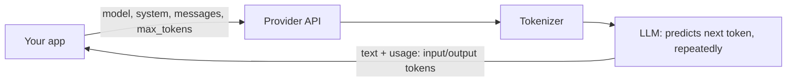
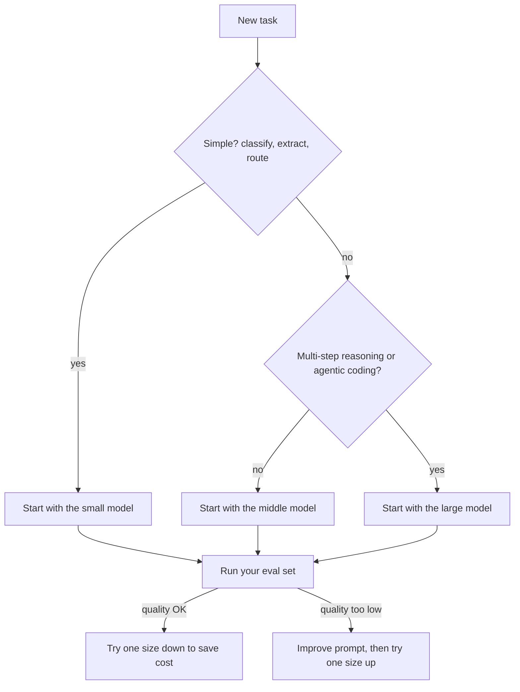

Every "AI feature" you will build in this track is, underneath, an HTTP request: you send some text
to a provider, it sends text back, and it charges you for both. That sounds simple, and it is, but
the details (what the text is made of, how much fits, how random the reply is, which model you
pick) decide whether your feature is fast, cheap and reliable or slow, expensive and flaky.

This session gives you the mental model that the rest of Track 9 builds on. The examples use the
[Claude Developer Platform docs](https://platform.claude.com/docs/en/home) and the
[OpenAI API docs](https://developers.openai.com/api/docs); the ideas apply to every provider.



## Messages, roles and system prompts

An LLM API is **stateless**. It does not remember your previous request. Analogy: a very capable
consultant with total amnesia. Every time you call, you must hand over the whole case file: who
they are supposed to be, everything said so far, and the new question.

That case file has three parts:

- **System prompt**: standing instructions about role, tone, rules and context ("You are a patient
  tutor for junior developers. Answer in under 200 words."). It applies to the whole conversation.
- **Messages**: an ordered list of turns, each with a **role**. `user` is what the human (or your
  code) says; `assistant` is what the model said earlier. They alternate.
- **The new user turn**: the last message, which the model answers.

```json
{
  "model": "claude-sonnet-5-5",
  "max_tokens": 500,
  "system": "You are a concise tutor. Use one analogy per answer.",
  "messages": [
    {"role": "user", "content": "What is an index in a database?"},
    {"role": "assistant", "content": "Like the index at the back of a book..."},
    {"role": "user", "content": "And when does it slow things down?"}
  ]
}
```

To "continue a conversation" your app stores the history and sends it again each time. Claude
takes `system` as a top-level field; OpenAI's APIs take a similar instruction as `instructions` or
a `developer`/`system` message. The names differ; the idea is identical.

> [!NOTE]
> The model only "knows" what is in the request plus what it learned in training. If the answer
> depends on your database, today's date or the user's account, you must put it in the request.
> That is the whole idea behind retrieval-augmented generation (Module 9.3).

> [!TIP]
> Because you send the history yourself, you can also edit it: drop old turns, summarise them, or
> pre-fill facts. Session 9.4.3 turns this into proper memory.

## Tokens, context windows and costs

Models do not read characters or words; they read **tokens**, chunks of text produced by a
tokenizer. Common English words are often one token, rarer words split into several, and code,
numbers and non-English text usually take more tokens per word. A rough rule for English prose is
about three quarters of a word per token, but always measure for your own content: both
providers offer token-counting endpoints or libraries.

The **context window** is the maximum number of tokens the model can consider in one request:
system prompt + all messages + any documents + the reply it writes. Analogy: the size of the desk
the consultant can spread papers on. Current Claude models list a 1M-token context window and up
to 128K output tokens on the
models overview in the [Claude docs](https://platform.claude.com/docs/en/home); smaller or older models have less.

Two numbers control a request's size:

| Parameter | Meaning |
| --- | --- |
| Input tokens | Everything you send. You control this with what you include. |
| `max_tokens` | A hard cap on output tokens. The reply stops when it hits the cap. |

**Pricing** is per million tokens (MTok), with output tokens costing several times more than
input tokens. So a request costs:

```text
cost = input_tokens / 1_000_000 * input_price + output_tokens / 1_000_000 * output_price
```

> [!EXAMPLE]
> A support bot sends a 3,000-token system prompt + 2,000 tokens of history and gets a 400-token
> reply. At $2 per MTok input and $10 per MTok output, one call costs
> 5,000/1M x 2 + 400/1M x 10 = $0.010 + $0.004 = $0.014. At 50,000 calls a day that is $700 a day,
> and most of it is the repeated system prompt. Prompt caching (session 9.1.2) attacks exactly that.

The response tells you what you actually used: Claude returns a `usage` object with
`input_tokens` and `output_tokens`; OpenAI returns similar fields. Log them on every call from day
one. They are your bill.

> [!WARNING]
> Bigger context is not free context. You pay for every token on every call, latency grows with
> input size, and models can miss details buried in the middle of a very long prompt. Send what the
> task needs, not everything you have.

## Sampling parameters and determinism

At each step the model produces a probability for every possible next token. **Sampling** is how
one token is picked from that distribution. Analogy: the model writes a shortlist of next words
with odds; sampling is rolling a weighted die.

- **Temperature** reshapes the odds. Low (close to 0) makes the top choice dominate: focused and
  repetitive. High makes unlikely tokens more likely: varied and sometimes wild.
- **Top-p** (nucleus sampling) keeps only the smallest set of tokens whose probabilities add up to
  `p`, then samples among them.
- **Top-k** keeps only the `k` most likely tokens.
- **Stop sequences** end generation when a given string appears.
- **`max_tokens`** caps the length.

Not every model accepts every knob: reasoning models with built-in thinking often fix or restrict
sampling settings, and the docs tell you which apply. Check before you rely on one.

**Determinism**: even at temperature 0, you should not expect byte-identical outputs across
calls. Batching on the provider's GPUs, floating-point non-determinism and silent model updates
all introduce variation. Design for it:

- Pin a specific model ID rather than an alias that can move.
- Make your code tolerate small variations (parse JSON, don't compare strings).
- Use structured outputs (session 9.1.4) when you need a fixed shape.
- Test with evals that measure quality across many samples (session 9.6.1), not with one golden
  string.

> [!TIP]
> Extraction, classification and code generation: low temperature or provider defaults. Brainstorming
> and creative writing: higher. If you find yourself tuning temperature to fix a bad answer, fix the
> prompt first.

## Model families and choosing a model

Providers ship **families**: a large, slow, expensive top model; a balanced middle; and a small,
fast, cheap one. On the Claude side the current line-up is Opus (most capable for long agentic
and knowledge work), Sonnet (speed and intelligence balanced) and Haiku (fastest, for
classification, extraction and routing); OpenAI has its own tiers. You will also meet open-weight
models (Llama, Qwen, Mistral, Gemma and others) that you can run yourself with Ollama or vLLM,
as YouCanDoIt does for embeddings.

Choose with a short checklist rather than by reputation:

1. **Quality on your task**, measured on 20-50 real examples, not on public leaderboards.
2. **Latency**: time to first token and total time. A chat UI needs the first token fast.
3. **Cost** at your expected volume.
4. **Context and output limits** for your largest realistic input.
5. **Capabilities**: vision, tool use, structured output, thinking.
6. **Data and deployment constraints**: region, retention, whether data may leave your servers.



> [!TIP]
> Start with the cheapest model that might work, measure, and move up only when your examples
> show it is needed. Many production systems route: a small model handles most traffic and
> escalates hard cases to a larger one.

## Practice: compare cost and latency of three models on the same task

Goal: a small script that sends the same prompt to three models and prints latency, tokens and
cost. Allow about 60 minutes.

### Step 1: Pick a task and three models

Choose one realistic task, for example "summarise this 800-word article in five bullet points".
Pick three models: the small, middle and large tier of one provider, or mix providers. If you have
no paid key, use one hosted model plus two local Ollama models (cost zero, latency real).

Copy current prices for each model from the provider's pricing page into a dictionary. Do not
hard-code numbers from memory; prices change.

### Step 2: Write the script

```python
import time
import anthropic

PRICES = {  # USD per million tokens: copy from the pricing page today
    "claude-haiku-5-5": (0.0, 0.0),
    "claude-sonnet-5-5": (0.0, 0.0),
    "claude-opus-5-5": (0.0, 0.0),
}
ARTICLE = open("article.txt").read()
client = anthropic.Anthropic()  # reads ANTHROPIC_API_KEY

for model, (p_in, p_out) in PRICES.items():
    t0 = time.perf_counter()
    msg = client.messages.create(
        model=model,
        max_tokens=600,
        system="Summarise the article in exactly five bullet points.",
        messages=[{"role": "user", "content": ARTICLE}],
    )
    dt = time.perf_counter() - t0
    u = msg.usage
    cost = u.input_tokens / 1e6 * p_in + u.output_tokens / 1e6 * p_out
    print(f"{model:20} {dt:5.1f}s in={u.input_tokens} out={u.output_tokens} ${cost:.5f}")
```

### Step 3: Run it five times

Single runs lie: latency varies a lot. Run the loop five times and record the median latency per
model. Save each model's summaries to files.

### Step 4: Judge quality blind

Shuffle the summaries, hide the model names, and score each 1-5 for accuracy and usefulness.
Then reveal.

### Step 5: Write a one-paragraph decision

Fill a table like this and write which model you would ship and why:

| Model | Median latency | Avg cost per call | Cost per 10k calls | Quality (1-5) |
| --- | --- | --- | --- | --- |
| small | | | | |
| middle | | | | |
| large | | | | |

Notice whether output tokens differ between models: a model that writes more costs more even at
the same price per token. Keep the script; you will reuse it in session 9.1.5.
