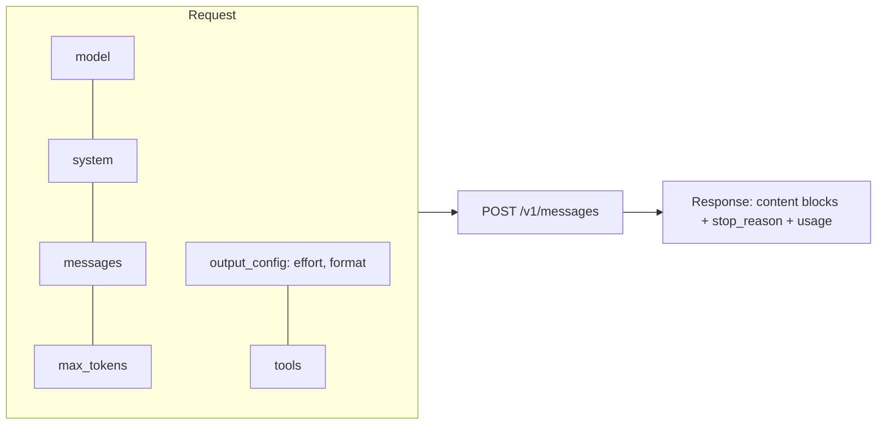
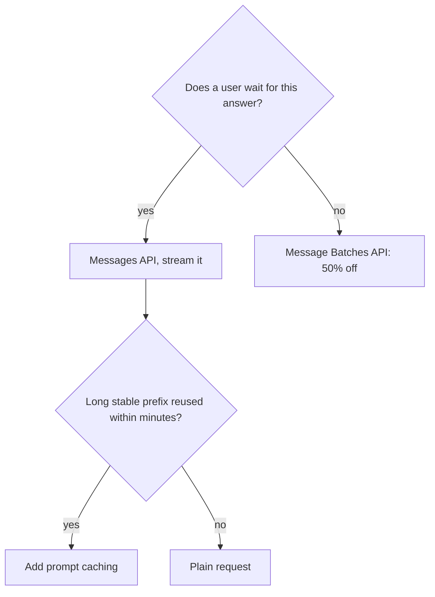

Session 9.1.1 gave you the general model: stateless requests, tokens, sampling, model tiers. Now
you will use one provider properly. The Claude API is a good first choice because its design is
small and consistent: almost everything is one endpoint, the **Messages API**, with features
switched on by fields in the request. The reference for everything here is the
[Claude Developer Platform docs](https://platform.claude.com/docs/en/home); Anthropic's free
[courses](https://github.com/anthropics/courses) include notebooks on the API fundamentals if you
want guided exercises.



## Messages API and the Python/TypeScript SDKs

You can call the API with raw HTTP (`POST https://api.anthropic.com/v1/messages` with an
`x-api-key` header and an `anthropic-version` header), but in real code use the official SDKs.
They handle authentication, retries with back-off, timeouts, typed responses and streaming.

```sh
pip install anthropic          # Python
npm install @anthropic-ai/sdk  # TypeScript / Node
export ANTHROPIC_API_KEY=sk-ant-...   # never commit this
```

```python
import anthropic

client = anthropic.Anthropic()  # reads ANTHROPIC_API_KEY from the environment

msg = client.messages.create(
    model="claude-sonnet-5-5",
    max_tokens=1024,
    messages=[{"role": "user", "content": "Explain a database index in two sentences."}],
)
print(msg.content[0].text)
print(msg.stop_reason, msg.usage.input_tokens, msg.usage.output_tokens)
```

```typescript
import Anthropic from "@anthropic-ai/sdk";

const client = new Anthropic();
const msg = await client.messages.create({
  model: "claude-sonnet-5-5",
  max_tokens: 1024,
  messages: [{ role: "user", content: "Explain a database index in two sentences." }],
});
for (const block of msg.content) if (block.type === "text") console.log(block.text);
```

Three things in the response matter every time:

- **`content`** is a list of **blocks**, not a string. Usually one `text` block, but you can also
  get `thinking` blocks and `tool_use` blocks (session 9.1.4). Loop over them and pick by `type`.
- **`stop_reason`** tells you why generation ended: `end_turn` (finished naturally),
  `max_tokens` (cut off: your answer is incomplete), `tool_use` (the model wants you to run a
  tool), `stop_sequence`.
- **`usage`** has the token counts you are billed for.

> [!WARNING]
> Always check `stop_reason`. A summary that stopped at `max_tokens` looks fine at a glance but
> ends mid-sentence. Either raise the limit or treat it as an error.

> [!TIP]
> In async apps (FastAPI) use `anthropic.AsyncAnthropic()` and `await client.messages.create(...)`
> so a slow model call does not block your server. YouCanDoIt's `AnthropicProvider` in
> `apps/api/app/llm.py` is a small example of wrapping the SDK behind your own interface.

## System prompts, multi-turn conversations

The **system prompt** is a top-level `system` field, not a message. Put the role, rules, output
format and stable background there.

**Multi-turn** means you keep the history and append. The API remembers nothing between calls:

```python
history = []
SYSTEM = "You are a patient programming tutor. Use one analogy per answer. Max 150 words."

def ask(question: str) -> str:
    history.append({"role": "user", "content": question})
    msg = client.messages.create(
        model="claude-sonnet-5-5", max_tokens=600, system=SYSTEM, messages=history
    )
    answer = "".join(b.text for b in msg.content if b.type == "text")
    history.append({"role": "assistant", "content": answer})
    return answer

ask("What is a race condition?")
ask("Give me a Python example of one.")  # "one" works because history is sent again
```

Rules of thumb:

- Messages normally alternate `user` / `assistant` and start with `user`.
- Content can be a plain string or a list of blocks (text, image, document, tool results). Lists
  let you mix an image and a question in one turn.
- History grows every turn, and so does your cost. Long chats need trimming or summarising
  (session 9.4.3).

> [!EXAMPLE]
> YouCanDoIt's tutor (`apps/api/app/routes/ai.py`) builds a system prompt from the session's
> outline plus retrieved source passages, then sends the learner's last 20 turns as `messages`.
> The model "remembers" the conversation only because the browser sends that history back.

## Thinking, effort and model selection

Hard problems benefit from the model reasoning before it answers. Claude models can produce
**thinking** blocks: internal reasoning returned as separate content blocks before the final text.
On current models this is **adaptive thinking**: the model decides when and how much to think.
You steer it with the **effort** parameter, set in `output_config`:

```python
msg = client.messages.create(
    model="claude-opus-5-5",
    max_tokens=16000,
    output_config={"effort": "high"},   # low | medium | high | xhigh | max
    messages=[{"role": "user", "content": "Find the bug in this function: ..."}],
)
```

According to the effort page of the [Claude docs](https://platform.claude.com/docs/en/home), effort affects all
output tokens (thinking, text and tool calls), is a behavioural signal rather than a strict
budget, and has a model-specific default (`medium` on some current models, `high` on others).
Lower effort means faster, cheaper and terser; higher means more thorough. Thinking tokens count
towards `max_tokens` and are billed as output, so give enough room at higher effort.

> [!NOTE]
> Older models used **extended thinking** with an explicit `budget_tokens`. The docs mark that mode
> as deprecated on recent models and not accepted on the newest ones, so if you see
> `thinking={"type": "enabled", "budget_tokens": ...}` in a tutorial, it is written for an older
> model.

**Model selection** for Claude works like the checklist in 9.1.1: Haiku for high-volume
classification, extraction and routing; Sonnet as the default for most product features; Opus or
the top tier for long agentic and difficult reasoning work. Effort gives you a second dial: a
larger model at `low` effort can beat a smaller one at `high` on some tasks. Measure both dials on
your own examples.

## Prompt caching and the Batch API

Two features cut costs dramatically when used for the right workload.

### Prompt caching

Most requests repeat a long, stable prefix: tools, system prompt, a big document. **Prompt
caching** stores the processed prefix so later requests that start with the same bytes read it
cheaply. Analogy: a chef who preps the base sauce once in the morning instead of for every plate.

```python
msg = client.messages.create(
    model="claude-sonnet-5-5",
    max_tokens=800,
    system=[{
        "type": "text",
        "text": LONG_STYLE_GUIDE,               # thousands of stable tokens
        "cache_control": {"type": "ephemeral"},  # cache everything up to here
    }],
    messages=[{"role": "user", "content": article}],
)
print(msg.usage.cache_creation_input_tokens, msg.usage.cache_read_input_tokens)
```

Key facts from the prompt caching page of the [Claude docs](https://platform.claude.com/docs/en/home):

- The cache covers the **prefix** in order: `tools`, then `system`, then `messages`. Anything that
  changes before the breakpoint (a timestamp in the system prompt!) breaks the match.
- Default lifetime is 5 minutes, refreshed on each hit; a 1-hour option exists.
- Writing to the cache costs a bit more than normal input; reading costs a small fraction of it.
- Prompts below a model-specific minimum length are silently not cached. Check
  `cache_read_input_tokens` to confirm hits.

> [!TIP]
> Put stable content first and variable content last. "System prompt, then tools, then the user's
> question" caches well. "Today's date, then system prompt" never does.

### Message Batches API

If you don't need an answer right now (nightly summaries, evals, back-filling a database), send a
**batch**. Each request gets a `custom_id`; the batch is processed asynchronously at a 50% discount.
The docs say most batches finish within an hour and results are available when all requests are
done or after 24 hours.

```python
batch = client.messages.batches.create(requests=[
    {"custom_id": f"article-{a.id}",
     "params": {"model": "claude-haiku-5-5", "max_tokens": 400,
                "messages": [{"role": "user", "content": f"Summarise:\n{a.text}"}]}}
    for a in articles
])
# later, once batch.processing_status == "ended":
for result in client.messages.batches.results(batch.id):
    if result.result.type == "succeeded":
        save(result.custom_id, result.result.message.content[0].text)
```



## Practice: an article summariser with Claude

Build a CLI that takes a URL and prints a structured summary. About 90 minutes.

### Step 1: Set up

```sh
mkdir summariser && cd summariser
python -m venv .venv && source .venv/bin/activate
pip install anthropic trafilatura
export ANTHROPIC_API_KEY=...
```

### Step 2: Fetch and extract the article

Use `trafilatura` (the same library YouCanDoIt uses in `apps/api/app/rag.py`) to get clean text:

```python
import sys, trafilatura

url = sys.argv[1]
text = trafilatura.extract(trafilatura.fetch_url(url)) or ""
if not text:
    sys.exit("Could not extract text")
```

### Step 3: Summarise with a cached system prompt

```python
import anthropic
client = anthropic.Anthropic()

SYSTEM = """You summarise technical articles for a junior developer.
Return:
- One sentence TL;DR
- 3-5 key points as bullets
- One "why it matters for my job" line
Do not invent facts that are not in the article."""

msg = client.messages.create(
    model="claude-sonnet-5-5",
    max_tokens=700,
    system=[{"type": "text", "text": SYSTEM, "cache_control": {"type": "ephemeral"}}],
    messages=[{"role": "user", "content": f"<article>\n{text[:60000]}\n</article>"}],
)
if msg.stop_reason == "max_tokens":
    print("warning: summary truncated", file=sys.stderr)
print("".join(b.text for b in msg.content if b.type == "text"))
print(f"\n[{msg.usage.input_tokens} in / {msg.usage.output_tokens} out]", file=sys.stderr)
```

Your system prompt here is probably shorter than the caching minimum, so expect no cache hits;
that is a useful lesson in itself. Add a long style guide to see the cache fields change.

### Step 4: Add a follow-up mode

Add a `--chat` flag that keeps `messages` history so you can ask "explain point 2 more simply".
Watch `input_tokens` grow with each turn.

### Step 5: Batch mode

Accept a file of URLs and submit them as one batch with `custom_id` set to a slug of each URL.
Poll every 30 seconds until `processing_status` is `ended`, then write one Markdown file per
article. Compare the cost against running them one by one. You will port this summariser to
OpenAI in the next session, so keep it in a git repo.
