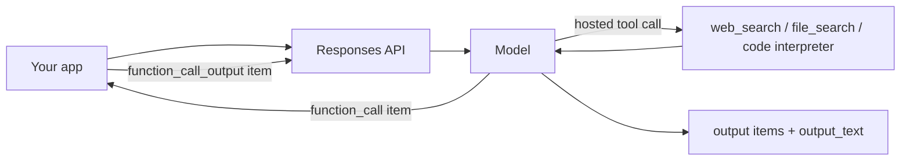

Knowing two providers well is worth more than knowing one perfectly. You learn which ideas are
universal (stateless requests, tokens, roles, tools) and which are one vendor's design choices,
and you can build features that survive a price change or an outage. This session walks through
OpenAI's API, using the [OpenAI API docs](https://developers.openai.com/api/docs) and the
[OpenAI Cookbook](https://developers.openai.com/cookbook) for worked examples, and compares it with
the Claude API from session 9.1.2.

> [!NOTE]
> OpenAI model names change often. The snippets below use an `OPENAI_MODEL` variable: copy a
> current ID from the models page in the docs rather than trusting a name in a tutorial.

## Responses API and chat

OpenAI has two text-generation APIs you will meet in the wild:

- **Chat Completions** (`client.chat.completions.create`): the older, widely copied design. You
  send a `messages` array (with `system`/`developer`, `user`, `assistant` roles) and read
  `choices[0].message.content`. Many open-source tools and local servers (Ollama, vLLM) expose a
  Chat Completions-compatible endpoint, so this shape is worth recognising.
- **Responses** (`client.responses.create`): the newer API that OpenAI recommends for new
  projects. It takes `instructions` (system-level guidance) and an `input` (a string or a list of
  items) and returns a list of typed `output` items, with an `output_text` helper.

```python
import os
from openai import OpenAI

client = OpenAI()  # reads OPENAI_API_KEY
MODEL = os.environ["OPENAI_MODEL"]

resp = client.responses.create(
    model=MODEL,
    instructions="You are a concise tutor. One analogy per answer.",
    input="What is a database index?",
)
print(resp.output_text)
print(resp.usage)  # input/output token counts
```

**Conversation state** is the biggest design difference. With Claude (and Chat Completions) you
resend the whole history every time. The Responses API also lets the server keep state: pass
`previous_response_id=resp.id` to chain a turn onto an earlier one, or use a persistent
**Conversation** object. According to the migration guide, responses are stored by default (set
`store=False` to opt out), earlier input tokens are still billed when you chain, and top-level
`instructions` are not carried over, so you resend them.

```python
follow_up = client.responses.create(
    model=MODEL,
    instructions="You are a concise tutor. One analogy per answer.",
    input="When does it slow writes down?",
    previous_response_id=resp.id,
)
```

| Concept | Claude Messages API | OpenAI Responses API |
| --- | --- | --- |
| Instructions | `system` | `instructions` (or a developer message) |
| Conversation | you resend `messages` | resend items, or `previous_response_id` / Conversations |
| Output | `content` blocks | `output` items + `output_text` |
| Why it stopped | `stop_reason` | `status` and incomplete details |
| Server-side storage | not by default | on by default, `store=False` to disable |

> [!WARNING]
> Server-side state is convenient but it is someone else's database. For anything with personal
> data, decide deliberately whether conversations may be stored by the provider, and for how
> long. Session 9.6.5 returns to data leakage.

## Embeddings endpoints

An **embedding** is a list of numbers that represents the meaning of a text, so that similar
texts get nearby vectors (session 9.3.1 goes deep). OpenAI offers an embeddings endpoint; the
embeddings guide lists `text-embedding-3-small` (1,536 dimensions by default) and
`text-embedding-3-large` (3,072), both accepting up to 8,192 input tokens, plus the older
`text-embedding-ada-002`.

```python
emb = client.embeddings.create(
    model="text-embedding-3-small",
    input=["How do I reset my password?", "Steps to change account credentials"],
)
vectors = [d.embedding for d in emb.data]
print(len(vectors[0]))  # 1536
```

The `dimensions` parameter shortens vectors at creation time, which is handy when your vector
store has a size limit or you want smaller indexes. Shorter vectors are cheaper to store and search
but can lose some quality.

> [!NOTE]
> Anthropic does not offer its own embedding model; Claude-based apps pair it with another
> provider's or an open-weight embedding model. YouCanDoIt uses `nomic-embed-text` on Ollama
> (768 dimensions) for that reason, and because local embeddings are free.

> [!WARNING]
> Vectors from different embedding models are not comparable. If you switch models, or change
> `dimensions`, re-embed your whole corpus.

## Assistants, files and tools

OpenAI's older **Assistants API** stored assistants, threads and runs on the server. It has been
replaced: the docs' migration guide says it was sunset on 26 August 2026, with **Responses**
replacing runs and **Conversations** replacing threads. You will still see it in old blog posts
and code; port rather than copy.

What survives, and is useful, is the toolbox around Responses:

- **Function tools**: you describe a function with a JSON Schema; the model returns a
  `function_call` item with arguments; you run it and send back a `function_call_output` item with
  the same `call_id`. Session 9.1.4 covers this pattern in depth (Claude's equivalent is
  `tool_use` / `tool_result` blocks).
- **Hosted tools** that OpenAI runs for you, enabled by type: `web_search`, `file_search` over
  your uploaded documents, a code interpreter, and remote MCP servers (session 9.5.3).
- **Files and vector stores**: upload files, attach them to a vector store, and let `file_search`
  do retrieval for you. It is a managed RAG in a box.

```python
resp = client.responses.create(
    model=MODEL,
    input="What changed in the latest PostgreSQL release? Cite sources.",
    tools=[{"type": "web_search"}],
)
print(resp.output_text)
```



> [!TIP]
> Hosted tools are fast to prototype with but tie you to one vendor and hide the retrieval step
> you may later want to tune. Building your own RAG (Module 9.3) is more work and much more
> controllable. A good habit: prototype with the hosted tool, then decide.

## Practice: port your summariser to OpenAI and compare

Take the Claude summariser from session 9.1.2 and make it run on both providers behind one
function. About 75 minutes.

### Step 1: Introduce a tiny interface

The goal is that the rest of your code does not care which provider answers. YouCanDoIt does the
same thing with its `LLMProvider` protocol in `apps/api/app/llm.py`.

```python
from typing import Protocol

class Summariser(Protocol):
    name: str
    def summarise(self, system: str, text: str) -> tuple[str, int, int]: ...
```

### Step 2: Implement both

```python
import anthropic, openai, os

class ClaudeSummariser:
    name = "claude"
    def __init__(self, model="claude-sonnet-5-5"):
        self.c, self.model = anthropic.Anthropic(), model
    def summarise(self, system, text):
        m = self.c.messages.create(model=self.model, max_tokens=700, system=system,
                                   messages=[{"role": "user", "content": text}])
        out = "".join(b.text for b in m.content if b.type == "text")
        return out, m.usage.input_tokens, m.usage.output_tokens

class OpenAISummariser:
    name = "openai"
    def __init__(self, model=os.environ.get("OPENAI_MODEL", "")):
        self.c, self.model = openai.OpenAI(), model
    def summarise(self, system, text):
        r = self.c.responses.create(model=self.model, instructions=system, input=text,
                                    max_output_tokens=700)
        return r.output_text, r.usage.input_tokens, r.usage.output_tokens
```

### Step 3: Run the same five articles through both

Reuse the timing loop from session 9.1.1. For each article record latency, tokens, cost (using
today's prices from each pricing page) and the summary.

### Step 4: Compare beyond the numbers

Write a short comparison covering:

- **Token counts**: the same article produces different input token counts because the
  tokenizers differ. Cost per article is what matters, not price per token.
- **Instruction following**: did both respect "3-5 bullets" and "don't invent facts"?
- **Developer experience**: which SDK was clearer? How do errors look? How is the stop reason
  exposed?
- **Data handling**: which provider stored your requests by default, and did you change that?

### Step 5: Make the provider a setting

Choose the implementation from an environment variable (`SUMMARY_PROVIDER=claude|openai`), just
as YouCanDoIt chooses with `LLM_PROVIDER`. You now have the seed of the provider abstraction and
fallback you will build properly in session 9.1.5.
