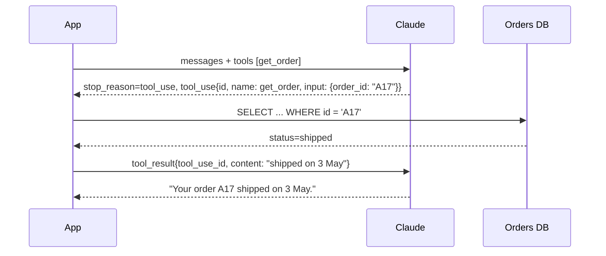
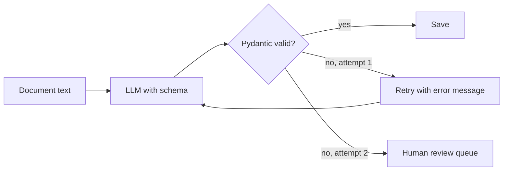

A chat answer is for humans. Your code needs something else: a dictionary with known keys, a
number it can compare, a function it can call. This session is about turning a model's free text
into **data and actions** your program can trust: structured outputs for data, tool calling for
actions, and validation as the safety net under both. The references are
[Claude tool use](https://platform.claude.com/docs/en/agents-and-tools/tool-use/overview) and the
[OpenAI API docs](https://developers.openai.com/api/docs).

## JSON mode and structured outputs

The naive approach is to write "reply in JSON" in the prompt and call `json.loads`. It works most
of the time, which is exactly the problem: one reply in a few hundred starts with "Sure! Here's the
JSON:" or forgets a field, and your pipeline crashes at 3 a.m.

There are three levels of reliability:

| Level | How | Guarantee |
| --- | --- | --- |
| Prompting | "Return JSON with keys a, b" + examples | None. Usually fine, sometimes not. |
| JSON mode | Provider flag: output must be valid JSON | Parses, but may have wrong or missing keys. |
| Structured outputs | You give a JSON Schema; decoding is constrained to it | Parses **and** matches the schema. |

**Structured outputs** use *constrained decoding*: while generating, the model is only allowed to
pick tokens that keep the output valid against your schema. Analogy: instead of asking someone to
fill in a form neatly, you give them a form whose boxes only accept the right kind of answer.

On Claude, you pass the schema in `output_config.format`, and the Python SDK can take a Pydantic
model directly and give you back a parsed object:

```python
from pydantic import BaseModel
import anthropic

class Contact(BaseModel):
    name: str
    email: str
    wants_demo: bool

client = anthropic.Anthropic()
resp = client.messages.parse(
    model="claude-sonnet-5-5",
    max_tokens=500,
    messages=[{"role": "user", "content": "Ada (ada@example.com) would love a demo next week."}],
    output_format=Contact,
)
print(resp.parsed_output)  # Contact(name='Ada', email='ada@example.com', wants_demo=True)
```

On OpenAI's Responses API the schema goes under `text.format`, and the SDK has a similar
`responses.parse(..., text_format=Contact)` helper.

> [!WARNING]
> A schema guarantees *shape*, not *truth*. The model can still put the wrong date in a perfectly
> valid `date` field, or invent an email that wasn't in the text. You still need validation of
> values, and evals (session 9.6.1).

> [!TIP]
> Design schemas for the model, not only for your database: clear field names, a `description`
> on each field, enums for closed sets (`"currency": "EUR" | "USD"`), and an explicit way to say
> "not found" (`"due_date": null`) so the model is not pushed to invent a value.

## Tool (function) calling: definitions, calls and results

**Tool calling** lets the model ask your code to do something: look up an order, query a
database, call a weather API. The model never runs anything itself. It writes a structured
request; your code decides whether and how to execute it. Analogy: a manager who can't touch the
systems, but writes precise work orders for you to carry out.

The cycle has three parts, following the
[Claude tool use docs](https://platform.claude.com/docs/en/agents-and-tools/tool-use/overview):

1. **Definition**: you send `tools`, each with a `name`, a `description` (when and why to use it)
   and an `input_schema` (JSON Schema for the arguments).
2. **Call**: if the model decides to use a tool, the response has `stop_reason == "tool_use"` and
   a `tool_use` content block with an `id`, the tool `name` and an `input` object.
3. **Result**: you run the function and send a new `user` message containing a `tool_result`
   block with the matching `tool_use_id`. The model then continues, maybe calling more tools, maybe
   answering.



```python
tools = [{
    "name": "get_order",
    "description": "Look up an order by its ID. Use when the user asks about an order's status.",
    "input_schema": {
        "type": "object",
        "properties": {"order_id": {"type": "string", "description": "e.g. A17"}},
        "required": ["order_id"],
    },
}]

messages = [{"role": "user", "content": "Where is my order A17?"}]
resp = client.messages.create(model="claude-sonnet-5-5", max_tokens=500,
                              tools=tools, messages=messages)

if resp.stop_reason == "tool_use":
    call = next(b for b in resp.content if b.type == "tool_use")
    result = get_order(**call.input)                    # your code, your rules
    messages += [
        {"role": "assistant", "content": resp.content},  # keep the model's tool_use block
        {"role": "user", "content": [{"type": "tool_result",
                                       "tool_use_id": call.id, "content": str(result)}]},
    ]
    resp = client.messages.create(model="claude-sonnet-5-5", max_tokens=500,
                                  tools=tools, messages=messages)
print(resp.content[-1].text)
```

Useful controls:

- **`tool_choice`**: let the model decide (`auto`), force some tool (`any`), force a specific one
  (`{"type": "tool", "name": "get_order"}`), or forbid tools (`none`).
- **`strict: true`** on a tool definition makes the arguments follow the schema with constrained
  decoding, like structured outputs.
- **`is_error: true`** on a `tool_result` tells the model the call failed, so it can retry or
  explain.

OpenAI's version has the same shape with different names: `function_call` items with a
`call_id`, answered by `function_call_output` items.

> [!NOTE]
> Forcing a single tool is also a classic way to get structured data: define a `record_invoice`
> tool whose schema is the shape you want and force it. The "arguments" are your extraction.
> Native structured outputs now do this more directly.

## Validating model output with Pydantic

Treat model output like any **untrusted input** from the network: parse it, validate it, and
decide what to do when it is wrong. Pydantic is ideal because you already use it for FastAPI
request bodies.

```python
from datetime import date
from decimal import Decimal
from pydantic import BaseModel, Field

class LineItem(BaseModel):
    description: str
    quantity: Decimal = Field(gt=0)
    unit_price: Decimal = Field(ge=0)

class Invoice(BaseModel):
    invoice_number: str
    issue_date: date
    currency: str = Field(pattern=r"^[A-Z]{3}$")
    items: list[LineItem]
    total: Decimal

def business_errors(inv: Invoice) -> list[str]:
    """Rules a schema can't express. Empty list means OK."""
    errors = []
    computed = sum(i.quantity * i.unit_price for i in inv.items)
    if abs(computed - inv.total) > Decimal("0.05"):
        errors.append(f"total {inv.total} != sum of line items {computed}")
    if inv.issue_date > date.today():
        errors.append("issue_date is in the future")
    return errors
```

Keep the schema (shape) and the business rules (meaning) apart: the schema is sent to the model,
the rules run in your code afterwards. You could also express the rules as a Pydantic
`model_validator`, but then a broken total raises inside the SDK's parsing step instead of giving
you an object you can inspect and send back.

Validation catches two kinds of error:

- **Shape errors**: missing fields, wrong types. Structured outputs mostly prevent these.
- **Business-rule errors**: totals that don't add up, dates in the future, negative quantities.
  Only your validators catch these.

When validation fails, you have options, in order of preference:

1. **Retry with feedback**: send the validation error back ("total does not equal the sum of line
   items; re-check the numbers") and ask again. One retry fixes most problems.
2. **Fall back** to a stronger model or higher effort for that item.
3. **Flag for a human** with the raw output attached. Never silently save bad data.



## Practice: extract structured data from invoices

Build an extractor that turns invoice text into validated `Invoice` objects. About 90 minutes.

### Step 1: Collect test invoices

Make five to ten invoice texts. Use real ones with personal data removed, or write varied fake
ones: different layouts, a European date (`03/05/2026`), a currency symbol instead of a code, one
with a discount line, one with a deliberate arithmetic error. Save them as `invoices/*.txt` and
write the correct answer for each as `invoices/*.expected.json`.

### Step 2: Write the schema

Use the `Invoice` model and `business_errors` above. Add `Field(description=...)` to each field explaining formats,
for example "ISO 8601 date" and "ISO 4217 currency code, e.g. EUR".

### Step 3: Extract with structured outputs and retry

```python
def extract(text: str, attempts: int = 2) -> Invoice | None:
    messages = [{"role": "user", "content": f"Extract the invoice.\n<invoice>\n{text}\n</invoice>"}]
    for _ in range(attempts):
        resp = client.messages.parse(model="claude-sonnet-5-5", max_tokens=1500,
                                     messages=messages, output_format=Invoice)
        inv = resp.parsed_output
        errors = business_errors(inv)
        if not errors:
            return inv
        messages += [
            {"role": "assistant", "content": resp.content},
            {"role": "user", "content": f"Re-check the invoice; these rules failed: {errors}"},
        ]
    return None  # caller sends this one to human review
```

### Step 4: Score against expected answers

For each invoice compare field by field with the expected JSON and print a table of matches.
Count: fully correct, partially correct, failed validation. Note which fields go wrong most.

### Step 5: Try the tool-calling version

Re-implement extraction by forcing a `record_invoice` tool with the same schema
(`tool_choice={"type": "tool", "name": "record_invoice"}`) and compare accuracy with the
structured-outputs version. Then try the smallest model tier: is the accuracy still good enough
at a fraction of the price? Write down your conclusion; you have just run your first eval.
