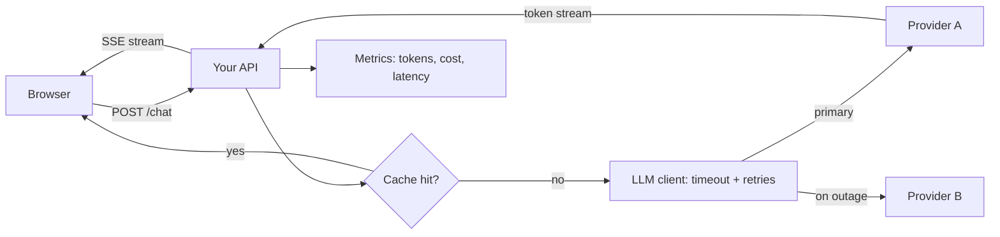

A demo calls the model once and prints the answer. A product calls it thousands of times a day,
from impatient users, through networks that drop, against providers that rate-limit you and
occasionally go down, while someone watches the bill. This session covers the engineering that
turns the first into the second. References: the
[Claude Developer Platform docs](https://platform.claude.com/docs/en/home) (streaming, errors,
rate limits, caching) and the [OpenAI Cookbook](https://developers.openai.com/cookbook) for
production recipes.



## Streaming responses to the UI

A large model can take many seconds to write a long answer. If the user stares at a spinner for
that long, the app feels broken. **Streaming** sends tokens as they are generated, so the first
words appear quickly. Analogy: a waiter bringing dishes as each is ready instead of waiting for the
whole table's order.

Two latency numbers matter:

- **Time to first token (TTFT)**: how long until something appears. This is what users feel.
- **Total time**: how long until the answer is complete. This matters for pipelines.

Providers stream with **server-sent events (SSE)**: a long-lived HTTP response that sends small
`data:` events. The Claude SDK wraps them in a helper:

```python
async with client.messages.stream(
    model="claude-sonnet-5-5", max_tokens=1000, messages=messages
) as stream:
    async for text in stream.text_stream:
        print(text, end="", flush=True)
    final = await stream.get_final_message()   # full message with usage
```

Your backend then re-streams to the browser. In FastAPI that is a `StreamingResponse` with the
`text/event-stream` media type:

```python
from fastapi.responses import StreamingResponse
import json

@router.post("/chat")
async def chat(body: ChatIn):
    async def events():
        async with client.messages.stream(model=MODEL, max_tokens=1000,
                                          messages=body.messages) as stream:
            async for text in stream.text_stream:
                yield f"data: {json.dumps({'text': text})}\n\n"
            final = await stream.get_final_message()
            yield f"data: {json.dumps({'done': True, 'usage': final.usage.model_dump()})}\n\n"
    return StreamingResponse(events(), media_type="text/event-stream")
```

On the client, read the response body with `fetch` and a `ReadableStream` reader (or the
`EventSource` API for GET endpoints), appending text to the message as it arrives.

> [!WARNING]
> Streaming changes error handling. Once you have sent HTTP 200 and half an answer, you can't
> switch to a 500. Send an explicit `error` event in the stream, and make the UI show "the answer
> was interrupted" instead of silently presenting half a reply as complete.

> [!TIP]
> Proxies and load balancers sometimes buffer responses, which kills streaming. If tokens arrive
> all at once at the end, check buffering settings in Nginx or your platform (for example the
> `X-Accel-Buffering: no` header for Nginx).

## Retries, timeouts and rate limits

LLM calls fail in a few predictable ways:

| Failure | Typical signal | Retry? |
| --- | --- | --- |
| Rate limited | HTTP 429, often with a `retry-after` header | Yes, after waiting |
| Provider overloaded or internal error | HTTP 5xx (Anthropic also uses 529 for overloaded) | Yes, with back-off |
| Network drop, timeout | Connection error | Yes |
| Bad request, invalid key, too long | HTTP 400, 401, 403, 413 | No: fix the request |

**Retry** only what can succeed next time, and use **exponential back-off with jitter**: wait
roughly 1s, 2s, 4s... plus a random amount, so a thousand clients don't retry at the same instant.
Respect `retry-after` when present. The official SDKs already retry some errors (a small default
number of times) and accept `max_retries` and `timeout` settings, so configure them rather than
wrapping your own loop around a loop.

```python
client = anthropic.AsyncAnthropic(max_retries=3, timeout=60.0)
fast_client = client.with_options(timeout=15.0)  # tighter limit for an autocomplete feature
```

**Timeouts** must exist at every layer: the LLM call, your HTTP endpoint and the browser. A
request without a timeout eventually ties up a worker forever.

**Rate limits** are set per organisation and model, usually as requests per minute and tokens per
minute (input and output). The rate-limits page of the [Claude docs](https://platform.claude.com/docs/en/home)
explain the tiers and the response headers that tell you how much budget remains. In your own
app:

- Put a queue or a concurrency limit (`asyncio.Semaphore`) in front of batch jobs so they don't
  starve interactive users.
- Rate-limit your **own** users too (requests per user per minute). Otherwise one script can
  burn your whole quota and budget.
- Use the Batch API for work that can wait (session 9.1.2).

> [!WARNING]
> Never retry non-idempotent side effects blindly. If a tool call already sent an email before the
> model call failed, retrying the whole turn sends it twice.

## Caching and cost control

Three different caches help, and they solve different problems:

1. **Provider prompt caching** (session 9.1.2): same long prefix, different question. Cuts input
   cost and latency for the cached part.
2. **Response caching** in your app: identical request, identical answer. Hash
   `(model, system, messages, params)` and store the result in Redis with a TTL. Perfect for
   deterministic tasks like "summarise article 42", useless for open chat.
3. **Semantic caching**: embed the question and reuse an answer for a *very similar* earlier
   question. Powerful for FAQs, risky elsewhere: "cancel my order" and "don't cancel my order" are
   close in embedding space. Use high thresholds and limit it to safe domains.

Cost control is mostly about **measuring** and **budgets**:

- Log `model`, `input_tokens`, `output_tokens`, cache tokens, latency and a feature name for
  every call. Multiply by a price table to get cost per call.
- Set `max_tokens` deliberately for each feature; long replies cost more and are often worse.
- Route easy requests to small models; reserve big models for hard ones.
- Trim conversation history and retrieved context to what the task needs.
- Set budgets and alerts: per user per day, per feature per month, and a hard monthly limit in the
  provider console.

> [!EXAMPLE]
> A "summarise this article" button was costing more than the rest of the app. The fixes: cache the
> summary per article ID (each article is summarised once, not once per reader), move from the
> large to the middle model after an eval showed no quality loss, and cap output at 400 tokens.
> Same feature, a small fraction of the cost.

## Provider abstraction and fallbacks

Your business logic should not import a vendor SDK directly. Put a thin interface in between,
the way YouCanDoIt's `apps/api/app/llm.py` defines an `LLMProvider` protocol with Ollama,
Anthropic and Fake implementations and picks one from configuration. Benefits:

- **Fallbacks**: if provider A is down or rate-limited, try provider B (or a local model).
- **Testing**: a fake provider gives deterministic answers in unit and end-to-end tests.
- **Migration**: switching models is a config change plus an eval run, not a rewrite.

```python
class FallbackLLM:
    def __init__(self, primary: LLMProvider, backup: LLMProvider):
        self.primary, self.backup = primary, backup

    async def chat(self, system, messages, json_mode=False):
        try:
            return await self.primary.chat(system, messages, json_mode)
        except LLMError as e:          # only "provider is unhealthy" errors, not bad requests
            log.warning("primary failed, falling back: %s", e)
            return await self.backup.chat(system, messages, json_mode)
```

> [!WARNING]
> Keep the abstraction thin. Providers differ in tool formats, caching, thinking and structured
> outputs. A "universal" wrapper that hides all of that also hides the features you are paying for.
> Abstract the operations your app needs (`chat`, `summarise`, `embed`), not the whole API.

A fallback model is a different model: its answers will differ, its prompts may need tuning, and
its data-processing terms may differ. Run your eval set against the fallback too, and decide which
features may fall back and which should fail clearly instead.

## Practice: streaming chat endpoint with retries and a cost dashboard

Build a small FastAPI service with a streaming chat endpoint, sensible retries and a page that
shows spend. About two hours.

### Step 1: Streaming endpoint

Create `POST /chat` as in the streaming section. Configure the client with `max_retries=3` and a
60-second timeout. Add a per-IP limit of 10 requests per minute (an in-memory dict is fine for
now).

### Step 2: Record every call

Create a `llm_calls` table:

```sql
CREATE TABLE llm_calls (
  id bigserial PRIMARY KEY,
  at timestamptz NOT NULL DEFAULT now(),
  feature text NOT NULL,
  model text NOT NULL,
  input_tokens int NOT NULL,
  output_tokens int NOT NULL,
  cache_read_tokens int NOT NULL DEFAULT 0,
  latency_ms int NOT NULL,
  ttft_ms int,
  ok boolean NOT NULL
);
```

After the stream ends, insert a row using the final message's `usage`. Measure TTFT as the time
until the first text chunk.

### Step 3: Simulate failures

Point the client at a wrong base URL, or wrap it in a fake that raises a 429 twice and then
succeeds. Confirm that retries happen, that the stream sends an `error` event when all retries
fail, and that failed calls are recorded with `ok = false`.

### Step 4: The dashboard

Add `GET /dashboard` returning, for today and the last 30 days: number of calls, error rate,
median and p95 latency, median TTFT, total tokens and cost by model (join to a price table you
maintain). Render it as a simple HTML table or a small page in your front-end.

### Step 5: Add a fallback

Wrap your provider in `FallbackLLM` with a local Ollama model as backup. Stop the primary (bad
key) and check that chat still works and the dashboard shows which model answered.
