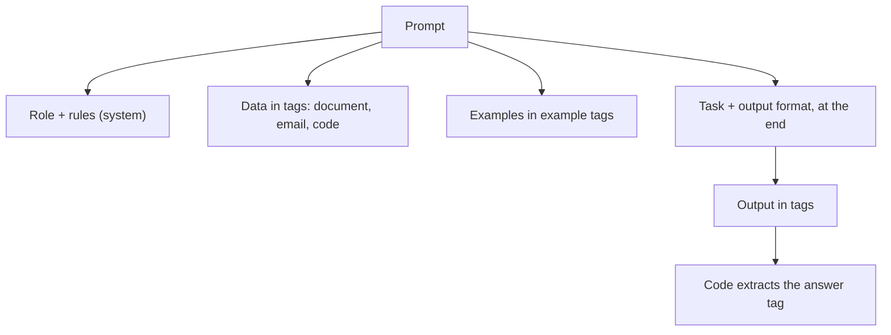

Prompt engineering sounds like a bag of magic phrases. It isn't. It is the same skill as writing a
good ticket for a new colleague: say what you want, give the background they lack, show an
example, and say what "done" looks like. The model is extremely capable and has zero context about
your situation unless you provide it. This session covers the fundamentals that fix most bad
outputs, based on the
[Anthropic prompt engineering overview](https://platform.claude.com/docs/en/build-with-claude/prompt-engineering/overview),
the [Anthropic interactive tutorial](https://github.com/anthropics/prompt-eng-interactive-tutorial)
and the [Prompt Engineering Guide](https://www.promptingguide.ai/).

> [!NOTE]
> Anthropic's overview recommends having three things before you start tuning a prompt: a clear
> definition of success, a way to test against it, and a first draft. Prompting without tests is
> guessing. Session 9.2.3 builds the tests; this session builds the draft.

## Clarity, context and constraints

The single most useful mental model: **imagine the prompt is going to a brilliant new hire on
their first day**. They are smart but know nothing about your project, your users or your
preferences. Would they produce what you want from your prompt alone? If a human would need to
ask follow-up questions, so does the model, and since it can't ask, it guesses.

Three ingredients:

**Clarity** means saying exactly what you want, directly.

| Vague | Clear |
| --- | --- |
| "Summarise this." | "Summarise this incident report in 3 bullet points for the on-call engineer who takes over tomorrow." |
| "Make the code better." | "Refactor this function to remove the duplicated SQL. Keep the public signature. Explain each change in one line." |
| "Don't be too long." | "Maximum 120 words." |

**Context** is the background that changes the right answer: who the audience is, what the output
is for, what has been tried, what the constraints of the system are. "This summary goes into a
Slack message read on phones" changes formatting more than any style instruction.

**Constraints** define the edges: length, format, tone, what to exclude, what to do when unsure.

> [!TIP]
> Tell the model what to do rather than what not to do. "Write in flowing prose paragraphs" works
> better than "don't use bullet points", because a negative instruction still puts the unwanted
> thing in focus. And explain *why* a rule exists ("no ellipses, because a text-to-speech engine
> will read this"): models generalise better from reasons than from bare rules.

> [!TIP]
> Give the model a way out. "If the document does not contain the answer, say 'Not in the
> document'" dramatically reduces made-up answers (hallucinations). Chapter 8 of the interactive
> tutorial is about exactly this.

Number your steps when order matters, and separate the **data** from the **instructions** so the
model never confuses "the email you should summarise" with "an instruction to follow" (which also
matters for security: session 9.6.5).

## Roles and system prompts

A **role** ("You are a senior PostgreSQL DBA reviewing a migration for a fintech startup") changes
vocabulary, depth, priorities and what the model notices. It is a shortcut for a lot of context.
The more specific the role, the more useful it is: "a helpful assistant" adds nothing.

Put the role and standing rules in the **system prompt**; put the task and the data in the user
turn. A reasonable system prompt skeleton:

```text
You are <specific role> helping <specific audience> with <specific job>.

Context:
<what the product is, what the user already knows, relevant facts>

Rules:
1. <format and length>
2. <what to do when unsure>
3. <tone>

Output:
<exact shape of the answer>
```

> [!EXAMPLE]
> YouCanDoIt's tutor uses a role plus context: "You are a patient tutor for a junior developer
> without a CS degree who is working towards a senior software engineer role. Explain with
> analogies and concrete examples." followed by the current session's outcomes and subchapters
> (see `apps/api/app/routes/ai.py`). The role sets the level; the outline keeps answers on topic.

> [!WARNING]
> A role does not grant knowledge. "You are a world-class tax lawyer" doesn't make answers about
> your country's tax law correct. Roles shape style and focus; facts still need to come from the
> model's training or, better, from documents you provide.

## Examples (few-shot)

Describing a format in words is hard; showing it is easy. **Few-shot prompting** means including a
few input-output examples. Zero examples is *zero-shot*, one is *one-shot*.

```text
Classify each support ticket as one of: billing, bug, feature_request, other.

<examples>
<example>
<ticket>I was charged twice this month.</ticket>
<label>billing</label>
</example>
<example>
<ticket>The export button does nothing on Safari.</ticket>
<label>bug</label>
</example>
<example>
<ticket>Could you add dark mode?</ticket>
<label>feature_request</label>
</example>
</examples>

<ticket>{{TICKET}}</ticket>
```

Good examples are:

- **Relevant**: they look like your real inputs, including the messy ones.
- **Diverse**: they cover different categories and edge cases, so the model learns the rule, not
  a surface pattern. If all your examples are short, outputs will be short.
- **Clearly marked**: wrapped in tags so they are not confused with the real input.

Three to five well-chosen examples usually beat a page of description. Collect them from real data
and update them when you find failure cases.

> [!WARNING]
> Models copy examples closely, including accidents. If every example answer starts with "Great
> question!", so will every real answer.

## Output formatting with XML tags

When a prompt mixes instructions, documents, examples and questions, the model needs to know which
part is which. **XML-style tags** are a simple, robust way to label parts. Claude in particular
responds well to them, and they work with other models too. There are no special tag names; pick
descriptive ones and use them consistently.

```text
Answer the question using only the contract below.

<contract>
{{CONTRACT_TEXT}}
</contract>

<question>
Can the client cancel before 12 months?
</question>

Put your reasoning in <analysis> tags and the final answer, "yes", "no" or "unclear",
followed by one sentence, in <answer> tags.
```

Then your code extracts just what it needs:

```python
import re
answer = re.search(r"<answer>(.*?)</answer>", reply, re.S).group(1).strip()
```

Tags help in both directions:

- **Input**: separate data from instructions (`<document>`, `<email>`, `<code>`), and put long
  documents near the top of the prompt with the question at the end.
- **Output**: ask for sections in tags so you can parse them, or hide reasoning from the user and
  show only the `<answer>`.



> [!TIP]
> For output your *code* depends on (classifications, extracted fields), prefer structured outputs
> from session 9.1.4. Use tags for mixed outputs (reasoning plus answer) and for clearly separating
> inputs.

## Practice: the Anthropic interactive tutorial

Anthropic's [interactive tutorial](https://github.com/anthropics/prompt-eng-interactive-tutorial)
is a set of Jupyter notebooks with exercises that check your prompts automatically. It covers
exactly this session's material and a bit of the next one. Plan two or three sittings of about an
hour.

### Step 1: Set up

```sh
git clone https://github.com/anthropics/prompt-eng-interactive-tutorial.git
cd prompt-eng-interactive-tutorial
python -m venv .venv && source .venv/bin/activate
pip install anthropic jupyter
jupyter notebook
```

Open the Anthropic 1P folder and start with the tutorial's "how to use" notebook, which explains
where to put your API key. Read the repository README for the current setup steps, since they may
change.

### Step 2: Work through the beginner and intermediate chapters

The chapters move from basic prompt structure through being clear and direct, assigning roles,
separating data from instructions, formatting output, thinking step by step, using examples and
avoiding hallucinations. Do the exercises yourself before looking at the hints.

### Step 3: Keep a prompt journal

For each exercise, write down in a markdown file:

- your first prompt and what went wrong,
- the change that fixed it,
- the general rule you would reuse ("put the question after the document").

### Step 4: Do the "complex prompts" chapter

The final chapter builds full, industry-style prompts from all the pieces. Then apply the same
structure to a prompt from your own projects (YouCanDoIt's tutor prompt, or your summariser from
9.1.2): rewrite it with a specific role, context, tagged data, two examples and an explicit output
format.

### Step 5: Compare before and after

Run the old and new prompt on five real inputs and compare side by side. Keep both versions; you
will turn this comparison into an automated test suite in session 9.2.3.
