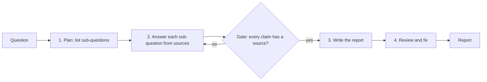

The fundamentals from 9.2.1 fix most prompts. This session is for the tasks where a single clear
prompt still isn't enough: multi-step reasoning, long research tasks, outputs that must be checked,
and inputs that fill a large part of the context window. The techniques have names in the
literature, and the [Prompt Engineering Guide](https://www.promptingguide.ai/) has a page for each;
the [Anthropic prompt engineering overview](https://platform.claude.com/docs/en/build-with-claude/prompt-engineering/overview)
covers how they apply to Claude.

The common idea behind all of them: **give the model room and structure to work, instead of
asking for the final answer in one leap.** Analogy: a maths exam where you must show your working.
Showing the steps makes mistakes less likely and much easier to find.

## Step-by-step reasoning and thinking models

A language model produces one token at a time, and each token is computed with a fixed amount of
work. If the answer requires several reasoning steps and the model must output the answer
immediately, it has no "scratch paper". **Chain-of-thought (CoT) prompting** gives it some: ask
the model to reason step by step before answering, and the intermediate tokens become working
memory.

Three levels, from the CoT chapter of the Anthropic tutorial and the guide:

1. **Basic**: "Think step by step before answering."
2. **Guided**: tell it *which* steps: "First list the requirements, then check each against the
   design, then give a verdict."
3. **Structured**: separate the reasoning from the answer with tags so your code can show only the
   answer.

```text
<diff>{{DIFF}}</diff>

Review this diff for concurrency bugs.
In <thinking>, list every shared variable and which goroutines touch it.
Then, in <answer>, list only real bugs with line numbers, or "none".
```

**Thinking models** build this into the model. They are trained to reason before answering and
expose that reasoning as separate thinking output. On current Claude models, **adaptive thinking**
lets the model decide when and how much to think, steered by the `effort` parameter (session
9.1.2). This changes how you prompt:

- With a thinking model, you usually don't need "think step by step"; it already does. High-level
  guidance ("consider edge cases with empty input") tends to work better than a rigid script of
  steps.
- Raising effort is often a better fix for shallow reasoning than piling on instructions.
- Thinking costs output tokens and latency. For simple classification it is wasted money.

> [!WARNING]
> Reasoning text is not a faithful log of how the model computed its answer. It is useful for
> debugging and often improves accuracy, but don't treat it as proof the answer is correct, and
> don't show raw reasoning to end users as an explanation.

## Prompt chaining and decomposition

Some tasks are too big for one prompt: "Research this topic, compare five sources, write a report
and check its citations." Doing everything at once means the model juggles many goals and any
error is hard to locate. **Prompt chaining** splits the task into steps, each a separate call whose
output feeds the next.



Benefits:

- **Accuracy**: each step has one clear job and the full attention of the model.
- **Debuggability**: when the report is wrong, you can see which step failed.
- **Control**: you can put code between steps: validation, a search API, a human approval, a
  cheaper model for easy steps.
- **Parallelism**: independent steps (answering five sub-questions) can run at the same time.

Hand data between steps in tags (`<plan>`, `<findings>`) so each prompt clearly knows what it
received. Anthropic's [Building effective agents](https://www.anthropic.com/engineering/building-effective-agents)
article (session 9.5.1) calls this pattern a **workflow**: the steps are fixed by your code, not
chosen by the model.

> [!TIP]
> Decompose along natural seams: research vs writing, extraction vs judgement, generating vs
> checking. If you can't describe a step's input and output in one sentence, it is not a step yet.

## Self-consistency and self-critique

Two techniques use extra calls to improve reliability.

**Self-consistency**: sample several independent answers (with some randomness) and take the
majority. If five reasoning paths reach "42" and one reaches "41", "42" is more likely right. It
works best for tasks with a single checkable answer: maths, classification, extraction of one
value. The cost is N times the tokens, so use it where errors are expensive.

```python
from collections import Counter

answers = [classify(ticket) for _ in range(5)]   # five independent calls
label, votes = Counter(answers).most_common(1)[0]
if votes < 4:
    send_to_human(ticket, answers)               # low agreement = low confidence
```

Agreement is also a cheap **confidence signal**: when the samples disagree, route the item to a
human or a stronger model.

**Self-critique** (also called reflection): generate, then ask the model (in a separate call) to
review the output against explicit criteria, then revise.

```text
<draft>{{DRAFT}}</draft>
<source>{{SOURCE}}</source>

Check the draft against the source. For each sentence, mark SUPPORTED, UNSUPPORTED or WRONG.
Then rewrite the draft keeping only supported claims.
```

Critique works when the reviewer has something concrete to check against: a source document,
tests, a rubric, a schema. "Is this good?" without criteria mostly produces "Yes, but you could
add more detail."

> [!NOTE]
> The strongest critic is not a model but a tool: run the code, execute the tests, validate the
> JSON, check the URL exists. Use model critique for what tools can't check, like tone or whether a
> claim is supported by a passage.

## Long-context prompting

Modern models accept enormous inputs, but how you arrange a long prompt still matters. The
Anthropic guidance on long context recommends:

- **Put long documents at the top**, above the instructions and the question. Queries at the end
  tend to get better answers with long inputs.
- **Wrap each document in tags with metadata**, so the model can refer to them:

```text
<documents>
  <document index="1">
    <source>postgres-release-notes.md</source>
    <document_content>...</document_content>
  </document>
  <document index="2">...</document>
</documents>
```

- **Ask for relevant quotes first**: "Find the quotes relevant to the question and put them in
  `<quotes>` tags, then answer using only those quotes." This makes the model ground its answer and
  makes it checkable.

Long context is not always the right tool. Every token costs money on every call, latency grows,
and details in the middle of very long inputs can be missed. Rules of thumb:

| Situation | Approach |
| --- | --- |
| One long document, many questions in a session | Long context + prompt caching |
| Thousands of documents, any could be relevant | Retrieval (RAG, Module 9.3) |
| Long document, one focused task | Chain: extract relevant sections, then work on them |

## Practice: a multi-step research prompt chain

Build a small chain that answers a technical question from a set of documents and checks its own
citations. About two hours.

### Step 1: Pick a question and sources

For example: "Should I use pgvector or a dedicated vector database for a 1-million-document
project?" Save three to five relevant pages as text files (use `trafilatura` from 9.1.2).

### Step 2: Plan

Call 1 takes the question and returns three to five sub-questions in `<subquestions>` tags, one per
line. Parse them in code.

### Step 3: Research each sub-question in parallel

For each sub-question, send all documents (in tagged form, at the top) plus the sub-question and
ask for relevant quotes in `<quotes>` then a short answer in `<answer>` citing document indexes
like `[2]`. Run these calls concurrently with `asyncio.gather`.

### Step 4: Gate

In code, check that every answer contains at least one citation and every cited index exists. Re-run
any sub-question that fails, once.

### Step 5: Write and critique

Call 3 writes a 300-word report from the findings. Call 4 receives the report plus the quotes and
marks each sentence SUPPORTED or UNSUPPORTED, then returns a revised report. Print both versions
and the list of removed claims.

### Step 6: Reflect

Compare against a single big prompt doing the whole job. Note differences in accuracy, cost
(total tokens across calls) and latency. Write down when the chain was worth it and when it was
overkill.
