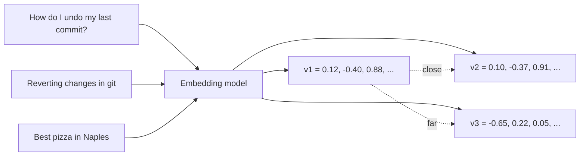

Keyword search finds documents that contain your words. Ask "how do I undo my last commit?" and a
page titled "Reverting changes in git" may not match, because it never says "undo". **Semantic
search** finds documents that mean the same thing, even with different words. The technology
behind it is the **embedding**, and it is the foundation of every RAG system in this module.
References: the [Hugging Face LLM Course](https://huggingface.co/learn/llm-course) for how the
models work and the [Ollama docs](https://docs.ollama.com/) for running embedding models locally.

## What embeddings are and how they are trained

An **embedding** is a list of numbers (a vector) that represents the meaning of a piece of text.
Texts with similar meanings get vectors that point in similar directions.

Analogy: a map of a city where shops are placed by what they sell rather than by address. Bakeries
cluster together, hardware stores together, and a shop selling bread and tools sits in between.
To find "somewhere to buy a croissant" you go to the bakery district, even if no shop is called
"croissant". An embedding model is the map-maker; the map has hundreds of dimensions instead of
two.



How do these models learn? Two steps, both covered in the
[Hugging Face LLM Course](https://huggingface.co/learn/llm-course):

1. **Pre-training a transformer encoder** (like BERT) on huge amounts of text, so it builds rich
   internal representations of words in context. "Bank" in "river bank" and "bank account" get
   different representations.
2. **Contrastive fine-tuning** to turn those representations into one vector per text that is
   good for similarity. The model sees pairs that should match (a question and its answer, a
   title and its article, two paraphrases) and pairs that shouldn't. Training pulls matching pairs
   together and pushes non-matching pairs apart. **Pooling** (often averaging the token vectors)
   turns many token vectors into a single text vector.

Two consequences matter in practice:

- An embedding model knows what "similar" means **only as its training data defined it**. A
  general model may put "Python" (language) and "python" (snake) closer than you'd like in a
  zoology app, and may not understand your company's internal jargon.
- Embeddings capture **topic and meaning**, not truth or negation well. "The deploy succeeded" and
  "The deploy did not succeed" are close together. Retrieval finds relevant passages; the LLM must
  still read them.

> [!NOTE]
> Embedding models are different from chat models. They are smaller, much cheaper, and output a
> vector, not text. You can't "ask" an embedding model anything.

## Similarity measures

Once texts are vectors, "how similar?" becomes geometry. Three measures are common:

| Measure | Idea | Range | Use when |
| --- | --- | --- | --- |
| Cosine similarity | angle between vectors, ignoring length | -1 to 1 (higher = closer) | Default for text embeddings |
| Dot product | length x length x cos(angle) | unbounded | Vectors already normalised (then equals cosine), or model trained for it |
| Euclidean (L2) distance | straight-line distance | 0 to infinity (lower = closer) | Some image models, clustering |

```python
import numpy as np

def cosine(a, b):
    a, b = np.asarray(a), np.asarray(b)
    return float(a @ b / (np.linalg.norm(a) * np.linalg.norm(b)))
```

**Cosine distance** is `1 - cosine similarity`, which is what pgvector's `<=>` operator returns
and what YouCanDoIt's `rag.retrieve` orders by (`Chunk.embedding.cosine_distance(qv)`).

If you **normalise** vectors to length 1 when you store them, cosine similarity and dot product give
the same ranking, and dot product is slightly faster. Many embedding APIs already return
normalised vectors; check the model card.

> [!WARNING]
> Similarity scores are only comparable within one model. A cosine of 0.8 may be "very similar" for
> one model and "vaguely related" for another. Pick thresholds by looking at real examples, not by
> intuition.

## Embedding models (local and hosted)

You have two families of options.

**Hosted** embedding APIs: OpenAI's `text-embedding-3` models (session 9.1.3) and other providers.
Easy, scalable, good quality, priced per token. Your text leaves your servers.

**Local / open-weight** models: run on your machine or server with
[Ollama](https://docs.ollama.com/), the `sentence-transformers` library, or a model server. Free per
call, private, and you control versions. You need RAM/CPU (or a GPU) and must operate it yourself.
YouCanDoIt uses `nomic-embed-text` on Ollama, which produces 768-dimensional vectors.

```sh
ollama pull nomic-embed-text
curl http://localhost:11434/api/embed -d '{
  "model": "nomic-embed-text",
  "input": ["How do I undo my last commit?", "Reverting changes in git"]
}'
# -> {"embeddings": [[...768 numbers...], [...]], ...}
```

How to choose:

- **Quality on your data**: test on 20-50 real queries with known good results (session 9.3.5).
  Public leaderboards such as MTEB on Hugging Face are a good shortlist, not a decision.
- **Language**: if your content is not English, pick a multilingual model.
- **Dimensions**: more dimensions often means better quality but more storage and slower search.
  1M chunks x 1,536 floats x 4 bytes is about 6 GB before indexes.
- **Max input length**: text beyond the limit is truncated, silently in some tools. Chunk your
  documents to fit (session 9.3.3).
- **Privacy and cost** at your volume.

> [!TIP]
> Some models expect **task prefixes** and work noticeably worse without them. `nomic-embed-text`,
> for example, is documented with prefixes like `search_query: ` for queries and
> `search_document: ` for documents. Read the model card before indexing.

> [!WARNING]
> Changing the embedding model means re-embedding every document; vectors from different models
> live in different "maps". Store the model name next to each vector so you notice mismatches.

## Practice: semantic search over your notes

Build a command-line semantic search over your own Markdown notes (or the `content/lessons` folder
of this repo). About 90 minutes.

### Step 1: Install and start the model

```sh
ollama pull nomic-embed-text
pip install ollama numpy
```

### Step 2: Load and split notes

Split each Markdown file into paragraphs of reasonable size (join short paragraphs until about
150-300 words). Keep the file name and heading for each piece.

```python
from pathlib import Path

def pieces(folder: str):
    for path in Path(folder).rglob("*.md"):
        for para in path.read_text().split("\n\n"):
            if len(para.split()) > 20:
                yield {"file": path.name, "text": para.strip()}
```

### Step 3: Embed and save

```python
import json, ollama

docs = list(pieces("notes"))
resp = ollama.embed(model="nomic-embed-text",
                    input=["search_document: " + d["text"] for d in docs])
for d, v in zip(docs, resp["embeddings"]):
    d["vector"] = v
json.dump(docs, open("index.json", "w"))
```

For a few thousand pieces a JSON file and NumPy are perfectly fine. Vector databases come in
the next session.

### Step 4: Search

```python
import numpy as np

docs = json.load(open("index.json"))
M = np.array([d["vector"] for d in docs])
M /= np.linalg.norm(M, axis=1, keepdims=True)          # normalise once

def search(q: str, k: int = 5):
    qv = np.array(ollama.embed(model="nomic-embed-text", input="search_query: " + q)["embeddings"][0])
    scores = M @ (qv / np.linalg.norm(qv))
    for i in np.argsort(-scores)[:k]:
        print(f"{scores[i]:.3f}  {docs[i]['file']}: {docs[i]['text'][:100]}")
```

### Step 5: Probe its behaviour

Try queries that use **different words** from your notes (synonyms, a question instead of a
statement), a query in another language, and a **negation** ("things that are not secure"). Then
remove the task prefixes and compare rankings. Write down three cases where semantic search beat
`grep`, and one where `grep` would have been better. That last one is the motivation for hybrid
search in session 9.3.4.
